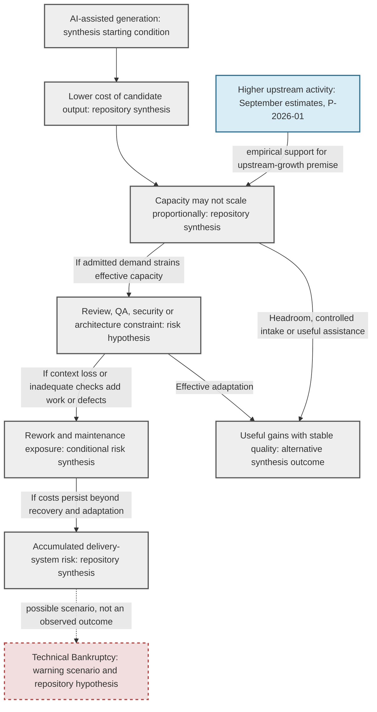

# The Subprime Code Crisis

**An independent research synthesis on AI-assisted software delivery risk**

When local coding gains improve delivery, and when review, QA, security, architecture, maintenance or operating work may absorb them.

**Primary author:** [Vitalii Oborskyi](https://www.linkedin.com/in/vitaliioborskyi) · **Project:** [Uncertainty Architecture Group](https://github.com/UncertaintyArchitectureGroup)

> **Navigation:** [📉 **Read the Report**](report/01_the_illusion.md) | [🧾 **Evidence Library**](evidence/README.md) | [🛡️ **Operational Protocols**](protocols/README.md)

## Quick Start

Repository/source ideas enter through [Issues](https://github.com/UncertaintyArchitectureGroup/The-Subprime-Code-Crisis/issues).
See the [live master work plan](https://github.com/UncertaintyArchitectureGroup/The-Subprime-Code-Crisis/issues/84),
[dated backlog audit](governance/issue-backlog-audit.md),
[intake and reviewed closure](governance/issue-workflow.md), and
[cross-repository ownership](governance/repository-map.md).

| Need | Start here |
| --- | --- |
| Understand the complete argument | [Read the report](report/01_the_illusion.md) |
| Inspect the SDLC rebalancing thesis, every node's outcomes and testable hypotheses | [Canonical hypothesis register](report/appendices/mechanism-hypotheses.md) |
| Inspect sources, evidence briefs, and source status | [Evidence Library](evidence/README.md) and [Source Registry](evidence/SOURCES.md) |
| Apply practical controls | [Operational Protocols](protocols/README.md) |
| Understand the research and reasoning boundaries | [Scope](SCOPE.md), [Doctrine](DOCTRINE.md), and [Artifact Model](ARTIFACT_MODEL.md) |
| Contribute or change the repository | [`AGENTS.md`](AGENTS.md) and [Contributing](CONTRIBUTING.md) |

## Key Takeaways

1. **Empirical finding:** AI tools can accelerate isolated coding work.
2. **Systems inference:** Local code-generation speed does not guarantee end-to-end software-delivery throughput.
3. **Systems hypothesis:** Additional admitted work may strain a downstream stage when effective capacity and work policies cannot absorb it; successful adaptation can preserve useful gains.
4. **Repository risk framing:** Delivery risk depends on task selection, tool behavior, verification capacity and deployment choices.
5. **Proposed practice:** Assess the delivery system and adjust controls where evidence identifies a gap; reuse adequate existing capability.

The repository examines this as a delivery-system problem. It distinguishes source-reported findings and documented facts from repository interpretations, systems inferences, risk scenarios, and warning scenarios. It does not claim that AI coding tools are useless, that every organization will fail, or that isolated productivity gains are unreal. The detailed research boundary is defined in [Repository Scope](SCOPE.md).

## Repository Map

| Area | Purpose | Start here |
| --- | --- | --- |
| **Report** | Evidence, conditional delivery mechanisms, alternative scenarios and adoption decisions | [Part 1: Evidence and Delivery Outcomes](report/01_the_illusion.md) |
| **Evidence** | Source registry, evidence taxonomy, source-oriented briefs, limitations, and integration status | [Evidence Library](evidence/README.md) |
| **Protocols** | Adaptable controls for engineers, teams, public evidence, and organizations | [Operational Protocols](protocols/README.md) |
| **Scope and Doctrine** | Subject boundaries, evidence principles, claim boundaries, and reasoning rules | [Scope](SCOPE.md) and [Doctrine](DOCTRINE.md) |
| **Artifact Model and Glossary** | Repository structure, artifact relationships, and canonical terminology | [Artifact Model](ARTIFACT_MODEL.md) and [Glossary](GLOSSARY.md) |
| **Governance** | Workflows, approval, source states, verification, synchronization, and independent review | [`AGENTS.md`](AGENTS.md) and [governance playbooks](governance/README.md) |
| **Citation and attribution** | Repository citation metadata, terminology provenance, and attribution boundaries | [`CITATION.cff`](CITATION.cff) and [Terminology & Attribution](TERMINOLOGY_AND_ATTRIBUTION.md) |
| **History** | Selected material evolution of the repository | [Changelog](CHANGELOG.md) |

`AGENTS.md` governs repository work. The Doctrine governs content principles and claim boundaries. Scope and the Artifact Model expand those boundaries for readers. The Glossary governs recurring repository vocabulary. None of these documents overrides original source evidence or the canonical source-state rules.

## Claim confidence map

The **Claim confidence map** evaluates selected repository conclusions: what kind of claim each statement is and how strongly the current evidence supports it. It does not classify sources.

| Claim                                                                                          | Type                      | Confidence  |
| ---------------------------------------------------------------------------------------------- | ------------------------- | ----------- |
| AI tools can accelerate isolated coding tasks                                                  | Empirical finding         | High        |
| Local code generation speed does not guarantee SDLC throughput                                 | Systems inference         | High        |
| Additional admitted work may strain downstream verification under the stated conditions | Systems inference | Conditional; stage and prevalence not established |
| Unresolved verification or maintenance work may accumulate under the stated conditions | Risk scenario | Conditional; magnitude and prevalence not established |
| Industry-wide “technical bankruptcy” under aggressive cost-cutting adoption models | Warning scenario | Not estimated; no calibrated probability |

Canonical definitions for these claim types are maintained in the [Glossary](GLOSSARY.md); their use is governed by the [Repository Doctrine](DOCTRINE.md#claim-boundaries).

The debt-risk row describes a [conditional local scenario](report/03_the_aftermath.md#local-delivery-deterioration), not a measured debt balance or probability. Rework and structural metrics motivate investigation; they do not alone establish persistent maintenance burden. Test accumulation and recovery over a defined period alongside useful delivery, total effort and quality.

## 🧾 Evidence Map

The **Evidence Map** classifies materials by role. It answers a different question from the Claim confidence map: not *how confident are we in a claim?*, but *what kind of source, interpretation, or operational artifact is this?*

| Layer | Purpose | Current coverage in this repository |
| --- | --- | --- |
| **Primary empirical research** | Original studies and measurement reports with inspectable methods and results | [NBER: September revision, positive releases and bounded attenuation](evidence/primary/2026-writing-code-vs-shipping-code.md); [Peng bounded Copilot experiment](evidence/primary/2023-copilot-task-productivity.md); [METR early-2025 task-time RCT](evidence/primary/2025-metr-experienced-developer-productivity.md) and [2026 follow-up with identification limits](evidence/primary/2026-metr-productivity-design-update.md); [METR v1 long-task methods and verification limits](evidence/primary/2025-metr-task-horizon.md); [Xu OSS activity/rework with proxy and uncertainty limits](evidence/primary/2025-xu-copilot-oss-activity.md); [Agarwal adoption-mode activity/structure estimates](evidence/primary/2026-agarwal-agent-adoption.md); [GitClear historical code-change/clone signals](evidence/primary/2025-gitclear-code-quality.md) and [separate developer-output measures](evidence/primary/2025-gitclear-developer-output.md); [Menlo market-size estimates](evidence/primary/2025-menlo-enterprise-ai-spend.md) and [CloudZero budget intentions](evidence/primary/2025-cloudzero-ai-budget-intentions.md), distinct from delivery outcomes; [McKinsey 2025 adoption/value](evidence/primary/2025-mckinsey-ai-adoption-value.md), [Deloitte Q4 reported ROI/scaling expectations](evidence/primary/2025-deloitte-genai-q4.md) and [Stack Overflow 2024 attitudes](evidence/primary/2024-stackoverflow-ai-attitudes.md), distinct respondent-reported outcomes |
| **Primary documentary sources** | First-party records used for infrastructure, spending, organizational, and terminology-provenance claims | [Alphabet CY2024](evidence/documentary/2024-alphabet-financial-context.md), [Meta CY2024](evidence/documentary/2024-meta-financial-context.md) and [Microsoft FY2024](evidence/documentary/2024-microsoft-financial-context.md) company-wide filings; [Google historical engineering practices](evidence/documentary/2020-google-engineering-practices.md); [Microsoft FY25Q2 AI-business run rate](evidence/documentary/2025-microsoft-fy25q2-ai-run-rate.md), distinct from Copilot revenue/customer ROI; [terminology provenance records](evidence/documentary/terminology-provenance.md); [project-analysis provenance](evidence/documentary/project-provenance.md) |
| **Secondary evidence and industry context** | Reviews, practitioner analyses, and synthesis used for context without treating them as independent measurements | [Techno Diaries single accessible anecdote](evidence/secondary/2025-technodiaries-review-anecdote.md); Horn’s personal [capability forecast](evidence/secondary/2026-horn-capability-commentary.md) and [engineering commentary](evidence/secondary/2026-horn-engineering-commentary.md); [Markus cost commentary](evidence/secondary/2026-inference-cost-commentary.md); [SoftwareSeni discovery/correction record](evidence/secondary/2025-softwareseni-review-synthesis.md), without live report/protocol use |
| **Theory and methodology** | Frameworks used to interpret delivery-system behavior rather than to measure AI effects directly | [Goldratt/Cox methodology and original-access gap](evidence/methodology/1984-the-goal.md) |
| **Datasets** | Documented data sources and datasets used by cited studies or future independent analysis | [Dataset registry](evidence/datasets/README.md); GitHub activity and marketplace datasets documented in cited studies |
| **Repository interpretation** | The Subprime Code Crisis synthesis: bottleneck migration, production attenuation, risk scenarios, and system-level implications | [Report](report/01_the_illusion.md), Claim confidence map, and Crisis Map |
| **Protocols** | Practical responses, controls, metrics, and decision rules derived from the risk analysis | [Operational Protocols](protocols/README.md) |

The canonical source inventory and status registry is [`evidence/SOURCES.md`](evidence/SOURCES.md). [`REFERENCES.md`](REFERENCES.md) is a compact bibliography and navigation aid. The [Artifact Model](ARTIFACT_MODEL.md) explains the complete relationship among sources, briefs, interpretation, claims, protocols, and feedback.

## 📊 The Crisis Map

The Crisis Map is an **explanatory systems synthesis**, not a chronology, an evidence scorecard, or a causal chain measured by one study. Each node states its claim type. Solid arrows show the repository's proposed system mechanism; they do not imply that one population, tool, period, or metric was followed from end to end.

### Evidence boundary for the map

- **P-2026-01, September 2026 revision:** selected public GitHub tool cohorts, matched event studies and agent-authored interrupted time series. Coding and release estimates are positive, with outcome-specific populations, uncertainty and magnitude sensitivity. Separate marketplace series use three early-usage proxies, including modest Android growth; SourceForge contributes only an entry comparison. The [brief](evidence/primary/2026-writing-code-vs-shipping-code.md) pins the original and keeps older versions as history. These data support bounded attenuation, not identification of a particular verification stage.
- The capacity branch depends on admitted work/risk mix, effective capacity, utilization/variation and WIP/release policy. Headroom and successful adaptation may produce useful gains. The [SDLC hypothesis register](report/appendices/mechanism-hypotheses.md) contains the full function/outcome inventory and retains the [earlier claim graph and tests](report/appendices/mechanism-hypotheses.md#claim-classes-and-permitted-edges). These are repository synthesis with separate trigger, endpoint and net-benefit tests; they assign no scenario probabilities.
- The arrows after the empirical node are **repository synthesis, not one measured causal chain**. P-2026-01 does not establish general code-quality decline, review as the only bottleneck, technical debt, security effects, or Technical Bankruptcy.
- **Technical Bankruptcy** remains a warning scenario and repository hypothesis, not an empirically measured outcome. The adverse branch ends in **Accumulated delivery-system risk**; useful gains and recovery remain possible.

The Doctrine defines why these maps remain bounded views rather than substitutes for evidence, report argument, or source status.

## 🛡️ Operational Response

The repository organizes its practical response as a four-layer control stack:

| Layer | Protocol | Primary question |
| --- | --- | --- |
| **Engineer** | [Personal Defense](protocols/01_personal_defense.md) | What verification is required before generated output changes durable code, data, or operations? |
| **Team** | [Operational Defense](protocols/02_operational_defense.md) | Is local acceleration improving or degrading delivery-system outcomes? |
| **Public evidence** | [Public Evidence and Disclosure](protocols/03_public_defense.md) | What can be claimed, with what support, limitations, and correction path? |
| **Organization** | [Organizational Control Model](protocols/04_systemic_cure.md) | Who owns adoption policy, capacity, exceptions, escalation, and learning? |

These are adaptable operating patterns, not universal thresholds or empirical proof. Teams should adapt them to local risk, architecture, regulation, and delivery constraints, then return measured implementation feedback to the evidence system.

## Project provenance

The public records for this repository's own analysis are documented separately from phrase history. The [2026-01-05 DOU precursor](https://dou.ua/forums/topic/57244/) by Vitalii Oborskyi discusses generation/review asymmetry and downstream delivery constraints. The [2026-02-10 Subprime Code publication](https://dou.ua/forums/topic/57846/) attributes its follow-up investigation to work on that article and reader discussion. This is the author's documented continuity account, not independent empirical validation. GitHub records repository-object creation at `2026-02-06T17:16:44Z`; it does not establish when the repository became public. The currently inspected February-dated DOU page links the repository, but the link's insertion date and historical public-opening time remain unestablished.

See the [project provenance brief](evidence/documentary/project-provenance.md) and [Terminology & Attribution](TERMINOLOGY_AND_ATTRIBUTION.md) for the source record and boundaries. This chronology documents development of this project's delivery-system synthesis; it is **not** a claim that the repository invented the general phrase **Subprime Code Crisis** or that similar work elsewhere was derived from it.

## Citation, Attribution, and History

> Oborskyi, Vitalii, and contributors. *The Subprime Code Crisis: An Independent Research Synthesis on AI-Assisted Software Delivery Risk*. Uncertainty Architecture Group, 2026. https://github.com/UncertaintyArchitectureGroup/The-Subprime-Code-Crisis

Use [`CITATION.cff`](CITATION.cff) with GitHub's **Cite this repository** function. When reusing a specific diagram, report chapter, evidence brief, or protocol, cite that artifact in addition to the repository. See [Terminology & Attribution](TERMINOLOGY_AND_ATTRIBUTION.md) for name provenance and contribution boundaries, and [Changelog](CHANGELOG.md) for selected material history.

This repository does not claim ownership of, or exclusive authorship over, the phrase **Subprime Code Crisis**. Its attributable contribution is the evidence-governed delivery-system synthesis, claim boundaries, risk mechanism, maps, and operational protocols.

---
*License: CC-BY-SA 4.0*
