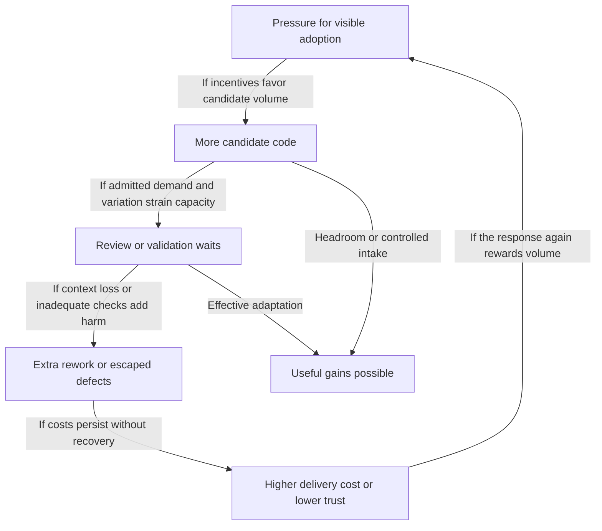
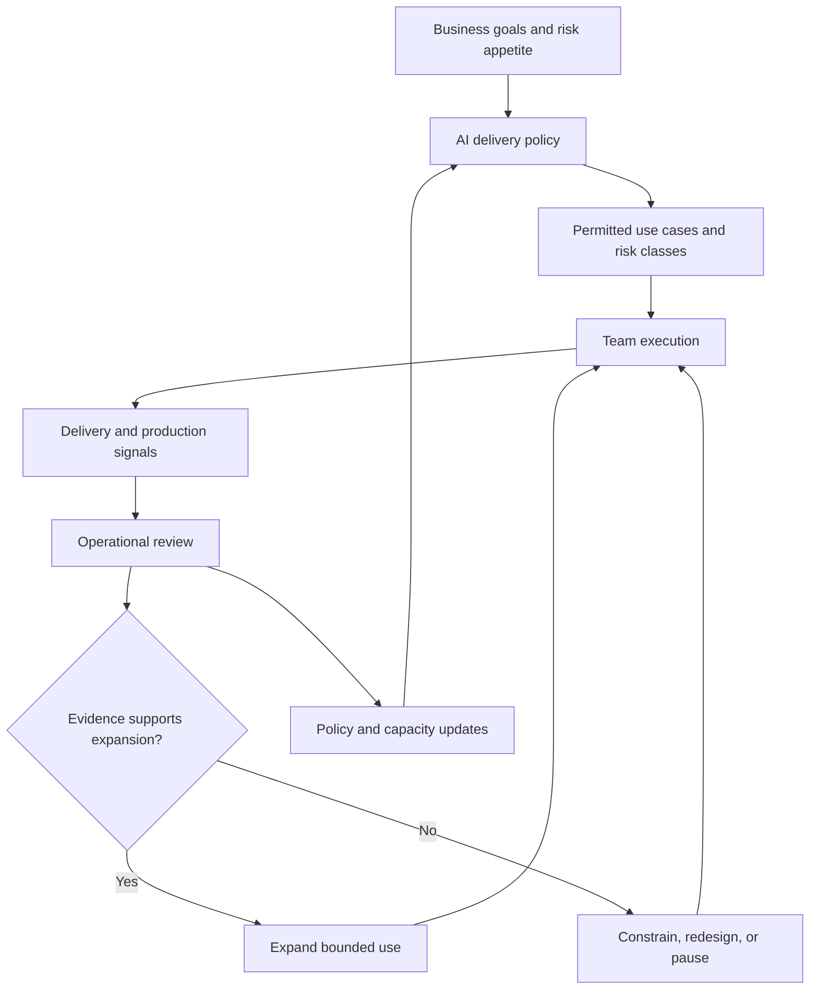
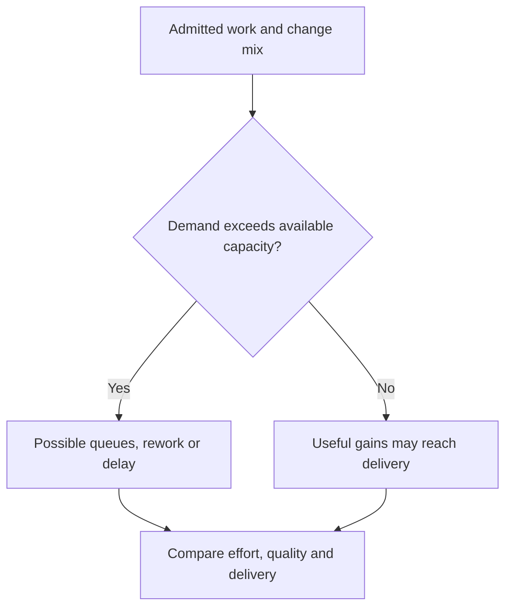
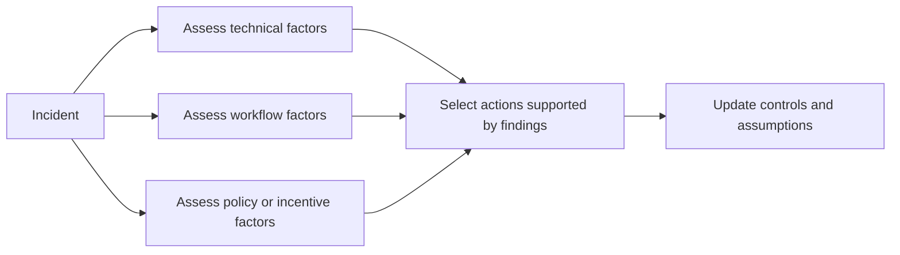
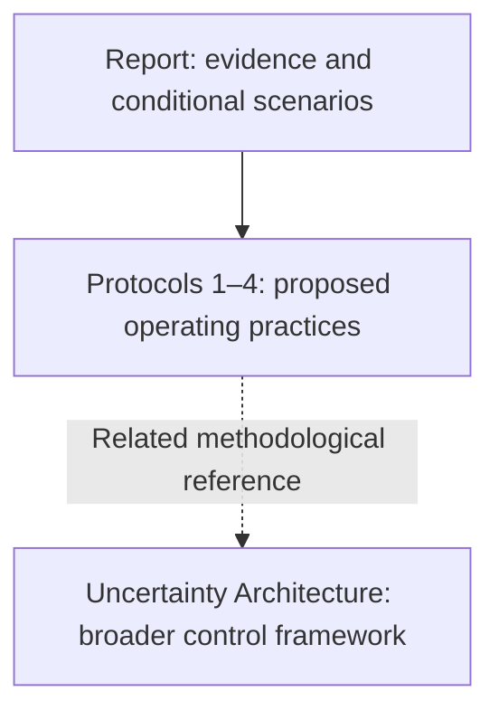

# Protocol 4: Organizational Control Model
## Build an Organizational Control System for AI-Assisted Delivery

> **Navigation:** [🏠 Home](../README.md) | [🧭 Doctrine](../DOCTRINE.md) | [📖 Glossary](../GLOSSARY.md) | [🛡️ Protocols Index](README.md) | [🔙 Protocol 3](03_public_defense.md) | **Protocol 4** | [📚 References](../REFERENCES.md)

Individual verification and team gates operate within budgets, incentives, ownership and deadlines. Where those conditions contribute to a measured delivery problem, organizational changes may be needed alongside local engineering work.

This is a proposed control model to adapt and evaluate, not an empirically validated remedy. Existing effective capability may be reused; the report does not prescribe a transformation programme for every organization.

The goal is not to slow AI adoption. The goal is to make adoption conditional on evidence that the organization can absorb the additional code-production capacity without overloading review, testing, architecture, security, release, and maintenance.

---

## 1. A Conditional Failure Mechanism

AI-assisted coding can increase the rate at which candidate changes are produced. If downstream capacity and controls remain unchanged, the organization may create more work than it can reliably verify and absorb.

**Conditional repository scenario:** The diagram proposes a feedback mechanism to investigate. The [enterprise surveys and market commentary in Chapter 3](../report/01_the_illusion.md#enterprise-surveys-use-benefits-and-scaling-are-different-outcomes) do not measure this causal loop or its prevalence. Sufficient existing capacity, useful review assistance or intake limits could prevent it; stable quality and improved delivery would weaken the adverse scenario.



The [mechanism tests](../report/appendices/mechanism-hypotheses.md) require independently assessed demand/capacity, work boundaries and quality outcomes. Absent triggers and successful recovery are alternatives to this loop; a diagram does not estimate effects or probabilities.

In this hypothesis, rewards for activity signals could reinforce the loop if additional costs fall outside the measured team, period or production boundary. The surveys do not establish those incentive effects.

**Systemic rule:** the unit of optimization is the complete delivery system, not the coding step.

---

## 2. The Organizational Control Plane

An organization adopting AI-assisted development needs a control layer that connects policy, observation, decision rights, and corrective action.



The control plane must answer five questions:

1. **What is permitted?**
2. **Who is accountable?**
3. **What evidence is required?**
4. **What happens when signals degrade?**
5. **Who may expand, constrain, or stop the adoption path?**

Without these answers, an AI policy is guidance, not governance.

---

## 3. Required Organizational Roles

Roles may be combined in smaller organizations, but the responsibilities must remain explicit.

| Role | Primary responsibility | Must not be confused with |
| --- | --- | --- |
| **Executive sponsor** | Sets business objective, risk appetite, and funding boundary | Declaring productivity gains without delivery evidence |
| **Adoption owner** | Owns the end-to-end pilot or operating model | Tool procurement alone |
| **Engineering owner** | Owns technical boundaries, architecture, and review standards | Individual prompt support |
| **Delivery owner** | Tracks flow, queues, capacity, and production outcomes | Counting generated output |
| **Security / compliance owner** | Defines restricted data, tools, and critical controls | Reviewing every ordinary change |
| **Measurement owner** | Maintains definitions, baselines, comparators, and reporting | Selecting only favorable metrics |
| **Team lead / manager** | Applies local gates and escalation rules | Absorbing governance work invisibly |
| **Engineer** | Verifies and owns accepted changes | Acting as a passive recipient of model output |

### Named accountability rule

Every adoption path must have one named owner with authority to:

- reduce permitted scope;
- require additional controls;
- pause a use case;
- request capacity changes;
- escalate unresolved risk.

A committee may advise. A committee cannot replace accountable ownership.

---

## 4. Policy as an Executable Operating Model

A useful policy defines decisions and actions, not only principles.

At minimum, document:

### Permitted scope

- approved tools and models;
- approved repositories, environments, and data classes;
- permitted task categories;
- prohibited or restricted use cases;
- maximum autonomy level;
- requirements for third-party code and licensing review.

### Risk classification

Use the risk classes defined in [Protocol 2](02_operational_defense.md), or an equivalent local model. Classification must depend on system impact, not whether AI was used.

### Required evidence

For each risk class, define:

- review requirements;
- test and validation requirements;
- security checks;
- observability requirements;
- rollback or kill mechanism;
- required decision records.

### Escalation actions

Define in advance what conditions trigger:

- investigation;
- constrained use;
- temporary pause;
- incident review;
- policy revision;
- executive escalation.

### Expiration and review

Every policy exception, pilot approval, and elevated permission should have:

- an owner;
- a start date;
- an expiration or review date;
- evidence required for renewal;
- a reversal condition.

---

## 5. Assess Demand Against Available Capacity

Higher candidate output does not determine the additional review, testing, security, operating or maintenance effort. Demand at a downstream stage depends on the work admitted to that stage, its size and risk, familiarity, and available assistance. Existing spare capacity or useful verification improvements may absorb added work; a fixed resource budget alone does not establish overload.

**Conditional capacity scenario:** Compare observed demand with available capacity and the resulting delivery and quality. The enterprise surveys and practitioner accounts reviewed here do not establish a universal volume-to-burden multiplier or inevitable maintenance inventory.



Before expanding adoption, assess the actual demand and headroom of relevant functions. More work may require a response where a constraint is observed; positive delivery at stable quality and comparable total effort would weaken the overload scenario.

### Capacity questions

- Is review wait time increasing?
- Are senior engineers spending more time correcting generated changes?
- Is QA inventory growing?
- Are security and architecture reviews becoming late-stage bottlenecks?
- Are incidents, hotfixes, or rollbacks rising?
- Is planned product work displaced by cleanup?
- Is maintenance ownership clear for generated changes?

### Capacity responses

Possible actions include:

- reduce work in progress;
- limit change size;
- reserve reviewer capacity;
- strengthen automated checks before human review;
- add QA, security, or platform capacity;
- narrow permitted use cases;
- redesign team boundaries;
- delay expansion until queues stabilize.

**Measurement practice:** Evaluate delivered benefits together with additional or released downstream effort, at the required quality and against a credible baseline. Extra work could offset some or all local savings; sufficient capacity or useful assistance could preserve a net benefit. Measure that comparison before drawing a productivity conclusion.

---

## 6. Incentives and Performance Management

**Incentive hypothesis:** Rewards tied mainly to activity could encourage behavior that misses delivery outcomes. Assess actual targets and decisions; this is not a measured law of organizational behavior.

Do not reward individuals or teams primarily for:

- generated lines of code;
- raw commit count;
- prompt volume;
- AI acceptance rate;
- tool activation;
- number of AI-assisted tasks;
- isolated coding-speed improvements.

Reward outcomes that reflect the whole delivery system:

- completed and adopted product value;
- lead time through production;
- reliability and change success;
- reduced avoidable rework;
- maintainability;
- quality of decision records;
- successful containment of incidents;
- learning that improves policy or controls.

### Anti-Goodhart rule

No single metric should determine performance evaluation or adoption success. Pair local acceleration measures with downstream flow, quality, and production outcomes.

---

## 7. Adoption Gates

Expansion should be earned through stable evidence, not calendar deadlines or executive enthusiasm.

### Gate 0 — Problem definition

Before tool rollout, define:

- the problem being solved;
- target users and task classes;
- expected benefit;
- known risks;
- baseline metrics;
- decision owner;
- stopping conditions.

### Gate 1 — Controlled pilot

Run in a bounded environment with:

- limited teams or repositories;
- explicit risk classes;
- local baselines or comparators;
- required review gates;
- weekly operating review;
- reversible permissions.

### Gate 2 — Stable operating evidence

Expansion requires evidence across multiple cycles that:

- downstream queues remain controlled;
- quality and production outcomes do not materially degrade;
- engineers can explain and maintain accepted changes;
- exceptions are visible and handled;
- reviewer and operational capacity are sufficient;
- gains survive beyond code generation.

### Gate 3 — Bounded expansion

Expand one dimension at a time:

- more users;
- more repositories;
- higher-risk work;
- greater autonomy;
- additional tools or models.

Do not expand all dimensions simultaneously. Separating changes can make investigation more interpretable, but causal attribution still requires an appropriate comparison and attention to concurrent changes.

### Gate 4 — Institutionalization

A mature operating model includes:

- policy ownership;
- recurring measurement;
- auditability;
- incident learning;
- model and tool change management;
- capacity planning;
- scheduled reassessment of assumptions.

---

## 8. Exception and Override Management

Plan how exceptions will be handled if they arise. Undocumented exceptions can make accepted exposure and accountability harder to inspect.

Every exception should record:

- the policy or gate being bypassed;
- business justification;
- affected systems and risk class;
- accountable approver;
- compensating controls;
- duration;
- monitoring plan;
- rollback condition;
- review date.

### Emergency override rule

Emergency use may reduce process, but it must not erase accountability. Record the override after stabilization and review whether urgency was genuine or produced by planning failure.

### Exception debt

Repeated exceptions warrant investigation. Possible explanations include:

1. the policy does not fit reality;
2. incentives encourage bypassing controls;
3. the organization lacks required capacity.

This list is non-exhaustive. Examine the context before attributing exceptions to a particular cause; treat their volume as a diagnostic signal.

---

## 9. Audit Trail and Decision Memory

The organization should be able to reconstruct:

- which tools and models were permitted;
- which policy version applied;
- who approved the use case;
- what evidence supported expansion;
- which exceptions existed;
- what signals triggered corrective action;
- why a control was changed or removed.

This does not require logging every prompt. It requires preserving the decisions that shaped the operating system.

### Minimum decision record

```text
Decision:
Scope:
Owner:
Evidence reviewed:
Assumptions:
Risks accepted:
Controls added or removed:
Review date:
Reversal condition:
```

Decision memory is intended to expose when the assumptions behind an earlier workflow have changed. It supports reassessment; it does not guarantee that the organization will act on the record.

---

## 10. Incident Learning Loop

When an AI-assisted change contributes to a defect or incident, do not stop at “the model made a mistake” or “the engineer should have reviewed better.”

Investigate the full control system:

- Was the work correctly classified?
- Were required references and tests available?
- Did the review gate match the risk?
- Was reviewer capacity adequate?
- Did incentives favor speed over verification?
- Was the failure observable before production?
- Did an exception bypass the intended control?
- Had a model, tool, prompt, or context source changed?



Use the review to select corrective actions supported by the findings, then evaluate whether they reduce recurrence or improve detection. A review alone does not demonstrate effectiveness.

---

## 11. Boundaries of This Control Model

It is not:

- a universal ban on AI-generated code;
- mandatory central approval for every change;
- surveillance of individual prompt usage;
- a dashboard with no decision rights;
- a static policy written once;
- a claim that deterministic checks can eliminate all uncertainty;
- a replacement for engineering judgment.

The goal is **bounded autonomy with inspectable control**, not bureaucracy for its own sake.

---

## 12. Relationship to Uncertainty Architecture

This protocol defines an organizational operating model for AI-assisted software delivery.

[Uncertainty Architecture](https://github.com/UncertaintyArchitectureGroup/uncertainty-architecture) provides a broader open specification for governing non-deterministic systems through control planes, sensors, constraints, actuators, ownership, and feedback loops.

The relationship is:



This repository should remain useful without requiring readers to adopt another framework. The UA repository is a deeper reference for teams that want to formalize or extend the control model. It is a related methodological project, not independent empirical validation of this report or of protocol effectiveness.

---

## 13. Systemic Readiness Checklist

Before organization-wide expansion, verify that:

- [ ] the business objective is explicit;
- [ ] a named adoption owner exists;
- [ ] permitted and prohibited use cases are documented;
- [ ] risk classes and gates are defined;
- [ ] local baselines exist;
- [ ] downstream capacity is measured;
- [ ] escalation and pause authority are explicit;
- [ ] exceptions expire and are reviewed;
- [ ] incentives do not reward output volume alone;
- [ ] incidents update policy and controls;
- [ ] public claims follow Protocol 3 disclosure rules;
- [ ] expansion is reversible;
- [ ] model and tool changes trigger reassessment.

Missing items identify questions to resolve before expansion. Assess their significance against the use case and existing controls; the checklist is not a validated readiness score.

---

## Final Principle

**Proposed operating principle:** Evaluate useful delivery gains together with accountability, evidence and control as autonomy increases. This is a design objective, not a forecast of competitive advantage or guaranteed adoption success.

**Generate less blindly. Verify proportionally. Expand only when the system can absorb it.**

---

*End of Report.*
