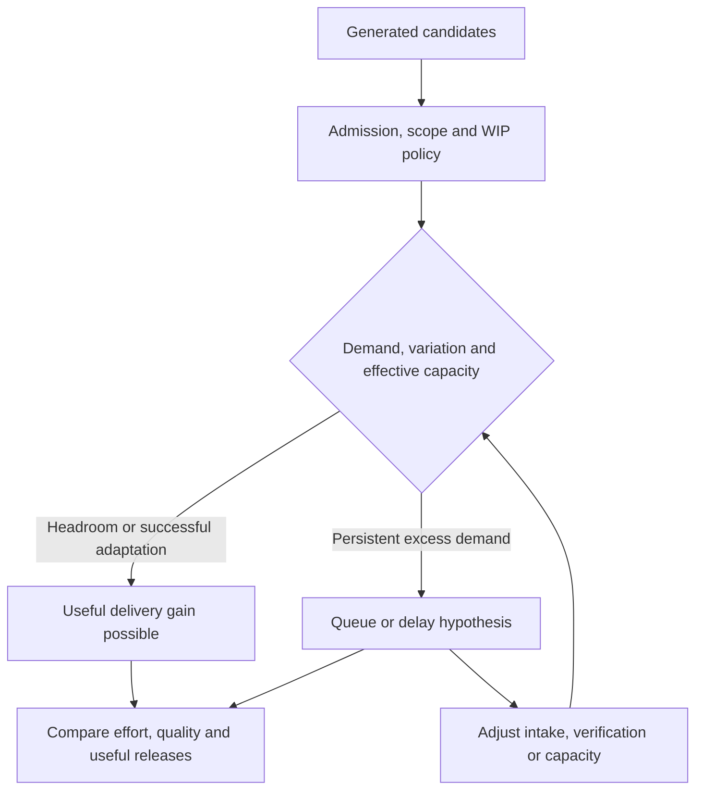

# Part 1: Evidence and Delivery Outcomes

> **Navigation:** [🏠 Home](../README.md) | [🧭 Doctrine](../DOCTRINE.md) | [📖 Glossary](../GLOSSARY.md) | **Part 1** | [⚙️ Part 2: Verification and Delivery Mechanisms](02_broken_mechanics.md) | [🔥 Part 3: Scenarios and Adoption Decisions](03_the_aftermath.md) | [SDLC hypothesis register](appendices/mechanism-hypotheses.md) | [🛡️ Protocols](../protocols/README.md) | [📚 References](../REFERENCES.md)

**Table of Contents:**
*   [Chapter 1. Faster changes, but what did the whole system gain?](#chapter-1-faster-changes-but-what-did-the-whole-system-gain)
*   [Chapter 2. The SDLC produces more than code](#chapter-2-the-sdlc-produces-more-than-code)
*   [Chapter 3. Intent — choose the problem before the solution](#chapter-3-intent--choose-the-problem-before-the-solution)
*   [Chapter 4. Requirements — generated text is not shared meaning](#chapter-4-requirements--generated-text-is-not-shared-meaning)
*   [Detailed research and earlier-edition sections](#detailed-research-and-earlier-edition-sections)
    *   [Task-time and delivery evidence — earlier Chapter 1](#chapter-1-what-productivity-studies-measure-task-time-and-delivery-outcomes)
    *   [Writing Code vs. Shipping Code](#writing-code-vs-shipping-code)
    *   [Firm Evidence: The Work Around Code Changes Too](#firm-evidence-the-work-around-code-changes-too)
    *   [Cost context — earlier Chapter 2](#chapter-2-evaluating-the-cost-of-ai-assisted-delivery)
    *   [Adoption decisions — earlier Chapter 3](#chapter-3-adoption-budgets-and-delivery-capability)
    *   [Capacity scenario — earlier Chapter 4](#chapter-4-a-review-capacity-scenario-when-candidate-work-outruns-verification)

---

## Chapter 1. Faster changes, but what did the whole system gain?

Engineering starts with a problem, not a code editor: **problem statement → hypothesis → proposed solution → implementation → verification → reassess or stop**. If a problem is framed as “we need more code faster,” buying AI licenses can look like the solution before anyone asks what constrains delivery. AI tools can genuinely reduce implementation effort; the larger question is whether that gain produces useful, supportable software.

**The central thesis is that AI can unbalance the SDLC when candidate-code production accelerates faster than the connected delivery functions can adapt.** If admitted changes outpace a team's effective ability to select, understand, review, test, integrate, release and operate them, the constraint moves: work may queue, return for rework, or become harder to own. This relative-capacity mismatch is the **systems mechanism this report investigates**, not a measured claim about how many organizations have fallen behind. The engineering task is to **rebalance the whole delivery system without losing the functions that make its output useful and supportable**.

AI already assists design, testing, review and coordination; some teams adapt effectively or have enough capacity. **The question is which capability improved, which work or responsibility moved, and whether the resulting delivery meets its useful-outcome, quality and cost requirements.**

### What changed, and what was actually measured?

There are several different outcomes that are too often called “productivity” as though they were interchangeable:

- **Candidate production:** generated lines, edits, commits and proposed changes. This tells us about activity, not accepted value.
- **Accepted and integrated work:** changes reviewed, understood where necessary, tested and merged to a coherent system. A merge is not necessarily a functioning release.
- **Released and operated software:** something made available, monitored and recoverable under its actual obligations. A repository release is not automatically a production deployment.
- **Realized value:** a user successfully completes something worthwhile, experiences improved reliability or accessibility, or gets the same useful outcome at lower total cost and acceptable risk.

Each measure captures different decisions and responsibilities. A local gain may be valuable without raising the final outcome by the same percentage.

The [September 2026 revision of Demirer, Musolff and Yang's NBER working paper](../evidence/primary/2026-writing-code-vs-shipping-code.md#numeric-findings-and-uncertainty) estimates, for the pooled synchronous-agent effect in weeks 21–30, **153.2% more commits** and **19.8% more GitHub repository releases**. Both estimates are positive. They come from **different selected outcome samples** in an observational analysis, not a batch of commits followed through a conversion funnel. Release frequency is not a measure of users' benefit, code quality or lifecycle cost. The paper's complementary-production interpretation additionally depends on an explicitly calibrated model. Still, the contrast gives us a serious reason to ask where the larger upstream gain goes—and whether the smaller downstream gain is enough.

A separate [Chen–Stratton firm study, 4 August 2026](../evidence/primary/2026-chen-stratton-firm-production.md#published-estimates-and-reproduced-calculations), reports agent-adoption estimates of roughly **30% more added lines and 23% more submitted PRs per active worker-month** in its selected organizational panel. Its estimated increase in tracked Jira issue completion is much smaller and statistically uncertain, **not a demonstrated zero**. The researchers also find **3.45 additional days from PR submission to merge** relative to a **7.03-day baseline**—approximately **49% longer elapsed time**—alongside more review interactions. Elapsed days include waiting and coordination; they are **not measured reviewer labor hours**. The authors' review findings are compatible with multiple mechanisms, including **changed review standards or more useful scrutiny** as well as problems with generated code. Adoption was not randomized, and visible pre-adoption movements limit causal conclusions.

These studies use different populations and outcomes; they motivate examining how activity becomes useful delivery, **not inferring a shared causal bottleneck**. The [nine-source comparison](appendices/mechanism-hypotheses.md#nine-source-comparison) preserves positive, negative and uncertain task results; [detailed evidence remains below](#detailed-research-and-earlier-edition-sections).

### The mechanism worth testing

A delivery system combines complementary work. Someone must identify a useful problem, make consequential design choices, check what was implemented, integrate it with other work, and be able to respond after release. If the work admitted into one function grows while the next function's *effective* capability does not, work may wait, be rejected, return for rework or pass through with inadequate understanding. Each outcome has different consequences. This is a **conditional constraint mechanism**, not proof that a particular reviewer queue is overloaded.

Consider an intentionally hypothetical team that can competently process **eight similarly sized, risk-comparable changes per week** at a defined quality requirement. A generator can now produce one hundred candidate changes in that week. The queue does **not** automatically grow by ninety-two: the team may admit only useful work, discard experiments, batch changes, use better checking tools, or have spare capacity elsewhere. Starting from an empty queue, it grows by ninety-two only **if all one hundred comparable changes are admitted, none is withdrawn, and competent completion remains limited to eight**. The important quantities are **admitted demand, effective service capacity, task mix, and outcomes**—not the number of tokens generated.

The “subprime” analogy concerns the possibility of **recognizing the gain immediately while postponing the obligations required to understand, verify, change and operate the result**. An attractive short-term output measure can coexist with obligations whose cost is not yet on the dashboard. This is a proposed risk mechanism, not a forecast of industry collapse, universal technical debt or inevitable loss.

### What else could explain the same observations?

Several strong alternatives deserve the same attention as the mismatch hypothesis. Teams may have adequate capacity or effective AI-supported substitutes; extra PRs may be useful experimentation; release batching, change scope or product demand may explain differing growth rates. A smaller percentage increase in releases can coexist with **positive net value**.

**More review is not necessarily failed review.** Chen–Stratton's [source interpretation](../evidence/primary/2026-chen-stratton-firm-production.md#model-and-source-author-interpretation) allows **stricter review standards** as well as a possible change in draft quality. Extra requests, comments and calendar days might reflect useful checking, learning or coordination rather than saturation. To distinguish these possibilities, compare **active review effort with waiting**, change size and risk, defects and rework, reviewer understanding and outcomes after merge. Comment counts or elapsed time alone cannot settle it.

These possibilities are testable. If comparable teams repeatedly achieve **sustained gains in useful outcomes** while maintaining required quality, competent ownership, operating capability and justified total cost under their existing process, the claimed need for rebalancing in that setting is weakened. If an independently observed capacity shortfall does not produce the predicted queue or outcome effect over an appropriate period, that weakens the proposed local mechanism. Conversely, a bottleneck alone does not establish persistent defects, lost knowledge, burnout or negative economics; those consequences require their own measurements.

The objective is therefore not to defend the word *crisis*. It is to find out **where work, knowledge, responsibility and cost moved**, which functions still work, and whether a change is worth making.

### The first management decision

Choose one recurring type of change, not an organization's total commit count. Agree on the intended user result, who accepts that result, the minimum quality and recovery capability, the relevant comparison workflow and a period long enough to include work after the merge. Follow proposed changes through acceptance, review, integration, release, operation and feedback. Count abandoned experiments separately from admitted delivery work; separate active effort from waiting and include rework and downstream ownership.

Then decide among three defensible actions: **keep the existing workflow because it works; improve a demonstrated constraint; or limit the use case when obligations cannot be met**. None is predetermined. The [team operating guide](../protocols/02_operational_defense.md) describes a proposed measurement loop, not an empirically proven universal remedy.

---

## Chapter 2. The SDLC produces more than code

A software-delivery lifecycle is often drawn as a chain of boxes, but its most valuable outputs are not always files handed from one box to the next. It also produces and preserves **decisions, shared meaning, working knowledge, coordination, accountable ownership and feedback**. Those functions may be performed concurrently, revisited, automated, or combined into one role. They do not become unnecessary merely because writing code is cheap.

**Rebalancing is a higher-order design problem that starts during project planning.** Decide which functions must produce which outcomes, where the limiting capability is likely to be, and who owns the trade-offs. Buying tools or optimizing each local activity can help, but it does not answer that system-level question. Preserve a necessary function through a demonstrably adequate replacement, not a ceremony for its own sake.

### Before code: choose and understand the work

**Intent** asks whose problem warrants solving, what improvement counts and whether the work should be attempted at all. Cheaper prototypes can improve discovery by allowing more ideas to be tested; they can also make it easier to commit to poorly justified features. Useful experiments that are abandoned are not automatically waste. The result of Intent is a reasoned choice—including the choice to stop.

**Requirements** translate the need into shared, testable meaning: business rules, unacceptable outcomes, boundaries, examples and the person entitled to make a policy decision. Generated text may help people expose ambiguity, or it may make an unresolved assumption look settled. The needed function is **agreement on meaning and acceptance**, not a particular document format.

**Design** chooses structures, interfaces and constraints that will still matter after the first working demonstration. It links alternatives and trade-offs to reliability, security, operability, future change and who can explain the system. An AI agent can propose or implement a design. What matters is whether the consequential choices remain inspectable and someone can maintain them. A larger document or more generated explanations do not, on their own, demonstrate that capability.

### At the implementation boundary: more than a green check

**Code** turns those choices into executable behavior. AI's ability to accelerate some of this work is central to the evidence; tool version, familiarity, task choice and actual measured outcome still matter. Generated code is candidate output until an appropriate process accepts it.

**Review has two distinct functions.** It can detect defects, incorrect assumptions and unacceptable changes—its **quality function**. It can also transfer the knowledge needed for another accountable person or team to **explain consequential behavior, diagnose a fault, modify the system and recover from failure**—its **competent-ownership function**. The first may improve through static checks, tests, better tooling or automated review; the second may be supported by good contracts, explanations, pairing and deliberate operational practice. Neither requires every old line-by-line ritual to survive. But neither is established by a clicked approval button, a plausible AI summary or an assigned name.

For one consequential change, an **optional ownership diagnostic** is to ask a non-author team member to explain a key rule, make a small safe modification, and describe how they would diagnose and recover from a likely failure. Compare the demonstrated ability, effort and cost with the **team's real previous process**—which may also have been weak. This is a testable local practice, **not a universal release gate** or evidence that AI has already caused a loss of understanding.

**Testing** needs to answer whether the result satisfies the *right* expectations, not just whether the implementation and generated tests agree with each other. If requirements, code and tests share one wrong assumption, passing tests will faithfully reproduce that mistake. Independent acceptance examples, real operational conditions and deliberate negative cases can help; verification can also be much cheaper than implementation and create significant net savings. That is a benefit to measure, not a premise to deny.

**Integration** asks whether individually acceptable changes form a coherent system: compatible interfaces, state, concurrency, dependencies and a stable baseline. A conflict-free merge is a useful signal, but it does not prove the combined behavior is correct or that anyone understands the interaction.

### After merge: exposure, recovery and value

**Deployment** makes a decision about real exposure, environment, data migrations, observability and who receives responsibility. A GitHub release count is not the same thing as a verified production rollout. Even a technically available rollback might not undo a data change or a consequence already experienced by a user.

**Operation** supplies the continuing ability to detect, diagnose, contain and repair problems; support users; maintain integrations; meet obligations; and feed lessons into new work. Regenerating the code is not necessarily the same thing as restoring state, undoing a harmful action or recovering an understandable system. No single person needs to memorize every line; the team needs demonstrable capability over the behavior it owns.

**User outcomes** are the point of the exercise. A shipped feature may be valuable, ignored, too hard to discover or actively burdensome. Value also includes safer service, fewer steps, accessibility, reliability and useful learning. More functionality or higher usage is not automatically more benefit; **unchanged usage does not prove unchanged value**.

**Business economics** close the loop: include the benefits and total effort of choosing, building, checking, coordinating, operating and maintaining the result over an explicit horizon, plus tool and transition costs. Freed staff capacity is not identical to reduced cash spend. A beneficial AI adoption can still have a harmful local effect, and a proposed extra control must justify *its own* incremental cost. Feedback returns these findings to **Intent**, where leaders decide what to continue, change, narrow or stop.

The functional loop is **Intent → Requirements → Design → Code → Review → Test → Integration → Deployment → Operation → User outcomes → Business economics → Intent**. It is a map of dependencies and responsibilities, **not a mandate to install eleven sequential approvals**. The [node-by-node hypothesis register](appendices/mechanism-hypotheses.md#node-index) owns the detailed tests and competing explanations; later chapters examine those functions without treating their unmeasured consequences as established facts.

### Rebalance the chain, not the org chart

A change in one function affects demands on the others. An agent that makes more complete design choices may reduce later review effort; better tests might permit safe, faster integration; restricting weak initiatives may improve useful delivery without producing more code. Equally, handing off implementation without preserving the ability to understand or recover it can move the obligation into the future. We should test *both* trajectories rather than assume that more automation is either salvation or decay.

For each actual workflow, ask: **What did the old process really achieve, including its failures? What does the AI-assisted process achieve? Which required functions are still demonstrably supplied, by whom or by what substitute, and at what full cost and risk?** The baseline is the real previous system, not an imaginary world of perfect human reviews. Some old activities were wasteful and can be removed. Some supplied knowledge or control that must be deliberately replaced.

The target is **useful, understandable and operable software at acceptable quality, justified cost and risk**. Name the actual constraint and who accepts each trade-off. A rebalancing measure fails its own test if it merely moves cost out of sight, harms a critical outcome, or delivers no worthwhile improvement over unchanged practice. **Preserve what matters; remove what does not.**

---

## Chapter 3. Intent — choose the problem before the solution

When implementation is expensive, a team often has to choose which ideas deserve the effort. AI can lower that cost, sometimes substantially. This can be a genuine advantage: a team may explore needs it could not afford to investigate before. But **the ability to build an idea is not evidence that the idea solves the right problem**. Faster implementation changes the price of testing a solution; it does not make the decision to pursue that solution correct.

The first part of the software-development lifecycle, **Intent**, is where a problem becomes a decision: investigate, experiment, commit to delivery, or stop. Its output is more than a backlog entry. It is a defensible explanation of *whose problem matters, what would improve, what cannot be sacrificed, and who owns the choice*. Those outputs must still exist if an agent drafts the entire proposal.

### Four decisions that should not be confused

A **need** is a condition worth changing: users cannot accomplish something, a service is unreliable, or a business process consumes avoidable effort. A **solution idea** is one possible response. A **prototype** is an experiment to learn whether a response has merit. A **production commitment** means accepting the longer-lived work of operating, supporting, changing, and eventually retiring it.

These can be close together, but they are not synonyms. An impressive prototype may show technical feasibility while leaving the user need, safety obligations, adoption prospects, or cost of ownership unanswered. Conversely, an experiment abandoned before release may have delivered exactly the learning the team paid for. **A useful stop is an outcome, not a failed release count.**

Consider a team that can now produce five plausible feature demonstrations for the previous cost of one. Its ability to compare possible solutions may improve. The failure mode would be to treat all five demonstrations as approved commitments, each adding requirements, support work, and future maintenance before anyone has selected a useful problem. The mechanism is **admission without sufficient selection**, not AI-generated prototypes themselves. No study reviewed here measures how often this happens across organizations.

### A hypothetical recovery decision

Consider an invented online service where customers sometimes lose both their password and their second authentication factor. The problem is not initially “build an AI-generated recovery page.” It is **restore rightful access while preventing an impostor from taking over an account**, with reasonable effort for users and support staff. The product owner needs to understand both harms: locking out a legitimate customer and granting control to the wrong person.

For this example only, suppose the organization's chosen policy is:

**Account access may be restored only after identity has been independently confirmed by the service's approved process. No payout destination may be changed before that confirmation.**

This is an **illustrative local policy**, not a security standard or evidence that this is the right recovery policy for a real provider. The exact identity-check method, accessibility alternatives, exception authority, residual fraud risk, and any additional rules for payout changes are still decisions for the relevant product, security, and operations owners.

A fast generated interface might help users discover confusing instructions or help a team compare assisted and human-supported recovery paths. Neither prototype should silently decide what counts as independent identity confirmation. That is the boundary between exploring a solution and delegating a consequential policy choice. Chapter 4 carries **this same hypothetical policy**, unchanged, into requirements and acceptance examples.

### When faster exploration helps — and when it might hurt

AI may help organize interview notes, propose competing hypotheses, model service flows, write disposable experiments, and compare alternative journeys. Those uses can improve selection and learning, especially where the real previous workflow relied on slow documentation or a narrow range of ideas. There is no virtue in preserving unnecessary handoffs simply because humans once performed them.

The adverse hypothesis, [INT-1](appendices/mechanism-hypotheses.md#intent--int-1-and-int-2), is narrower: **cheaper implementation combined with activity-driven admission** might increase poorly justified commitments and reduce useful outcomes per invested effort. The strongest alternatives are that unmet demand is finally served, cheaper experiments improve discovery, or the team already has effective selection and stop practices. More admitted work or a larger backlog does not, by itself, distinguish these accounts.

To test the concern, examine a comparable portfolio of **evaluated initiatives**, not just approved features. For each, record the problem evidence available at the decision, alternatives considered, exposure to AI-assisted work, reason for admission or stopping, time and capacity invested, and later user outcome or useful learning. Include rejected and abandoned experiments. Look at **value or justified learning per invested effort**, not the percentage of prototypes shipped. Ask who had authority to expand the commitment and what existing work was displaced.

**What would weaken the adverse hypothesis?** Comparable selection quality and stronger downstream outcomes despite cheaper implementation, including valuable discarded experiments, would limit a claim that weak intent selection is deteriorating in that setting. **What would weaken the proposed remedy [INT-2](appendices/mechanism-hypotheses.md#intent--int-1-and-int-2)?** If an extra decision brief, explicit stop criterion, or product-owner check costs time without improving decisions, learning, or value against the team's *real previous practice*, it may not be worth retaining. A prettier backlog is not evidence of better Intent.

### The decision before the project plan

Before committing to implementation, the accountable product or portfolio owner should be able to answer a small number of consequential questions in ordinary language: Which observed need are we addressing? What outcome would count as useful? What other option might serve it? What could make us stop? What will the team have to own if the experiment succeeds?

The answer need not be a long document. A short decision shared by the people who bear the trade-offs may be better than an elaborate generated plan nobody can explain. Where these decisions are already made well, **leave the process alone or make it cheaper**. Where they are missing and later harm is observable, improve selection before increasing the rate of commitments.

**Evidence boundary:** the repository's INT-1 and INT-2 verdicts are both **Open**. Existing coding-activity, deployment, marketplace, or management-survey results do not directly establish AI-caused deterioration of organizational Intent, nor the incremental benefit of this proposed selection practice. [The source and hypothesis register](appendices/mechanism-hypotheses.md#intent--int-1-and-int-2) owns the open research question; [the retained management-record discussion](#what-management-records-actually-show) remains relevant context, not causal proof.

---

## Chapter 4. Requirements — generated text is not shared meaning

Intent selects a problem worth addressing. **Requirements** turn that intent into behavior and constraints people can understand, test, and accept. A generated specification can describe an entire interface in seconds. It may also describe the *wrong rule* in confident, consistent language. The engineering challenge is not to slow down drafting; it is to ensure that the meaning behind the draft belongs to the people entitled to make the decision.

A requirement supplies more than words. It helps a team **discover ambiguity, negotiate scope, agree on consequential domain rules, define acceptance from an accountable perspective, and preserve meaning as design, code, tests, and operations evolve**. These functions can be carried by examples, conversations, executable checks, short policy records, or tools. They do not require a universal document format or a second bureaucracy.

### Faster drafts can reveal gaps — or conceal disagreement

AI can generate alternative use cases, summarize a conversation, search for missing branches in a flow, or suggest edge cases for a domain expert to judge. This may improve a weak manual process and reduce routine transcription. An agent may also produce polished language before the people involved have agreed on the meaning. **Apparent completeness can hide unresolved authority.**

Suppose a product manager says “make recovery simple,” an engineer assumes that a verified email address is enough, and a security owner understands “identity independently confirmed” to require something else. An agent might generate requirements, implementation, and tests that all agree with the engineer's assumption. The suite could pass while the intended policy is violated. In this **hypothetical scenario**, the danger is a *shared mistaken assumption*, not a measured AI defect rate or proof that generated tests are generally unreliable.

The previous human process may have had precisely the same problem: vague tickets, informal exceptions, inaccessible domain experts, or tests written from the implementer's assumptions. The fair comparison is **actual previous requirements practice versus a specified AI-assisted practice**, for changes of similar risk and scope, not an ideal human specification versus an unchecked agent.

### The same recovery policy, now expressed as requirements

Carry the hypothetical policy from [Chapter 3](#a-hypothetical-recovery-decision) **without changing its meaning**:

**Account access may be restored only after identity has been independently confirmed by the service's approved process. No payout destination may be changed before that confirmation.**

This says what the service must uphold; it does **not** yet define which identity evidence is sufficient, which accessibility route applies when the usual method is unavailable, or how disputes are resolved. Those are unresolved domain decisions. A generator must not silently settle them by inventing a convenient check.

A product/domain owner, with security and operations input, could agree on independent examples before implementation:

| Situation (hypothetical) | Agreed expectation | Decision still owned by people |
| --- | --- | --- |
| A legitimate customer loses both factors and completes the service's independently approved identity check | Restoring access **may** proceed subject to other applicable rules | What evidence makes the identity check valid, and who handles exceptions |
| A request arrives without independently confirmed identity | Do **not** restore access or change the payout destination based on that request | How the customer can safely continue or appeal |
| A request tries to change the payout destination while identity remains unconfirmed | Do **not** make that change | Additional rules that may still apply **after** confirmation |
| A generated recovery test assumes access can be restored through an unconfirmed email link alone | The test is **not** an adequate oracle for this policy, even if its implementation passes | Which independently grounded cases must challenge the shared assumption |

These are **proposed acceptance examples for an invented service**, not measured observations, comprehensive fraud controls, an exhaustive recovery design, or a requirement that every team introduce manual approval for every task. They deliberately leave undecided matters visible. For a real product, domain experts must set and accept its actual policy, including the competing harms of exclusion and unauthorized access.

### What checking must remain independent of drafting?

The critical distinction is between **a test that agrees with a generated implementation** and **a test that checks the agreed domain meaning**. The first can be useful, but agreement among requirements, code, and tests produced from the same flawed assumption will not challenge the assumption itself. Independently grounded examples or a trusted acceptance oracle can break that common-source dependency. “Independent” here means **independent grounding of the expectation**, not a universal requirement for a separate department or a human to manually approve every generated artifact.

A domain owner should be able to explain which behavior is acceptable in an unseen case. An engineer should be able to find how that rule reached the implementation and tests. If the policy changes, the team needs a way to update the relevant checks and downstream understanding without preserving a mountain of stale links. Traceability is useful to the extent that someone can **locate a disputed assumption, correct it, and verify the correction**.

Useful substitutes are allowed. A well-maintained executable example, a reliable domain contract, or an automated cross-check against independently supplied policy may be more effective than a long requirements document. Its effectiveness is something to demonstrate in the relevant context, not infer from having more text or more test cases.

### Compare harm and remedy separately

The adverse hypothesis, [REQ-1](appendices/mechanism-hypotheses.md#requirements--req-1-and-req-2), is that rapid drafting might allow unresolved domain assumptions to propagate into code and generated tests, producing semantic rework or failures. Alternatives include **better examples, earlier domain involvement, improved task selection, effective existing checks, or a less ambiguous project**. A low number of requirement defects after AI adoption could reflect successful assistance, not hidden debt.

A useful local comparison would select similar domain changes and record their **actual** prior process, AI exposure or drafting method, independent domain cases, resolution of disagreements, effort spent checking meaning, and later semantic corrections or user failures. Follow changes beyond the merge where possible. Separate mistakes in policy formulation from implementation bugs; passing more generated tests is not sufficient evidence either way.

The proposed remedy, [REQ-2](appendices/mechanism-hypotheses.md#requirements--req-1-and-req-2), is to ground consequential acceptance examples and maintain useful traceability. **What would weaken REQ-1?** Clearer AI-assisted requirements with stable or lower semantic error/rework, at comparable risk, weaken the prediction of harm. **What would weaken REQ-2?** If extra oracle-building, review, or linking does not reduce meaningful errors or improve understanding enough to justify its total cost relative to the *unchanged real process*, the remedy is not established. An added checkpoint that merely moves work elsewhere is not an improvement.

The product/domain and engineering owners should agree on the acceptable behavior and necessary quality floor; they also bear the costs of defining and maintaining it. Work can be more valuable with **less specification prose** if the required shared meaning, decision rights, and correct behavior survive. What matters is the accepted rule and the team's ability to maintain it.

**Evidence boundary:** both REQ-1 and REQ-2 remain **Open** in the [requirements card](appendices/mechanism-hypotheses.md#requirements--req-1-and-req-2). The recovery-policy example demonstrates a plausible propagation failure and a way to test for it. It establishes neither the incidence of that failure nor a measured benefit of independent acceptance checks. These unanswered comparisons belong to [research issue #90](https://github.com/UncertaintyArchitectureGroup/The-Subprime-Code-Crisis/issues/90), not to an assumed result of this chapter rewrite.

### The handoff that matters

Before implementation, the smallest useful handoff is not necessarily a detailed document. It is a **shared account of the consequential rules and a way to tell when behavior violates them**, with the right person able to resolve a dispute. Then Design, Code, Review, and Test can change form and speed without losing their common purpose.

**Next:** Chapter 5 will examine **Design** under its separately owned editorial issue. The current report deliberately leaves that work unimplemented until [#133](https://github.com/UncertaintyArchitectureGroup/The-Subprime-Code-Crisis/issues/133) is approved.

---

## Detailed research and earlier-edition sections

**The new seventeen-chapter sequence currently stops after Chapter 4.** The numbered sections below are **retained research detail from the earlier edition**, not a continuation of the new chapter numbering. Their old headings and deep links remain intact while later editorial issues reorganize them. The underlying findings and citations are still available; the new chapters do not replace their evidence.

## Chapter 1. What Productivity Studies Measure: Task Time and Delivery Outcomes

AI assistance can shorten one coding task, lengthen another or change which tasks developers choose. To judge a productivity claim, readers need to know who did the work, what the task was, which tools they used and when, and what result the study measured.

The experiments below measure task time. They do not directly measure an enterprise's complete delivery process. This report asks when time saved in coding leads to better software delivery, and when the work of checking, integrating, releasing and maintaining changes uses up that saving.

Our research thesis is that AI coding tools have changed the capacity to produce proposed code faster than delivery systems have adapted their ability to select, understand, check, integrate, operate and get value from it. Parts of the evidence support investigating this mismatch; they do not establish the whole causal chain. Teams may also have enough capacity, or adapt successfully, and keep the gains.

Original methods and limitations matter alongside the headline result, including the funding and affiliations of the research team.

---

### Bounded Experiments: Positive, Negative and Temporally Limited Evidence

| Source and setting | Design and measured outcome | Finding and boundary |
| --- | --- | --- |
| [Peng et al., 2023 preprint](../evidence/primary/2023-copilot-task-productivity.md); experiment in May–June 2022 with GitHub Copilot | 95 developers randomized, 45 treatment and 50 control; 70 task-and-survey completers, 35 per arm. One JavaScript HTTP-server task; time to pass the provided tests | Among completers, **55.8% less completion time** (71.17 versus 160.89 minutes; 95% CI 21–89%). This is positive task-level evidence, conditional on completion; it does not measure production delivery or lifecycle quality. |
| [METR, July 2025 preprint/report](../evidence/primary/2025-metr-experienced-developer-productivity.md); February–June 2025 tools, mainly Cursor Pro with Claude 3.5/3.7 Sonnet | 16 experienced contributors; 246 completed tasks analyzed in familiar mature open-source repositories. Tasks defined before AI-permission randomization; active implementation time before/after review, with some post-review time imputed. Completion/exclusion rules and robustness checks are in the brief | AI allowed was associated with **19% longer task time** in the randomized experiment (95% CI +2 to +39%, as restated in the February 2026 update). Developers forecast 24% less time and retrospectively estimated 20% less time. These perceptions are separate from the measured result; this is not a universal seniority effect. |
| [METR, 24 February 2026 follow-up](../evidence/primary/2026-metr-productivity-design-update.md); experiment begun August 2025 | Later tools and a broader recruited pool; tasks again randomized to allow/disallow AI | Authors consider the current magnitude **unreliably estimated** because participation/task selection and concurrent-agent time measurement changed. They expect more benefit than in early 2025, but describe weak evidence for its size. This update neither establishes a general speedup nor invalidates the historical 2025 result. |

**Repository interpretation:** The experiments differ in tasks, participants and tools. They do not isolate junior versus senior developers, or new projects versus existing systems, so they cannot tell us how much each difference explains the contrasting results. A percentage reduction in task time is not the same percentage increase in the rate of completed delivery. Neither the positive nor the negative task result, on its own, determines how an enterprise's delivery process performs.

### [Observational Activity and Rework: Xu et al., v3](../evidence/primary/2025-xu-copilot-oss-activity.md)

Xu et al. use Copilot's 2021 language availability in Microsoft-owned open-source projects as a quasi-experiment, not a replication of the task-time experiments. The study reports **2,755 repositories and a separately filtered panel of 1,699 contributors**, observed during July 2020–July 2022. Actual individual Copilot use is unobserved; difference-in-differences estimates depend on comparable counterfactual language trends.

* **Positive project activity:** Table 5 reports +17.7% lines added and +4.3% PRs (p<.01), alongside +4.1% commits (only p<.10). These gains do not disappear in the aggregate results.
* **Activity-quartile differences:** Appendix Table 13 reports approximately **+43.5% commits for the bottom pre-treatment activity quartile** and **−19.3% for the top/core quartile**. Core means commit activity, not professional seniority; the bottom quartile does not represent all peripheral contributors.
* **Review and rework proxies:** The top quartile's **+6.5% review-count estimate is uncertain** (Table 11: p=.086; derived 95% interval −0.9 to +14.4%). Table 5 reports **+2.4% repository-month follow-up-commit activity with PR volume controlled**, not per-PR defects. Neither measure is review hours or measured displacement of coding time.

The [brief](../evidence/primary/2025-xu-copilot-oss-activity.md) gives coefficients, transformed-count uncertainty and source-internal reporting discrepancies. The subgroup pattern motivates a redistribution hypothesis; it does not establish its cause, net project value or an enterprise-wide senior penalty.

**Mechanism hypothesis:** More generated work could require more review effort if the ability to check it does not keep pace. The task-time experiments above do not show that work shifted between people across teams. Difficulties using the tools, different tasks and changes in the amount of work attempted are alternative explanations. In a local deployment, stable review effort alongside better production outcomes would weaken the explanation that review became a bottleneck.

---

### [Agent Adoption and Code Structure: Agarwal et al., v2](../evidence/primary/2026-agarwal-agent-adoption.md)

Agarwal et al. study **repository-month outcomes after the first observable agent-attributed PR**, using matched staggered difference-in-differences. Their January 2024–November 2025 OSS panels distinguish agent-first (AF: 401 treated/606 controls) from IDE-first (IF: 117/73), using detectable IDE configuration traces. These labels approximate exposure histories; missing traces do not establish no prior AI use. This is not a comparison of purely AI-authored and human-authored codebases.

| Table 2 outcome | Agent-first | IDE-first |
| --- | --- | --- |
| Commits / lines added | **+36.25% / +76.59%**, both p<.001 | +3.06% / −6.34%, both inconclusive at 5% |
| Cognitive/code complexity | **+34.85%**, p<.001 | **+42.87%**, p<.01 |
| Static-analysis warnings | **+17.73%**, p<.001 | +19.00%, inconclusive at 5% |

Positive AF activity gains coexist with higher structural-risk metrics; average IF activity gains are uncertain. Outcomes are aggregated by repository-month, with LOC among the covariates. They do not measure complexity per feature, functional correctness, reviewers' mental effort or lifecycle cost. Figure 2 shows some pre-treatment warning/complexity signals, including IF complexity at t=−2, which the authors acknowledge as a design limitation. A causal interpretation remains conditional on the identification assumptions.

**Repository hypothesis:** More structurally complex changes could increase maintenance or review effort in some deployments. This study does not measure that mechanism. Task mix, repository growth and exposure misclassification are alternatives; direct review-time, defect and production measures are needed. The [brief](../evidence/primary/2026-agarwal-agent-adoption.md) preserves all Table 2 outcomes and the version/publication boundary.

---

### [GitClear Quality Signals: A Historical Vendor Sample](../evidence/primary/2025-gitclear-code-quality.md)

GitClear's February 2025 quality report examines approximately **211 million meaningful changed lines from January 2020–December 2024** in a selected commercial/OSS sample. It describes historical code-change patterns, without identifying individual AI exposure or an AI/no-AI counterfactual. It is a separate dataset from the developer-output report below.

| Quality signal | Comparison and unit | Original locator |
| --- | --- | --- |
| Moved-line operations | **24.65% in 2021 → 9.47% in 2024** of that year's meaningful changed lines | Derived from Appendix A1 p24 counts; relocation is a reuse/refactoring proxy, not all refactoring |
| Copy/pasted-line operations | **8.86% in 2020 → 12.32% in 2024** of meaningful changed lines | Derived from A1 p24 counts; matching contents across functions/files within a commit |
| All-line two-week churn | **3.05% in 2020 → 5.67% in 2024** | Derived from A1 p24 counts; overlaps operation categories and does not directly measure defects |
| Scanned commits containing a clone | **139/19,805 (0.70%) in 2020 → 3,764/56,495 (6.66%) in 2024** | Table p12; at least one detected Type 1 repeated block of ≥5 eligible lines, not the count of duplicated blocks |

These operation shares explicitly use the appendix counts. Some main-table/landing values and multiplier wording differ; the [brief](../evidence/primary/2025-gitclear-code-quality.md) preserves the discrepancies. Clone backfilling prioritized large commits in earlier years (A8 p31), so the scanned sets are not demonstrated to be comparable representative samples. The author's later-year projections are not observations. No interval or causal AI effect is established by these descriptive contrasts.

The patterns motivate investigating maintainability, while the author also describes useful AI-assisted consistency work and acknowledges that early revision can be beneficial. A declining moved-line share does not prove every codebase loses modularity or that review automation must deteriorate. Direct review, defect and maintenance outcomes are needed to test those hypotheses.

### [GitClear Output Growth: Separate Cohorts and Measures](../evidence/primary/2025-gitclear-developer-output.md)

The separate developer-output report compares selected records with a **2022 baseline**. Methods 1/2 follow the same **17,341 contributors with ≥500 commits in each studied year**; their 2025 count is a trailing 365-day window in September/October 2025. Methods 3/4 use different, changing GitClear samples. Actual individual AI use is not measured.

| Output measure | Reported change | Boundary |
| --- | --- | --- |
| Method 1, median annual commit count | **+6.8%** | Ratio of cohort medians; not the median individual change |
| Method 2, median individual commit-count change | **+6.1%** | Each contributor compared with their own baseline |
| Method 3, median Diff Delta | **+14.1%** | Proprietary weighted code-change metric; sample 132 in 2022 / 286 in 2025 |
| Method 4, monthly added-line output | **+131.1% mean / +76.3% median** | Selected developer-month records with ≥50 commits and ≥10 added lines; changing coverage, not a universal team-input multiplier |

These are positive activity results, with different aggregations and populations. The source's **9.0%** composite averages **three** medians: `(6.8 + 6.1 + 14.1) / 3`. Our former two-number formula yields **10.1%**. Neither arithmetic result is a validated net-delivery or causal AI-productivity estimate. Method 1's mean conflicts between the method and summary tables; it and the dependent mean composite are withheld as headline findings. The [brief](../evidence/primary/2025-gitclear-developer-output.md) records the exact conflict, units, selection and window limits. These figures cannot be multiplied by the preceding quality study or other studies into one measured SDLC chain.

---

### From Task Results to Delivery Questions

The positive Peng result belongs in the central comparison above. Its bounded scope does not make it irrelevant; it defines what was tested. METR likewise supplies a bounded negative result for early-2025 tools, followed by a later update with substantial identification limits.

**Repository inference:** Time saved on one task may improve delivery. Other constraints may use up the saving, or developers may use it to attempt more or different work. To tell these outcomes apart, measure what happens after coding and compare it with a suitable baseline. An assumed industry-wide share of maintenance work cannot answer that question. Nor can treating a contributor's repository role as their professional seniority.

The next section examines a separate study of coding activity, projects and releases. Its findings apply to the people, tools and outcomes that study examined, under its own research design.

---

### Writing Code vs. Shipping Code

The **September 2026 revision** of Demirer, Musolff and Yang's NBER Working Paper 35275 follows coding activity toward repository outcomes. The authors describe more than 500,000 developers across tool samples, with repeat adopters and much smaller outcome-specific regression samples. Matched observational event studies use earlier-year controls; agent-authored async outcomes instead use interrupted time series. The [version-pinned brief](../evidence/primary/2026-writing-code-vs-shipping-code.md) records methods, uncertainty, sensitivity and the preserved May history.

Figure1 reports cumulative adoption-generation estimates of about **30%, 180% and 240% more commits** for autocomplete, +sync and +async. The final display reaches roughly **80% more distinct repositories touched and 30% more releases**. These are positive downstream results; smaller proportional gains toward releases do not mean zero benefit or overall productivity decline.

They do not track a fixed batch of commits through one funnel. Releases count recently contributed-to repositories with a GitHub release, not the developer's own deployed features, quality or customer value. Table6 gives incremental release estimates of **9.0% (SE5.0)** for autocomplete and **19.8% (SE2.9)** for pooled sync; the former is uncertain at conventional levels. There is **no separate async release estimate**. The cumulative headline must not be relabeled as an additional async effect. Samples and specifications materially affect magnitudes; exact comparisons belong in the brief.

**Model result:** The revision calibrates a substitution elasticity of approximately **0.23** to autocomplete outcomes in an assumed hierarchical production model. The authors' complementarity interpretation is model-dependent, not a directly measured review burden, fixed capacity or replacement ratio. Experiments, selection and changed scope can also contribute to the observed activity pattern; abandoned alternatives are not necessarily defective work.

**Separate descriptive marketplace analysis:** Entry rises or reverses a decline on iOS, Android and Chrome, although Chrome growth predates the agentic period; SourceForge shows a slight entry increase. Three-month new-cohort usage has different proxies: iOS ratings are roughly stable, Android downloads rise modestly, and Chrome's proxy declines on an earlier trend. Chrome uses maxima of observed current-user counts, not directly measured cumulative installs. SourceForge has insufficient usage data for an equivalent comparison. These series are not causal follow-ups of the matched developers or measures of all consumer value. Discovery, demand, selection and adoption lag remain alternatives to a production constraint.

**Repository hypothesis:** Waiting could increase if more work is accepted for checking than a stage can handle at the required quality. That depends on available capacity, fluctuations in demand and the rules for taking in and releasing work. Spare capacity, limits on intake, better task selection or useful assistance could instead preserve quality and improve delivery. Neither the smaller gains toward releases nor the marketplace results identifies review as the constraint in most organizations. [Chapter4](#chapter-4-a-review-capacity-scenario-when-candidate-work-outruns-verification) and the [claim graph and tests](appendices/mechanism-hypotheses.md) distinguish the evidence from the assumptions and possible consequences.

### Firm Evidence: The Work Around Code Changes Too

Chen and Stratton's [August 2026 working paper](../evidence/primary/2026-chen-stratton-firm-production.md) adds a distinct organizational setting to the activity-versus-delivery question. Across selected Jellyfish firms, the pooled agent-adoption estimates are about **30% more added lines and 23% more submitted PRs per active worker-month** ([Figure 6, p39; estimates and calculations](../evidence/primary/2026-chen-stratton-firm-production.md#published-estimates-and-reproduced-calculations)). Resolved Jira issues per active worker-month have a much smaller positive estimate, about **3%, with an approximate 95% interval spanning −6% to +12%** ([Figure 7, p40; calculation boundary](../evidence/primary/2026-chen-stratton-firm-production.md#published-estimates-and-reproduced-calculations)). Completion gains remain possible; these different outcomes do not form a measured loss funnel, and their comparison is not a statistical test of their difference.

The review path also changes: the pooled estimate for PR submission-to-merge **elapsed time is +3.45 days from a 7.03-day baseline**, alongside more formal change requests and comments and broader reviewer participation ([Figures 11–13, pp44–46; source measures](../evidence/primary/2026-chen-stratton-firm-production.md#published-estimates-and-reproduced-calculations)). These are consequential process observations. They strengthen the case for examining complementary work around code generation. They do not measure active reviewer hours or the team's acquired understanding.

This is observational evidence with adoption assumptions and visible pre-period movements. Earlier assistant estimates do not show the same significant increases in merge latency, formal change requests and comments. Together with [NBER's positive release gains and broader attenuation](#writing-code-vs-shipping-code), the firm results support the rebalancing investigation without establishing an inevitable failure of every AI-assisted workflow. The [source brief](../evidence/primary/2026-chen-stratton-firm-production.md) and [hypothesis assessment](appendices/mechanism-hypotheses.md#e-chen-stratton) distinguish those observations from the proposed capacity mechanism, ownership consequences and remedies.

---

### Unmeasured Work Intensity: A Confounder to Test

Changes in how much people work could affect comparisons of output over time. Neither GitClear dataset measures whether participants worked more hours or felt pressure from the prospect of replacement. Its activity percentages cannot show whether either explanation applies.

**Repository hypothesis:** Adoption expectations might increase overtime or change task selection in some teams. A local study would need hours, task mix, perceived pressure and an appropriate comparator. Stable hours with sustained downstream gains would weaken the overtime explanation. Neither respondent attitudes nor an individual burnout account identifies that causal pathway; they are different evidence from the GitClear results.

**Attitudes and practitioner context:** In the [2024 Stack Overflow survey](../evidence/primary/2024-stackoverflow-ai-attitudes.md), 69.6% of 28,142 professional-developer respondents answered No to whether AI threatened their current job (the publisher rounds to 70%). Overall AI favorability was also mostly positive, while other questions recorded trust and context concerns. These self-selected, question-specific responses do not establish rising fear, overtime or measured productivity.

A [Techno Diaries introduction](../evidence/secondary/2025-technodiaries-review-anecdote.md) contains one first-person claim that review time doubled compared with the same period a year earlier, alongside useful assistance on small tasks. The logs and member-only remainder are unavailable. This motivates measurement; it is not a representative senior-developer estimate or a finding that burnout caused the activity changes above.

---

### Match Productivity Claims to Their Outcome Boundary

Peng's measured task-time reduction is an operational result for a standardized task, not merely sentiment. METR's comparison of forecast and measured time shows that perceptions can diverge from performance in a particular setting. It does not establish that every productivity survey is invalid.

For a claim about enterprise value, ask whether the evidence follows review effort, completed releases, defects, production use and total engineering cost for long enough to assess the result. A task experiment alone cannot show whether those outcomes improved or worsened. The experiments' missing measures do not show that no relevant vendor or external research exists. This chapter compares the identified sources reviewed here; it is not a comprehensive search of vendor or enterprise evaluations. Task experiments, surveys and company revenue statements answer different questions.

**Proposed measurement practice:** Publish task definitions, tool dates, population, comparator and uncertainty alongside the outcome. Keep task-time results, self-reported experience, activity counts and delivery measures separate. Apply the same scope requirements to positive and negative findings.

---

### Governance and Marketing Claims

Claims about faster coding should specify what was measured and the safeguards required in the intended setting. GitClear's selected historical samples do not establish an industry-wide default failure mode or a vendor's responsibility for a particular defect.

**Proposed disclosure practice:** State task/tool scope, comparator, review and production outcomes, and material limitations. Responsibility for tool design, deployment choices and accepted changes should remain inspectable. Criticism should address a specific claim or operating choice with evidence; the code-change metrics do not establish vendor intent or misconduct.

---

### Economic Hypothesis: Count Downstream Work

A subscription buys access to a tool. Whether it pays off depends on demonstrated benefits and the work needed to use its output. More proposed code could raise later costs if review, testing or maintenance cannot keep pace. Neither GitClear study measures total cost of ownership (TCO) over the software's life or establishes that maintenance budgets must fail.

To test this hypothesis, compare delivered value with total engineering effort, quality, and release and operating costs. Sustained delivery gains at stable or lower total cost would limit where the hypothesis applies.

---

### Conclusion: Separate Task Time from Delivery Performance

The experiments establish a positive effect on conditional completion time in Peng's standardized task and a negative effect on active task time in METR's familiar-repository setting with early-2025 tools. The 2026 follow-up leaves the present magnitude uncertain. They do not establish an industry-wide slowdown or a universal penalty for experienced developers.

**Repository hypothesis:** If more work enters checking and release than those functions can handle, faster coding may lead to longer queues or more rework without more delivered value. Shorter time to production with stable or improved quality would limit where that hypothesis applies. Effects on code quality and maintenance need their own evidence; task-time percentages do not measure them.

Xu likewise reports positive project activity alongside heterogeneous contributor activity; Agarwal reports substantial AF activity gains, uncertain IF activity gains and mode-specific structural metrics. These observational results do not establish disappearing aggregate gains, per-feature debt or measured cognitive load. They belong beside the task experiments as different evidence, not additional stages of one causal estimate.

GitClear adds positive selected-cohort output trends and historical quality-proxy signals in separate datasets. Its composite is not net delivery, and its clone/reuse measures do not prove a universal maintenance or staffing outcome.

The practical question is whether useful software reaches users with the required quality and at a justified total cost. Measure the full delivery process, while reporting the benefits and costs at each step separately.

---

#### References

* **METR Study (July 2025):** [Paper v2](https://arxiv.org/abs/2507.09089v2) and [evidence brief](../evidence/primary/2025-metr-experienced-developer-productivity.md) — 16 experienced contributors, 246 completed familiar open-source tasks analyzed, early-2025 tools; AI allowed increased task time by 19% (95% CI +2 to +39%, restated in the February 2026 update). The brief records exclusion/imputation rules; forecast and retrospective perceptions differ from measured time.
* **METR Follow-up (24 February 2026):** [Author update](https://metr.org/blog/2026-02-24-uplift-update/) and [evidence brief](../evidence/primary/2026-metr-productivity-design-update.md) — later experiment; authors report selection and time-measurement problems that prevent a reliable current magnitude estimate.
* **Xu et al. (arXiv v3, 28 January 2026):** [Paper](https://arxiv.org/abs/2510.10165v3) and [evidence brief](../evidence/primary/2025-xu-copilot-oss-activity.md) — 2,755 OSS repositories/1,699 contributors; positive project activity and activity-quartile differences. Core is not seniority; the +6.5% core review-count estimate has p=.086, not an established increase in review hours. Rework is a repository-month proxy with PR count controlled.
* **Agarwal et al. (arXiv v2; MSR 2026 Mining Challenge):** [Reviewed v2](https://arxiv.org/abs/2601.13597v2) and [evidence brief](../evidence/primary/2026-agarwal-agent-adoption.md) — separate AF/IF repository-month panels, positive AF activity and heterogeneous structure estimates; IF activity/warning estimates are inconclusive. Static metrics do not measure human cognitive load or per-feature debt. Final publisher-edition equivalence was not checked.
* **Peng et al. (arXiv v1, 2023):** [The Impact of AI on Developer Productivity: Evidence from GitHub Copilot](https://arxiv.org/abs/2302.06590v1) and [evidence brief](../evidence/primary/2023-copilot-task-productivity.md) — 95 randomized (45/50), 70 task-and-survey completers (35/35); 55.8% less completion time among completers on one JavaScript task (95% CI 21–89%). Experience heterogeneity is exploratory, not a universal seniority rule.
* **GitClear quality (February 2025, v2025.2.5):** [Full original PDF](https://gitclear-public.s3.us-west-2.amazonaws.com/GitClear-AI-Copilot-Code-Quality-2025.pdf) and [brief](../evidence/primary/2025-gitclear-code-quality.md) — 2020–24 operation/clone signals in selected samples; exact fractions, sampling, appendix/body/landing conflicts and projections are distinguished.
* **GitClear developer output (publisher date 1 October 2025; inspected 20 October 2026):** [Original report](https://www.gitclear.com/research/ai_tool_impact_on_developer_productive_output_from_2022_to_2025) and [brief](../evidence/primary/2025-gitclear-developer-output.md) — separate cohort/aggregation results; positive activity, unobserved AI exposure and internal Method 1 mean discrepancy, not net-delivery productivity.
* **Demirer, Musolff and Yang (NBER Working Paper 35275, September 2026 revision):** [Evidence brief and version boundary](../evidence/primary/2026-writing-code-vs-shipping-code.md) — positive coding/release estimates with attenuation, a calibrated model and separate descriptive marketplace series. Exact revised original and historical versions are identified in the brief.
* **Chen and Stratton (4 August 2026 Job Market Paper):** [Artificial Intelligence in the Firm: Bottlenecks in Software Production](https://fion.ac/jellyfish.pdf) and [version-pinned evidence brief](../evidence/primary/2026-chen-stratton-firm-production.md) — firm-level observational estimates of coding activity, tracked completion and review-process measures; elapsed merge time is distinct from active labor and competent ownership.
* **Techno Diaries (29 October 2025):** [Public introduction and source brief](../evidence/secondary/2025-technodiaries-review-anecdote.md) — one unaudited first-person review-time account; member-only remainder unavailable. Practitioner context, not a population estimate.
* **Stack Overflow Developer Survey (2024):** [AI results](https://survey.stackoverflow.co/2024/ai) and [source brief](../evidence/primary/2024-stackoverflow-ai-attitudes.md) — question-specific attitudes, including mostly favorable sentiment and a majority reporting no current-job threat; not a fear/overtime trend.

---

## Chapter 2. Evaluating the Cost of AI-Assisted Delivery

A coding-tool invoice tells only part of the cost story. Compare a defined use case with and without assistance, doing comparable work at comparable quality. Count the benefits and any additional work. Corporate spending totals and faster code production do not determine whether another organization's deployment pays off.

### Historical Engineering Context

Google’s *Software Engineering at Google* was published in **March 2020**. Chapter 23 describes TAP running **more than four billion individual test cases daily**; Chapters 9/19 describe human review supported by Critique, and Chapter 20 describes static analysis and its tradeoffs. These are historical practice descriptions, not current universal limits or evidence that automation eliminates human judgment. The [documentary brief](../evidence/documentary/2020-google-engineering-practices.md) gives exact sections and boundaries.

This example shows a surrounding engineering system, without pricing it or proving that every AI deployment needs a comparable platform. The former exact 4.2-billion count, billion-dollar platform estimates and construction timelines were not established by the inspected source and are withdrawn.

Alphabet, Meta and Microsoft report substantial company-wide research expenses and cash investment. Those amounts cover many businesses and assets; they are not budgets for verifying AI-generated code. Their exact 2024 statement lines, Meta’s lease-principal reconciliation and Microsoft’s different fiscal period belong in the [historical cost-context appendix](appendices/cost-context.md#company-wide-2024-records). They do not calibrate a customer’s adoption budget or establish the cause of an internal productivity gain.

### Build a Conditional Budget

The former **$7–27M transformation table**, **30–120-times license multiplier** and **1–3% license share** did not have a traceable empirical basis for their scope, timing or incremental allocation. They are withdrawn as benchmarks. Adding one-time programs to recurring labor and comparing the sum with one year of licenses does not establish a universal cost requirement.

The [conditional sensitivity appendix](appendices/tco-sensitivity.md) shows how the calculation changes under stated assumptions. It includes hypothetical paid seats, price, new external setup, annual cash costs, already-funded staff effort and a share of existing-platform costs. It separates the first year from a later steady year and allows for time freed as well as added work. Every input is an assumption. The examples imply no market price, forecast or typical-enterprise estimate; they demonstrate arithmetic, not measured return on investment (ROI) or complete TCO.

Some teams may already have the tools, skills and capacity they need and gain benefits after costs. Others may need more investment or face more rework. Compare each team's results with its own baseline to tell these cases apart. Include the relevant share of an existing platform's cost, while distinguishing it from new spending: charging the platform's entire sunk or already-funded cost to the AI rollout would overstate the added budget.

### Market Spending Is Different from Local Economics

[Menlo’s original 2025 report](../evidence/primary/2025-menlo-enterprise-ai-spend.md) combines a U.S. enterprise survey with market sizing. Its estimated spending growth uses a revised historical boundary, not a sample of software-maintenance bills. [CloudZero’s original survey](../evidence/primary/2025-cloudzero-ai-budget-intentions.md) contrasts retrospective spending reports with future budget intentions, and contains an unresolved percentage/threshold discrepancy. The [context appendix](appendices/cost-context.md) preserves exact figures, methods and limits. Both sources also report positive adoption/value perceptions; spending growth alone is not evidence of waste.

Artur Markus’s [2026 practitioner commentary](../evidence/secondary/2026-inference-cost-commentary.md) proposes a Jevons-style demand rebound. That is a possible interpretation, not proof that cheaper tokens caused code debt or higher verification costs. A matched price, capability, volume and outcome comparison is needed to separate demand expansion from price, mix, new useful applications or rework. The former +320% and same-period 1,000-fold retellings are not adopted.

### Measure Costs and Delivered Value Together

A decision record should distinguish:

- new license/usage, setup and recurring cash costs from existing funded capability;
- one-time work from recurring operations, with paid seat count and period;
- engineering time added or freed from actual payroll/cash savings;
- delivered benefits, quality, rework and risk for the same scope and period.

This is a proposed way to measure a rollout, not a validated operating model for every organization. Useful delivery gains at stable or lower comparable total cost, with stable or improved quality, would weaken the adverse cost scenario. If setup, supervision and rework cost more than the benefits, a deployment may need adjustment or rejection. The sources here do not estimate how likely each result is or imply that every positive ROI claim is false.

A rollout could increase proposed work faster than a team can check, integrate and operate it. Measure that ability and total cost alongside tool adoption. GitClear's selected added-line averages do not establish a universal 2x team-input increase, an 18-month maintenance bill or burnout.

#### References

- **Google, March 2020:** [Engineering-practices brief](../evidence/documentary/2020-google-engineering-practices.md), Chapters 9/19/20/23 — historical tooling and human review, not a platform budget.
- **Alphabet CY2024:** [Exact filing and accounting-line brief](../evidence/documentary/2024-alphabet-financial-context.md).
- **Meta CY2024:** [Exact filing and lease-principal reconciliation](../evidence/documentary/2024-meta-financial-context.md).
- **Microsoft FY2024, ended 30 June:** [Exact annual-report lines and fiscal boundary](../evidence/documentary/2024-microsoft-financial-context.md).
- **Menlo, 9 December 2025:** [Original market-model brief](../evidence/primary/2025-menlo-enterprise-ai-spend.md).
- **CloudZero, March 2025 survey:** [Original budget-intentions brief](../evidence/primary/2025-cloudzero-ai-budget-intentions.md).
- **Markus, 2 January 2026:** [Secondary interpretation and original-source corrections](../evidence/secondary/2026-inference-cost-commentary.md).
- **Repository analysis:** [Hypothetical sensitivity model](appendices/tco-sensitivity.md) — explicit inputs, formulas, outputs and reproduction.

---

## Chapter 3. Adoption Budgets and Delivery Capability

Chapter 1 reports different task-time effects in different settings; it does not establish that senior engineers generally slow down. Adoption decisions need to account for that variation and for the benefits and costs discussed in Chapter 2. This chapter asks whether expectations about adoption could lead organizations to fund tools before assessing the work needed to use them.

Market pressure is a possible explanation to test. The productivity experiments do not measure it, and it does not by itself establish that a team lacks the needed skills or capacity or must redesign how it works.

---

### The Mechanics of the "Execution Mandate"

The proposed mechanism begins when an organization sets adoption expectations before assessing the work, skills and capacity needed for a particular use case.

**Adoption-pressure hypothesis:** Headlines about large coding-task gains could encourage rapid rollout or cost-cutting expectations. The [bounded experiments in Chapter 1](#bounded-experiments-positive-negative-and-temporally-limited-evidence) do not measure investor pressure or establish enterprise savings. Evidence about adoption decisions and resulting delivery outcomes would be needed to test this mechanism.

In this scenario, leaders approve adoption before checking whether the team can review, test, integrate and operate the resulting changes. A budget covering only licenses leaves a gap if additional necessary work is identified and left unfunded. It may be adequate when the required capability already exists.

An illustrative **"Execution Mandate"** might read as follows. This is an invented example, not a recorded board quotation:

> *"Implement AI. Here is the budget for licenses. Here is a small budget for a prompt engineering workshop. Go."*

A budget covering only licenses can leave out work needed for a particular rollout. A subscription is not automatically a capital investment. Buying licenses also does not show that work volume increased or that capacity fell short. Chapter 2 proposes comparing added costs, resources that can be reused and delivered benefits. Testing the decision-making risk described here needs separate observations of how the rollout was approved and funded.

---

### What Management Records Actually Show

AI productivity messaging is not uniform. Some product announcements and adviser
or vendor studies report gains on selected coding tasks while also requiring
training, risk controls or human validation. A coding-task result is not
automatically a promise of the same gain across the whole delivery system.
See the bounded [GitHub communication](../evidence/documentary/2022-github-copilot-productivity-communication.md),
[McKinsey task study and advice](../evidence/primary/2023-mckinsey-developer-task-study.md)
and [Codex review requirement](../evidence/documentary/2025-openai-codex-launch-review-boundary.md).
[Google's code-share statement](../evidence/documentary/2024-google-ai-code-share-human-review.md)
also explicitly retains engineer review; code share is not engineering effort saved.

AI expectations nevertheless appear in concrete workforce decisions. Amazon's CEO
[anticipated a smaller corporate workforce](../evidence/documentary/2025-amazon-generative-ai-workforce-expectation.md);
a [later company announcement](../evidence/documentary/2025-amazon-workforce-action.md)
specified role reductions and invoked AI-era speed alongside bureaucracy reduction
and resource reallocation. [Anthropic's internal report](../evidence/primary/2026-anthropic-employment-and-organization.md)
describes changed hiring priorities and work organization, while also recording
continued absolute technical hiring and internal redeployment. These documents
establish expectations, announced action and reported organizational change. They
do not establish how many roles AI actually replaced, whether an outside supplier's
claim caused the decisions, or whether necessary review, integration or operating
capacity became inadequate.

The research question is when a management commitment gets ahead of the capability
needed to deliver safely and usefully. Test that link with dated decisions,
measured demand and capacity, delivered outcomes and full cost—not a coding
percentage or adoption count alone. The causal hypothesis remains
[Open](appendices/mechanism-hypotheses.md#h0-c--local-targets-sustain-the-mismatch).

### Enterprise Surveys: Use, Benefits and Scaling Are Different Outcomes

[McKinsey's November 2025 survey](../evidence/primary/2025-mckinsey-ai-adoption-value.md) collected 1,993 responses in 105 countries between 25 June and 29 July 2025. These are respondent reports about organizations, not a census of companies or an experiment on coding-tool ROI.

| Reported measure | Meaning |
| --- | --- |
| **88%** | Regular AI use in at least one business function; not necessarily coding-tool licenses or enterprise-wide deployment |
| **39%** | Any enterprise EBIT impact attributed to AI; most of these respondents attributed less than 5% of EBIT to AI |
| **About 6%** | Joint high-performer classification: at least 5% of EBIT attributed to AI **and** significant value, following the narrative definition; the brief records the exhibit's slightly different threshold wording |

The report also describes positive use-case cost/revenue benefits and improved innovation, while most organizations remain short of enterprise-wide scaling. The 6% group is not everyone deriving value, and subtracting it from 88% does not estimate unprofitable adoption, a missing-budget share or its cause. Neither regular use nor an EBIT attribution establishes a return after all investment costs.

[Deloitte's identified January 2025 quarter-four report](../evidence/primary/2025-deloitte-genai-q4.md) surveyed 2,773 AI-active senior leaders in 14 countries during July–September 2024. For **one selected most advanced/scaled initiative**, 74% reported meeting or exceeding ROI expectations (43% meeting plus 31% exceeding). At the same time, over two-thirds expected 30% or fewer of their current experiments to be fully scaled within 3–6 months. The latter is a near-term expectation, not an observed failure rate.

The surveys have different populations, questions, dates and outcome boundaries. They provide mixed enterprise context, not a common causal estimate or an admission that AI adoption failed. Their findings are compatible with useful gains, scaling challenges and uncertainty about total returns.

---

### Market Commentary and Supplier Revenue

> **Context, separate from measured effects:** In personal posts dated 6 February 2026 and 28 January 2026, Andreas Horn respectively [describes favorable agent experience and forecasts rapid capability/employment change](../evidence/secondary/2026-horn-capability-commentary.md), and [argues for engineering constraints around generated code](../evidence/secondary/2026-horn-engineering-commentary.md). These are one author's interpretations, not IBM endorsement, measured boardroom behavior or independent validation of METR. Neither post calibrates this report's delivery-risk scenario.

Supplier revenue answers another question. [Microsoft's 29 January 2025 FY25Q2 release](../evidence/documentary/2025-microsoft-fy25q2-ai-run-rate.md) attributes to chairman and CEO Satya Nadella an **annual revenue run rate above $13 billion for the overall AI business**. That is not disclosed Copilot revenue, a full year's recognized revenue or a measure of customer ROI. It cannot identify why customers adopted the tools.

**Repository hypothesis:** Market expectations could influence adoption budgets. To test the proposed execution-mandate mechanism, examine actual decisions and budgets, the ability to carry out the required work, and delivery outcomes. The surveys, personal commentary and revenue statement do not by themselves show investor coercion, vendor intent or underfunding. Existing controls, smaller changes or useful review assistance could preserve gains without a large transformation programme.

---

### An Illustrative Boundary: Disposable Prototypes and Durable Systems

This illustrative "Execution Mandate" can mislead when it ignores context.

Consider a short-lived prototype used to test a product idea. Assume the team has explicitly decided that its code can be discarded and does not yet carry lasting production obligations. Under those assumptions, rapid iteration with checks of a defined scope may be useful. This is an illustrative case. It does not describe all startups, guarantee their survival or imply that they will later rewrite the code.

For a startup or an established enterprise maintaining a durable system, the comparison includes later integration, operation and maintenance as well as initial implementation. Organizational age does not remove those obligations. No universal post-deployment TCO percentage is established by the sources reviewed in Chapter 2.

**Conditional cost-risk scenario:** Extra checking or maintenance could outweigh short-term coding savings if the additional work costs more than the delivered benefits. The scenario would be weakened where existing resources are sufficient, or useful gains last at stable or lower comparable cost. This section measures neither a share of lifecycle costs nor a future dollar loss.

---

### Measure Adoption and Delivered Outcomes Together

An adoption dashboard can answer whether tools are used. It cannot by itself show whether a defined deployment improved delivery, quality or comparable total cost. The surveys above also record benefits; their scaling limits do not imply that every executive dashboard hides deteriorating code.

**Proposed measurement practice:** Track adoption alongside lead time, completed releases, review effort, quality and operating cost, preserving the population and period for each measure. A local comparison might reveal gains, new constraints or both. A benchmark completion probability is not the share of enterprise changes that become defective assets.

---

### Conclusion: Test the Capability Gap Before Prescribing Transformation

The possible budget error is to assume that gains from a tool will improve delivery without checking what extra work the chosen use case requires. A team can avoid that error without a large transformation programme.

Where measured review, integration or maintenance needs exceed what the team can handle, targeted changes to its process or capacity may be justified. Where existing capability is sufficient and useful delivery improves at comparable or lower total cost, with stable or improved quality, the adverse scenario is weakened. The sources in Chapter 2 establish neither a universal ranking of typing and thinking costs nor a minimum transformation spend.

---

#### References

* **McKinsey (5 November 2025):** [Original survey and pinned PDF in the brief](../evidence/primary/2025-mckinsey-ai-adoption-value.md) — regular use, EBIT attribution and joint high-performer definition remain separate; positive functional benefits and selection limits are retained.
* **Deloitte AI Institute (January 2025):** [Identified Q4 original and source brief](../evidence/primary/2025-deloitte-genai-q4.md) — July–September 2024 sample; most advanced initiative's ROI expectations and near-term experiment-scaling expectations. Explicit replacement for an unpinned series citation, not a recovered Q3 2025 edition.
* **Andreas Horn (6 February 2026 / 28 January 2026):** [Capability commentary](../evidence/secondary/2026-horn-capability-commentary.md) and [engineering-risk commentary](../evidence/secondary/2026-horn-engineering-commentary.md) — two personal posts, not organizational endorsement or independent empirical evidence.
* **Microsoft (29 January 2025):** [FY25Q2 original release and documentary brief](../evidence/documentary/2025-microsoft-fy25q2-ai-run-rate.md) — management's overall AI-business annual run rate, not Copilot revenue or customer return.

---

## Chapter 4. A Review-Capacity Scenario: When Candidate Work Outruns Verification

Chapter 1 reports positive and mixed activity findings, plus static-analysis signals with design and uncertainty limits. Xu and Agarwal do not establish a universal decline in quality or a measured review bottleneck. This chapter examines a possible mismatch: more proposed changes arrive than a team can review and validate. Evidence from the local workflow is needed to show whether that mismatch exists and what follows from it.

Goldratt and Cox's **Theory of Constraints** is a methodological lens, not evidence identifying a team's constraint or an AI effect. The [methodology record](../evidence/methodology/1984-the-goal.md) explicitly retains an unresolved original-book edition/access gap. The assumptions below are repository proposals; they are not a theorem quoted from that edition.

---

### Which Stage Constrains This Use Case?

Consider coding, review, validation and release. If coding limits delivery and the later stages have spare capacity, faster implementation can increase useful releases. If review already limits delivery, more proposed code may leave the rate of completed delivery unchanged. Faster coding could still save effort or help the team choose better tasks. Coding speed can therefore be useful, and a new bottleneck is not inevitable.

The limiting factor can move or involve several stages. It can also be a release policy, rather than a person. Compare production outcomes before choosing a response.

---

### Admitted Work Meets Effective Capacity

**Conditional repository mechanism:** generating a change does not mean accepting it into the delivery process. To test whether accepted work creates a queue, measure the following over comparable periods and in comparable units:

- **Work accepted for review and its risk:** Which proposed changes enter review, and how much checking does each need? PR/line counts alone leave out size, risk, familiarity and rejected work.
- **Ability to review at the required quality:** How much can reviewers and validators handle with their available time, skills, context and tools? That ability can change even when headcount or budget stays the same.
- **Demand over time:** Average demand below capacity can still include bursts, unevenly available skills or unusually demanding tasks that cause waits. A backlog may keep growing if accepted work continues to exceed capacity and cannot be completed, redirected or withdrawn. This chapter estimates no waiting-time multiplier.
- **Work in progress (WIP) and release rules:** Limits on starting work, smaller changes, batching and release calendars can prevent a queue or move it elsewhere. A planned wait for a release date does not by itself show overload.

Estimate the work required and the capacity available separately from the queue itself, for a defined stage and period. Record how much work was already in progress, what entered, what finished, and what was withdrawn or transferred. That accounting does not itself establish an effect of AI. The arrows show assumptions and proposed relationships; no single source measures the whole path. Xu's positive project activity, Agarwal's mode-specific activity and structural estimates, and GitClear's [selected output measures](../evidence/primary/2025-gitclear-developer-output.md) cannot be combined to estimate arrival rates, time spent reviewing each change or a universal increase in volume.

---

### The Inventory Problem

Software waiting in a queue can take extra work to coordinate and understand later. The following are possible relationships to test; this scenario supplies no measured rates:

* **WIP (Work In Progress):** A larger queue could increase switching costs. [Xu v3](../evidence/primary/2025-xu-copilot-oss-activity.md) finds fewer commits in the core activity quartile, but its review-count increase is uncertain (p=.086). It measures neither WIP nor review hours and does not prove that senior engineers stopped building to triage.
* **Merge Conflicts:** Longer waits could create extra reconciliation work when overlapping changes continue. The rate depends on the repository and change mix; no exponential multiplier is established here.
* **Cognitive Load:** More structurally complex changes may be harder to inspect. [Agarwal v2](../evidence/primary/2026-agarwal-agent-adoption.md) reports repository-month complexity estimates of +34.85% (AF) and +42.87% (IF), not human cognitive load or time per review. The proposed link requires direct local measurement.
* **Stale Context:** A waiting change may need to be checked again against a newer codebase. That depends on what changed in the meantime and what context is available.

**Repository hypothesis:** More or less review effort is possible depending on change size, familiarity, risk and available assistance. Measure review hours and quality directly; no general 2–3× multiplier is established by the retained source set.

---

### Possible Responses at a Constrained Review Stage

If the work needing review exceeds what reviewers can handle, queues could grow or pressure to shorten checks could rise. These are possible adverse responses. They are not the only choices, and the report does not measure how often teams choose each one.

- **Keep the required checks:** New work may have to wait or intake may need to shrink if review capacity cannot grow. That need not imply burnout or poor delivery management.
- **Shorten checks without adequate verification:** Some defects could escape. Their frequency and consequences need to be observed; no source here establishes that this choice is inevitable or rational for the individual making it.
- **Adapt the workflow:** Smaller changes, intake limits, targeted checks or useful review assistance could preserve quality and improve flow.

The report's **Rubber Stamp Trap** names the second risk scenario. It does not establish that senior engineers generally approve unverified changes or that adoption necessarily rewards this behavior.

---

### A Feedback Hypothesis With Conditions

Buying licenses alone does not show that a team lacks capacity. For the proposed harmful feedback loop to occur, each link needs its own conditions:

1. **More work accepted for checking:** More proposed changes enter the process without enough rejection, smaller changes or other effort savings to offset the added work.
2. **Longer waits:** The amount and variability of work exceed what the stage can handle under its rules for work in progress and releases.
3. **More checking or rework:** Waiting, intervening changes or unfamiliarity actually add effort. Tools that preserve context may prevent this.
4. **Effects on quality or available capacity:** Inadequate checks could let defects through, or rework could displace planned work. Test this with defect measures and hours spent by each role; do not assume rubber stamping or burnout.

Useful delivery gains with stable or falling work in progress and review effort would weaken a claim of inevitable harm. If intake controls or added capacity prevented the overload condition, the team avoided it or adapted successfully. That does not test what would happen if the condition were present. Lower total effort can also coexist with more review effort, so measure each separately.

Growing queues could have other causes: a different task mix, absent staff, release batching or a constraint outside review. [Hypotheses H1–H4 and their tests](appendices/mechanism-hypotheses.md) retain these alternatives and the possibility of beneficial or null results. The scenarios have no assigned probabilities.

---

### Conclusion: Test the Constraint

A faster earlier stage can improve delivery when later stages can handle the work. If review is already constrained, more proposed changes may instead grow the queue. The scenario asks which conditions apply. It does not establish that AI only speeds up typing or necessarily worsens delivery.

Xu's positive project activity and Agarwal's positive AF activity remain compatible with either outcome. Their measures do not establish review hours, production lead time or a universal senior bottleneck. Measure those outcomes before attributing a local delay to the proposed mechanism or deciding how to change capacity.

---

#### References

* **Goldratt and Cox, *The Goal* (first published 1984):** [Methodology record and original-access limitation](../evidence/methodology/1984-the-goal.md). Interpretive lens; the repository does not claim an edition/page-verified universal inventory theorem or an empirical AI effect.
* **Cross-references:** [Xu](../evidence/primary/2025-xu-copilot-oss-activity.md) measures activity and follow-up-commit/review-count proxies; [Agarwal](../evidence/primary/2026-agarwal-agent-adoption.md) measures repository-month activity and static metrics by exposure history. Their positive, null and uncertain estimates remain distinct from a measured review bottleneck. METR's productivity experiment measures task time, not these measures; see Chapter 1 for boundaries. GitClear's [quality proxies](../evidence/primary/2025-gitclear-code-quality.md) and [selected output metrics](../evidence/primary/2025-gitclear-developer-output.md) retain separate samples/units.

---

**Next:** [⚙️ Part 2: Verification and Delivery Mechanisms](02_broken_mechanics.md)
