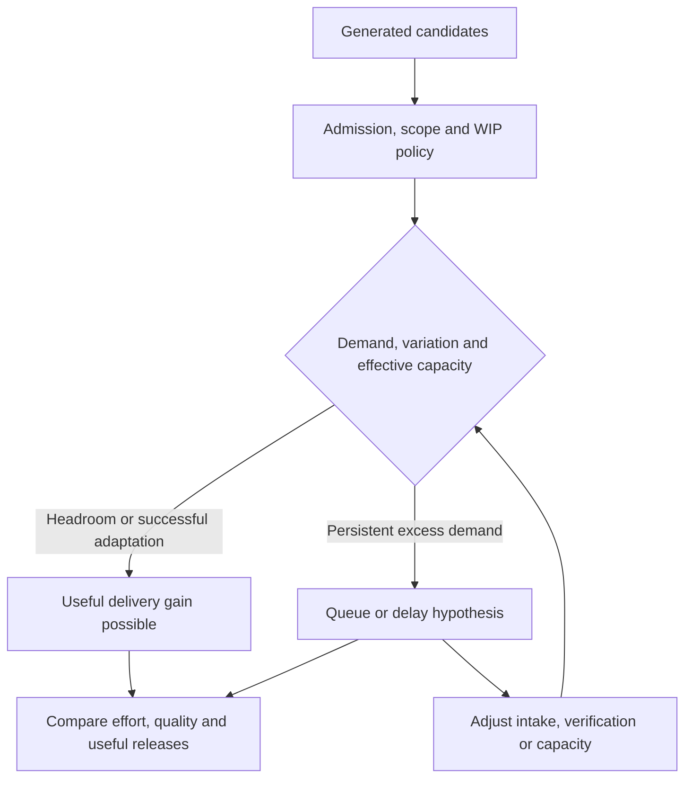

# Part 1: Evidence and Delivery Outcomes

> **Navigation:** [🏠 Home](../README.md) | [🧭 Doctrine](../DOCTRINE.md) | [📖 Glossary](../GLOSSARY.md) | **Part 1** | [⚙️ Part 2: Verification and Delivery Mechanisms](02_broken_mechanics.md) | [🔥 Part 3: Scenarios and Adoption Decisions](03_the_aftermath.md) | [SDLC hypothesis register](appendices/mechanism-hypotheses.md) | [🛡️ Protocols](../protocols/README.md) | [📚 References](../REFERENCES.md)

**Table of Contents:**
*   [Chapter 1. What Productivity Studies Measure](#chapter-1-what-productivity-studies-measure-task-time-and-delivery-outcomes)
    *   [Writing Code vs. Shipping Code](#writing-code-vs-shipping-code)
*   [Chapter 2. Evaluating the Cost of AI-Assisted Delivery](#chapter-2-evaluating-the-cost-of-ai-assisted-delivery)
*   [Chapter 3. Adoption Budgets and Delivery Capability](#chapter-3-adoption-budgets-and-delivery-capability)
*   [Chapter 4. A Review-Capacity Scenario](#chapter-4-a-review-capacity-scenario-when-candidate-work-outruns-verification)
---

## Chapter 1. What Productivity Studies Measure: Task Time and Delivery Outcomes

AI assistance can reduce time on a coding task, add time on another, or change which tasks developers choose. A credible productivity claim therefore needs a population, task, tool vintage and outcome boundary.

The experiments below report different task-time effects. Neither directly measures an enterprise's complete delivery system. The question for this report is when local gains reach production, and under what conditions downstream work absorbs them.

Original methods and limitations matter alongside the headline result, including the funding and affiliations of the research team.

---

### Bounded Experiments: Positive, Negative and Temporally Limited Evidence

| Source and setting | Design and measured outcome | Finding and boundary |
| --- | --- | --- |
| [Peng et al., 2023 preprint](../evidence/primary/2023-copilot-task-productivity.md); experiment in May–June 2022 with GitHub Copilot | 95 developers randomized, 45 treatment and 50 control; 70 task-and-survey completers, 35 per arm. One JavaScript HTTP-server task; time to pass the provided tests | Among completers, **55.8% less completion time** (71.17 versus 160.89 minutes; 95% CI 21–89%). This is positive task-level evidence, conditional on completion; it does not measure production delivery or lifecycle quality. |
| [METR, July 2025 preprint/report](../evidence/primary/2025-metr-experienced-developer-productivity.md); February–June 2025 tools, mainly Cursor Pro with Claude 3.5/3.7 Sonnet | 16 experienced contributors; 246 completed tasks analyzed in familiar mature open-source repositories. Tasks defined before AI-permission randomization; active implementation time before/after review, with some post-review time imputed. Completion/exclusion rules and robustness checks are in the brief | AI allowed was associated with **19% longer task time** in the randomized experiment (95% CI +2 to +39%, as restated in the February 2026 update). Developers forecast 24% less time and retrospectively estimated 20% less time. These perceptions are separate from the measured result; this is not a universal seniority effect. |
| [METR, 24 February 2026 follow-up](../evidence/primary/2026-metr-productivity-design-update.md); experiment begun August 2025 | Later tools and a broader recruited pool; tasks again randomized to allow/disallow AI | Authors consider the current magnitude **unreliably estimated** because participation/task selection and concurrent-agent time measurement changed. They expect more benefit than in early 2025, but describe weak evidence for its size. This update neither establishes a general speedup nor invalidates the historical 2025 result. |

**Repository interpretation:** These are different experiments, not a controlled comparison of juniors and seniors, or of greenfield and brownfield work. Task, participant and tool differences could each contribute to the contrast; their separate causal contributions are not identified here. Time reduction is not an equally sized percentage increase in throughput. Neither the positive nor the negative task result can decide enterprise delivery performance by itself.

### [Observational Activity and Rework: Xu et al., v3](../evidence/primary/2025-xu-copilot-oss-activity.md)

Xu et al. use Copilot's 2021 language availability in Microsoft-owned open-source projects as a quasi-experiment, not a replication of the task-time experiments. The study reports **2,755 repositories and a separately filtered panel of 1,699 contributors**, observed during July 2020–July 2022. Actual individual Copilot use is unobserved; difference-in-differences estimates depend on comparable counterfactual language trends.

* **Positive project activity:** Table 5 reports +17.7% lines added and +4.3% PRs (p<.01), alongside +4.1% commits (only p<.10). These gains do not disappear in the aggregate results.
* **Activity-quartile differences:** Appendix Table 13 reports approximately **+43.5% commits for the bottom pre-treatment activity quartile** and **−19.3% for the top/core quartile**. Core means commit activity, not professional seniority; the bottom quartile does not represent all peripheral contributors.
* **Review and rework proxies:** The top quartile's **+6.5% review-count estimate is uncertain** (Table 11: p=.086; derived 95% interval −0.9 to +14.4%). Table 5 reports **+2.4% repository-month follow-up-commit activity with PR volume controlled**, not per-PR defects. Neither measure is review hours or measured displacement of coding time.

The [brief](../evidence/primary/2025-xu-copilot-oss-activity.md) gives coefficients, transformed-count uncertainty and source-internal reporting discrepancies. The subgroup pattern motivates a redistribution hypothesis; it does not establish its cause, net project value or an enterprise-wide senior penalty.

**Mechanism hypothesis:** Additional generated work could increase review effort when verification capacity does not grow with it. The task-time experiments above do not establish that labor redistribution occurred across teams. Tool friction, task mix and changes in scope are alternative explanations; stable review effort and improved production outcomes would weaken a review-bottleneck explanation in a local deployment.

---

### [Agent Adoption and Code Structure: Agarwal et al., v2](../evidence/primary/2026-agarwal-agent-adoption.md)

Agarwal et al. study **repository-month outcomes after the first observable agent-attributed PR**, using matched staggered difference-in-differences. Their January 2024–November 2025 OSS panels distinguish agent-first (AF: 401 treated/606 controls) from IDE-first (IF: 117/73), using detectable IDE configuration traces. These labels approximate exposure histories; missing traces do not establish no prior AI use. This is not a comparison of purely AI-authored and human-authored codebases.

| Table 2 outcome | Agent-first | IDE-first |
| --- | --- | --- |
| Commits / lines added | **+36.25% / +76.59%**, both p<.001 | +3.06% / −6.34%, both inconclusive at 5% |
| Cognitive/code complexity | **+34.85%**, p<.001 | **+42.87%**, p<.01 |
| Static-analysis warnings | **+17.73%**, p<.001 | +19.00%, inconclusive at 5% |

Positive AF activity gains coexist with higher structural-risk metrics; average IF activity gains are uncertain. Outcomes are aggregated by repository-month, with LOC among the covariates. They do not measure complexity per feature, functional correctness, reviewers' mental effort or lifecycle cost. Figure 2 shows some pre-treatment warning/complexity signals, including IF complexity at t=−2, which the authors acknowledge as a design limitation. A causal interpretation remains conditional on the identification assumptions.

**Repository hypothesis:** More structurally complex changes could increase maintenance or review effort in some deployments. This study does not measure that mechanism. Task mix, repository growth and exposure misclassification are alternatives; direct review-time, defect and production measures are needed. The [brief](../evidence/primary/2026-agarwal-agent-adoption.md) preserves all Table 2 outcomes and the version/publication boundary.

---

### [GitClear Quality Signals: A Historical Vendor Sample](../evidence/primary/2025-gitclear-code-quality.md)

GitClear's February 2025 quality report examines approximately **211 million meaningful changed lines from January 2020–December 2024** in a selected commercial/OSS sample. It describes historical code-change patterns, without identifying individual AI exposure or an AI/no-AI counterfactual. It is a separate dataset from the developer-output report below.

| Quality signal | Comparison and unit | Original locator |
| --- | --- | --- |
| Moved-line operations | **24.65% in 2021 → 9.47% in 2024** of that year's meaningful changed lines | Derived from Appendix A1 p24 counts; relocation is a reuse/refactoring proxy, not all refactoring |
| Copy/pasted-line operations | **8.86% in 2020 → 12.32% in 2024** of meaningful changed lines | Derived from A1 p24 counts; matching contents across functions/files within a commit |
| All-line two-week churn | **3.05% in 2020 → 5.67% in 2024** | Derived from A1 p24 counts; overlaps operation categories and does not directly measure defects |
| Scanned commits containing a clone | **139/19,805 (0.70%) in 2020 → 3,764/56,495 (6.66%) in 2024** | Table p12; at least one detected Type 1 repeated block of ≥5 eligible lines, not the count of duplicated blocks |

These operation shares explicitly use the appendix counts. Some main-table/landing values and multiplier wording differ; the [brief](../evidence/primary/2025-gitclear-code-quality.md) preserves the discrepancies. Clone backfilling prioritized large commits in earlier years (A8 p31), so the scanned sets are not demonstrated to be comparable representative samples. The author's later-year projections are not observations. No interval or causal AI effect is established by these descriptive contrasts.

The patterns motivate investigating maintainability, while the author also describes useful AI-assisted consistency work and acknowledges that early revision can be beneficial. A declining moved-line share does not prove every codebase loses modularity or that review automation must deteriorate. Direct review, defect and maintenance outcomes are needed to test those hypotheses.

### [GitClear Output Growth: Separate Cohorts and Measures](../evidence/primary/2025-gitclear-developer-output.md)

The separate developer-output report compares selected records with a **2022 baseline**. Methods 1/2 follow the same **17,341 contributors with ≥500 commits in each studied year**; their 2025 count is a trailing 365-day window in September/October 2025. Methods 3/4 use different, changing GitClear samples. Actual individual AI use is not measured.

| Output measure | Reported change | Boundary |
| --- | --- | --- |
| Method 1, median annual commit count | **+6.8%** | Ratio of cohort medians; not the median individual change |
| Method 2, median individual commit-count change | **+6.1%** | Each contributor compared with their own baseline |
| Method 3, median Diff Delta | **+14.1%** | Proprietary weighted code-change metric; sample 132 in 2022 / 286 in 2025 |
| Method 4, monthly added-line output | **+131.1% mean / +76.3% median** | Selected developer-month records with ≥50 commits and ≥10 added lines; changing coverage, not a universal team-input multiplier |

These are positive activity results, with different aggregations and populations. The source's **9.0%** composite averages **three** medians: `(6.8 + 6.1 + 14.1) / 3`. Our former two-number formula yields **10.1%**. Neither arithmetic result is a validated net-delivery or causal AI-productivity estimate. Method 1's mean conflicts between the method and summary tables; it and the dependent mean composite are withheld as headline findings. The [brief](../evidence/primary/2025-gitclear-developer-output.md) records the exact conflict, units, selection and window limits. These figures cannot be multiplied by the preceding quality study or other studies into one measured SDLC chain.

---

### From Task Results to Delivery Questions

The positive Peng result belongs in the central comparison above. Its bounded scope does not make it irrelevant; it defines what was tested. METR likewise supplies a bounded negative result for early-2025 tools, followed by a later update with substantial identification limits.

**Repository inference:** A local time saving may improve delivery, be absorbed by other constraints, or be traded for a larger or different output. Distinguishing these outcomes requires downstream measures and an appropriate comparator. It cannot be settled by assuming an unsupported industry-wide percentage of maintenance work or equating repository role with professional seniority.

The next section examines a separate source that explicitly follows activity toward projects and releases. Its findings must retain their own design and population boundaries.

---

### Writing Code vs. Shipping Code

The **September 2026 revision** of Demirer, Musolff and Yang's NBER Working Paper 35275 follows coding activity toward repository outcomes. The authors describe more than 500,000 developers across tool samples, with repeat adopters and much smaller outcome-specific regression samples. Matched observational event studies use earlier-year controls; agent-authored async outcomes instead use interrupted time series. The [version-pinned brief](../evidence/primary/2026-writing-code-vs-shipping-code.md) records methods, uncertainty, sensitivity and the preserved May history.

Figure1 reports cumulative adoption-generation estimates of about **30%, 180% and 240% more commits** for autocomplete, +sync and +async. The final display reaches roughly **80% more distinct repositories touched and 30% more releases**. These are positive downstream results; smaller proportional gains toward releases do not mean zero benefit or overall productivity decline.

They do not track a fixed batch of commits through one funnel. Releases count recently contributed-to repositories with a GitHub release, not the developer's own deployed features, quality or customer value. Table6 gives incremental release estimates of **9.0% (SE5.0)** for autocomplete and **19.8% (SE2.9)** for pooled sync; the former is uncertain at conventional levels. There is **no separate async release estimate**. The cumulative headline must not be relabeled as an additional async effect. Samples and specifications materially affect magnitudes; exact comparisons belong in the brief.

**Model result:** The revision calibrates a substitution elasticity of approximately **0.23** to autocomplete outcomes in an assumed hierarchical production model. The authors' complementarity interpretation is model-dependent, not a directly measured review burden, fixed capacity or replacement ratio. Experiments, selection and changed scope can also contribute to the observed activity pattern; abandoned alternatives are not necessarily defective work.

**Separate descriptive marketplace analysis:** Entry rises or reverses a decline on iOS, Android and Chrome, although Chrome growth predates the agentic period; SourceForge shows a slight entry increase. Three-month new-cohort usage has different proxies: iOS ratings are roughly stable, Android downloads rise modestly, and Chrome's proxy declines on an earlier trend. Chrome uses maxima of observed current-user counts, not directly measured cumulative installs. SourceForge has insufficient usage data for an equivalent comparison. These series are not causal follow-ups of the matched developers or measures of all consumer value. Discovery, demand, selection and adoption lag remain alternatives to a production constraint.

**Repository hypothesis:** Additional admitted verification demand could increase waits when effective capacity, variation and work policies make the stage constrained. Headroom, controlled intake, useful selection or effective assistance could preserve quality and improve delivery. Neither attenuation nor the marketplace series identifies review as the constraint in most organizations. [Chapter4](#chapter-4-a-review-capacity-scenario-when-candidate-work-outruns-verification) and the [claim graph and tests](appendices/mechanism-hypotheses.md) separate evidence, assumptions and proposed consequences.

---

### Unmeasured Work Intensity: A Confounder to Test

Work intensity could confound historical output comparisons. Neither GitClear dataset measures whether participants worked more hours or felt replacement pressure; its activity percentages cannot identify those mechanisms.

**Repository hypothesis:** Adoption expectations might increase overtime or change task selection in some teams. A local study would need hours, task mix, perceived pressure and an appropriate comparator. Stable hours with sustained downstream gains would weaken the overtime explanation. Neither respondent attitudes nor an individual burnout account identifies that causal pathway; they are different evidence from the GitClear results.

**Attitudes and practitioner context:** In the [2024 Stack Overflow survey](../evidence/primary/2024-stackoverflow-ai-attitudes.md), 69.6% of 28,142 professional-developer respondents answered No to whether AI threatened their current job (the publisher rounds to 70%). Overall AI favorability was also mostly positive, while other questions recorded trust and context concerns. These self-selected, question-specific responses do not establish rising fear, overtime or measured productivity.

A [Techno Diaries introduction](../evidence/secondary/2025-technodiaries-review-anecdote.md) contains one first-person claim that review time doubled compared with the same period a year earlier, alongside useful assistance on small tasks. The logs and member-only remainder are unavailable. This motivates measurement; it is not a representative senior-developer estimate or a finding that burnout caused the activity changes above.

---

### Match Productivity Claims to Their Outcome Boundary

Peng's measured task-time reduction is an operational result for a standardized task, not merely sentiment. METR's comparison of forecast and measured time shows that perceptions can diverge from performance in a particular setting. It does not establish that every productivity survey is invalid.

For a claim about enterprise value, ask whether the evidence measures review effort, release completion, defects, production use and total engineering cost over an adequate period. A task experiment alone establishes neither an improvement nor a deterioration in those outcomes. The absence of those measures in these experiments is not evidence that no relevant vendor or external research exists. This is a comparison of the identified sources reviewed here, not a comprehensive search of vendor or enterprise evaluations; task experiments, surveys and documentary revenue statements answer different questions.

**Proposed measurement practice:** Publish task definitions, tool dates, population, comparator and uncertainty alongside the outcome. Keep task-time results, self-reported experience, activity counts and delivery measures separate. Apply the same scope requirements to positive and negative findings.

---

### Governance and Marketing Claims

Claims about faster coding should specify what was measured and the safeguards required in the intended setting. GitClear's selected historical samples do not establish an industry-wide default failure mode or a vendor's responsibility for a particular defect.

**Proposed disclosure practice:** State task/tool scope, comparator, review and production outcomes, and material limitations. Responsibility for tool design, deployment choices and accepted changes should remain inspectable. Criticism should address a specific claim or operating choice with evidence; the code-change metrics do not establish vendor intent or misconduct.

---

### Economic Hypothesis: Count Downstream Work

A subscription purchases a capability; its economic result depends on verified benefits and the work required to absorb it. More candidate code could increase downstream cost when review, testing or maintenance capacity is constrained, but neither GitClear study measures lifecycle TCO or inevitable maintenance-budget failure.

Testing this hypothesis requires total engineering effort, quality, release and operating costs alongside delivered value. A deployment with sustained delivery gains and stable or lower total cost would limit the hypothesis's applicability.

---

### Conclusion: Separate Task Time from Delivery Performance

The experiments establish a positive effect on conditional completion time in Peng's standardized task and a negative effect on active task time in METR's familiar-repository setting with early-2025 tools. The 2026 follow-up leaves the present magnitude uncertain. They do not establish an industry-wide slowdown or a universal penalty for experienced developers.

**Repository hypothesis:** Where additional upstream work exceeds downstream verification and release capacity, local acceleration may increase queues or rework rather than delivered value. A deployment with shorter production lead time and stable or improved quality would limit that hypothesis's applicability. Code quality and maintenance effects require separate evidence; they cannot be read out of these task-time percentages.

Xu likewise reports positive project activity alongside heterogeneous contributor activity; Agarwal reports substantial AF activity gains, uncertain IF activity gains and mode-specific structural metrics. These observational results do not establish disappearing aggregate gains, per-feature debt or measured cognitive load. They belong beside the task experiments as different evidence, not additional stages of one causal estimate.

GitClear adds positive selected-cohort output trends and historical quality-proxy signals in separate datasets. Its composite is not net delivery, and its clone/reuse measures do not prove a universal maintenance or staffing outcome.

The practical implication is to measure the complete delivery boundary while retaining local benefits and costs as distinct results.

---

#### References

* **METR Study (July 2025):** [Paper v2](https://arxiv.org/abs/2507.09089v2) and [evidence brief](../evidence/primary/2025-metr-experienced-developer-productivity.md) — 16 experienced contributors, 246 completed familiar open-source tasks analyzed, early-2025 tools; AI allowed increased task time by 19% (95% CI +2 to +39%, restated in the February 2026 update). The brief records exclusion/imputation rules; forecast and retrospective perceptions differ from measured time.
* **METR Follow-up (24 February 2026):** [Author update](https://metr.org/blog/2026-02-24-uplift-update/) and [evidence brief](../evidence/primary/2026-metr-productivity-design-update.md) — later experiment; authors report selection and time-measurement problems that prevent a reliable current magnitude estimate.
* **Xu et al. (arXiv v3, 28 January 2026):** [Paper](https://arxiv.org/abs/2510.10165v3) and [evidence brief](../evidence/primary/2025-xu-copilot-oss-activity.md) — 2,755 OSS repositories/1,699 contributors; positive project activity and activity-quartile differences. Core is not seniority; the +6.5% core review-count estimate has p=.086, not an established increase in review hours. Rework is a repository-month proxy with PR count controlled.
* **Agarwal et al. (arXiv v2; MSR 2026 Mining Challenge):** [Reviewed v2](https://arxiv.org/abs/2601.13597v2) and [evidence brief](../evidence/primary/2026-agarwal-agent-adoption.md) — separate AF/IF repository-month panels, positive AF activity and heterogeneous structure estimates; IF activity/warning estimates are inconclusive. Static metrics do not measure human cognitive load or per-feature debt. Final publisher-edition equivalence was not checked.
* **Peng et al. (arXiv v1, 2023):** [The Impact of AI on Developer Productivity: Evidence from GitHub Copilot](https://arxiv.org/abs/2302.06590v1) and [evidence brief](../evidence/primary/2023-copilot-task-productivity.md) — 95 randomized (45/50), 70 task-and-survey completers (35/35); 55.8% less completion time among completers on one JavaScript task (95% CI 21–89%). Experience heterogeneity is exploratory, not a universal seniority rule.
* **GitClear quality (February 2025, v2025.2.5):** [Full original PDF](https://gitclear-public.s3.us-west-2.amazonaws.com/GitClear-AI-Copilot-Code-Quality-2025.pdf) and [brief](../evidence/primary/2025-gitclear-code-quality.md) — 2020–24 operation/clone signals in selected samples; exact fractions, sampling, appendix/body/landing conflicts and projections are distinguished.
* **GitClear developer output (publisher date 1 October 2025; inspected 20 October 2026):** [Original report](https://www.gitclear.com/research/ai_tool_impact_on_developer_productive_output_from_2022_to_2025) and [brief](../evidence/primary/2025-gitclear-developer-output.md) — separate cohort/aggregation results; positive activity, unobserved AI exposure and internal Method 1 mean discrepancy, not net-delivery productivity.
* **Demirer, Musolff and Yang (NBER Working Paper 35275, September 2026 revision):** [Evidence brief and version boundary](../evidence/primary/2026-writing-code-vs-shipping-code.md) — positive coding/release estimates with attenuation, a calibrated model and separate descriptive marketplace series. Exact revised original and historical versions are identified in the brief.
* **Techno Diaries (29 October 2025):** [Public introduction and source brief](../evidence/secondary/2025-technodiaries-review-anecdote.md) — one unaudited first-person review-time account; member-only remainder unavailable. Practitioner context, not a population estimate.
* **Stack Overflow Developer Survey (2024):** [AI results](https://survey.stackoverflow.co/2024/ai) and [source brief](../evidence/primary/2024-stackoverflow-ai-attitudes.md) — question-specific attitudes, including mostly favorable sentiment and a majority reporting no current-job threat; not a fear/overtime trend.

---

## Chapter 2. Evaluating the Cost of AI-Assisted Delivery

A coding-tool invoice is one input to a delivery decision. The relevant comparison is a defined use case with and without assistance, at comparable quality and scope, including benefits and any additional work. Neither corporate spending totals nor faster code production determines the result for another organization.

### Historical Engineering Context

Google’s *Software Engineering at Google* was published in **March 2020**. Chapter 23 describes TAP running **more than four billion individual test cases daily**; Chapters 9/19 describe human review supported by Critique, and Chapter 20 describes static analysis and its tradeoffs. These are historical practice descriptions, not current universal limits or evidence that automation eliminates human judgment. The [documentary brief](../evidence/documentary/2020-google-engineering-practices.md) gives exact sections and boundaries.

This example shows a surrounding engineering system, without pricing it or proving that every AI deployment needs a comparable platform. The former exact 4.2-billion count, billion-dollar platform estimates and construction timelines were not established by the inspected source and are withdrawn.

Alphabet, Meta and Microsoft report substantial company-wide research expenses and cash investment. Those amounts cover many businesses and assets; they are not budgets for verifying AI-generated code. Their exact 2024 statement lines, Meta’s lease-principal reconciliation and Microsoft’s different fiscal period belong in the [historical cost-context appendix](appendices/cost-context.md#company-wide-2024-records). They do not calibrate a customer’s adoption budget or establish the cause of an internal productivity gain.

### Build a Conditional Budget

The former **$7–27M transformation table**, **30–120-times license multiplier** and **1–3% license share** did not have a traceable empirical basis for their scope, timing or incremental allocation. They are withdrawn as benchmarks. Adding one-time programs to recurring labor and comparing the sum with one year of licenses does not establish a universal cost requirement.

The [conditional sensitivity appendix](appendices/tco-sensitivity.md) instead exposes hypothetical paid seats, price, new external setup, annual cash, already-funded staff effort and existing-platform allocation. It separates the first year from a subsequent steady year and allows released capacity as well as added effort. Every input is an explicit assumption; no market price, forecast or typical-enterprise estimate is implied. The examples reproduce arithmetic, not a measured ROI or complete TCO.

Some teams may reuse sufficient capability and realize net benefits; others may need additional investment or face more rework. A local baseline and measured change distinguish those cases. An existing platform’s allocated cost should be visible, but relabeling its entire sunk or already-funded cost as a new AI expense would overstate the incremental budget.

### Market Spending Is Different from Local Economics

[Menlo’s original 2025 report](../evidence/primary/2025-menlo-enterprise-ai-spend.md) combines a U.S. enterprise survey with market sizing. Its estimated spending growth uses a revised historical boundary, not a sample of software-maintenance bills. [CloudZero’s original survey](../evidence/primary/2025-cloudzero-ai-budget-intentions.md) contrasts retrospective spending reports with future budget intentions, and contains an unresolved percentage/threshold discrepancy. The [context appendix](appendices/cost-context.md) preserves exact figures, methods and limits. Both sources also report positive adoption/value perceptions; spending growth alone is not evidence of waste.

Artur Markus’s [2026 practitioner commentary](../evidence/secondary/2026-inference-cost-commentary.md) proposes a Jevons-style demand rebound. That is a possible interpretation, not proof that cheaper tokens caused code debt or higher verification costs. A matched price, capability, volume and outcome comparison is needed to separate demand expansion from price, mix, new useful applications or rework. The former +320% and same-period 1,000-fold retellings are not adopted.

### Measure Costs and Delivered Value Together

A decision record should distinguish:

- new license/usage, setup and recurring cash costs from existing funded capability;
- one-time work from recurring operations, with paid seat count and period;
- additional or released engineering capacity from actual payroll/cash savings;
- delivered benefits, quality, rework and risk over the same comparison boundary.

This is a proposed measurement practice, not a validated universal operating model. If useful delivery improves at stable or lower comparable total cost, with stable or improved quality, that weakens the adverse cost scenario. If setup, supervision and rework exceed benefits, a deployment may require adjustment or rejection. The source records here do not assign relative probabilities or imply that every positive ROI claim is false.

A rollout could increase candidate work faster than a team can absorb it, so capacity and total cost should be measured alongside tool adoption. GitClear's selected added-line averages do not establish a universal 2x team-input increase, an 18-month maintenance bill or burnout.

#### References

- **Google, March 2020:** [Engineering-practices brief](../evidence/documentary/2020-google-engineering-practices.md), Chapters 9/19/20/23 — historical tooling and human review, not a platform budget.
- **Alphabet CY2024:** [Exact filing and accounting-line brief](../evidence/documentary/2024-alphabet-financial-context.md).
- **Meta CY2024:** [Exact filing and lease-principal reconciliation](../evidence/documentary/2024-meta-financial-context.md).
- **Microsoft FY2024, ended 30 June:** [Exact annual-report lines and fiscal boundary](../evidence/documentary/2024-microsoft-financial-context.md).
- **Menlo, 9 December 2025:** [Original market-model brief](../evidence/primary/2025-menlo-enterprise-ai-spend.md).
- **CloudZero, March 2025 survey:** [Original budget-intentions brief](../evidence/primary/2025-cloudzero-ai-budget-intentions.md).
- **Markus, 2 January 2026:** [Secondary interpretation and original-source corrections](../evidence/secondary/2026-inference-cost-commentary.md).
- **Repository analysis:** [Hypothetical sensitivity model](appendices/tco-sensitivity.md) — explicit inputs, formulas, outputs and reproduction.

---

## Chapter 3. Adoption Budgets and Delivery Capability

Chapter 1 reports different task-time effects in different settings; it does not establish that senior engineers generally slow down. The business question is how adoption decisions account for such variation and for the conditional cost comparison discussed in Chapter 2. The market-pressure explanation below is a proposed mechanism, not a finding of the productivity experiments.

Market pressure is one possible influence on adoption budgets. It does not establish a capability shortfall or a need to redesign every team's operating model.

---

### The Mechanics of the "Execution Mandate"

The proposed mechanism begins when adoption expectations are set before the work and capability needed for a defined use case have been assessed.

**Adoption-pressure hypothesis:** Headlines about large coding-task gains could encourage rapid rollout or cost-cutting expectations. The [bounded experiments in Chapter 1](#bounded-experiments-positive-negative-and-temporally-limited-evidence) do not measure investor pressure or establish enterprise savings. Evidence about adoption decisions and resulting delivery outcomes would be needed to test this mechanism.

In this scenario, leadership approves adoption without assessing whether existing review, testing, integration and operating capability is sufficient. A license-only budget creates a gap if additional necessary work is identified and left unfunded; it may be adequate when the required capability already exists.

An illustrative **"Execution Mandate"** might read as follows. This is an invented example, not a recorded board quotation:

> *"Implement AI. Here is the budget for licenses. Here is a small budget for a prompt engineering workshop. Go."*

A license-only budget can omit additional work needed for a particular rollout. A subscription is not automatically a capital investment, and approving licenses does not itself establish a volume increase or a capacity shortfall. Chapter 2 proposes comparing incremental costs, reused capability and delivered benefits; the governance-risk mechanism here requires separate observations.

---

### Enterprise Surveys: Use, Benefits and Scaling Are Different Outcomes

[McKinsey's November 2025 survey](../evidence/primary/2025-mckinsey-ai-adoption-value.md) collected 1,993 responses in 105 countries between 25 June and 29 July 2025. These are respondent reports about organizations, not a census of companies or an experiment on coding-tool ROI.

| Reported measure | Meaning |
| --- | --- |
| **88%** | Regular AI use in at least one business function; not necessarily coding-tool licenses or enterprise-wide deployment |
| **39%** | Any enterprise EBIT impact attributed to AI; most of these respondents attributed less than 5% of EBIT to AI |
| **About 6%** | Joint high-performer classification: at least 5% of EBIT attributed to AI **and** significant value, following the narrative definition; the brief records the exhibit's slightly different threshold wording |

The report also describes positive use-case cost/revenue benefits and improved innovation, while most organizations remain short of enterprise-wide scaling. The 6% group is not everyone deriving value, and subtracting it from 88% does not estimate unprofitable adoption, a missing-budget share or its cause. Neither regular use nor an EBIT attribution establishes a return after all investment costs.

[Deloitte's identified January 2025 quarter-four report](../evidence/primary/2025-deloitte-genai-q4.md) surveyed 2,773 AI-active senior leaders in 14 countries during July–September 2024. For **one selected most advanced/scaled initiative**, 74% reported meeting or exceeding ROI expectations (43% meeting plus 31% exceeding). At the same time, over two-thirds expected 30% or fewer of their current experiments to be fully scaled within 3–6 months. The latter is a near-term expectation, not an observed failure rate.

The surveys have different populations, questions, dates and outcome boundaries. They provide mixed enterprise context, not a common causal estimate or an admission that AI adoption failed. Their findings are compatible with useful gains, scaling challenges and uncertainty about total returns.

---

### Market Commentary and Supplier Revenue

> **Context, separate from measured effects:** In personal posts dated 6 February 2026 and 28 January 2026, Andreas Horn respectively [describes favorable agent experience and forecasts rapid capability/employment change](../evidence/secondary/2026-horn-capability-commentary.md), and [argues for engineering constraints around generated code](../evidence/secondary/2026-horn-engineering-commentary.md). These are one author's interpretations, not IBM endorsement, measured boardroom behavior or independent validation of METR. Neither post calibrates this report's delivery-risk scenario.

Supplier revenue answers another question. [Microsoft's 29 January 2025 FY25Q2 release](../evidence/documentary/2025-microsoft-fy25q2-ai-run-rate.md) attributes to chairman and CEO Satya Nadella an **annual revenue run rate above $13 billion for the overall AI business**. That is not disclosed Copilot revenue, a full year's recognized revenue or a measure of customer ROI. It cannot identify why customers adopted the tools.

**Repository hypothesis:** Market expectations could influence adoption budgets. Testing the proposed execution-mandate mechanism requires actual decisions, local budgets, capability and delivery outcomes. The surveys, personal commentary and revenue statement do not by themselves show investor coercion, vendor intent or underfunding. Existing controls, smaller changes or useful review assistance could preserve gains without a large transformation programme.

---

### An Illustrative Boundary: Disposable Prototypes and Durable Systems

This illustrative "Execution Mandate" can mislead when it ignores context.

Consider a time-limited prototype used to test a product hypothesis, with an explicit decision that its code can be discarded and does not yet carry durable production obligations. Under those assumptions, rapid iteration with bounded verification may be useful. This is an illustrative case, not a description of startups as a class or a guarantee of survival or a later rewrite.

For a startup or an established enterprise maintaining a durable system, the comparison includes later integration, operation and maintenance as well as initial implementation. Organizational age does not remove those obligations. No universal post-deployment TCO percentage is established by the sources reviewed in Chapter 2.

**Conditional cost-risk scenario:** Short-term coding savings could be outweighed by extra verification or maintenance if that additional work exceeds delivered benefits. Reusing sufficient capability or sustaining useful gains at stable or lower comparable cost would weaken this scenario. Neither a lifecycle cost share nor a future dollar loss is measured here.

---

### Measure Adoption and Delivered Outcomes Together

An adoption dashboard can answer whether tools are used. It cannot by itself show whether a defined deployment improved delivery, quality or comparable total cost. The surveys above also record benefits; their scaling limits do not imply that every executive dashboard hides deteriorating code.

**Proposed measurement practice:** Track adoption alongside lead time, completed releases, review effort, quality and operating cost, preserving the population and period for each measure. A local comparison might reveal gains, new constraints or both. A benchmark completion probability is not the share of enterprise changes that become defective assets.

---

### Conclusion: Test the Capability Gap Before Prescribing Transformation

The budget error examined here is conditional: assuming tool-level gains will reach delivery without checking any additional work required for the chosen use case. The absence of a large transformation programme does not establish that error.

Where measured review, integration or maintenance needs exceed existing capability, targeted process or capacity changes may be justified. If existing capability is sufficient and useful delivery improves at comparable or lower total cost, with stable or improved quality, that weakens the adverse scenario. No universal ranking of typing and thinking costs, or minimum transformation spend, follows from the sources in Chapter 2.

---

#### References

* **McKinsey (5 November 2025):** [Original survey and pinned PDF in the brief](../evidence/primary/2025-mckinsey-ai-adoption-value.md) — regular use, EBIT attribution and joint high-performer definition remain separate; positive functional benefits and selection limits are retained.
* **Deloitte AI Institute (January 2025):** [Identified Q4 original and source brief](../evidence/primary/2025-deloitte-genai-q4.md) — July–September 2024 sample; most advanced initiative's ROI expectations and near-term experiment-scaling expectations. Explicit replacement for an unpinned series citation, not a recovered Q3 2025 edition.
* **Andreas Horn (6 February 2026 / 28 January 2026):** [Capability commentary](../evidence/secondary/2026-horn-capability-commentary.md) and [engineering-risk commentary](../evidence/secondary/2026-horn-engineering-commentary.md) — two personal posts, not organizational endorsement or independent empirical evidence.
* **Microsoft (29 January 2025):** [FY25Q2 original release and documentary brief](../evidence/documentary/2025-microsoft-fy25q2-ai-run-rate.md) — management's overall AI-business annual run rate, not Copilot revenue or customer return.

---

## Chapter 4. A Review-Capacity Scenario: When Candidate Work Outruns Verification

Chapter 1 reports positive and mixed activity findings, plus static-analysis signals with design and uncertainty limits. Xu and Agarwal do not establish a universal decline in quality or a measured review bottleneck. This chapter proposes a conditional systems scenario: additional candidate work could exceed review and validation capacity. Its assumptions and downstream consequences require local evidence.

Goldratt and Cox's **Theory of Constraints** is a methodological lens, not evidence identifying a team's constraint or an AI effect. The [methodology record](../evidence/methodology/1984-the-goal.md) explicitly retains an unresolved original-book edition/access gap. The assumptions below are repository proposals; they are not a theorem quoted from that edition.

---

### Which Stage Constrains This Use Case?

Consider coding, review, validation and release stages. If coding initially limits delivery and later stages have headroom, faster implementation can increase useful releases. If review already limits delivery, extra candidate output need not increase throughput; faster coding can still save effort or enable better task selection. Neither case establishes that coding speed is useless or that every team must encounter a new bottleneck.

A constraint can move, be shared across stages or be a release policy rather than a person. Compare production outcomes before selecting a response.

---

### Admitted Work Meets Effective Capacity

**Conditional repository mechanism:** generated candidates are not automatically admitted work. A queue hypothesis needs the following measured conditions, with comparable units and observation windows:

- **Admission and risk mix:** Which candidates enter review, and how much verification does each require? PR/line counts alone omit size, risk, familiarity and rejected work.
- **Effective service capacity:** Available reviewer/validator time, skills, context, tools and required quality determine processing capacity. Constant headcount or budget does not imply fixed effective capacity.
- **Utilization and variation:** Average demand below capacity does not rule out burst-related waits, uneven skills or long-tail tasks. Persistently greater admitted demand suggests an accumulating backlog only while work cannot be completed, redirected or withdrawn; no waiting-time multiplier is calibrated here.
- **WIP and release policies:** Pull limits, smaller changes, batching and release calendars can prevent or relocate a queue. A deliberate scheduled wait is different from evidence of overload.

Demand and service capacity must be estimated independently of observing a queue, over a defined stage and window. Record opening WIP, admissions, completions, withdrawals and transfers; backlog accounting itself is not an empirical discovery about AI. The arrows describe assumptions and proposed relationships, not a path measured in one source. Xu's positive project activity, Agarwal's mode-specific activity and structural estimates, and GitClear's [selected output measures](../evidence/primary/2025-gitclear-developer-output.md) do not jointly calibrate arrival rates, review service time or a universal volume multiplier.

---

### The Inventory Problem

Queued software work can carry coordination and context costs. The following are possible relationships in this scenario, not measured rates:

* **WIP (Work In Progress):** A larger queue could increase switching costs. [Xu v3](../evidence/primary/2025-xu-copilot-oss-activity.md) finds fewer commits in the core activity quartile, but its review-count increase is uncertain (p=.086). It measures neither WIP nor review hours and does not prove that senior engineers stopped building to triage.
* **Merge Conflicts:** Longer waits could create extra reconciliation work when overlapping changes continue. The rate depends on the repository and change mix; no exponential multiplier is established here.
* **Cognitive Load:** More structurally complex changes may be harder to inspect. [Agarwal v2](../evidence/primary/2026-agarwal-agent-adoption.md) reports repository-month complexity estimates of +34.85% (AF) and +42.87% (IF), not human cognitive load or time per review. The proposed link requires direct local measurement.
* **Stale Context:** A queued change may need reevaluation against a newer codebase; this depends on intervening changes and available context.

**Repository hypothesis:** More or less review effort is possible depending on change size, familiarity, risk and available assistance. Measure review hours and quality directly; no general 2–3× multiplier is established by the retained source set.

---

### Possible Responses at a Constrained Review Stage

If review demand exceeds capacity, a team might experience longer queues or pressure to shorten checks. These are adverse possibilities, not the only choices or an observed response distribution.

- **Maintain the review boundary:** Intake may have to wait or shrink if review capacity cannot grow. That need not imply burnout or poor delivery management.
- **Reduce scrutiny without adequate verification:** Some defects could escape. The frequency and consequences require observation; no source here establishes that this is the inevitable or individually rational choice.
- **Adapt the workflow:** Smaller changes, intake limits, targeted checks or useful review assistance could preserve quality and improve flow.

The report's **Rubber Stamp Trap** names the second risk scenario. It does not establish that senior engineers generally approve unverified changes or that adoption necessarily rewards this behavior.

---

### A Feedback Hypothesis With Conditions

License procurement alone does not identify a capacity gap. A possible adverse loop requires additional conditions at each edge:

1. **More admitted service demand:** Extra candidates enter the pipeline without sufficient rejection, smaller changes or offsetting effort savings.
2. **Longer waits:** Demand and variation exceed effective capacity under the chosen WIP/release policy.
3. **Additional verification or rework:** Waiting/intervening changes or unfamiliarity actually increase effort; context tools may prevent this.
4. **Quality or capacity consequences:** Inadequate checks could permit defects, or rework could displace planned work. These require measured defects and role-hours, not an assumption of rubber stamping or burnout.

Stable or falling WIP/review effort with useful delivery gains would weaken an inevitable-harm account. If intake controls or new capacity prevented the trigger, this is nonactivation or adaptation, not disconfirmation of harm under that trigger. Lower total effort can coexist with more review effort; test those endpoints separately. Growing queues could instead reflect changing task mix, staff absence, release batching or a non-review constraint. [Hypotheses H1–H4 and their tests](appendices/mechanism-hypotheses.md) preserve these alternatives and beneficial/null outcomes; no probability is assigned to the scenarios.

---

### Conclusion: Test the Constraint

A faster upstream stage can improve delivery when downstream stages can absorb the work. If review is already constrained, more candidate changes may instead grow the queue. This conditional distinction is the point of the scenario; it is not a finding that AI only optimizes typing or necessarily worsens delivery.

Xu's positive project activity and Agarwal's positive AF activity remain compatible with either outcome. Their measures do not establish review hours, production lead time or a universal senior bottleneck. Measure those outcomes before attributing a local traffic jam to the proposed mechanism or selecting a capacity intervention.

---

#### References

* **Goldratt and Cox, *The Goal* (first published 1984):** [Methodology record and original-access limitation](../evidence/methodology/1984-the-goal.md). Interpretive lens; the repository does not claim an edition/page-verified universal inventory theorem or an empirical AI effect.
* **Cross-references:** [Xu](../evidence/primary/2025-xu-copilot-oss-activity.md) measures activity and follow-up-commit/review-count proxies; [Agarwal](../evidence/primary/2026-agarwal-agent-adoption.md) measures repository-month activity and static metrics by exposure history. Their positive, null and uncertain estimates remain distinct from a measured review bottleneck. METR's productivity experiment measures task time, not these measures; see Chapter 1 for boundaries. GitClear's [quality proxies](../evidence/primary/2025-gitclear-code-quality.md) and [selected output metrics](../evidence/primary/2025-gitclear-developer-output.md) retain separate samples/units.

---

**Next:** [⚙️ Part 2: Verification and Delivery Mechanisms](02_broken_mechanics.md)
