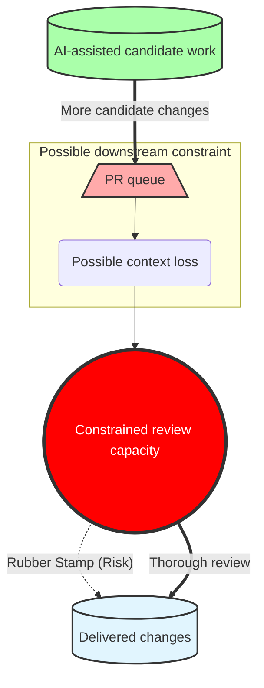

# Part 1: The Illusion of Speed

> **Navigation:** [🏠 Home](../README.md) | [🧭 Doctrine](../DOCTRINE.md) | [📖 Glossary](../GLOSSARY.md) | **Part 1** | [⚙️ Part 2: Broken Mechanics](02_broken_mechanics.md) | [🔥 Part 3: The Aftermath](03_the_aftermath.md) | [🛡️ Protocols](../protocols/README.md) | [📚 References](../REFERENCES.md)

**Table of Contents:**
*   [Chapter 1. What Productivity Studies Measure](#chapter-1-what-productivity-studies-measure-task-time-and-delivery-outcomes)
    *   [Writing Code vs. Shipping Code](#writing-code-vs-shipping-code)
*   [Chapter 2. The Missing Price Tag](#chapter-2-the-missing-price-tag-the-true-cost-of-making-ai-work)
*   [Chapter 3. The "Free Lunch" Trap](#chapter-3-the-free-lunch-trap-why-the-board-chooses-a-strategy-of-degradation)
*   [Chapter 4. A Review-Capacity Scenario](#chapter-4-a-review-capacity-scenario-when-candidate-work-outruns-verification)
---

## Chapter 1. What Productivity Studies Measure: Task Time and Delivery Outcomes

AI assistance can reduce time on a coding task, add time on another, or change which tasks developers choose. A credible productivity claim therefore needs a population, task, tool vintage and outcome boundary.

The experiments below report different task-time effects. Neither directly measures an enterprise's complete delivery system. The question for this report is when local gains reach production, and under what conditions downstream work absorbs them.

Original methods and limitations matter alongside the headline result, including the funding and affiliations of the research team.

---

### Bounded Experiments: Positive, Negative and Temporally Limited Evidence

| Source and setting | Design and measured outcome | Finding and boundary |
| --- | --- | --- |
| [Peng et al., 2023 preprint](../evidence/primary/2023-copilot-task-productivity.md); experiment in May–June 2022 with GitHub Copilot | 95 developers randomized, 45 treatment and 50 control; 70 task-and-survey completers, 35 per arm. One JavaScript HTTP-server task; time to pass the provided tests | Among completers, **55.8% less completion time** (71.17 versus 160.89 minutes; 95% CI 21–89%). This is positive task-level evidence, conditional on completion; it does not measure production delivery or lifecycle quality. |
| [METR, July 2025 preprint/report](../evidence/primary/2025-metr-experienced-developer-productivity.md); February–June 2025 tools, mainly Cursor Pro with Claude 3.5/3.7 Sonnet | 16 experienced contributors; 246 completed tasks analyzed in familiar mature open-source repositories. Tasks defined before AI-permission randomization; active implementation time before/after review, with some post-review time imputed. Completion/exclusion rules and robustness checks are in the brief | AI allowed was associated with **19% longer task time** in the randomized experiment (95% CI +2 to +39%, as restated in the February 2026 update). Developers forecast 24% less time and retrospectively estimated 20% less time. These perceptions are separate from the measured result; this is not a universal seniority effect. |
| [METR, 24 February 2026 follow-up](../evidence/primary/2026-metr-productivity-design-update.md); experiment begun August 2025 | Later tools and a broader recruited pool; tasks again randomized to allow/disallow AI | Authors consider the current magnitude **unreliably estimated** because participation/task selection and concurrent-agent time measurement changed. They expect more benefit than in early 2025, but describe weak evidence for its size. This update neither establishes a general speedup nor invalidates the historical 2025 result. |

**Repository interpretation:** These are different experiments, not a controlled comparison of juniors and seniors, or of greenfield and brownfield work. Task, participant and tool differences could each contribute to the contrast; their separate causal contributions are not identified here. Time reduction is not an equally sized percentage increase in throughput. Neither the positive nor the negative task result can decide enterprise delivery performance by itself.

### [Observational Activity and Rework: Xu et al., v3](../evidence/primary/2025-xu-copilot-oss-activity.md)

Xu et al. use Copilot's 2021 language availability in Microsoft-owned open-source projects as a quasi-experiment, not a replication of the task-time experiments. The study reports **2,755 repositories and a separately filtered panel of 1,699 contributors**, observed during July 2020–July 2022. Actual individual Copilot use is unobserved; difference-in-differences estimates depend on comparable counterfactual language trends.

* **Positive project activity:** Table 5 reports +17.7% lines added and +4.3% PRs (p<.01), alongside +4.1% commits (only p<.10). These gains do not disappear in the aggregate results.
* **Activity-quartile differences:** Appendix Table 13 reports approximately **+43.5% commits for the bottom pre-treatment activity quartile** and **−19.3% for the top/core quartile**. Core means commit activity, not professional seniority; the bottom quartile does not represent all peripheral contributors.
* **Review and rework proxies:** The top quartile's **+6.5% review-count estimate is uncertain** (Table 11: p=.086; derived 95% interval −0.9 to +14.4%). Table 5 reports **+2.4% repository-month follow-up-commit activity with PR volume controlled**, not per-PR defects. Neither measure is review hours or measured displacement of coding time.

The [brief](../evidence/primary/2025-xu-copilot-oss-activity.md) gives coefficients, transformed-count uncertainty and source-internal reporting discrepancies. The subgroup pattern motivates a redistribution hypothesis; it does not establish its cause, net project value or an enterprise-wide senior penalty.

**Mechanism hypothesis:** Additional generated work could increase review effort when verification capacity does not grow with it. The task-time experiments above do not establish that labor redistribution occurred across teams. Tool friction, task mix and changes in scope are alternative explanations; stable review effort and improved production outcomes would weaken a review-bottleneck explanation in a local deployment.

---

### [Agent Adoption and Code Structure: Agarwal et al., v2](../evidence/primary/2026-agarwal-agent-adoption.md)

Agarwal et al. study **repository-month outcomes after the first observable agent-attributed PR**, using matched staggered difference-in-differences. Their January 2024–November 2025 OSS panels distinguish agent-first (AF: 401 treated/606 controls) from IDE-first (IF: 117/73), using detectable IDE configuration traces. These labels approximate exposure histories; missing traces do not establish no prior AI use. This is not a comparison of purely AI-authored and human-authored codebases.

| Table 2 outcome | Agent-first | IDE-first |
| --- | --- | --- |
| Commits / lines added | **+36.25% / +76.59%**, both p<.001 | +3.06% / −6.34%, both inconclusive at 5% |
| Cognitive/code complexity | **+34.85%**, p<.001 | **+42.87%**, p<.01 |
| Static-analysis warnings | **+17.73%**, p<.001 | +19.00%, inconclusive at 5% |

Positive AF activity gains coexist with higher structural-risk metrics; average IF activity gains are uncertain. Outcomes are aggregated by repository-month, with LOC among the covariates. They do not measure complexity per feature, functional correctness, reviewers' mental effort or lifecycle cost. Figure 2 shows some pre-treatment warning/complexity signals, including IF complexity at t=−2, which the authors acknowledge as a design limitation. A causal interpretation remains conditional on the identification assumptions.

**Repository hypothesis:** More structurally complex changes could increase maintenance or review effort in some deployments. This study does not measure that mechanism. Task mix, repository growth and exposure misclassification are alternatives; direct review-time, defect and production measures are needed. The [brief](../evidence/primary/2026-agarwal-agent-adoption.md) preserves all Table 2 outcomes and the version/publication boundary.

---

### [GitClear Quality Signals: A Historical Vendor Sample](../evidence/primary/2025-gitclear-code-quality.md)

GitClear's February 2025 quality report examines approximately **211 million meaningful changed lines from January 2020–December 2024** in a selected commercial/OSS sample. It describes historical code-change patterns, without identifying individual AI exposure or an AI/no-AI counterfactual. It is a separate dataset from the developer-output report below.

| Quality signal | Comparison and unit | Original locator |
| --- | --- | --- |
| Moved-line operations | **24.65% in 2021 → 9.47% in 2024** of that year's meaningful changed lines | Derived from Appendix A1 p24 counts; relocation is a reuse/refactoring proxy, not all refactoring |
| Copy/pasted-line operations | **8.86% in 2020 → 12.32% in 2024** of meaningful changed lines | Derived from A1 p24 counts; matching contents across functions/files within a commit |
| All-line two-week churn | **3.05% in 2020 → 5.67% in 2024** | Derived from A1 p24 counts; overlaps operation categories and does not directly measure defects |
| Scanned commits containing a clone | **139/19,805 (0.70%) in 2020 → 3,764/56,495 (6.66%) in 2024** | Table p12; at least one detected Type 1 repeated block of ≥5 eligible lines, not the count of duplicated blocks |

These operation shares explicitly use the appendix counts. Some main-table/landing values and multiplier wording differ; the [brief](../evidence/primary/2025-gitclear-code-quality.md) preserves the discrepancies. Clone backfilling prioritized large commits in earlier years (A8 p31), so the scanned sets are not demonstrated to be comparable representative samples. The author's later-year projections are not observations. No interval or causal AI effect is established by these descriptive contrasts.

The patterns motivate investigating maintainability, while the author also describes useful AI-assisted consistency work and acknowledges that early revision can be beneficial. A declining moved-line share does not prove every codebase loses modularity or that review automation must deteriorate. Direct review, defect and maintenance outcomes are needed to test those hypotheses.

### [GitClear Output Growth: Separate Cohorts and Measures](../evidence/primary/2025-gitclear-developer-output.md)

The separate developer-output report compares selected records with a **2022 baseline**. Methods 1/2 follow the same **17,341 contributors with ≥500 commits in each studied year**; their 2025 count is a trailing 365-day window in September/October 2025. Methods 3/4 use different, changing GitClear samples. Actual individual AI use is not measured.

| Output measure | Reported change | Boundary |
| --- | --- | --- |
| Method 1, median annual commit count | **+6.8%** | Ratio of cohort medians; not the median individual change |
| Method 2, median individual commit-count change | **+6.1%** | Each contributor compared with their own baseline |
| Method 3, median Diff Delta | **+14.1%** | Proprietary weighted code-change metric; sample 132 in 2022 / 286 in 2025 |
| Method 4, monthly added-line output | **+131.1% mean / +76.3% median** | Selected developer-month records with ≥50 commits and ≥10 added lines; changing coverage, not a universal team-input multiplier |

These are positive activity results, with different aggregations and populations. The source's **9.0%** composite averages **three** medians: `(6.8 + 6.1 + 14.1) / 3`. Our former two-number formula yields **10.1%**. Neither arithmetic result is a validated net-delivery or causal AI-productivity estimate. Method 1's mean conflicts between the method and summary tables; it and the dependent mean composite are withheld as headline findings. The [brief](../evidence/primary/2025-gitclear-developer-output.md) records the exact conflict, units, selection and window limits. These figures cannot be multiplied by the preceding quality study or other studies into one measured SDLC chain.

---

### From Task Results to Delivery Questions

The positive Peng result belongs in the central comparison above. Its bounded scope does not make it irrelevant; it defines what was tested. METR likewise supplies a bounded negative result for early-2025 tools, followed by a later update with substantial identification limits.

**Repository inference:** A local time saving may improve delivery, be absorbed by other constraints, or be traded for a larger or different output. Distinguishing these outcomes requires downstream measures and an appropriate comparator. It cannot be settled by assuming an unsupported industry-wide percentage of maintenance work or equating repository role with professional seniority.

The next section examines a separate source that explicitly follows activity toward projects and releases. Its findings must retain their own design and population boundaries.

---

### Writing Code vs. Shipping Code

NBER Working Paper 35275, *Writing Code vs. Shipping Code*, provides direct evidence for the distinction between local coding activity and downstream software outcomes. The authors examine successive generations of AI coding tools and follow their measured effects across a production hierarchy rather than stopping at lines of code or commits.

For the cumulative generation that includes asynchronous agents, the reported effect falls from approximately:

- **180%** for commits;
- to **50%** for distinct projects or repositories touched;
- to **30%** for releases.

The exact percentages come from specific samples and event-study specifications. They should not be treated as universal productivity constants. The robust insight is the attenuation pattern: the further measurement moves from writing code toward shipping and adoption, the smaller the observed gain becomes.

```text
Generated code
      ↓
Commits
      ↓
Pull requests and review
      ↓
Projects and releases
      ↓
Usage and customer value
```

The paper also reports that new application supply increased across four marketplaces beginning around mid-2025, while total application usage did not increase during the first three months after launch. This does not mean that no AI-assisted application creates value. It means that producing more software artifacts is not the same as producing more adopted software.

> **Architecture insight:** The productivity bottleneck has shifted. AI can scale code generation faster than organizations can scale verification, integration, release, and adoption capacity. Once downstream capacity becomes the constraint, additional upstream output increases inventory more readily than delivered value.

This evidence strengthens the report's central distinction between **activity metrics** and **system-level productivity**. It does not, by itself, establish that AI-generated code is generally lower quality, that all additional commits are waste, or that every organization experiences the same effects. Those claims require separate evidence.

For the study's methodology, observed findings, model-calibrated estimate, limitations, and explicit claim boundaries, see the repository's [NBER evidence brief](../evidence/primary/2026-writing-code-vs-shipping-code.md).

---

### Unmeasured Work Intensity: A Confounder to Test

Work intensity could confound historical output comparisons. Neither GitClear dataset measures whether participants worked more hours or felt replacement pressure; its activity percentages cannot identify those mechanisms.

**Repository hypothesis:** Adoption expectations might increase overtime or change task selection in some teams. A local study would need hours, task mix, perceived pressure and an appropriate comparator. Stable hours with sustained downstream gains would weaken the overtime explanation. Survey and practitioner claims about fear/burnout require their own source review (#61); they are not established by the GitClear results.

---

### Match Productivity Claims to Their Outcome Boundary

Peng's measured task-time reduction is an operational result for a standardized task, not merely sentiment. METR's comparison of forecast and measured time shows that perceptions can diverge from performance in a particular setting. It does not establish that every productivity survey is invalid.

For a claim about enterprise value, ask whether the evidence measures review effort, release completion, defects, production use and total engineering cost over an adequate period. A task experiment alone establishes neither an improvement nor a deterioration in those outcomes. The absence of those measures in these experiments is not evidence that no relevant vendor or external research exists.

**Proposed measurement practice:** Publish task definitions, tool dates, population, comparator and uncertainty alongside the outcome. Keep task-time results, self-reported experience, activity counts and delivery measures separate. Apply the same scope requirements to positive and negative findings.

---

### Governance and Marketing Claims

Claims about faster coding should specify what was measured and the safeguards required in the intended setting. GitClear's selected historical samples do not establish an industry-wide default failure mode or a vendor's responsibility for a particular defect.

**Proposed disclosure practice:** State task/tool scope, comparator, review and production outcomes, and material limitations. Responsibility for tool design, deployment choices and accepted changes should remain inspectable. Criticism should address a specific claim or operating choice with evidence; the code-change metrics do not establish vendor intent or misconduct.

---

### Economic Hypothesis: Count Downstream Work

A subscription purchases a capability; its economic result depends on verified benefits and the work required to absorb it. More candidate code could increase downstream cost when review, testing or maintenance capacity is constrained, but neither GitClear study measures lifecycle TCO or inevitable maintenance-budget failure.

Testing this hypothesis requires total engineering effort, quality, release and operating costs alongside delivered value. A deployment with sustained delivery gains and stable or lower total cost would limit the hypothesis's applicability.

---

### Conclusion: Separate Task Time from Delivery Performance

The experiments establish a positive effect on conditional completion time in Peng's standardized task and a negative effect on active task time in METR's familiar-repository setting with early-2025 tools. The 2026 follow-up leaves the present magnitude uncertain. They do not establish an industry-wide slowdown or a universal penalty for experienced developers.

**Repository hypothesis:** Where additional upstream work exceeds downstream verification and release capacity, local acceleration may increase queues or rework rather than delivered value. A deployment with shorter production lead time and stable or improved quality would limit that hypothesis's applicability. Code quality and maintenance effects require separate evidence; they cannot be read out of these task-time percentages.

Xu likewise reports positive project activity alongside heterogeneous contributor activity; Agarwal reports substantial AF activity gains, uncertain IF activity gains and mode-specific structural metrics. These observational results do not establish disappearing aggregate gains, per-feature debt or measured cognitive load. They belong beside the task experiments as different evidence, not additional stages of one causal estimate.

GitClear adds positive selected-cohort output trends and historical quality-proxy signals in separate datasets. Its composite is not net delivery, and its clone/reuse measures do not prove a universal maintenance or staffing outcome.

The practical implication is to measure the complete delivery boundary while retaining local benefits and costs as distinct results.

---

#### References

* **METR Study (July 2025):** [Paper v2](https://arxiv.org/abs/2507.09089v2) and [evidence brief](../evidence/primary/2025-metr-experienced-developer-productivity.md) — 16 experienced contributors, 246 completed familiar open-source tasks analyzed, early-2025 tools; AI allowed increased task time by 19% (95% CI +2 to +39%, restated in the February 2026 update). The brief records exclusion/imputation rules; forecast and retrospective perceptions differ from measured time.
* **METR Follow-up (24 February 2026):** [Author update](https://metr.org/blog/2026-02-24-uplift-update/) and [evidence brief](../evidence/primary/2026-metr-productivity-design-update.md) — later experiment; authors report selection and time-measurement problems that prevent a reliable current magnitude estimate.
* **Xu et al. (arXiv v3, 28 January 2026):** [Paper](https://arxiv.org/abs/2510.10165v3) and [evidence brief](../evidence/primary/2025-xu-copilot-oss-activity.md) — 2,755 OSS repositories/1,699 contributors; positive project activity and activity-quartile differences. Core is not seniority; the +6.5% core review-count estimate has p=.086, not an established increase in review hours. Rework is a repository-month proxy with PR count controlled.
* **Agarwal et al. (arXiv v2; MSR 2026 Mining Challenge):** [Reviewed v2](https://arxiv.org/abs/2601.13597v2) and [evidence brief](../evidence/primary/2026-agarwal-agent-adoption.md) — separate AF/IF repository-month panels, positive AF activity and heterogeneous structure estimates; IF activity/warning estimates are inconclusive. Static metrics do not measure human cognitive load or per-feature debt. Final publisher-edition equivalence was not checked.
* **Peng et al. (arXiv v1, 2023):** [The Impact of AI on Developer Productivity: Evidence from GitHub Copilot](https://arxiv.org/abs/2302.06590v1) and [evidence brief](../evidence/primary/2023-copilot-task-productivity.md) — 95 randomized (45/50), 70 task-and-survey completers (35/35); 55.8% less completion time among completers on one JavaScript task (95% CI 21–89%). Experience heterogeneity is exploratory, not a universal seniority rule.
* **GitClear quality (February 2025, v2025.2.5):** [Full original PDF](https://gitclear-public.s3.us-west-2.amazonaws.com/GitClear-AI-Copilot-Code-Quality-2025.pdf) and [brief](../evidence/primary/2025-gitclear-code-quality.md) — 2020–24 operation/clone signals in selected samples; exact fractions, sampling, appendix/body/landing conflicts and projections are distinguished.
* **GitClear developer output (publisher date 1 October 2025; inspected 20 October 2026):** [Original report](https://www.gitclear.com/research/ai_tool_impact_on_developer_productive_output_from_2022_to_2025) and [brief](../evidence/primary/2025-gitclear-developer-output.md) — separate cohort/aggregation results; positive activity, unobserved AI exposure and internal Method 1 mean discrepancy, not net-delivery productivity.
* **Demirer, Musolff, and Yang (NBER Working Paper 35275, 2026):** [Writing Code vs. Shipping Code: Productivity Effects Across Generations of AI Coding Tools](https://www.nber.org/papers/w35275) — Reports substantial attenuation from commits toward projects and releases, and increased application supply without higher early aggregate usage. See the [evidence brief](../evidence/primary/2026-writing-code-vs-shipping-code.md) for methodology, limitations, and claim boundaries.
* **Post-Copilot Burnout (Oct 2025):** [Are AI Assistants Making Senior Developers the New Bottleneck?](https://technodiaries.medium.com/post-copilot-burnout-are-ai-assistants-making-senior-developers-the-new-bottleneck-1689e20364f1) — Senior devs report doubled review time, PR queues described as "tidal wave."
* **Stack Overflow Developer Survey (2024):** [Developer Survey Results](https://survey.stackoverflow.co/2024/) — Documents rising developer anxiety regarding AI displacement and shifting productivity expectations.

---

## Chapter 2. The Missing Price Tag: The True Cost of Making AI Work

*The preceding chapter addressed what the data shows engineers on the ground. This chapter addresses what the data means for the business — specifically, for the executives and financial officers who approve AI budgets without visibility into the full cost of making those budgets productive.*

---

Large technology companies often point out that they successfully use these tools internally. There is little reason to doubt this claim. However, what is rarely discussed is the full cost structure behind that success.

Such organizations operate with exceptional engineering maturity. They have invested heavily over many years in internal platforms, architectural governance, and review automation that absorb the additional complexity introduced by AI. This is not a minor operational detail. It is the foundation upon which any "AI productivity gain" is built.

---

### The Invisible Infrastructure

Consider the engineering infrastructure that existed at Google **before** a single line of AI-assisted code was ever written:

- **Blaze/Bazel:** A build system engineered over a decade to handle a monorepo of billions of lines of code.
- **TAP (Test Automation Platform):** An infrastructure running approximately 4.2 billion test executions per day — a system that took over 15 years and, by reasonable estimates, well over **$1 billion** to build and maintain.
- **Critique:** An internal code review platform with deep integration into static analysis, style enforcement, and automated checks — replacing any need for a human to catch the kind of "plausible lies" that AI generates.
- **Tricorder:** A static analysis framework that automatically flags issues before a reviewer ever sees the code.

These systems are documented extensively in Google's own engineering publications. They represent a cumulative investment of **10–15 years** and, conservatively, **$1–3 billion** in dedicated platform engineering. And this is just one company.

Microsoft maintains **1ES (One Engineering System)** and **CodeFlow**. Meta has rebuilt its internal developer platform multiple times. The R&D expenditures that fund these systems are staggering:

| Company | Annual R&D (CY2024) | Annual CapEx (CY2024) | CapEx Plans (2025) |
|---|---|---|---|
| Alphabet (Google) | $45.4B | $52.5B | ~$75B |
| Meta | $44.4B | $39.2B | $60–65B |
| Microsoft | $29.5B (FY2024) | $44.5B (FY2024) | ~$80B |

*Sources: Alphabet 10-K (CY2024); Meta 10-K (CY2024); Microsoft 10-K (FY2024, ended June 2024). Note: Microsoft's fiscal year ends June 30; CY2024 run rate CapEx is substantially higher (~$64B annualized based on H1 FY2025 spending). 2025 CapEx plans per company earnings calls and Financial Times reporting.*

When Sundar Pichai tells investors that AI provides a "10% productivity gain," that gain is measured **on top of** this multi-billion-dollar foundation. It is not a gain from the AI license alone. It is a gain from the AI license **plus** decades of infrastructure investment that makes safe adoption possible.

---

### The Transformation Multiplier

When the same AI tools are sold externally — to organizations that lack this surrounding operational model — the market creates a dangerous illusion: that comparable results can be achieved primarily through license adoption.

Let us quantify this illusion. The direct cost of AI tooling for a mid-size enterprise (1,000–5,000 engineers) is trivial:

> **GitHub Copilot Business:** $19/user/month ≈ **$228K/year** for 1,000 engineers.

Now consider the actual cost of building the infrastructure required to safely absorb the complexity that AI introduces. The following estimates are based on our analysis of publicly available infrastructure costs, industry benchmarking data, and enterprise transformation case studies. They represent order-of-magnitude ranges, not precise figures:

| Transformation Component | Estimated Cost | Timeline |
|---|---|---|
| CI/CD modernization & automated quality gates | $2–10M | 6–18 months |
| Code quality & security scanning (SonarQube, Semgrep) | $500K–2M | 3–6 months |
| RAG infrastructure for contextual AI review | $1–5M | 6–12 months |
| Developer training & process redesign | $1–3M/year | Ongoing |
| Additional senior engineers for review capacity | $2–5M/year | Ongoing |
| Architectural governance & compliance frameworks | $500K–2M | 3–6 months |
| **Total (Year 1)** | **$7–27M** | — |

This produces a ratio that should alarm any CFO:

$$\text{Transformation Multiplier} = \frac{\text{Real Transformation Cost}}{\text{License Cost}} = \frac{\$7\text{–}27M}{\$228K} \approx 30\text{–}120\times$$

**The license is 1–3% of the real cost of making AI work safely.** The remaining 97–99% — the transformation bill — is invisible on every vendor pitch deck.

---

### The Jevons Paradox of AI Code

The situation is worse than a one-time bill. Enterprise AI spending data reveals a troubling dynamic: even as the unit cost of AI drops, total spending accelerates.

According to 2025 market data, enterprise generative AI spending surged from **$11.5B (2024)** to **$37B (2025)** — a **320% increase** — despite per-token inference costs dropping by approximately **1,000x** over the same period. The average monthly AI budget per organization rose 36% to **$85,521/month**, with **45%** of organizations now spending over **$100K/month**.

This is a textbook **Jevons Paradox**: cheaper AI per unit → more AI consumed → more infrastructure required to govern it → higher total cost. The "savings" from cheaper tokens are consumed — and then exceeded — by the expanding blast radius of AI-generated complexity across the organization.

---

### The License Is Visible. The Transformation Bill Is Not.

This asymmetry is the engine of the crisis. When a Board approves an AI budget, they see a line item:

> ✅ **AI Licenses:** $228K/year — *Approved.*

What they do not see is the operational debt they are implicitly authorizing:

> ❌ **Infrastructure to safely absorb AI output:** $7–27M — *Not requested. Not funded. Not discussed.*

A rollout could increase candidate work faster than a team can absorb it, so capacity and total cost should be measured alongside tool adoption. GitClear's selected added-line averages do not establish a universal 2x team-input increase, an 18-month maintenance bill or burnout. The separate transformation-cost estimates above require their own economic-source review (#60).

Until the industry develops transparent TCO models for AI-assisted development — models that include the full cost of governance, verification, and process transformation — every "AI ROI" calculation presented to a Board is, at best, incomplete, and at worst, a fiction.

---

### The Challenge to Vendors

If AI Code Assistants are as mature and universally beneficial as current messaging implies, the path forward should be straightforward.

Instead of investing predominantly in adoption campaigns, we challenge vendors to allocate capital to **independent, objective research**. Fund university or neutral industry groups to study real teams working on real backlogs, measuring concrete indicators such as cycle time, defect rates, rework, and maintenance cost across diverse organizations over an extended period.

The absence of such evidence does not imply malicious intent. However, it leaves the industry operating in a critical evidence gap. Until rigorous, independent data is available, a prudent conclusion remains unavoidable:

**Without corresponding changes to the operating model, AI Code Assistants are unlikely to deliver net positive outcomes at the system level — and may actively increase long-term cost and risk.**

---

#### References

* **Google Software Engineering (O'Reilly):** [Software Engineering at Google](https://abseil.io/resources/swe-book) — Detailed documentation of Google's internal infrastructure (Blaze, TAP, Critique, Tricorder) built over 15+ years, representing billions in platform investment.
* **Alphabet 10-K (CY2024):** [SEC Filing, goog-20241231](https://www.sec.gov/Archives/edgar/data/1652044/000165204425000014/goog-20241231.htm) — R&D $45.4B, CapEx $52.5B. 2025 CapEx guidance ~$75B.
* **Meta 10-K (CY2024):** [Investor Relations](https://investor.fb.com/) — R&D $44.4B, CapEx $39.2B. 2025 CapEx guidance $60–65B.
* **Microsoft 10-K (FY2024):** [Investor Relations](https://www.microsoft.com/en-us/investor) — R&D $29.5B, CapEx $44.5B. FY ends June 30; H1 FY2025 run rate substantially higher. 2025 CapEx guidance ~$80B.
* **Big Tech 2025 AI Spending:** [Financial Times via delo.ua](https://delo.ua/news/amazon-meta-microsoft-ta-alphabet-vitratyat-300-mlrd-na-si-u-2025-roci-441442) — Amazon, Meta, Microsoft, and Alphabet plan combined CapEx exceeding $320B in 2025, up from $246B in 2024 (+63% YoY from $151B in 2023).
* **Enterprise AI Spending (2025):** [The Inference Cost Paradox: Why Generative AI Spending Surged 320%](https://www.arturmarkus.com/the-inference-cost-paradox-why-generative-ai-spending-surged-320-in-2025-despite-per-token-costs-dropping-1000x-and-what-it-means-for-your-ai-budget-in-2026/) — Jevons Paradox in action: per-token costs down 1000x, total enterprise spend up from $11.5B to $37B. Average monthly AI budget per org: $85,521.
* **Enterprise AI TCO (2025):** [Total Cost of Ownership for Enterprise AI](https://xenoss.io/blog/total-cost-of-ownership-for-enterprise-ai) — Framework for hidden costs beyond API bills: data engineering, RAG infrastructure, MLOps, governance, compliance.
* **Frontier Model Training Costs:** [How Much Does It Cost to Train Frontier AI Models?](https://epoch.ai/blog/how-much-does-it-cost-to-train-frontier-ai-models) — Training costs growing at 2.4x/year; largest runs projected to exceed $1B by 2027.
---

## Chapter 3. The "Free Lunch" Trap: Why the Board Chooses a Strategy of Degradation

Chapter 1 reports different task-time effects in different settings; it does not establish that senior engineers generally slow down. The business question is how adoption decisions account for such variation and for the transformation costs discussed in Chapter 2. The market-pressure explanation below is a proposed mechanism, not a finding of the productivity experiments.

The answer lies not in engineering, but in market pressure. We are witnessing a classic collision between the **Gartner Hype Cycle** and corporate budgeting reality.

---

### The Mechanics of the "Execution Mandate"

The disaster starts long before a developer installs an AI Code Assistant. It starts with the investors.

**Adoption-pressure hypothesis:** Headlines about large coding-task gains could encourage rapid rollout or cost-cutting expectations. The [bounded experiments in Chapter 1](#bounded-experiments-positive-negative-and-temporally-limited-evidence) do not measure investor pressure or establish enterprise savings. Evidence about adoption decisions and resulting delivery outcomes would be needed to test this mechanism.

However, the Board faces a dilemma. They demand AI adoption, but they lack a clear understanding of the ROI or the complexity of the necessary transformation. They view AI as a tool (like a faster IDE), not as a change in the operating model.

Consequently, they refuse to allocate budget for a deep transformation (new roles, re-architecting processes, training agents). Instead, they issue what we call the **"Execution Mandate"**:

> *"Implement AI. Here is the budget for licenses. Here is a small budget for a prompt engineering workshop. Go."*

This appears to be the "safe" strategy. It's low cost (CapEx) and easy to implement. But in reality, it is a strategic error of massive proportions. By funding the *generation* of code without funding the *management* of code, the Board has authorized a sustained volume increase that far exceeds their engineering team's processing capacity — with no plan to close the gap.

---

### The Adoption-Impact Gap: 88% In, 6% Out

The scale of this disconnect is not theoretical. It is already measurable at the macro level.

McKinsey's 2025 global survey on the state of AI in the enterprise found that **88% of organizations** have adopted AI in some form. Yet only **6% report meaningful impact on EBIT** — the metric that actually reflects whether AI is creating business value, not just activity.

This is the "Execution Mandate" rendered in aggregate data. Nearly nine out of ten companies have bought the licenses. Fewer than one in fifteen can demonstrate that the investment is paying for itself.

The 82-percentage-point gap between adoption and impact is not a mystery. It is the predictable result of what Chapter 2 quantified: organizations are funding 1–3% of the real cost of making AI productive (the license) while leaving the remaining 97–99% (the transformation) unaddressed.

---

### The Blindness of Scale: Vertical Curves vs. Horizontal Planning

This gap between executive planning and technical reality is being acknowledged even by those leading the AI "Renaissance."

**Andreas Horn, Head of AIOps at IBM**, recently noted that software development has crossed a line it cannot uncross. While he advocates for the power of these tools, he highlights a staggering disconnect in leadership planning. While this is social media commentary rather than peer-reviewed analysis, the observation from a senior AI practitioner at a major vendor is notable precisely because it comes from inside the industry:

> *"The curve is going vertical. Most planning is still horizontal."*

This is where the **Subprime Crisis** ignites. Proponents like Horn see a vertical curve of *capability* and predict that the minority of manual coders will be *"smaller than anyone in a boardroom is currently planning for."* But when we intersect this "vertical curve" with **METR's March 2025 data** on *reliability* (a 50% failure rate for tasks requiring 7 hours of expert human work), the danger becomes clear.

Boardrooms are planning for a linear, "horizontal" increase in efficiency. Meanwhile, the technology is delivering a vertical spike in **unverified complexity**. Horn's warning of **"vibe coding"** resulting in a *"patchwork of plausible code that ages badly"* confirms our thesis: without a total overhaul of the SDLC, we aren't accelerating engineering; we are accelerating **entropy**.

---

### The Startup vs. Enterprise Paradox

This "Execution Mandate" is particularly dangerous because it ignores context.

For an early-stage **Startup**, this strategy might actually work. Startups operate on a **"fail fast"** model. Their goal is to validate a hypothesis before they run out of cash. If the code is messy but the product finds product-market fit, they survive to rewrite it.

For an **Enterprise**, however, this strategy is **toxic**.
In a mature organization, the cost of software is not in writing it; it is in **maintaining it**. Industry standards suggest that **80% of the Total Cost of Ownership (TCO)** of software occurs *after* deployment.

When an Enterprise adopts the **"Startup Strategy"** of AI (maximum speed, minimum process), they flood their long-term codebase with **"disposable"** code. But unlike a startup, they cannot throw it away. They have to support it for years. By saving pennies on code generation today, the Board is guaranteeing millions in increased maintenance costs tomorrow.

---

### The Dashboard Blind Spot

Why doesn't the C-Suite see this looming crisis? Because they are looking at the wrong dashboard.

Most executive dashboards measure **Activity**, not **Health**.
* They see: *Number of Commits (Up), Features Released (Steady), AI Adoption Rate (100%).*
* They do not see: *Code Complexity (Skyrocketing), Technical Debt Ratio (Critical), Maintainability Index (Plummeting).*

McKinsey's data reinforces this: the dashboard shows **88% adoption**. It does not show that only **6% are deriving real value**. The ship is taking on water, but the Captain is only looking at the speedometer.

With **METR's 2025 data** showing that even the best agents reach only **50% reliability** on substantive projects, the "Activity" shown on dashboards is increasingly decoupled from value. Half of that "speed" is simply the rapid accumulation of toxic assets.

Deloitte's 2025 enterprise survey corroborates this shift: organizations are moving from experimentation to demanding measurable ROI — an implicit acknowledgment that the initial "adopt first, measure later" strategy has not delivered as expected.

---

### Conclusion: The Strategy of Degradation

The **"Free Lunch"** trap is the belief that you can get the benefits of AI (speed) without paying the price (process transformation).

The Board has successfully optimized the cheapest part of the SDLC — **typing** — while ignoring the most expensive part — **thinking**. Until leadership understands that AI requires a fundamental shift in *how* we build, not just *what tools* we use, they will continue to fund the degradation of their own assets.

---

#### References

* **McKinsey & Company (2025):** [The state of AI in early 2025](https://www.mckinsey.com/capabilities/quantumblack/our-insights/the-state-of-ai) — Global survey: 88% of organizations report AI adoption; only 6% report meaningful EBIT impact. Highlights the gap between deployment activity and business value creation.
* **METR (March 19, 2025):** [Measuring AI Ability to Complete Long Tasks](https://metr.org/blog/2025-03-19-measuring-ai-ability-to-complete-long-tasks/) — AI task horizons are doubling every 7 months; GPT-5.2 handles 7-hour tasks at 50% reliability.
* **Andreas Horn, IBM (Feb 2026):** ["The most important chart in AI" (Vertical Curves)](https://www.linkedin.com/posts/andreashorn1_𝗧𝗵𝗲-𝗺𝗼𝘀𝘁-𝗶𝗺𝗽𝗼𝗿𝘁𝗮𝗻𝘁-𝗰𝗵𝗮𝗿𝘁-activity-7425435461994635264-IW2S/) — Social media commentary from a senior AI practitioner at IBM on the disconnect between vertical AI capability curves and horizontal boardroom planning.
* **Andreas Horn, IBM (Feb 2026):** ["AI writes code faster than teams can keep up with" (Vibe Coding)](https://www.linkedin.com/posts/andreashorn1_%F0%9D%97%94%F0%9D%97%9C-%F0%9D%98%84%F0%9D%97%BF%F0%9D%97%B6%F0%9D%98%81%F0%9D%97%B2%F0%9D%98%80-%F0%9D%97%B0%F0%9D%97%BC%F0%9D%97%B1%F0%9D%97%B2-%F0%9D%97%B3%F0%9D%97%AE%F0%9D%98%80%F0%9D%98%81%F0%9D%97%B2%F0%9D%97%BF-%F0%9D%98%81%F0%9D%97%B5%F0%9D%97%AE%F0%9D%97%BB-activity-7422178629528330240-Z4Bc) — Analysis of "patchwork of plausible code" and entropy acceleration in enterprise codebases.
* **Deloitte (2025):** [Now decides next: Insights from the leading edge of generative AI adoption](https://www2.deloitte.com/us/en/pages/consulting/articles/state-of-generative-ai-in-enterprise.html) — Enterprise survey documenting the shift from AI experimentation toward ROI accountability, with observations on failure rates in scaling initiatives.
* **Microsoft (2025):** [FY25 Q2 Financial Results](https://www.microsoft.com/en-us/investor/earnings/fy-2025-q2/press-release-webcast) — Record Copilot revenue highlights the market-wide "Execution Mandate" and vendor-side incentive structure.

---

## Chapter 4. A Review-Capacity Scenario: When Candidate Work Outruns Verification

Chapter 1 reports positive and mixed activity findings, plus static-analysis signals with design and uncertainty limits. Xu and Agarwal do not establish a universal decline in quality or a measured review bottleneck. This chapter proposes a conditional systems scenario: additional candidate work could exceed review and validation capacity. Its assumptions and downstream consequences require local evidence.

Goldratt's **Theory of Constraints** provides a lens for examining capacity limits. It is a framework for this scenario, not empirical identification of the bottleneck in any particular team.

---

### The Physics of Software Delivery

Consider an illustrative delivery system with coding, review, validation and release stages. Assume coding initially limits the flow and review has spare capacity. Faster candidate production could then expose a downstream constraint; it could also improve delivery if downstream capacity is sufficient.

These are scenario assumptions, not a measured description of the classic SDLC or a finding that typing was every team's original bottleneck. Local queue, effort and production measures determine whether the model applies.

---

### Candidate Work Meets a Capacity Limit

**Conditional scenario diagram:** arrows describe proposed relationships, not a measured path through Xu or Agarwal data. The constraint may be review, another stage, or absent in a deployment.



In this scenario, candidate-production capacity grows faster than the team's ability to verify changes.

In the scenario considered here, candidate-code production accelerates while downstream capacity remains constrained. Chapter 1 reports positive activity effects and structural-risk signals in different samples: Xu has positive project activity, and Agarwal separates AF gains from uncertain IF activity. Neither measures a universal junior speedup or one pipeline whose volume and complexity jointly rise at fixed rates. GitClear's [selected output measures](../evidence/primary/2025-gitclear-developer-output.md) cannot calibrate this scenario as a universal volume multiplier.

If arrivals persistently exceed a constrained stage's processing capacity, work may accumulate before it. Reducing change size, improving verification or limiting intake are possible responses; the appropriate response depends on which constraint is actually observed.

---

### The Inventory Problem

In manufacturing, inventory sitting on the factory floor is a known cost — it takes up space, ties up capital, and degrades over time. In software, the equivalent is even more toxic because it is invisible:

* **WIP (Work In Progress):** A larger queue could increase switching costs. [Xu v3](../evidence/primary/2025-xu-copilot-oss-activity.md) finds fewer commits in the core activity quartile, but its review-count increase is uncertain (p=.086). It measures neither WIP nor review hours and does not prove that senior engineers stopped building to triage.
* **Merge Conflicts:** Grow exponentially as PRs sit longer in the queue. What was a 10-minute merge becomes a 2-hour archeological expedition.
* **Cognitive Load:** More structurally complex changes may be harder to inspect. [Agarwal v2](../evidence/primary/2026-agarwal-agent-adoption.md) reports repository-month complexity estimates of +34.85% (AF) and +42.87% (IF), not human cognitive load or time per review. The proposed link requires direct local measurement.
* **Stale Context:** By the time a PR reaches the front of the queue, the codebase has moved on. The reviewer must now evaluate code against a state that no longer exists.

This is not a theoretical concern. Industry analysis confirms that AI-generated code requires **2–3x longer review time** due to plausible bugs hidden within syntactically elegant output — what this report terms "plausible lies."

---

### The Binary Choice at the Bottleneck

When a senior engineer faces a queue of 30 AI-generated PRs and a sprint deadline, they have exactly two options:

**Option A: Deep Review (Slow, Safe)**
Read every line. Understand the logic. Verify edge cases. Reject what doesn't meet standards. This is the correct engineering practice — but at AI-generated volume, it creates a delivery bottleneck that makes the team appear "slow" to management.

**Option B: Rubber Stamp (Fast, Dangerous)**
Skim the PR. Check that tests pass. Trust the AI. Approve. This keeps the dashboard green and the sprint velocity high — but it is the mechanism by which unverified complexity enters production.

Under the pressure of the "Execution Mandate" described in Chapter 3, Option B becomes the rational individual choice even though it is the catastrophic systemic choice. The senior engineer is not lazy or negligent — they are responding to a system that punishes thoroughness and rewards speed.

This is the **Rubber Stamp Trap**: a structural incentive to approve code you haven't fully verified, created not by individual failure but by a system that generates code faster than humans can evaluate it.

---

### The Illusion of "Safe" Adoption

Buying licenses without assessing downstream capacity could leave a team exposed to a new constraint. The studies reviewed here do not rank this strategy as the most dangerous or show that it necessarily causes failure.

If candidate changes grow faster than review and validation capacity, the review stage may become a bottleneck. Xu and Agarwal motivate investigating this possibility; their activity and static-analysis estimates do not demonstrate it in every organization.

The following is a conditional systems scenario, not a sequence measured by the cited studies. Its inputs require local measurement; no cross-study percentage calibrates this loop:

1. **Candidate work increases** relative to downstream capacity
2. **Changes become harder to inspect**, if complexity or unfamiliarity grows; Agarwal does not estimate a per-unit rate
3. **Review capacity stays constant** (no new senior hires, no automated review infrastructure)
4. **Queue grows** → **Context degrades** → **Rubber stamps increase** → **Defects escape**
5. **Maintenance costs explode** → **Seniors burn out** → **Review capacity shrinks**

This proposed feedback loop would be weakened by stable review effort, shorter production lead time and stable or improved quality despite increased candidate work. Its later consequences are hypotheses, not outcomes measured by Xu or Agarwal.

---

### Conclusion: Test the Constraint

A faster upstream stage can improve delivery when downstream stages can absorb the work. If review is already constrained, more candidate changes may instead grow the queue. This conditional distinction is the point of the scenario; it is not a finding that AI only optimizes typing or necessarily worsens delivery.

Xu's positive project activity and Agarwal's positive AF activity remain compatible with either outcome. Their measures do not establish review hours, production lead time or a universal senior bottleneck. Measure those outcomes before attributing a local traffic jam to the proposed mechanism or selecting a capacity intervention.

---

#### References

* **Goldratt, E. M. (1984):** *The Goal: A Process of Ongoing Improvement.* North River Press. — The foundational text on Theory of Constraints, establishing that optimizing non-bottleneck steps increases inventory without improving throughput.
* **Theory of Constraints in Software Development:** [Finding and Fixing the Real Bottleneck](https://www.theagilemindset.co.uk/2025/10/07/the-theory-of-constraints-in-software-development-finding-and-fixing-the-real-bottl) — Applied analysis of how AI shifts the coding bottleneck to human review capacity.
* **AI Code Review Paradox (2025):** [Why AI Coding Speed Gains Disappear in Code Reviews](https://www.softwareseni.com/why-ai-coding-speed-gains-disappear-in-code-reviews/) — Industry analysis confirming AI code requires 2–3x longer review due to plausible bugs hidden in elegant syntax.
* **Cross-references:** [Xu](../evidence/primary/2025-xu-copilot-oss-activity.md) measures activity and follow-up-commit/review-count proxies; [Agarwal](../evidence/primary/2026-agarwal-agent-adoption.md) measures repository-month activity and static metrics by exposure history. Their positive, null and uncertain estimates remain distinct from a measured review bottleneck. METR's productivity experiment measures task time, not these measures; see Chapter 1 for boundaries. GitClear's [quality proxies](../evidence/primary/2025-gitclear-code-quality.md) and [selected output metrics](../evidence/primary/2025-gitclear-developer-output.md) retain separate samples/units; secondary review-time claims remain a separate audit (#61).

---

**Next:** [⚙️ Part 2: Broken Mechanics](02_broken_mechanics.md)
