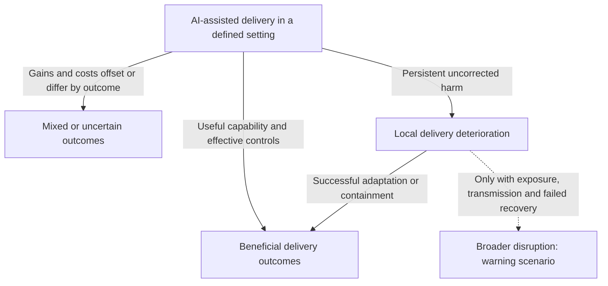

# Part 3: Scenarios and Adoption Decisions

> **Navigation:** [🏠 Home](../README.md) | [🧭 Doctrine](../DOCTRINE.md) | [📖 Glossary](../GLOSSARY.md) | [📉 Part 1: Evidence and Delivery Outcomes](01_the_illusion.md) | [⚙️ Part 2: Verification and Delivery Mechanisms](02_broken_mechanics.md) | **Part 3** | [🛡️ Protocols](../protocols/README.md) | [📚 References](../REFERENCES.md)

**Table of Contents:**

* [Chapter 8. When Local Improvements Improve Delivery](#chapter-8-when-local-improvements-improve-delivery)
* [Chapter 9. Conditional Scenarios and Observable Signals](#chapter-9-conditional-scenarios-and-observable-signals)
* [Chapter 10. Responsibilities for Measurement and Adoption](#chapter-10-responsibilities-for-measurement-and-adoption)

---

## Chapter 8. When Local Improvements Improve Delivery

We began with [different task-time results across experiments](01_the_illusion.md#bounded-experiments-positive-negative-and-temporally-limited-evidence), followed by an update that leaves the current magnitude uncertain. Those results do not establish a universal industry slowdown.
The report's systems hypothesis is conditional: treating code-generation speed as sufficient evidence of delivery improvement can hide downstream constraints. Its applicability depends on the task, tools, operating model and observed production outcomes.

### Local Automation: A Conditional Tradeoff

[Chapter 6](02_broken_mechanics.md#chapter-6-a-thought-experiment-operating-an-ai-review-system) proposes evaluating a review assistant's benefits against setup, supervision and maintenance. It does not demonstrate that automation necessarily adds net work or leaves senior engineers with an equally severe bottleneck.

GitClear's [historical quality proxies](../evidence/primary/2025-gitclear-code-quality.md) and [selected output measures](../evidence/primary/2025-gitclear-developer-output.md) do not measure that intervention's total effort, human cognitive load or production outcome. A local pilot could find useful review savings, added maintenance burden or a mixture. Stable quality and lower total effort would weaken the adverse scenario.

### The Challenge of Systemic Rebalancing

The proposed mechanism depends on the surrounding delivery system. Faster requirements, code or review can create queues when downstream capacity is constrained; sufficient capacity and effective verification could instead turn local gains into delivered value. Neither a universal failure nor a requirement to redesign every stage follows from the GitClear activity percentages.

### Conclusion: Measure the Result of the Intervention

Compare task and downstream outcomes, including human effort, quality, release performance and operating cost. Expand, adjust or constrain a use case according to that evidence. This is a proposed measurement practice; the studies reviewed here do not establish one inevitable outcome for startups, enterprises or review automation.

---
## Chapter 9. Conditional Scenarios and Observable Signals

The [illustrative adoption mandate in Chapter 3](01_the_illusion.md#chapter-3-adoption-budgets-and-delivery-capability) describes one possible budget error, not a measured industry trajectory. The [cost comparison in Chapter 2](01_the_illusion.md#chapter-2-evaluating-the-cost-of-ai-assisted-delivery) does not establish that every adopter needs a new transformation programme.

The following are **repository scenarios**, not observations or forecasts. They are non-exhaustive and have no calibrated probability, ordering of likelihood or time to failure. Define the population, workload, quality boundary and follow-up before interpreting local observations.

### Beneficial Adaptation

If assistance saves effort or enables useful work and the delivery system can absorb it, more useful output or lower total effort at comparable quality is a possible result. Existing headroom, better task selection, smaller changes or effective verification could contribute. No new transformation programme is assumed necessary.

Observe accepted outcomes, implementation and verification/rework effort separately, defects, release performance and operating cost. Sustained benefit would weaken an inevitable-harm claim. It would not by itself refute an increase in verification demand if implementation savings were larger.

### Mixed or Uncertain Outcomes

Local coding gains could coexist with unchanged release completion, different task scope, greater review effort or offsetting costs. Short follow-up, changing task mix and imprecise estimates can also prevent a conclusion.

Report those outcomes separately. A nonsignificant difference is not evidence of equivalence; a larger task or more valuable release is not comparable to the old workload without accounting for scope. Longer observation or a better comparator may resolve uncertainty. Mixed results do not establish either a net loss or universal success.

### Local Delivery Deterioration

An adverse mechanism requires additional conditions: generated work is admitted, service demand strains effective capacity, checks or context are inadequate, and the resulting costs persist without sufficient adaptation. Possible outcomes include longer waits, rework, escaped defects or reduced delivery capacity. None is assumed to occur in every AI-assisted change.

Inspect stage demand/capacity, task risk, active effort versus waiting, WIP, quality and useful completion against a credible baseline. Staffing changes, release batching, dependencies and changed scope remain alternatives. Successful containment or useful gains at comparable quality would limit this scenario's applicability. The [H1–H5 tests](appendices/mechanism-hypotheses.md) distinguish absent triggers, disconfirmation under the trigger and net benefit.

### Broader Disruption as a Warning Scenario

A local problem does not establish an industry crisis. A broader scenario additionally requires shared dependencies or correlated exposure, a mechanism that transmits failures beyond the originating deployment, and insufficient containment or recovery. Loss of trust, restrictions on use or sustained maintenance burden are possible consequences to investigate, not a predicted AI winter, insolvency rate or industry-wide productivity decline.

Evidence would need a defined population, longitudinal outcomes, correlated exposure and traced transmission, alongside competing explanations. Isolated incidents, independent causes, successful recovery or an absence of linked failures in the defined exposed population would weaken an inference of systemic propagation. No such population-level test is supplied here.

| Scenario | Signals to compare | What would limit the interpretation |
| --- | --- | --- |
| Beneficial | Useful delivery and total effort/cost at comparable quality | Changed scope, selected successes or incomplete quality follow-up |
| Mixed/uncertain | Coding, review, release and quality outcomes reported separately | Better measurement may reveal benefit or harm; do not force a single result |
| Local adverse | Independently measured demand, waits, rework, quality and completion | Absent trigger, effective adaptation or a competing cause |
| Broader warning | Shared exposure, transmission, sustained effects and failed recovery | Local containment, uncorrelated causes, successful recovery or no propagation |

These are proposed observation categories, not a collected dataset or a requirement that a pilot validate the adverse mechanism. [Issue #54](https://github.com/UncertaintyArchitectureGroup/The-Subprime-Code-Crisis/issues/54) owns any later study-design and collection decision.

### Budget Risk Depends on the Capability Gap

A license-only budget may underfund a deployment if required review, integration or operating work beyond existing capability is left unfunded. The absence of deep operational transformation does not itself establish that gap or rank the strategy as more dangerous than every alternative.

As Chapter 2 proposes, compare added cash, staff capacity, quality and delivered benefits against a local baseline. Sufficient existing capability and useful gains at comparable or lower total cost, with stable or improved quality, would weaken the unfunded-capability scenario. The reviewed cost sources do not establish an industry-wide bubble or the probabilities of the wider scenarios above.

---

## Chapter 10. Responsibilities for Measurement and Adoption

Evaluate specific product behavior, published claims and adoption decisions against their evidence. The studies reviewed here do not establish participants' motives, dishonesty or innocence, or a legal breach. Named companies and researchers belong beside attributed findings and disclosures, not in an unsupported account of who caused a crisis.

### Incentives as a Hypothesis to Test

Targets based on activation or output could favor expansion before downstream outcomes are understood. This is a **repository hypothesis**, not a finding about every vendor, investor or executive. Testing it requires actual targets, contracts, product defaults, decision records and subsequent delivery outcomes. Outcome-based decisions, effective checks and successful adjustment are plausible alternatives.

*   **The C-Suite:** Market expectations could influence adoption decisions. The [enterprise surveys in Chapter 3](01_the_illusion.md#enterprise-surveys-use-benefits-and-scaling-are-different-outcomes) do not measure investor pressure or executive fear, and preserve reported benefits alongside scaling limits. The proposed decision mechanism requires observations of actual choices and delivery outcomes; it is not an established motive for all executives.

Responsibility can be discussed without inferring intent: identify who defines the use case, accepts a change, supplies evaluation information and can intervene when results differ from expectations. Existing capability may be sufficient; proportionate controls should address an observed gap rather than assume the whole organization needs redesign.

### Decisions for Engineering and Executive Leaders

The recommendations below are proposed practices, not a legal opinion or a demonstrated universal adoption programme.

1.  **Specify the Use Case and Acceptance Boundary:** Identify the intended work, risk, existing capability and accountable decision owner. A license-only purchase may be adequate where the necessary delivery capability already exists.
2.  **Evaluate Delivered Value and Total Cost:** Compare a defined use case against a credible baseline, including additional or released review, QA and maintenance effort and the resulting quality. Coding speed alone does not establish net ROI.
3.  **Measure Adoption Alongside Outcomes:** Track use together with delivery, quality and comparable total cost; adoption alone does not establish success. Useful **Asset Health** diagnostics include:
    *   *Technical Debt Ratio*
    *   *Defect Escape Rate*
    *   *Maintenance Effort vs. New Feature Delivery*
4.  **Resource Identified Gaps:** Fund targeted changes where local evaluation identifies unmet delivery needs. Reuse adequate existing teams, controls and pipelines; a new transformation programme is not a universal prerequisite for beneficial adoption.

Define each diagnostic locally and report its denominator and limits. A technical-debt ratio or activity metric alone does not establish asset value, causality or a legal duty violation.

### Product and Evaluation Disclosures

For a specific capability or marketing claim, ask suppliers and evaluators to provide:

- the task, model/tool version, operating scope and comparator;
- whether the result measures activity, task time, quality or production outcomes;
- required human review, known failure modes and material evaluation limits;
- the basis for any enterprise-wide generalization;
- a correction path when later evidence changes the conclusion.

Product defaults, autonomy settings and integration choices can then be assessed against the customer's risk and verification boundary. A narrow benchmark can still demonstrate useful capability; the question is whether its scope supports the proposed use. No particular vendor's intent, contract or misconduct is established by these recommendations.

### Conclusion: Keep Benefits, Costs and Uncertainty Visible

The [evidence comparison in Chapter 1](01_the_illusion.md#chapter-1-what-productivity-studies-measure-task-time-and-delivery-outcomes) preserves positive, negative, null and uncertain findings with their different outcome boundaries. The conditional mechanism in Chapters 4–7 does not turn them into a universal failure path.

A justified decision may continue a useful deployment, adjust a specific constraint, pause an unverified use case or seek better evidence. Compare delivered value, total effort/cost and required quality; preserve both successful adaptation and adverse observations. The protocols offer practices to evaluate in that setting, rather than proof of effectiveness or a reason to reject beneficial assistance.

---

**Next:** [🛡️ Operational Protocols](../protocols/README.md)
