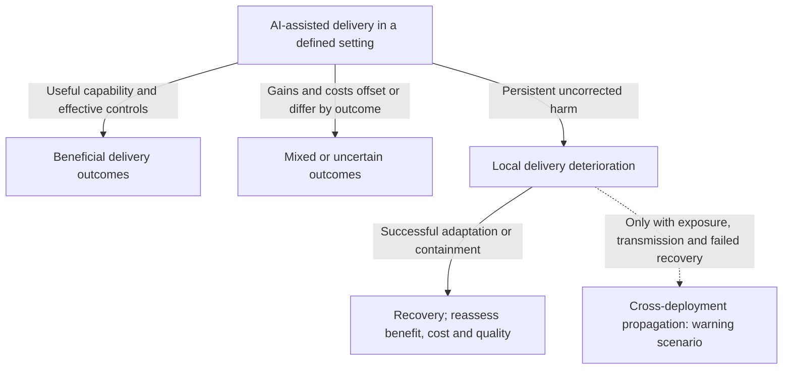

# Part 3: Scenarios and Adoption Decisions

> **Navigation:** [🏠 Home](../README.md) | [🧭 Doctrine](../DOCTRINE.md) | [📖 Glossary](../GLOSSARY.md) | [📉 Part 1: Evidence and Delivery Outcomes](01_the_illusion.md) | [⚙️ Part 2: Verification and Delivery Mechanisms](02_broken_mechanics.md) | **Part 3** | [SDLC hypothesis register](appendices/mechanism-hypotheses.md) | [🛡️ Protocols](../protocols/README.md) | [📚 References](../REFERENCES.md)

**Table of Contents:**

* [Chapter 8. When Local Improvements Improve Delivery](#chapter-8-when-local-improvements-improve-delivery)
* [Chapter 9. Conditional Scenarios and Observable Signals](#chapter-9-conditional-scenarios-and-observable-signals)
* [Chapter 10. Responsibilities for Measurement and Adoption](#chapter-10-responsibilities-for-measurement-and-adoption)

---

## Chapter 8. When Local Improvements Improve Delivery

We began with [different task-time results across experiments](01_the_illusion.md#bounded-experiments-positive-negative-and-temporally-limited-evidence), followed by an update that leaves the current magnitude uncertain. Those results do not establish a universal industry slowdown.
The report's hypothesis is conditional: treating faster code generation as proof of better delivery can hide limits in the work that follows it. Whether this happens depends on the task, tools, way of working and observed production outcomes.

### Local Automation: A Conditional Tradeoff

[Chapter 6](02_broken_mechanics.md#chapter-6-a-thought-experiment-operating-an-ai-review-system) proposes comparing a review assistant's benefits with its setup, supervision and maintenance costs. It does not demonstrate that automation must add more work than it saves or leave senior engineers with a bottleneck as severe as before.

GitClear's [historical quality proxies](../evidence/primary/2025-gitclear-code-quality.md) and [selected output measures](../evidence/primary/2025-gitclear-developer-output.md) do not measure that intervention's total effort, human cognitive load or production outcome. A local pilot could find useful review savings, added maintenance burden or a mixture. Stable quality and lower total effort would weaken the adverse scenario.

### The Challenge of Systemic Rebalancing

The proposed mechanism depends on the rest of the delivery process. Faster requirements work, coding or review can create queues when later stages cannot keep pace. Enough capacity and effective checking could instead turn those gains into useful delivered software. GitClear's activity percentages establish neither universal failure nor a need to redesign every stage.

### Conclusion: Measure the Result of the Intervention

Compare what happens during the task and afterward: human effort, quality, release performance and operating cost. Use that evidence to expand, adjust or constrain a use case. This is a proposed measurement practice. The studies reviewed here do not establish one inevitable outcome for startups, enterprises or review automation.

---
## Chapter 9. Conditional Scenarios and Observable Signals

The [illustrative adoption mandate in Chapter 3](01_the_illusion.md#chapter-3-adoption-budgets-and-delivery-capability) describes one possible budget error, not a measured industry trajectory. The [cost comparison in Chapter 2](01_the_illusion.md#chapter-2-evaluating-the-cost-of-ai-assisted-delivery) does not establish that every adopter needs a new transformation programme.

The following **repository scenarios** describe possible outcomes. They are not observations or forecasts, do not cover every possibility, and have no estimated probability, ranking of likelihood or time to failure. Before interpreting local results, define which people or systems are being studied, the workload, the required quality and how long they will be followed.

Containing a problem can prevent further harm without producing a benefit after costs. After recovery, compare the outcomes again; recovery alone does not establish that the deployment was beneficial overall.

### Beneficial Adaptation

If assistance saves effort or enables useful work that the delivery system can handle, the team could produce more useful output or use less total effort at comparable quality. Spare capacity, better task selection, smaller changes or effective checking could help. A new transformation programme is not assumed necessary.

Measure the outcomes accepted as useful, defects, release performance and operating cost. Record implementation effort separately from checking and rework, and report sustained benefit as a result for that setting. To test a proposed harmful link, also check whether its starting condition occurred and whether the predicted result followed. Implementation savings can exceed added checking, so a benefit overall does not show that the need for checking stayed the same or fell.

### Mixed or Uncertain Outcomes

Coding gains could coexist with unchanged release completion, a change in the work attempted, greater review effort or costs that offset the savings. A short follow-up, changing task mix or imprecise estimates may also leave the result unclear.

Report those outcomes separately. A difference that is not statistically significant does not show that the outcomes are equivalent. A larger task or more valuable release also needs an adjustment for scope before comparison with the old workload. Longer observation or a better comparison may resolve uncertainty. Mixed results establish neither an overall loss nor universal success.

### Local Delivery Deterioration

The proposed mechanism starts when work accepted into the process places strain on what a stage can handle at the required quality. Assess that demand and capacity independently. Waiting, lost context or inadequate checks could then add rework or defects. Test whether those costs persist or useful delivery worsens; do not define the hypothesis so that deterioration is assumed from the start. This is one possible cause of harm, not a complete account of AI-related failures.

Against a credible baseline, compare the work each stage receives, its capacity, task risk, active effort, waiting, work in progress, quality and useful completion. Changes in staffing, release batching, dependencies and scope are alternative explanations.

If the independently measured starting condition is present but the predicted result is absent or reversed, that weakens the particular link—provided the estimate is precise enough to rule out an effect defined in advance as meaningful. If the starting condition never occurs or the team adapts successfully, the mechanism has less scope to apply. Whether benefits exceed all relevant costs is a separate question. The [H1–H5 tests](appendices/mechanism-hypotheses.md) explain these distinctions.

### Cross-Deployment Propagation as a Warning Scenario

A local problem does not establish an industry crisis. For the wider failure scenario considered here, dependencies must expose other deployments to the problem, failures must spread beyond where they began, and containment or recovery must be insufficient. Several failures could also share a common cause without spreading from one another. Correlation alone does not show transmission. Lost trust, restrictions on use or lasting maintenance burdens are possible consequences to investigate. They are not predictions of an AI winter, an insolvency rate or industry-wide productivity decline.

Testing this scenario would require identifying which systems were exposed, following outcomes over time, tracing how failures spread and comparing other explanations. Decide in advance which failures the observation can detect, how long to follow them and what amount of spread would matter. If failures occur at the origin and dependent systems are actually exposed through the proposed path, but the predicted spread does not appear under adequate observation, that would weaken the transmission prediction.

If no initiating failure occurs, or the proposed path never exposes another system, the starting condition was absent. Successful containment tests the response; evidence of unrelated causes challenges the claimed attribution. These distinctions do not rule out every possible systemic risk. This report supplies no such test across an exposed population.

| Scenario | Signals to compare | What would limit the interpretation |
| --- | --- | --- |
| Beneficial | Useful delivery and total effort/cost at comparable quality | Changed scope, selected successes or incomplete quality follow-up |
| Mixed/uncertain | Coding, review, release and quality outcomes reported separately | Better measurement may reveal benefit or harm; do not force a single result |
| Local adverse | Independently measured demand, waits, rework, quality and completion | Missing predicted endpoint under the trigger; separately, absent trigger, adaptation or competing cause |
| Propagation warning | Originating failures, actual downstream exposure, traced transmission, sustained effects and recovery | Missing predicted propagation after the trigger; separately, no initiating event/path, containment or another cause |

These are proposed observation categories, not a collected dataset or a requirement that a pilot validate the adverse mechanism. [Issue #54](https://github.com/UncertaintyArchitectureGroup/The-Subprime-Code-Crisis/issues/54) owns any later study-design and collection decision.

### Budget Risk Depends on the Capability Gap

A budget covering only licenses may leave a deployment short of resources if it omits necessary review, integration or operating work that existing teams and tools cannot handle. The absence of a major change in how the organization works does not itself establish that shortfall or make the strategy more dangerous than every alternative.

As Chapter 2 proposes, compare added cash, staff capacity, quality and delivered benefits with a local baseline. If existing capability is sufficient and useful gains are achieved at comparable or lower total cost, with stable or improved quality, that would weaken the scenario of unfunded work. The reviewed cost sources do not establish an industry-wide bubble or estimate the probabilities of the wider scenarios above.

---

## Chapter 10. Responsibilities for Measurement and Adoption

Evaluate specific product behavior, published claims and adoption decisions against the evidence. The studies reviewed here do not establish participants' motives, dishonesty or innocence, or a legal breach. Identify companies and researchers when attributing findings and disclosures. Do not use those names to construct an unsupported account of who caused a crisis.

### Incentives as a Hypothesis to Test

Targets based on tool activation or output could encourage expansion before the later delivery outcomes are understood. This is a **repository hypothesis**, not a finding about every vendor, investor or executive. Testing it requires actual targets, contracts, product defaults, decision records and subsequent delivery outcomes. Decisions based on outcomes, effective checks and successful adjustment are plausible alternatives.

Compare otherwise similar settings that differ in their exposure to activity targets. Ask when and how widely adoption expands, and whether decision-makers use evidence that the resulting work meets delivery requirements. Different task opportunities, staffing and commercial deadlines could also explain the decisions.

The proposed link would be weakened if activity targets are present but adoption expands no earlier or more widely and decisions rely no less on delivery evidence, with enough precision to rule out a change defined in advance as meaningful. Later benefits after costs, or successful recovery, do not by themselves test how that earlier choice was made.

*   **The C-Suite:** Market expectations could influence adoption decisions. The [enterprise surveys in Chapter 3](01_the_illusion.md#enterprise-surveys-use-benefits-and-scaling-are-different-outcomes) do not measure investor pressure or executive fear, and preserve reported benefits alongside scaling limits. The proposed decision mechanism requires observations of actual choices and delivery outcomes; it is not an established motive for all executives.

Responsibility can be discussed without assuming intent. Identify who defines the use case, accepts a change, supplies evaluation information and can intervene when results differ from expectations. Existing capability may be sufficient. Match controls to an observed gap; a redesign of the whole organization is not assumed necessary.

### Decisions for Engineering and Executive Leaders

The recommendations below are proposed practices, not a legal opinion or a demonstrated universal adoption programme.

1.  **Specify the Use Case and Acceptance Boundary:** Identify the intended work, risks, existing skills and capacity, and accountable decision owner. A license-only purchase may be adequate where the team can already carry out the necessary delivery work.
2.  **Evaluate Delivered Value and Total Cost:** Compare a defined use case with a credible baseline. Include time added or freed in review, QA and maintenance, and the resulting quality. Coding speed alone does not establish a return after all relevant costs.
3.  **Measure Adoption Alongside Outcomes:** Track use together with delivery, quality and comparable total cost; adoption alone does not establish success. Useful **Asset Health** diagnostics include:
    *   *Technical Debt Ratio*
    *   *Defect Escape Rate*
    *   *Maintenance Effort vs. New Feature Delivery*
4.  **Resource Identified Gaps:** Fund targeted changes where local evaluation identifies unmet delivery needs. Reuse existing teams, controls and pipelines where they are adequate. Beneficial adoption does not always require a new transformation programme.

Define each diagnostic locally and report its denominator and limits. A technical-debt ratio or activity metric alone does not establish asset value, causality or a legal duty violation.

### Product and Evaluation Disclosures

For a specific capability or marketing claim, ask suppliers and evaluators to provide:

- the task, model/tool version, operating scope and comparator;
- whether the result measures activity, task time, quality or production outcomes;
- required human review, known failure modes and material evaluation limits;
- the basis for any enterprise-wide generalization;
- a correction path when later evidence changes the conclusion.

Product defaults, autonomy settings and integration choices can then be assessed against the customer's risks and required checks. A narrowly scoped benchmark can still demonstrate useful capability. The question is whether the work it tested supports the proposed use. These recommendations establish no particular vendor's intent, contract or misconduct.

### Conclusion: Keep Benefits, Costs and Uncertainty Visible

The [evidence comparison in Chapter 1](01_the_illusion.md#chapter-1-what-productivity-studies-measure-task-time-and-delivery-outcomes) preserves positive, negative, null and uncertain findings, each tied to the result it measured. The possible mechanism in Chapters 4–7 does not turn those findings into a universal path to failure.

The evidence may justify continuing a useful deployment, addressing a specific constraint, pausing an unverified use case or seeking better information. Compare delivered value with total effort and cost at the required quality. Keep successful adaptation and adverse observations visible. The protocols offer practices to evaluate in that setting; they do not prove their own effectiveness or justify rejecting beneficial assistance.

---

**Next:** [🛡️ Operational Protocols](../protocols/README.md)
