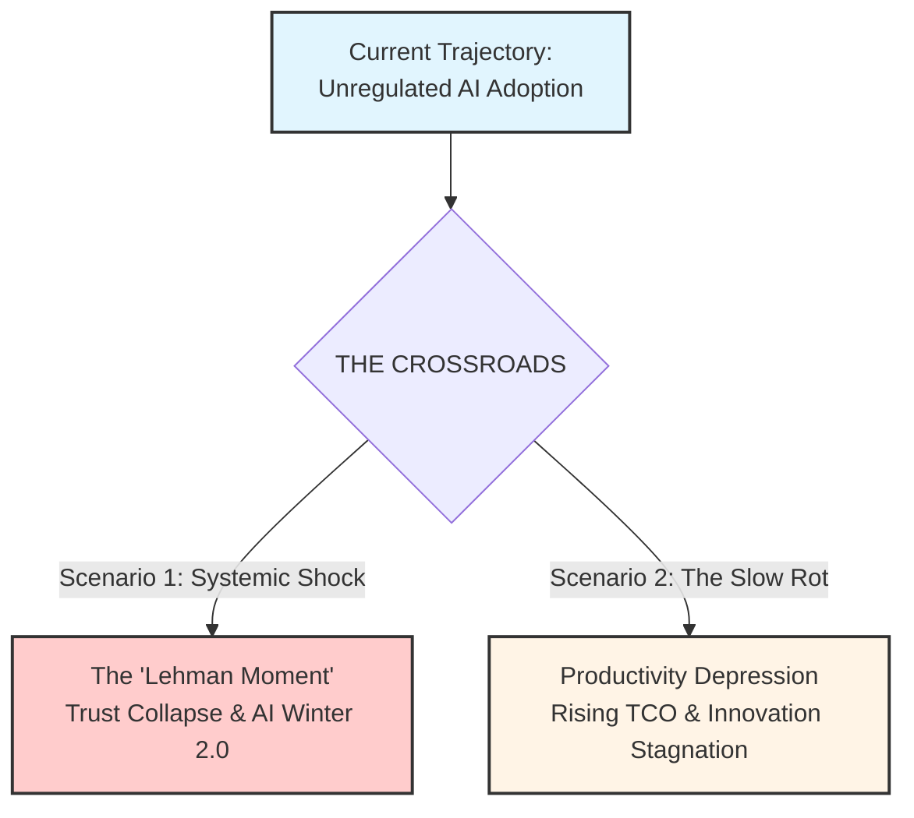

# Part 3: The Aftermath

> **Navigation:** [🏠 Home](../README.md) | [🧭 Doctrine](../DOCTRINE.md) | [📖 Glossary](../GLOSSARY.md) | [📉 Part 1: The Illusion](01_the_illusion.md) | [⚙️ Part 2: Broken Mechanics](02_broken_mechanics.md) | **Part 3** | [🛡️ Protocols](../protocols/README.md) | [📚 References](../REFERENCES.md)

**Table of Contents:**
*   [Chapter 8. The Paradox of Local Solutions](#chapter-8-conclusion-the-paradox-of-local-solutions-and-the-necessity-of-balance)
*   [Chapter 9. The Macro-Economic End Game](#chapter-9-the-macro-economic-end-game-the-trajectory-of-crisis)
*   [Chapter 10. The Architecture of Unintended Consequences](#chapter-10-the-architecture-of-unintended-consequences-who-is-actually-to-blame)

---

## Chapter 8. Conclusion: The Paradox of Local Solutions and the Necessity of Balance

We began with [different task-time results across experiments](01_the_illusion.md#bounded-experiments-positive-negative-and-temporally-limited-evidence), followed by an update that leaves the current magnitude uncertain. Those results do not establish a universal industry slowdown.
The report's systems hypothesis is conditional: treating code-generation speed as sufficient evidence of delivery improvement can hide downstream constraints. Its applicability depends on the task, tools, operating model and observed production outcomes.

### Local Automation: A Conditional Tradeoff

[Chapter 6](02_broken_mechanics.md#chapter-6-assessing-context-and-automation-tradeoffs) proposes evaluating a review assistant's benefits against setup, supervision and maintenance. It does not demonstrate that automation necessarily adds net work or leaves senior engineers with an equally severe bottleneck.

GitClear's [historical quality proxies](../evidence/primary/2025-gitclear-code-quality.md) and [selected output measures](../evidence/primary/2025-gitclear-developer-output.md) do not measure that intervention's total effort, human cognitive load or production outcome. A local pilot could find useful review savings, added maintenance burden or a mixture. Stable quality and lower total effort would weaken the adverse scenario.

### The Challenge of Systemic Rebalancing

The proposed mechanism depends on the surrounding delivery system. Faster requirements, code or review can create queues when downstream capacity is constrained; sufficient capacity and effective verification could instead turn local gains into delivered value. Neither a universal failure nor a requirement to redesign every stage follows from the GitClear activity percentages.

### Conclusion: Measure the Result of the Intervention

Compare task and downstream outcomes, including human effort, quality, release performance and operating cost. Expand, adjust or constrain a use case according to that evidence. This is a proposed measurement practice; the studies reviewed here do not establish one inevitable outcome for startups, enterprises or review automation.

---
## Chapter 9. The Macro-Economic End Game: The Trajectory of Crisis

The ["Execution Mandate" in Chapter 3](01_the_illusion.md#chapter-3-the-free-lunch-trap-when-adoption-budgets-miss-delivery-work) is an illustrative budget-risk mechanism, not a measured industry trajectory. The adverse scenarios below explore what could happen where required delivery work remains unfunded. The [cost comparison in Chapter 2](01_the_illusion.md#chapter-2-evaluating-the-cost-of-ai-assisted-delivery) does not establish that every adopter needs a new transformation programme.

We are not asserting that a collapse is inevitable. However, we must recognize the vector of our current movement: **The longer we operate under the "Safe Strategy" of unregulated AI adoption, the higher the probability of a systemic correction.**

Every day that an enterprise prioritizes "Typing Speed" over "Systemic Balance," it adds compound interest to a debt that will eventually come due. If this trajectory remains unchecked, we foresee two potential end games for the industry.

### Scenario 1: The "Lehman Moment" of AI (Systemic Shock)
*Low Probability, High Impact*

In this scenario, the accumulation of "Subprime Code" reaches a critical mass, leading to a sudden, visible collapse of trust.
*   **The Mechanism:** Just as subprime mortgages were bundled into "safe" assets, toxic AI-generated code is currently being bundled into critical infrastructure (Banking, Logistics, Healthcare).
*   **The Trigger:** A series of catastrophic failures in non-tech enterprises—perhaps a massive security breach caused by hallucinated vulnerabilities, or a total paralysis of a core banking system due to unmaintainable complexity.
*   **The Consequence:** The market realizes that the "assets" (codebases) are toxic. Investor trust evaporates. Boards issue panic-driven bans on AI tools. We enter **AI Winter 2.0**, not because the technology failed, but because our *management* of it failed.

### Scenario 2: The Slow Rot (Productivity Depression)
*High Probability, High Friction*

This is the more likely outcome. There is no explosion, only a gradual suffocation of innovation.
*   **The Mechanism:** The degradation of the SDLC slowly eats away at the engineering capacity of thousands of companies.
*   **The Process:** Maintenance budgets balloon as teams spend 80-90% of their time fixing the "plausible lies" generated in previous years. Feature delivery grinds to a halt.
*   **The Consequence:** The industry suffers a **"Productivity Depression."** We end up spending *more* money to build *less* software than we did in 2020. Small and medium businesses, unable to afford the massive refactoring required to clean their codebases, quietly go bankrupt or are acquired for parts.

### Budget Risk Depends on the Capability Gap

A license-only budget may underfund a deployment if required review, integration or operating work beyond existing capability is left unfunded. The absence of deep operational transformation does not itself establish that gap or rank the strategy as more dangerous than every alternative.

As Chapter 2 proposes, compare added cash, staff capacity, quality and delivered benefits against a local baseline. Sufficient existing capability and useful gains at comparable or lower total cost, with stable or improved quality, would weaken the unfunded-capability scenario. The reviewed cost sources do not establish an industry-wide bubble or the probabilities of the wider scenarios above.

***

## Chapter 10. The Architecture of Unintended Consequences: Who Is Actually to Blame?

We live and work in an ecosystem of extreme complexity, bordering on chaos. In such systems, the human brain craves simple answers. We want a villain. We want a name, a company logo, or a job title to point at and say: *"This is your fault."*

But if we are intellectually honest, we must admit a difficult truth: **There is no villain in this story.**

---

### The Tragedy of Rational Actors

If we analyze the motivations of every player in this crisis, we find that they are acting completely rationally within their own paradigms.

*   **The Vendors:** They have engineered a technological marvel. Their imperative is to monetize it to fund the massive R&D costs for the next generation. They want to capture market share quickly. Are they "evil" for selling their product aggressively? **No.**
*   **The Investors:** They are deploying capital into the highest-growth sector of the economy. They listen to the vendors' projections and demand exposure to AI. They want returns. Are they "guilty" for demanding growth? **No.**
*   **The C-Suite:** Market expectations could influence adoption decisions. The [enterprise surveys in Chapter 3](01_the_illusion.md#enterprise-surveys-use-benefits-and-scaling-are-different-outcomes) do not measure investor pressure or executive fear, and preserve reported benefits alongside scaling limits. The proposed decision mechanism requires observations of actual choices and delivery outcomes; it is not an established motive for all executives.

---

### The Design of Disaster

The profound tragedy of the "Subprime Code Crisis" is that it lacks a **Point of Architecture**.

No one sat down and planned to flood the industry with unmaintainable code. No one architected a collapse.
The crisis is emerging because every actor is optimizing for their **Local Best Interest**, but the vector sum of these rational efforts is driving the **Global System** toward a cliff.

This is the most dangerous type of catastrophe. When everyone is "doing the right thing" from their perspective, there is no obvious error to correct. There is only the silent accumulation of systemic risk. We are collectively sleepwalking into a disaster, driven by the best of intentions.

---

### A Plea to the "Stewards of Capital" (Investors & C-Level)

To the Boards and Executives: We do not ask you to stop innovation. We ask you to stop listening to the echo chamber of hype and remember the fundamentals of your business.

**Your Codebase Is Your Asset.**
It is not a cost center to be minimized; it is the machinery that generates your revenue.
Generating profit today through "AI Speed" is good. But exploding your **Total Cost of Ownership (TCO)** in a way that kills your agility tomorrow is a violation of your fiduciary duty.

**The Pivot:**
1.  **Stop the "License Strategy":** Buying AI Code Assistants is not a strategy. It is a procurement decision.
2.  **Evaluate Delivered Value and Total Cost:** Compare a defined use case against a credible baseline, including additional or released review, QA and maintenance effort and the resulting quality. Coding speed alone does not establish net ROI.
3.  **Change the Metrics:** Stop measuring "Adoption Rate." Start measuring **Asset Health**:
    *   *Technical Debt Ratio*
    *   *Defect Escape Rate*
    *   *Maintenance Effort vs. New Feature Delivery*
4.  **Resource Identified Gaps:** Fund targeted changes where local evaluation identifies unmet delivery needs. Reuse adequate existing teams, controls and pipelines; a new transformation programme is not a universal prerequisite for beneficial adoption.

---

### A Plea to the Vendors

To Microsoft, OpenAI, Google, Anthropic, and others:
We have immense respect for the technology you have built. It is a breakthrough.

But profit today cannot be your only metric.
If this technology "kills the host"—if it floods your clients' ecosystems with unmanageable debt until they collapse or reject the tool—you lose too.

**The "Parasitic Model" Risk:**
In biology, a relationship that exhausts the host eventually leads to the demise of the guest. If the market strategy for AI tools remains purely **extractive**—prioritizing short-term revenue from code volume over the long-term survival of the client's codebase—it becomes a **parasitic model**.

And as every biologist knows: a parasite that kills its host does not survive for long. If the industry loses faith in AI because it caused a "Subprime Crash," or if your enterprise clients become paralyzed by the complexity your tools generated, your revenue streams will evaporate.

**The Pivot:**
1.  **Restrain the PR:** Stop selling "magic." Start selling "power tools that require safety protocols."
2.  **Focus on Survival:** Your goal should shift from "User Adoption" to **"Client Survival."** Help us build the governance layers, the testing frameworks, and the educational programs needed to manage this power.
3.  **Balance the Narrative:** Be realistic. Acknowledge the risks. Be a partner in engineering integrity, not just a supplier of raw speed.

We are all in this ecosystem together. If it crashes, it crashes for everyone.

---
**Next:** [🛡️ Activate Defense Protocols](../protocols/README.md)
