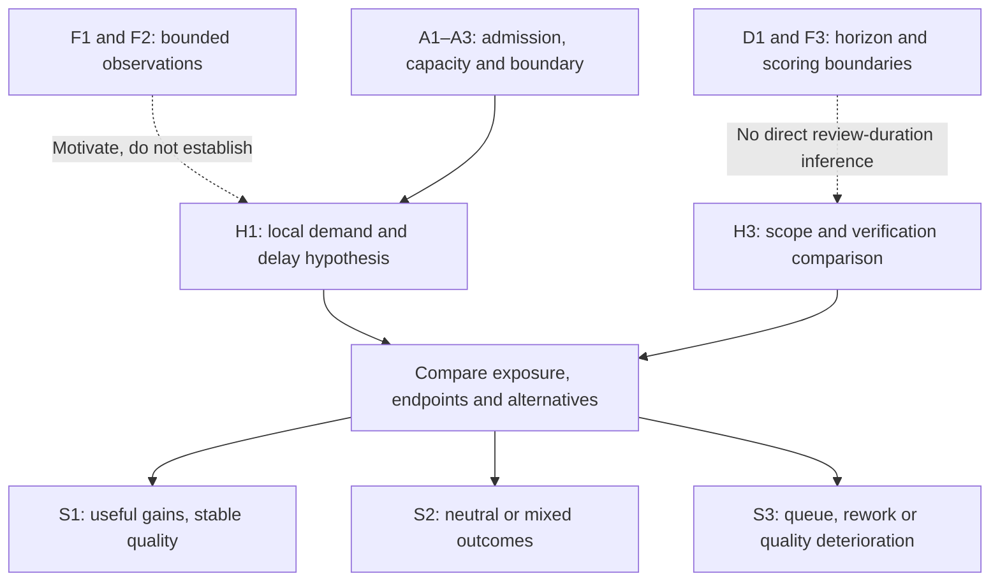

# SDLC rebalancing: functions, outcomes and testable hypotheses

> [Home](../../README.md) | [Evidence and delivery outcomes](../01_the_illusion.md) | [Mechanisms](../02_broken_mechanics.md) | [Source Registry](../../evidence/SOURCES.md) | [Live work plan #84](https://github.com/UncertaintyArchitectureGroup/The-Subprime-Code-Crisis/issues/84)

## The thesis and the outcome that matters

**Our research thesis: AI coding tools have changed how quickly and cheaply teams
can produce software changes. Delivery systems have not adapted as quickly in
their ability to choose useful work, understand the changes, review and test them,
integrate and operate the software, and obtain useful value from it. This mismatch
calls for reassessing the whole software-development lifecycle (SDLC).**
The proposed changes produced by coding tools are called *candidate software*
below: they still need to be accepted and made useful. *Rebalancing* means finding
and addressing the actual constraint while preserving the functions that make
software useful and sustainable. A useful response might be better automation,
clearer intent, smaller changes, stronger capability or less unnecessary work.
An already adequate process may need no change.

The full lifecycle is **Intent → requirements → design → code → review → test
→ integration → deployment → operation → realized user outcomes → business
economics → feedback to Intent**. Each part of the delivery process is called a
*node* in this register. These functions can recur and overlap; they do not require
a fixed sequence or equal staffing. AI can change several of them.

The goal is **useful software for users, sustainable team capability, and justified
total cost and risk**. The software must be understandable and operable. A release
needs to contribute to a useful outcome: solving a problem, preserving reliable
service, reducing user effort, improving accessibility, avoiding harm or producing
learning that helps a decision. Providing the same useful service more cheaply
can also be a benefit. User benefit, competitive advantage and return on investment
(ROI) are separate questions. The economics card tests their connection; code
counts, release counts and unchanged usage cannot settle it.

The strongest existing support concerns gaps between changes in coding activity
and changes in releases or tracked completion, plus review-process changes in a
distinct firm setting. Task experiments report different effects on time. The
[evidence map](#existing-evidence-and-its-exact-coverage) shows these findings and
their limits. **Each proposed consequence needs its own evidence:** review
overload, lost understanding, persistent debt, burnout and higher total cost of
ownership (TCO) are separate claims. Missing predicted harm or successful unchanged
practice can narrow the diagnosis. Counting work entering and leaving a backlog
cannot, by itself, prove that AI caused a harmful imbalance.

This is the single research register, expanded under
[#86](https://github.com/UncertaintyArchitectureGroup/The-Subprime-Code-Crisis/issues/86).
It implements the maintainer's [thesis and author-context direction](https://github.com/UncertaintyArchitectureGroup/The-Subprime-Code-Crisis/issues/84#2-authorial-continuity-and-existing-evidence),
including the R23 unpublished author-review context recorded there. That context
supplies questions and concepts; it is not independent empirical evidence. The
earlier [H1–H5](#hypotheses-and-distinguishing-observations), source/model graph and
measurement handoff remain below, with links showing how they fit the expanded
register. The live plan owns work order; this register owns the hypotheses and
records what the evidence covers.

### How to use this register

Start with the main thesis and its parts below. **H0 is the identifier for that
thesis, not a statistical null hypothesis.** Its parts ask whether coding gains
outpace other work (H0-A), whether a capacity gap limits useful delivery (H0-B),
whether local targets sustain that gap (H0-C), whether it causes lasting harm
(H0-D), and whether a particular response helps (H0-R).

Then read the card for the part of the delivery process where a benefit or loss
is claimed. Include everything that part is expected to supply—quality,
understanding, ownership and feedback as well as output. Separate what was measured
and for how long from a proposed explanation and from what remains unknown. The
linked issue identifies who owns the next research task. An Open verdict records
an unanswered question; the first readable edition need not wait for every
question to be answered.

The [competing explanations](#competing-explanations) show other accounts of the
same observations and questions about whether a proposed response is worthwhile.
Use them with the [comparison method](../../governance/hypothesis-evaluation.md#compare-explanations)
and [source-to-hypothesis comparison record](../../governance/templates.md#source-hypothesis-comparison)
to ask which explanation a result can actually distinguish.

## Common assessment contract

These are the rules for reading and testing every card. The
[existing evaluation method](../../governance/hypothesis-evaluation.md) defines the
evidence test and verdicts.

- **Actual starting process:** this register has not measured one common historical
  team. Its tables list intended functions; whether the previous process actually
  supplied them is **unmeasured** unless a specific source result says otherwise.
  For each outcome in a study, record demonstrated, weak, absent or unmeasured
  delivery and the supporting evidence. Include existing automation, defects,
  staffing, duties and costs.
- **Fair comparison:** describe the actual previous human/AI workflow, the tool
  version and the measure of AI access, use or adoption. State whether the measure
  records actual use, permission, availability or only an observed sign of adoption.
  Identify the unit compared or assigned (such as a person, team or task) and the
  particular change being tested. Compare similar tasks, risks and functions. Count
  rejected, failed and withdrawn work. When task selection changes, show results
  both per assigned task or initiative and per accepted useful outcome.
- **What was measured and for how long:** keep active working hours, elapsed
  waiting, activity, evidence of required quality, demonstrated understanding,
  user outcomes and money separate. Each card suggests measures and a follow-up
  period. Before testing, the owning research task must justify the period, the
  size of a change that would matter and the minimum acceptable outcomes. These cards are not
  preregistered experiments and set no universal thresholds.
- **Moving work and counting costs:** a function may move to another part of the
  process, tool or person. Name who receives it, show that the replacement supplies
  it adequately, and count setup and ongoing work. Count transferred work once.
  Fewer manual steps or a new procedure do not, by themselves, establish improvement.
  An unmeasured function cannot be assumed preserved or harmed.
- **Decisions and minimum acceptable outcomes:** the named local role decides
  whether a stated tradeoff is acceptable. These cards propose owners and criteria;
  they do not record actual organizational consent or create production gates.
  Preserve the quality, safety, data and capability outcomes that the context
  requires. Greater benefit can justify higher cost. A local saving cannot establish
  overall improvement if it conceals an unacceptable loss elsewhere. No net benefit
  is assumed in advance.
- **Test both the harm and the remedy:** measure the proposed trigger separately
  from the harm it is supposed to cause. Test a defined response against the actual
  starting process and, where feasible, unchanged AI-assisted practice. If unchanged
  practice produces adequate outcomes, that weakens a claim that it needs the
  response. Do not rescue a failed remedy by later calling it “not real rebalancing.”
  A statistically nonsignificant difference does not prove that outcomes are
  equivalent.

**Assessment history:** the starting #86 assessment on 2026-10-22 mapped existing
reviewed evidence; #87 adds the reviewed Chen–Stratton firm study and the explicitly
dated successor assessments below; #4 adds the reviewed Shen–Tamkin skill-formation
study and a bounded immediate individual-learning assessment. These are not
systematic searches of every node.
No full-chain **Plausible — triangulated** verdict
is assigned. Independent macro/micro evidence can justify that verdict when it
fits the same scoped proposition, methods and contrary evidence have been assessed,
and underlying data are independent. One rigorous study can establish its own
bounded finding without a second citation. Source states and hypothesis verdicts
remain different records.

## H0: separate the premise, mechanism, consequences and remedy

These five parts can receive different answers. Evidence for a coding gain does
not automatically establish a capacity shortfall, lasting harm or a useful remedy.

### H0-A — Uneven change in capacity and cost

**Prediction:** in specified task and tool settings, gains in implementation or
candidate production exceed gains elsewhere in delivery. Compare the same defined
work before and after the specified change in AI access, use or adoption, against
a credible group without that change or an alternative workflow. Measure
implementation time, cost and accepted work separately from activity, review,
release and operation. Follow complete task-to-release cycles.
When a source measures different groups for different outcomes, keep those groups
separate.

**Other explanations and what would weaken this claim:** better output quality,
different tasks, useful experiments or equally effective assistance elsewhere may
explain or absorb the activity increase. Sustained, proportionate downstream gains
for comparable scope, quality and cost weaken the claim of uneven gains in that
setting. Positive release gains remain benefits even when proportionally smaller.

**Test the proposed response:** compare a predefined allocation of investment
across delivery functions with further coding optimization alone. H0-R/BAL-1 assess
the overall result. The delivery owner must preserve each relevant part's minimum
acceptable outcomes; moving effort elsewhere does not eliminate it.

**Starting #86 verdict: Provisional support** for uneven translation in
the existing NBER setting and bounded coding gains; whole-system capacity/cost
ratios remain unmeasured. E-NBER/E-PENG support parts; E-METR-Productivity/E-METR-Update preserve
context/time heterogeneity.

**Assessment after #87, 2026-10-22:** retain **Provisional support** and extend its
observable scope to [Chen–Stratton's firm-level coding/completion pattern](#e-chen-stratton).
The small positive completion estimate is uncertain; neither study measures the
whole-system capacity/cost ratio or proves an industry-wide loss. Positive NBER
release gains remain benefits. Next: [Code #92](https://github.com/UncertaintyArchitectureGroup/The-Subprime-Code-Crisis/issues/92).

### H0-B — Complementary constraints attenuate useful outcomes

**Prediction:** when the demands of accepted work grow beyond what the available
people and tools can handle at the required quality, insufficient adaptation means
that coding gains do not fully carry through to useful delivery. Useful delivery
may improve less, remain unchanged or get worse. Waiting, coordination or rework
may explain the gap.
Measure required work, available capability, task and risk mix, and work policies
before attributing a queue to this mechanism. Compare similar AI-assisted workflows
with different spare capacity or adaptations over multiple delivery cycles and
later follow-up.

**Other explanations and what would weaken this claim:** deliberate experiments,
changed scope, release batching, product demand or discovery, selection and delayed
outcomes can create activity-to-delivery gaps without overloaded review. If the
independently measured capacity shortfall is present but the predicted worsening
at the affected stage or outcome is not meaningful, that weakens the local model.
Sustained gains under adequate unchanged practice limit how widely a need for
rebalancing can be claimed. If the capacity shortfall never occurred, the study
has not tested harm under that condition.

**Test the proposed response:** define a change to work intake, capability or
coordination at the affected stage before testing it. Ask whether useful outcomes
improve enough to justify the total cost, including displaced work and ownership.
The delivery owner and the owner of the affected part of the process accept the
tradeoff.

**Starting #86 verdict: Provisional support for the attenuation premise;
Open for identification of the proposed capacity mechanism.** E-NBER measures
bounded cross-outcome attenuation and provides a model-dependent complementarity
interpretation; it does not identify review overload. E-Xu is adjacent activity
evidence.

**Assessment after #87, 2026-10-22:** retain that split verdict.
[Chen–Stratton](#e-chen-stratton) adds direct review-process observations consistent
with the mechanism: longer elapsed merge time, more formal change requests and
comments, and broader reviewer participation after agent adoption. Active service
demand, competent capacity and causal mediation remain unidentified; altered
standards, coordination and successful adaptation remain alternatives. Next:
[Review #93](https://github.com/UncertaintyArchitectureGroup/The-Subprime-Code-Crisis/issues/93)
and [Integration #95](https://github.com/UncertaintyArchitectureGroup/The-Subprime-Code-Crisis/issues/95).

### H0-C — Local targets sustain the mismatch

**Prediction:** decisions driven by coding or AI-usage targets, without checking
downstream acceptance, expand commitments or remove needed delivery capability
earlier than comparable decisions based on useful outcomes. Inspect dated claims,
actual targets, budgets and decisions before measuring later capability gaps and
outcomes. Compare groups of decisions over an adoption cycle and subsequent
delivery and operation.

**Other explanations and what would weaken this claim:** commercial deadlines,
demand, staffing changes or already adequate capability may explain the choices.
If the specified targets are present but commitments do not expand earlier,
capability does not fall and downstream evidence receives no less attention, the
proposed decision link is weakened. A later net benefit alone does not test that
earlier link.

**Test the proposed response:** compare an explicit record of expected outcomes
and required capability with the actual previous decision practice. Count decision
delay and analysis cost. If it does not improve decision accuracy or outcomes
enough to justify those costs, that weakens the response. The investment owner
accepts the tradeoff; the test does not infer marketing intent.

**Verdict: Open**, including the remedy; no direct decision-chain evidence is
assessed here. MKT-1 separates the documentary and causal links. Next:
[#100](https://github.com/UncertaintyArchitectureGroup/The-Subprime-Code-Crisis/issues/100).

### H0-D — Persistent mismatch has distinct downstream costs

**Prediction:** lasting, independently observed capability shortfalls contribute
to lost understanding, unresolved obligations, overload, incidents or higher
lifecycle cost. Test each outcome separately; they need not occur in that order
or all occur together. Compare similar exposure and risk, account for earlier
trends, and follow tasks into later changes, operation and human outcomes. Assess
capability through practical tasks, track unresolved obligations over time, measure
human outcomes directly and compare benefits and costs over the same defined period.

**Other explanations and what would weaken this claim:** added scope, existing
debt, reorganizations, useful experiments and improved automation may explain
apparent burdens. Under the relevant conditions, stable or improved capability,
recovery, well-being or full cost weakens the corresponding harm prediction if
measurement is precise enough. One outcome cannot stand in for another.

**Test the proposed response:** separately test the specified training, ownership,
capacity or recovery change against its full cost and its effects on users and
teams. Engineering and operating owners share the relevant decisions. Human
outcomes must remain visible in those tradeoffs.

**Verdict: Open** for the downstream causal claims and remedies. E-Xu/E-Agarwal
provide adjacent proxies, not measured debt stock, cognition, burnout or TCO.
Next: HUM-1/2, DEBT-1 and OPS/ECO owners below.

### H0-R — Rebalancing improves the system

**Prediction:** a predefined change aimed at an independently identified constraint
improves useful outcomes, improves full cost and risk, or does both, compared with
the actual previous workflow and without unacceptable losses elsewhere in the
process. Where feasible, compare it with unchanged practice and with further coding
optimization. Count setup, learning, ongoing work, long-term maintenance and the value of other work
that the investment displaces.

**Other explanations and what would weaken this claim:** sufficient existing
capability, routine learning, improved tools or simpler task selection may deliver
the same gain. No meaningful added benefit, or a gain outweighed by cost or loss
of a required outcome, weakens the specified response. A successful unchanged
process weakens the claim that it needed that response. Identify the constraint
before judging the response; do not infer it from success or redefine a failed
intervention afterward.

**Response and decision:** the node-specific `-2` cards and BAL-1 propose changes
to test. The delivery/investment owner evaluates benefits, capability, user effects
and costs together over the same relevant period.

**Verdict: Open.** Existing observations
motivate this comparison but establish no common rebalancing package. Next:
[Economics #99](https://github.com/UncertaintyArchitectureGroup/The-Subprime-Code-Crisis/issues/99)
and each selected node issue; [#54](https://github.com/UncertaintyArchitectureGroup/The-Subprime-Code-Crisis/issues/54)
only if a specific feasible empirical question warrants collection.

## Competing explanations

**These six families ask different questions about the thesis.** The closest
direct rival says that existing capability or an effective replacement can already
handle the extra work. Other accounts accept an initial mismatch but question how
long it lasts, offer another explanation for an observed gap, or ask whether the
benefits still justify all costs and whether a particular remedy adds value.
They are starting points, not an exhaustive list or six blanket rejections of the
thesis. Several can be true in the same setting. State which observation each
account explains and where their predictions differ.

The common assessment rules and complete node inventories apply to every card.
Each describes a comparison to make, not a measured starting process or a validated
intervention. Before judging results, the owning task must define who and what is
being studied, the AI access, use, adoption or other change tested, the comparison
workflow, the observation period, the size of an effect that would matter and
minimum acceptable outcomes.
Disclose any choices made after seeing results. Preserve Review's quality checks
and the team's demonstrated ability to understand, change and recover the system,
even when one is unmeasured. These cards set no universal period, threshold,
probability or required manual activity.

| Family | Plain-English explanation | What it tests |
| --- | --- | --- |
| [ALT-1](#alt-1--adequate-capability-and-functional-substitution) | Existing capability or an effective substitute already handles the extra accepted work. | The closest direct rival: limits how common the H0-B constraint is and whether a particular H0-R response is needed. |
| [ALT-2](#alt-2--transitional-adaptation) | There is an initial mismatch, but teams adapt within a defined period. | Accepts an early H0-B gap while challenging lasting H0-D harm and whether H0-R caused recovery. |
| [ALT-3](#alt-3--task-mix-experimentation-and-measurement) | Changed work scope, useful experiments or counting differences explain an activity-to-output gap. | Tests the interpretation of H0-A/B and COD-1, including whether apparent waste persists and adds later costs under DEBT-1. |
| [ALT-4](#alt-4--demand-discovery-and-adoption) | Software is delivered, but users do not discover, need or adopt it as expected. | Tests the step from delivery to user value: H0-B at that boundary, plus INT/VAL/ECO. |
| [ALT-5](#alt-5--selection-heterogeneity-and-external-changes) | Who adopts AI, the setting or other changes explain an association or limit where it applies. | Tests whether AI caused the result and whether H0 or a node claim can generalize. |
| [ALT-6a](#alt-6--net-value-and-incremental-remedy-value) | Benefits outweigh all additional costs, even though some local harms remain. | Tests net value in H0-D/ECO; it does not erase an individually measured harm. |
| [ALT-6b](#alt-6--net-value-and-incremental-remedy-value) | A specified remedy may add too little benefit compared with unchanged practice or another investment. | Separately tests the added value of H0-R/BAL-1 and the node `-2` responses. |

**Initial verdicts, 2026-10-22: Open**, including ALT-6a and ALT-6b separately.
[#109](https://github.com/UncertaintyArchitectureGroup/The-Subprime-Code-Crisis/issues/109)
defines these comparisons; it does not apply them to the existing evidence packet
or change its dated assessments. The nine-entry comparison belongs to
[#110](https://github.com/UncertaintyArchitectureGroup/The-Subprime-Code-Crisis/issues/110),
and the finite diagnostic search to
[#111](https://github.com/UncertaintyArchitectureGroup/The-Subprime-Code-Crisis/issues/111).
The node owners below retain subsequent research. Definition of a family supplies
neither evidence for it nor a new source state.

### ALT-1 — Adequate capability and functional substitution

**The idea:** the team may already have enough capability, or a new tool or
practice may supply the required function effectively.

**What to compare:** study teams accepting a larger amount of comparable
AI-assisted candidate work. Record spare capacity in the starting process, the
quality of the proposed changes and assistance in other parts of delivery.
Estimate the work required and
the time, skills and tools available to do it properly, separately from the queues
or losses being predicted. Compare the actual workflow with its previous version
or a credible comparison at the same time. Distinguish existing capability from a
separately proposed extra intervention. Follow complete delivery cycles and later
ownership and maintenance outcomes.

**Prediction and distinguishing evidence:** useful delivery improves while
quality, demonstrated understanding and recovery capability remain adequate at
acceptable total cost. To show that a function has been replaced successfully,
observe the substitute supplying it; fewer manual steps alone are insufficient.
Sustained adequate outcomes without an extra intervention weaken a claim that the
setting needed it. If overload never occurred, those outcomes do not disprove a
prediction of harm under overload.

**What would weaken this explanation:** independently measured higher demand from
comparable accepted work exposes a capability shortfall, persistent waiting or
rework, or loss of required quality or ownership despite the claimed spare capacity
or substitute.
Before attributing success or failure, check for changed tasks, reduced intake,
added staff, hidden work shifted elsewhere and too little follow-up.

**What it tests and who follows up:** this challenges how widespread the H0-B
constraint is and whether a particular H0-R remedy is needed. It can coexist with
constraints elsewhere. Full node outcomes remain owned by the [node index](#node-index),
especially [Code #92](https://github.com/UncertaintyArchitectureGroup/The-Subprime-Code-Crisis/issues/92),
[Review #93](https://github.com/UncertaintyArchitectureGroup/The-Subprime-Code-Crisis/issues/93)
and [Integration #95](https://github.com/UncertaintyArchitectureGroup/The-Subprime-Code-Crisis/issues/95).

### ALT-2 — Transitional adaptation

**The idea:** an initial mismatch may be real but temporary as the team learns
and adjusts.

**What to compare:** follow the same teams doing comparable work through a defined
adoption and learning period. Where available, use credible comparison teams
observed at the same time. Record tool versions, staffing, training and process
changes. Separate routine adjustments from the particular H0-R intervention being
tested.

**Prediction and distinguishing evidence:** the early mismatch shrinks within the
stated period as capability or coordination improves. Useful outcomes and required
quality and ownership recover. Following the same teams and observing their
adjustments tells us more than comparing unrelated groups of early and late users.
Recovery after a specified intervention alone shows neither that teams would have
adapted without it nor how much benefit it added.

**What would weaken this explanation:** recovery fails within the stated period,
with sufficiently complete and precise measurement. It is also weakened if apparent
recovery comes only from struggling teams dropping out, reduced scope or uncounted
work shifted elsewhere. Check who remains in the study, seasonal demand, staffing
and simultaneous tool changes. Do not extend the learning period after an
unfavorable result.

**What it tests and who follows up:** this accepts an initial H0-B mismatch while
challenging its duration, lasting harm under H0-D and attribution of recovery to
H0-R. Owners are [Review #93](https://github.com/UncertaintyArchitectureGroup/The-Subprime-Code-Crisis/issues/93),
[Operation #97](https://github.com/UncertaintyArchitectureGroup/The-Subprime-Code-Crisis/issues/97)
and [Economics #99](https://github.com/UncertaintyArchitectureGroup/The-Subprime-Code-Crisis/issues/99).
HUM-1/2 and DEBT-1 keep their separate tests of later human and maintenance outcomes.

### ALT-3 — Task mix, experimentation and measurement

**The idea:** more coding activity may reflect broader work, useful experiments
or different counting practices, so an activity-to-output gap need not indicate
overload or waste.

**What to compare:** examine comparable assigned initiatives or tasks when scope,
exploration, activity counting or release policy changes alongside the AI access,
use or adoption being studied. Compare delivered functions, quality and total
effort across the same defined start and end points.
Include failed, discarded and stopped work. Follow experiments through the period
when they should inform decisions, and released work long enough to allow for
delivery delays.

**Prediction and distinguishing evidence:** broader scope, useful exploration,
finer counting or release batching explains some or all of the apparent gap,
without the proposed overload mechanism. Link tasks to outcomes and show useful
learning from stopped experiments to distinguish exploration from wasted work.
Percentages from different populations cannot be treated as steps in one conversion
funnel.

**What would weaken this explanation:** the gap and independently identified
capability shortfalls remain after credible comparisons of scope, quality, timing
and what was measured, without corresponding learning or added functionality.
Check task selection, abandoned work that was not observed and measurement changes.
Report the total estimated effect of the measured AI access, use or adoption
alongside adjusted comparisons. Broader scope or experimentation may themselves
be part of AI's effect; adjusting them away
does not automatically give a better causal estimate.

**What it tests and who follows up:** this qualifies interpretations of H0-A/B and
COD-1, including claims of waste or debt. A real constraint may still coexist with
it. Owners are [Intent #89](https://github.com/UncertaintyArchitectureGroup/The-Subprime-Code-Crisis/issues/89),
[Code #92](https://github.com/UncertaintyArchitectureGroup/The-Subprime-Code-Crisis/issues/92)
and [Integration #95](https://github.com/UncertaintyArchitectureGroup/The-Subprime-Code-Crisis/issues/95).
DEBT-1 retains its separate test of whether obligations persist and add later cost.

### ALT-4 — Demand, discovery and adoption

**The idea:** a gap between delivered software and user value may arise after
delivery because people do not discover, need or adopt the capability.

**What to compare:** examine released capabilities and comparable user groups or
tasks when user outcomes improve less or later than production. Link specific
changes to availability, discovery, adoption and task benefit. Compare demand and
service conditions over stated periods for adoption and lasting benefit.
Include non-users and groups that are adversely affected.

**Prediction and distinguishing evidence:** discovery, demand, competition or
uptake explains the gap despite adequate production and operability. Evidence
linking a delivered capability to users who do not find, need or yet adopt it helps
distinguish this explanation from a failure to deliver the capability. Measure
usage and user benefit separately: lower cost or better reliability can benefit
users even when usage is unchanged.

**What would weaken this explanation:** well-observed, stable demand and uptake
conditions accompany a production or quality constraint that explains the missing
useful outcome. A predicted recovery in uptake that fails within the stated period
also weakens it. Check changing audiences, pricing, product fit, competing offerings
and external shocks. Separate marketplace series cannot identify the complete
path from a particular production change to user benefit.

**What it tests and who follows up:** this competes with H0-B explanations at the
step from delivery to value. It need not explain a review queue and can coexist
with one. Owners are [Intent #89](https://github.com/UncertaintyArchitectureGroup/The-Subprime-Code-Crisis/issues/89),
[User outcomes #98](https://github.com/UncertaintyArchitectureGroup/The-Subprime-Code-Crisis/issues/98)
and [Economics #99](https://github.com/UncertaintyArchitectureGroup/The-Subprime-Code-Crisis/issues/99).

### ALT-5 — Selection, heterogeneity and external changes

**The idea:** an apparent AI effect may reflect who adopts it, what work they
choose, the setting or another change happening at the same time. A real effect
may also differ across settings.

**What to compare:** define the measure of AI access, use or adoption being studied.
Record how people, teams or repositories entered the compared groups, what unit
is analyzed and which subgroups matter.
Developers, teams or repositories may differ in task selection, experience,
architecture or concurrent changes. Use credible assigned or matched groups and
observe periods before and after the measured change that fit the claim.

**Prediction and distinguishing evidence:** an apparent effect shrinks under a
more credible comparison, appears before the measured change, follows another
change or occurs mainly in particular settings. Check how access, use or adoption
was assigned or chosen, earlier trends, who participated or dropped out, and
estimates within comparable settings. These observations help distinguish
selection and other causes from an effect of the stated AI access, use or adoption.
Even a credible average causal effect need not generalize when effects differ
across settings.

**What would weaken this explanation:** the specified effect survives credible
checks of assignment, comparison and measurement with adequate precision, and the
proposed external changes do not explain the pattern. Check effects spilling into
comparison groups, simultaneous staffing or deadline changes, measurement error
and selection after the measured change. Favorable subgroups chosen after seeing the
results remain exploratory. A robust result in one setting neither establishes
how common it is elsewhere nor rules out every unmeasured alternative cause.

**What it tests and who follows up:** this challenges causal attribution or
generalization of H0 and node claims, while allowing a conditional mechanism where
the relevant exposure really occurs.
[#110](https://github.com/UncertaintyArchitectureGroup/The-Subprime-Code-Crisis/issues/110)
owns the first comparative assessment. Each [node owner](#node-index) retains its
population and study-design question; [#100](https://github.com/UncertaintyArchitectureGroup/The-Subprime-Code-Crisis/issues/100)
owns the specific marketing-to-decision chain in H0-C/MKT-1.

### ALT-6 — Net value and incremental remedy value

**These are two separate questions: does AI-assisted work provide net value, and
does a particular extra remedy add enough value?** Judge ALT-6a and ALT-6b
separately. Neither judgment replaces the individual harm outcomes in H0-D.

For both, compare useful user outcomes, working time and costs for every affected
role, and minimum acceptable capability and quality. Use a stated period that
covers setup, delivery and maintenance. Explain how benefits are valued, what
other work the investment displaces and what remains uncertain. Do not add
incompatible units into a single balance score.

**ALT-6a — Positive net value despite a local burden.** For comparable useful
service, AI-assisted production may provide benefits or savings that justify
extra review, testing or other specified burdens. Compare the actual AI-assisted
workflow with a credible previous workflow or one observed at the same time.
Sustained benefits exceeding all additional costs support this explanation. A
justified finding of net loss, or a benefit that depends on leaving costs out,
weakens it. Check whether AI caused the result, delayed benefits, costs moved to
other people or stages, existing obligations and useful learning.

A positive financial result does not erase measured harm to learning, maintenance
or people. It cannot by itself establish acceptable overall improvement if a
required outcome falls below its minimum. ALT-6a challenges a claim of net harm;
it does not refute a separately measured harm. Owners are
[User outcomes #98](https://github.com/UncertaintyArchitectureGroup/The-Subprime-Code-Crisis/issues/98)
and [Economics #99](https://github.com/UncertaintyArchitectureGroup/The-Subprime-Code-Crisis/issues/99).
H0-D/HUM/DEBT/OPS owners retain their individual outcomes.

**ALT-6b — Insufficient incremental value from the specified remedy.** An extra
intervention may add too little benefit to justify its costs. Define it before
testing. Compare it with unchanged AI-assisted practice and, where feasible, with
further coding optimization at comparable investment. No meaningful added benefit,
or costs or losses of required outcomes that outweigh the gain, support this
explanation. Sufficient demonstrated added benefit while preserving minimum
acceptable outcomes weakens it.

Count setup, learning, upkeep and displaced work over the stated period. Check
routine adaptation, task selection and other simultaneous changes. Do not redefine
a failed remedy after seeing the result. This tests H0-R/BAL-1 and the node `-2`
cards separately from ALT-6a. Owners are
[Economics #99](https://github.com/UncertaintyArchitectureGroup/The-Subprime-Code-Crisis/issues/99)
and the relevant [node owner](#node-index). Any separately approved data collection
remains with [#54](https://github.com/UncertaintyArchitectureGroup/The-Subprime-Code-Crisis/issues/54).

## Existing evidence and its exact coverage

These are nine reviewed source entries, not nine independent confirmations of H0.
Each linked brief owns its methods, calculations, disclosures and limitations.
Original locators below identify the inspected edition. The
[Source Registry](../../evidence/SOURCES.md) owns current processing state; a
hypothesis verdict cannot promote that state.

### E-NBER

[P-2026-01 — September 2026 revision](../../evidence/primary/2026-writing-code-vs-shipping-code.md),
Figure 1, Table 6, §§5–7 and Appendix C.4.8. Selected public-GitHub observational
cohorts show cumulative headlines of approximately **240% more commits, 80% more
repositories touched and 30% more releases**. Positive release gains and broad
attenuation coexist. Different outcome populations, specification sensitivity and
no separate async release estimate prevent a common-cohort conversion interpretation.
Releases are recently contributed-to repositories releasing, not deployed features
or user benefit. Complementarity is model-calibrated. Separate marketplace proxies
include modest Android usage growth. This supports the H0-A/H0-B and COD-1 premise;
review overload, ownership loss and full TCO remain unmeasured. The brief preserves
the May attachment as history; this assessment uses September.

### E-CHEN-STRATTON

[P-2026-04 — Chen–Stratton, 4 August 2026 working paper](../../evidence/primary/2026-chen-stratton-firm-production.md),
§§2–4 and Figures 6–7/11–13, pp39–40/44–46. In selected Jellyfish firms,
pooled agent-adoption estimates are about **30% more added lines and 23% more PRs
per active worker-month**. Resolved Jira issues have an approximately **3% positive
estimate, with an approximate 95% interval of −6% to +12%**. These are different
outcomes, not a loss funnel or evidence of zero completion gain; a formal test of
their difference is not supplied. Jira resolution is the authors' completion
proxy, not an independent deployment or user-benefit audit.

The agent review path has **3.45 additional elapsed days to merge from a 7.03-day
baseline**, more formal change requests/comments and broader reviewer participation.
These are direct process observations, not active labor, actual defects, quality
effectiveness or demonstrated ownership. Earlier assistant estimates do not show
the same significant merge-time, change-request and comment increases. Adoption is
observational; visible pre-period movements and incomplete exposure/coverage limit
causal attribution. The source's two-stage model interprets these patterns but
does not identify review saturation or prove that AI review is ineffective.

This extends H0-A/H0-B/COD-1's bounded premise and gives REV-1 provisional process
support. The causal demand/capacity mechanism, quality/ownership consequences,
INTG-1/2 and remedies remain Open. The brief records exact coefficients, uncertainty,
source-reporting discrepancies and the NBER comparison; the [#87 impact report](../../governance/reviews/issue-87-2026-10-22-source-impact.md)
maps every affected Code/Review/Integration function, including the unmeasured ones.

### E-PENG

[P-2023-01 — arXiv v1, 13 February 2023](../../evidence/primary/2023-copilot-task-productivity.md),
Study Design, Results/Figure 6, Table 1 and Discussion. A randomized 2022 Copilot
experiment on one JavaScript HTTP-server task reports **55.8% less completion time**
among completers (95% CI 21–89%). Assignment and completion denominators differ.
This is positive local task evidence, not lifecycle quality, team ownership or
enterprise delivery. It supports the bounded acceleration premise in H0-A/COD-1;
differences from METR do not identify a universal seniority or task-type cause.

### E-METR-Productivity

[P-2025-01 — arXiv v2, 25 July 2025](../../evidence/primary/2025-metr-experienced-developer-productivity.md),
§§2.1–2.3, Figure 1 and Appendices C.3/D/G.7. Early-2025 AI permission increased
active implementer task time in familiar mature OSS work: **19% longer** (95% CI
+2 to +39%, interval restated in the dated follow-up). Completion, exclusion and
imputation boundaries matter. Perceived savings differ from measured time. This
qualifies automatic acceleration in H0-A/COD-1; it measures neither other reviewers'
hours nor lost understanding, and it does not estimate today's tools.

### E-METR-Update

[P-2026-03 — 24 February 2026 update](../../evidence/primary/2026-metr-productivity-design-update.md),
opening results, study details and selection/time-measurement discussion. The
authors expect greater benefit than in early 2025, while explaining why participation,
task selection and concurrent-agent measurement make its magnitude unreliable.
Raw returning/new-cohort intervals cross zero. Keep this beside the historical
result: it is neither a reliable universal speedup nor a retraction. The same
research programme and returning participants do not constitute an independent
replication of the old result or of H0.

### E-Xu

[P-2025-03 — arXiv v3, 28 January 2026](../../evidence/primary/2025-xu-copilot-oss-activity.md),
§§3.1–3.4, Table 5 and Appendix Tables 11–14. Language-availability DiD reports
positive project activity, follow-up-commit proxy changes and activity-quartile
differences. The core review-count estimate is uncertain (p=.086). Core denotes
pre-treatment activity, not seniority; actual individual use is unobserved.
These are adjacent signals for H0-B/H0-D/REV-1/DEBT-1, not measured reviewer hours,
causal displacement, persistent debt or net delivery value. Source-internal
reporting discrepancies remain in the brief.

### E-Agarwal

[P-2026-02 — inspected arXiv v2, 27 January 2026](../../evidence/primary/2026-agarwal-agent-adoption.md),
§3, Table 2 and Figure 2/§4. Matched repository-month DiD after observable agent
PRs reports positive agent-first activity, inconclusive IDE-first activity and
separate static structural estimates. Exposure traces, selection and an IDE-first
complexity pre-trend limit causal interpretation. Static complexity is not human
cognitive load or debt per feature. H0-D/DES-1/HUM-1/DEBT-1 receive a reason to
investigate, not evidence of their later human/cost outcomes. Equivalence to the
final proceedings text remains unverified.

### E-METR-Horizon

[P-2025-02 — arXiv v1, 18 March 2025](../../evidence/primary/2025-metr-task-horizon.md),
§§3–4, 6.4, 8.2 and Appendix B.2, “Time to score.” Task horizon is fitted
human-baseline task length at a chosen success level, not required review time.
A small internal-PR exercise found manual scoring faster than implementation:
useful counterevidence against equating those durations. It does not estimate
complete production assurance or ownership. The historical version, scaffold/time
limits and internal count discrepancies remain explicit. It constrains REV-1/2
and legacy H3/H4 without validating a remedy.

### E-SHEN-TAMKIN

[P-2026-05 — arXiv v2, 1 February 2026](../../evidence/primary/2026-ai-impacts-skill-formation.md),
§§4.1–4.3, 5.2.1–5.2.2, Figures 6/11, §6 and Appendix D/Figure 23. The randomized comparison
analyzes 52 developers, 26 per arm, learning unfamiliar Trio tasks with GPT-4o
chat assistance or instructions/examples and web resources. All were Trio
novices; 48 reported at least four years of coding experience. Recruitment,
completion and analysis counts differ and are recorded in the brief.

The AI arm scored lower on the immediate unassisted 14-question, 27-point quiz
(reported d = .738, p = .010; adjusted d = .725, p = .016). The mean task-time
comparison is inconclusive (p = .391). All 26 AI-arm participants and 22 of 26
controls completed Task 2 within the study's 35-minute programming limit. Median encountered task errors
were 1 versus 3; these are not production defects. The brief retains the raw
4.15-point/27-point-scale versus 17% reporting discrepancy rather than treating
17% as a verified skill-loss percentage.

This adds a direct immediate individual-learning endpoint relevant to Code's
learning function and HUM-1. The six interaction patterns and subarea analyses
are exploratory; they do not identify a learning-preserving remedy. Durable
retention, expert system understanding, knowledge transfer, collective ownership,
burnout, user benefit and lifecycle ROI were not measured. Versions, summaries
and within-study patterns are not independent replications.

### Independence and missing links

Chen–Stratton's firm-month Jellyfish data/design and NBER's selected individual
GitHub cohorts are distinct analytical settings. Their person/repository overlap
is unknown; they are not documented disjoint random samples. Convergent
activity/completion patterns and added review-process coverage strengthen a bounded
inference without supplying a second measurement of the complete causal mechanism.
Chen–Stratton cites the May NBER edition; this register compares the accepted
September edition. Those versions are not independent studies.

NBER and Peng use different data/designs but share an author and relevant
Microsoft/GitHub relationships. METR productivity and its follow-up are one research
family; the horizon study uses a different design with overlapping organization
and researchers. The public-GitHub studies have potentially overlapping ecosystems,
with overlap not quantified here. Do not sum their sample sizes or count versions,
retellings or author essays as replications.

Taken together, these sources justify investigating an explicit systems diagnosis.
They do not measure the same full mechanism. No mapped study directly establishes
the complete intent, shared-ownership, burnout, user-task-benefit or lifecycle-ROI
propositions below. That is a gap in this assessed packet, not a finding that no
such evidence exists. The linked research owners must search positive, negative,
null and successful-adaptation evidence before revising those verdicts.

The skill-formation source adds immediate individual-learning coverage. It does
not fill the durable or collective-capability gaps, and its versions, summaries
and exploratory interaction patterns do not supply independent replications.

## What the nine studies tell us — comparison of explanations

**Prepared 23 October 2026 under [#110](https://github.com/UncertaintyArchitectureGroup/The-Subprime-Code-Crisis/issues/110).**
This is the approved integration candidate, not an independently accepted or
fully verified update. The [integration record](../../governance/reviews/issue-110-2026-10-23-integration.md)
records remaining review/access work. Source processing states are in the
[registry](../../evidence/SOURCES.md). The dated hypothesis verdicts above and
below are unchanged.

### The conclusion in ordinary words

AI assistance can improve coding performance, but the gain is not the same across tasks or across the delivery process. The [NBER](#comparison-c1) and [firm-level](#comparison-c2) studies show larger changes in coding activity than in higher-level output measures. The firm study also reports longer merge delays and changes in review activity, making complementary delivery work an important explanation to test. Changed scope, useful experimentation, selection and adaptation remain relevant. These results do not establish universal overload, negative total value or the effectiveness of one prescribed remedy.

Completing a change and retaining the ability to understand it are also different outcomes. The [skill-formation experiment](#comparison-c9) supports that distinction for an immediate individual assessment; it does not measure long-term team ownership. A useful response must therefore be judged by delivery, quality, demonstrated capability and total cost—not by code volume alone, and not by the amount of manual process retained.

This is our synthesis, not a quotation or a newly measured end-to-end effect.
The studies compare different outcomes and settings; comparing their point
estimates is not a statistical test of equal effects. Positive gains and costs
remain separate instead of being averaged into one score.

**Read one comparison:** [NBER](#comparison-c1) · [Chen–Stratton](#comparison-c2) ·
[Peng](#comparison-c3) · [METR 2025](#comparison-c4) · [METR update](#comparison-c5) ·
[Xu](#comparison-c6) · [Agarwal](#comparison-c7) · [METR horizon](#comparison-c8) ·
[Shen–Tamkin](#comparison-c9).

### Versions and comparison rules

| Source ID | Accepted object reused | Original result locations used | Existing brief under `evidence/primary/` |
|---|---|---|---|
| P-2026-01 | NBER WP35275, September 2026 revision | Table 6; §6.2 and Table 7; §6.3; marketplace discussion; Table OA-8 | [Brief](../../evidence/primary/2026-writing-code-vs-shipping-code.md) |
| P-2026-04 | Chen–Stratton, 4 August 2026 working paper | §§2–3; Figures 6–7, 11–13, physical PDF pp.39–40, 44–46 | [Brief](../../evidence/primary/2026-chen-stratton-firm-production.md) |
| P-2023-01 | Peng et al., arXiv 2302.06590v1, 13 February 2023 | Study Design; Results around Figure 6; Discussion | [Brief](../../evidence/primary/2023-copilot-task-productivity.md) |
| P-2025-01 | METR productivity, arXiv 2507.09089v2, 25 July 2025 | §§2–3, Figure 1; Appendix C.3.4/D; interval provenance retained from the accepted brief | [Brief](../../evidence/primary/2025-metr-experienced-developer-productivity.md) |
| P-2026-03 | METR research update, 24 February 2026 | Opening estimates; study details; participation/task-selection and time-attribution discussion | [Brief](../../evidence/primary/2026-metr-productivity-design-update.md) |
| P-2025-03 | Xu et al., arXiv 2510.10165v3, 28 January 2026 | §§3.1–3.4; Table 5 p.16; Tables 11–14 p.29 | [Brief](../../evidence/primary/2025-xu-copilot-oss-activity.md) |
| P-2026-02 | Agarwal et al., arXiv 2601.13597v2, 27 January 2026 | §3; Table 2 p.3; Figure 2/§4 p.4 | [Brief](../../evidence/primary/2026-agarwal-agent-adoption.md) |
| P-2025-02 | METR task horizon, arXiv 2503.14499v1, 18 March 2025 | §4.2 p.10; §6.4 and Appendix B.2 pp.29–31, especially “Time to score” p.31 | [Brief](../../evidence/primary/2025-metr-task-horizon.md) |
| P-2026-05 | Shen–Tamkin, arXiv 2601.20245v2, 1 February 2026 | §§4–6; Table 1 p.7; results p.9; Figure 6 p.10 | [Brief](../../evidence/primary/2026-ai-impacts-skill-formation.md) |

The nine entries were Reviewed brief / Verified / 2026-10-22 at the baseline.
The new material uses follow Flow D; that earlier acceptance does not certify
this comparison. Exact original locators and the source-specific reporting
limits remain in the linked briefs. This is a retrospective assessment of known
studies, not a preregistered test or a new literature search. Questions adopted
in [#109](https://github.com/UncertaintyArchitectureGroup/The-Subprime-Code-Crisis/issues/109) precede this assessment, not the original results. No new effect margin,
competence floor, adaptation deadline or numerical probability is invented here.

The ALT questions have different roles and may be true together. Missing
measurement is not preservation or harm; imprecision is not equivalence; a
study of a different outcome is not a failed test. Full-cost benefit (ALT-6a)
and a specified remedy's added value (ALT-6b) are judged separately.

### Access and original-source limits

**NBER access history and correction.** The accepted brief pins a 134-page publisher PDF with SHA-256 `a11c3c7442a4299b54654ba303e791c92166e807d2b6e4f12af50087ee713711`. Initial publisher access failed; the author browsing surface mixed September text and matching table images with an older May cover. Independent review correctly required exact reacquisition rather than treating that mixed surface as one authenticated original. On 23 October 2026, a separate GitHub-hosted read-only access check downloaded the publisher PDF successfully: 1,437,135 bytes, with **exactly the accepted SHA-256**. The [access receipt](../../governance/reviews/issue-110-2026-10-23-nber-access.json) records the URL, time, response and hash. The author's copy had a different hash and was not substituted. This resolves publisher-binary identity, not the remaining independent inspection of original results and complete acceptance. Neither the May attachment nor the tool mismatch changes the accepted September source. No original PDF is redistributed.

The May PDF supplied with the task is the 97-page May edition, not the accepted September edition. It is not used to replace the September estimates. Existing hashes in the briefs are inherited acquisition records, not newly computed checksums during the comparison preparation. The original source limits and reporting discrepancies already documented in the briefs remain in force.

### C1 — P-2026-01: NBER, coding activity and releases

[Accepted-version source card](../../evidence/primary/2026-writing-code-vs-shipping-code.md) · [Existing coverage](#e-nber)

**Source observation and scope.** Selected developer-week observational panels, with different eligible populations by outcome; matched earlier-year controls for human outcomes and a separate agent-authored design. Table 6's weeks 21–30 pooled-sync estimates are +153.2% commits (SE 2.7) and +19.8% releases (SE 2.9). Table OA-8's common six-outcome sample still has positive releases, +35.0% (SE 6.1), alongside larger upstream gains. These are not active-hour productivity or a fraction of one workload lost between stages. [Accepted publisher original](https://www.nber.org/system/files/working_papers/w35275/w35275.pdf); see the [exact-version access note](#comparison-access).

| Explanation and prediction | Comparison with the finding | What would separate the accounts |
|---|---|---|
| H0-A/B: complementary work limits translation beyond coding | Supports unequal changes across observed outcomes; consistent with a complementary constraint. It does not identify a harmful capacity shortfall by itself. | Comparable accepted work, active work required at each function, available capability and resulting delivery/quality over time. |
| ALT-3: larger outputs or productive selection explain the counts | Relevant, not a generic dismissal. The authors examine scope and experimentation. Experimentation may itself coexist with complementarity; it need not be waste or retained debt. | Track why alternatives are rejected, useful learning, retained functionality and total effort, not only artifact counts. |
| ALT-1/2: sufficient capability or adaptation retains useful gains | Positive releases are real favorable evidence. The data do not establish preservation of the full quality/ownership inventory or a time-bounded adaptation mechanism. | Follow the same teams, comparable work and observed substitutes, recording tool/process/staff changes. |
| ALT-4/5: demand or selection changes the interpretation | Demand is relevant to the separate marketplace analysis, not an automatic explanation of a review queue. Selection/calendar/normalization concerns remain relevant to developer estimates. | Linked delivered changes and user outcomes; credible contemporaneous comparisons and sensitivity checks. |

**Coverage and conclusion.** Relevant: H0-A/B, COD-1, REV-1/INTG-1 as mechanisms to test, VAL/ECO at a separate boundary. H0-C, persistent H0-D harm, ALT-6a and a specified ALT-6b/H0-R remedy are not established. No common-cohort conversion ratio or general ROI is inferred. Next: [Q1](#comparison-q1); Review [#93](https://github.com/UncertaintyArchitectureGroup/The-Subprime-Code-Crisis/issues/93), Integration [#95](https://github.com/UncertaintyArchitectureGroup/The-Subprime-Code-Crisis/issues/95) and User outcomes [#98](https://github.com/UncertaintyArchitectureGroup/The-Subprime-Code-Crisis/issues/98).

### C2 — P-2026-04: Chen–Stratton, firm output and review

[Accepted-version source card](../../evidence/primary/2026-chen-stratton-firm-production.md) · [Existing coverage](#e-chen-stratton)

**Source observation and scope.** The source covers 718 selected firms overall; outcome-specific regression firm counts are not reported. The adoption analysis uses firm-month observations. Coding and tracked-completion totals are divided by active Jellyfish workers in each firm-month, not by labor-hours. On this per-active-worker-month basis, agents' pooled coefficients imply about +29.8% added lines, +20.2% commits and an uncertain +3.3% resolved issues; a derived normal interval for resolved issues is roughly −6% to +12%. Submission-to-merge elapsed time rises 3.45 days (SE 1.60) on a 7.03-day baseline. Formal change requests, comments and reviewer participation also rise. Figures 6–7 and 11–13, pp.39–40/44–46. [Original](https://fion.ac/jellyfish.pdf).

| Explanation and prediction | Comparison with the finding | What would separate the accounts |
|---|---|---|
| H0-B/REV-1: complementary review work constrains translation | This packet's most direct review-process evidence, beyond a coding/release count gap. The joint pattern makes a review-related explanation worth testing. | Independently measured service demand/capability and mediation between exposure, review effort/waiting and accepted useful completion. |
| ALT-3: changed work or review standards explain the process | Still possible. More change requests need not mean more defects; comparable PR size would not establish comparable difficulty or correctness. | Task/risk/standard-adjusted completion, handling of never-merged PRs and active effort by role. |
| ALT-2/1: participation or automation absorbs additional work | More reviewers may be an adaptation, not simply evidence that adaptation failed. Adequate ownership and a settled long-run workflow were not tested. | Within-team trajectories, actual substitutions and all relevant outcomes before/after the adaptation. |
| ALT-5: adoption selection or pre-existing changes | Material pre-period movement and nonrandom adoption prevent treating all changes as identified AI effects. | Credible timing/assignment checks across review and completion, not just coding. |

**Coverage and conclusion.** The coding estimates and review observations support further investigation; significance of one estimate and nonsignificance of another do not test their difference. ALT-4 is outside these process outcomes. H0-C, persistent H0-D, complete ownership, ALT-6a and the added value of an H0-R remedy remain unanswered. Next: Q1, [#93](https://github.com/UncertaintyArchitectureGroup/The-Subprime-Code-Crisis/issues/93)/#95. Do not rename elapsed days “reviewer-hours.”

### C3 — P-2023-01: Peng, a standardized coding task

[Accepted-version source card](../../evidence/primary/2023-copilot-task-productivity.md) · [Existing coverage](#e-peng)

**Source observation and scope.** Randomized Copilot access for 95 recruits, 45/50 assigned; the reported time comparison conditions on completion. A fixed JavaScript task passing 12 tests took 55.8% less time with assistance, 95% CI 21–89%. The success-rate contrast was imprecise. These are 2022 tools and a bounded task, not a delivery organization. [Original v1, Study Design and Results/Figure 6](https://arxiv.org/html/2302.06590v1).

| Explanation and prediction | Comparison with the finding | What would separate the accounts |
|---|---|---|
| Local-acceleration premise / COD and limited ALT-1 | Positive evidence that assistance can save time on specified coding work. It challenges universal claims that assistance necessarily slows execution. | Repeat under specified realistic contexts, preserving the assigned-task denominator and quality criteria. |
| ALT-3: apparent gain is merely inflated activity counts | A predefined task/time endpoint is more informative than counting generated lines. Completion conditioning still limits the effect's population. | Completion and time jointly, including withdrawals/failures; later maintainability and independently assessed quality. |
| ALT-5: context explains differences across studies | Randomization helps the within-study contrast; it does not make this task representative of every developer or repository. | Cross-context comparisons that vary task, familiarity and tool conditions explicitly. |

**Coverage and conclusion.** This study does not compare growth in admitted work with downstream capacity, so it neither confirms nor refutes H0-B. ALT-2 persistence, ALT-4 uptake, H0-C/D and ALT-6a/b are outside the measured scope. Test passage is not complete Review quality or team ownership. Next: Code [#92](https://github.com/UncertaintyArchitectureGroup/The-Subprime-Code-Crisis/issues/92); Q1 only as supporting local evidence, not a direct queue test.

### C4 — P-2025-01: METR, familiar repositories in early 2025

[Accepted-version source card](../../evidence/primary/2025-metr-experienced-developer-productivity.md) · [Existing coverage](#e-metr-productivity)

**Source observation and scope.** Issue-level randomized AI permission in familiar mature repositories: 16 developers and 246 analyzed completed issues, February–June 2025. Adjusted task time was about 19% longer; retain the accepted +2% to +39% interval and its documented provenance. Mainly Cursor/Claude 3.5–3.7. Time reporting, completion restrictions, clustering and some imputation remain limitations. [Original v2, §§2–3 and Appendix C/D](https://arxiv.org/html/2507.09089v2).

| Explanation and prediction | Comparison with the finding | What would separate the accounts |
|---|---|---|
| Universal local acceleration | Weakened in this setting. This is not evidence that coding accelerated and overloaded a later queue; measured local execution itself took longer. | Distinguish implementation overhead from other people's review/coordination work on the same tasks. |
| ALT-3/5: task, context or measurement determines the effect | Fixed tasks randomized before execution reduce one task-selection problem. Familiarity, quality requirements and tool vintage remain possible reasons for cross-study differences, not experimentally isolated causes. | Factorial or otherwise credible comparisons of those features, plus assigned-task and time sensitivity checks. |
| ALT-2: later tools or practice improve the result | Not tested by this historical experiment. A later improvement is possible without invalidating the old estimate. | A comparable follow-up with stable inclusion, accounting for concurrent-agent effort and changes in tools/practice. |

**Coverage and conclusion.** Relevant to H0-A's scope, COD and heterogeneous effects. It does not identify H0-B's increased-flow mechanism, H0-C, durable H0-D or H0-R. ALT-4 is irrelevant to its task-time endpoint. ALT-1 whole-process adequacy and ALT-6a/b remain unmeasured. Next: Q1 and [#92](https://github.com/UncertaintyArchitectureGroup/The-Subprime-Code-Crisis/issues/92); pair the historical result with C5, not with a claim about all current tools.

### C5 — P-2026-03: METR follow-up and measurement difficulties

[Accepted-version source card](../../evidence/primary/2026-metr-productivity-design-update.md) · [Existing coverage](#e-metr-update)

**Source observation and scope.** The dated research update describes 57 developers, including 10 returning participants. Later raw task-time estimates are −18% (95% CI −38% to +9%) for returning developers and −4% (−15% to +9%) for new developers. The authors identify participation/task withholding and concurrent-agent time attribution as reasons not to trust these as current general effect sizes. [Original, opening results and study/design discussion](https://metr.org/blog/2026-02-24-uplift-update/).

| Explanation and prediction | Comparison with the finding | What would separate the accounts |
|---|---|---|
| ALT-2: adaptation or better tools remove the earlier slowdown | Compatible with the direction of the point estimates, but not established: both precision and selection/measurement are problems. | Comparable sampling and assigned tasks, observed workflow changes and consistent active-time accounting. |
| ALT-3/5: task composition and observation change the estimate | The update directly documents threats to measurement and selection. It does not quantify how much each explains the observed estimates. | Report recruitment/withholding and re-estimate a justified target population; distinguish agent runtime, elapsed time and human attention. |
| A permanent slowdown or a proven universal reversal | Neither follows. Failure to obtain a reliable present estimate cannot rescue either sweeping claim. | A design that can measure the target effect credibly. |

**Coverage and conclusion.** This qualifies how C4 is generalized; it is not an independent confirmation of a reversal. H0-B/C/D/R and ALT-1 whole-system preservation are not tested; ALT-4 is outside scope; ALT-6a/b remain unanswered. Next: [#92](https://github.com/UncertaintyArchitectureGroup/The-Subprime-Code-Crisis/issues/92) and [Q1](#comparison-q1)'s measurement criteria. Treat selection concerns as more than a confidence interval crossing zero.

### C6 — P-2025-03: Xu, OSS activity and contributor differences

[Accepted-version source card](../../evidence/primary/2025-xu-copilot-oss-activity.md) · [Existing coverage](#e-xu)

**Source observation and scope.** Language-availability difference-in-differences in Microsoft-owned OSS, July 2020–July 2022; actual individual use is unobserved. Table 5 reports positive project activity and more follow-up-commit rework. Appendix p.29 reports top pre-activity-quartile commits about −19.3%, while bottom-quartile commits increase. The top-quartile review-count estimate is +6.5%, with an interval spanning zero (about −0.9% to +14.4%). “Core” means activity rank, not professional seniority. [Original v3, Table 5 and Tables 11–14](https://arxiv.org/pdf/2510.10165v3).

| Explanation and prediction | Comparison with the finding | What would separate the accounts |
|---|---|---|
| REV-1/H0-B: review displaces implementation | The activity redistribution is compatible, but the proposed hours-displacement mechanism is not observed. An uncertain review-count change cannot establish it. | Active effort and responsibility by contributor, accepted task output and independent review demand. |
| ALT-3/5: different work, roles or language trends | Relevant alternatives. Aggregate growth and subgroup declines can coexist without net project deterioration. Availability is not uniform treatment exposure. | Better exposure data, credible language comparisons, role/task-adjusted outcomes and spillover checks. |
| H0-D/DEBT-1: the extra rework is persistent debt | Not established. Follow-up commits are not a stock of unresolved obligations or a later maintenance-cost observation. | Retained defects/obligations and their subsequent cost, after useful rework and scope are separated. |

**Coverage and conclusion.** Limited adverse proxy evidence coexists with favorable project output. ALT-1 full adequacy, ALT-2 adaptation and ALT-6a/b are unmeasured; ALT-4 is outside scope. Original table/reporting ambiguities remain. Next: [#93](https://github.com/UncertaintyArchitectureGroup/The-Subprime-Code-Crisis/issues/93), [#97](https://github.com/UncertaintyArchitectureGroup/The-Subprime-Code-Crisis/issues/97)/#99; Q1 for measured workload, not a universal senior-engineer penalty.

### C7 — P-2026-02: Agarwal, activity and structure after agent adoption

[Accepted-version source card](../../evidence/primary/2026-agarwal-agent-adoption.md) · [Existing coverage](#e-agarwal)

**Source observation and scope.** Matched repository-month panels from AIDev v3, January 2024–November 2025, separated by observed prior IDE traces. Table 2 reports agent-first commits +36.25% and warnings +17.73%; complexity rises +34.85% in agent-first and +42.87% in IDE-first. The corresponding log-coefficient standard errors are .051 for agent-first commits, .048 for warnings, and .059/.114 for the two complexity estimates (Table 2). Several IDE-first activity/warning estimates are inconclusive. Configuration traces do not establish actual first AI use; some pre-adoption complexity differences remain. [Original v2, §3, Table 2 and Figure 2](https://arxiv.org/pdf/2601.13597v2).

| Explanation and prediction | Comparison with the finding | What would separate the accounts |
|---|---|---|
| DES-1/H0-D: structural change leads to maintenance burden | The structural observations justify a maintenance question. They are not measured comprehension, future effort, defects per feature or money-valued debt. | Comparable functional scope, subsequent change/diagnosis tasks, escaped defects and maintenance cost. |
| ALT-3: output scope or structure explains the metrics | Still plausible. LOC controls do not turn repository aggregates into per-feature measures or establish equivalent functionality. | Functionally matched work and longitudinal outcome measures. |
| ALT-5: prior exposure, selection and other changes | Important to causal/general interpretation; observable adoption groups are not randomized histories. | Actual use/intensity and credible prior-trend/comparator checks. |
| ALT-1/6a: useful gains coexist with additional complexity | Positive activity and higher structure metrics coexist. Whether the tradeoff is acceptable or net-positive is unmeasured. | Useful completion and capability floors evaluated alongside all costs. |

**Coverage and conclusion.** H0-B's review mechanism is not measured; H0-C and a tested H0-R/ALT-6b remedy are absent. ALT-2 needs a credible adaptation trajectory; ALT-4 does not explain this structural endpoint. Next: Design [#91](https://github.com/UncertaintyArchitectureGroup/The-Subprime-Code-Crisis/issues/91), Operation [#97](https://github.com/UncertaintyArchitectureGroup/The-Subprime-Code-Crisis/issues/97) and [Q3](#comparison-q3). Do not use “+39% debt per feature.”

### C8 — P-2025-02: METR horizon and the cost of checking

[Accepted-version source card](../../evidence/primary/2025-metr-task-horizon.md) · [Existing coverage](#e-metr-horizon)

**Source observation and scope.** Historical benchmark v1 fits success against human-baseline task duration, with selected suites, scaffolds and context. The fitted 50% horizon is not time spent by the agent or reviewer. Appendix B.2's small internal-task exercise reports average scoring of 3.5 minutes for maintainers and 8 for contractors; scoring was quicker than completion for each issue. [Original v1, §4.2 and Appendix B.2, p.31](https://arxiv.org/pdf/2503.14499v1).

| Explanation and prediction | Comparison with the finding | What would separate the accounts |
|---|---|---|
| Strong claim that checking necessarily takes as long as doing | Weakened by the bounded scoring counterexample. It is not legitimate to turn a task horizon into required review hours. | Measure actual verification across realistic security, fit, maintainability and ownership requirements. |
| ALT-1: an effective checking mechanism can absorb output | Shows a limited possibility, not preservation of all Review functions. Cheap task scoring and cheap production assurance are different claims. | Broader independent checks, shared understanding and later recovery with total effort recorded. |
| ALT-3/5: benchmark measurement and context change the meaning | Material. Human time, selected tasks, success scoring and context affect what the horizon represents. | Comparable real work and explicit deployment-quality criteria. |

**Coverage and conclusion.** Supports distinguishing capability progress from delivery assurance. Not a direct H0-B queue experiment; not H0-C or persistent H0-D. ALT-2 team adaptation and ALT-6a full value are unmeasured; ALT-6b remedy and ALT-4 uptake are outside the experiment. Next: [#93](https://github.com/UncertaintyArchitectureGroup/The-Subprime-Code-Crisis/issues/93)/#94 and Q1/Q3. No current frontier threshold is adopted; internal reporting discrepancies remain disclosed in the accepted brief.

### C9 — P-2026-05: Shen–Tamkin, completion and independent learning

[Accepted-version source card](../../evidence/primary/2026-ai-impacts-skill-formation.md) · [Existing coverage](#e-shen-tamkin)

**Source observation and scope.** One randomized unfamiliar-library session: 52 analyzed participants, GPT-4o chat versus no AI. Immediate unassisted quiz scores are lower with assistance (d=0.738, p=.010). Task-time difference is inconclusive (p=.391); second-task completion is 26/26 with AI versus 22/26 without. The percentage headline has a documented arithmetic discrepancy; no “17% less general skill” is adopted. [Original v2, §§4–6 and Figure 6](https://arxiv.org/pdf/2601.20245v2).

| Explanation and prediction | Comparison with the finding | What would separate the accounts |
|---|---|---|
| HUM-1 immediate-learning component / ALT-1 preservation of that outcome | The randomized contrast supports an immediate acquisition tradeoff and challenges automatic preservation of this outcome in this setup. It does not show deterioration of previously held skills. | Delayed independent explanation, diagnosis and modification under the actual assisted workflow. |
| ALT-2: later practice or other support restores capability | Not tested by an immediate quiz. Neither eventual recovery nor permanent loss is demonstrated. | Follow-up over a predefined period with actual compensating practice observed. |
| ALT-3/5: engagement, prompting or other contextual differences | Possible explanations of how the effect occurs and where it applies. Exploratory prompting groups do not isolate a causal remedy; randomization still matters for the main comparison. | Independently vary the proposed learning mechanism, with comparable tasks and complete outcomes. |
| ALT-6a/b: completion benefit justifies cost, or a learning remedy helps | Neither is decided by the quiz. The completion advantage and learning disadvantage must both remain visible. | Test a specified remedy and all relevant costs against the actual baseline, without hiding a critical competence loss. |

**Coverage and conclusion.** Supports the existing scoped HUM-1 assessment, not H0-B's queue mechanism or persistent H0-D/team-ownership loss. Review is adjacent, not an observed team-review intervention. H0-C and ALT-4 are outside scope. Next: [Q2](#comparison-q2); Code [#92](https://github.com/UncertaintyArchitectureGroup/The-Subprime-Code-Crisis/issues/92), Review [#93](https://github.com/UncertaintyArchitectureGroup/The-Subprime-Code-Crisis/issues/93) and later Operation [#97](https://github.com/UncertaintyArchitectureGroup/The-Subprime-Code-Crisis/issues/97).

### Why experimentation is not automatically waste

Experimentation and a complementary constraint are not mutually exclusive. The
NBER authors discuss producing and selecting alternatives within their model.
Our separate question is whether selection is useful exploration, avoidable
delay or unresolved work that creates later cost. For example, trying several
implementations and retaining the best may be useful; discarded alternatives
do not become technical debt simply because they never shipped. Accepted
changes without required assurance or competent ownership are a different
case. Counts alone cannot tell these cases apart.

### Independence and contrasting results

The nine entries do not form nine independent confirmations of one proposition.

| Relationship | How it is handled |
|---|---|
| METR early productivity and its follow-up | Same research programme and returning participants. Preserve historical and later results separately; do not count them as independent replications of the same effect. |
| METR horizon versus METR productivity | Different tasks, designs and outcomes. Being from one organization does not make them the same dataset, but neither do they replicate one delivery claim. |
| NBER versus Chen–Stratton | Different empirical settings and data sources, useful for cross-setting comparison. A shared broad pattern is not a measured common mechanism or a representative industry prevalence estimate. |
| Public-OSS studies | No row-level participant/repository overlap audit was performed. Do not assume disjoint underlying populations merely because titles and research teams differ. |
| NBER and Peng | Shared authorship does not itself mean shared observations. Their different designs should not be pooled into one effect or treated as a causal mediation chain. |
| Shen–Tamkin main trial, pilots, adjustments and publisher summary | One programme, not multiple independent confirmations of durable capability loss. |
| Additional papers cited inside these originals | Discovery leads only. They are not silently added to the fixed nine-source packet. |

No meta-analysis, pooled productivity percentage, overall balance score, raw-data replication or model-probability calculation was performed.

Peng and the early METR trial show different effects for different tasks,
people and tools; they do not isolate seniority as the cause. Later METR point
estimates do not establish a causal reversal. More activity plus structural
risk in Agarwal, or more completion plus less immediate learning in Shen–Tamkin,
are different simultaneous outcomes, not contradictions to average away.

### Current verdicts are retained

The current register already distinguishes bounded observations from the proposed complete mechanism. This comparison explains those positions; it does not assign new confidence labels.

| Claim | Current accepted position | Treatment retained in this candidate |
|---|---|---|
| H0-A: uneven change | Provisional support for unequal translation in specified settings; whole-system capacity/cost ratios unmeasured | **Keep.** Explain why coding, completion and release measures differ, including favorable results and task/tool context. Do not promote to a measured industry-wide ratio. |
| H0-B: complementary constraint | Provisional support for attenuation; Open for identification of the proposed capacity mechanism | **Keep that split.** Describe C2 as more directly relevant to the review process; compare it with scope, standards, selection and adaptation. “Open” for identification does not mean evidence-free or implausible. |
| H0-C: targets/incentives sustain mismatch | Open | **Keep.** None of these comparisons establishes the claimed decision chain. Retain [#100](https://github.com/UncertaintyArchitectureGroup/The-Subprime-Code-Crisis/issues/100) ownership. |
| H0-D: persistent downstream harm | Open for the complete downstream causal claims | **Keep.** Separate structural/rework signals from retained debt, burnout, production incidents and lifecycle cost. Do not join them into one measured progression. |
| HUM-1: learning/understanding | Provisional support for immediate individual-learning component; durable/shared capability and mechanism/remedy Open | **Keep.** Preserve both completion and quiz outcomes. Do not rename acquisition loss as proven long-term deskilling. |
| H0-R/BAL-1 and node remedy claims | Open | **Keep.** The packet does not validate a common rebalance package or its extra benefit over actual unchanged AI-assisted practice. |
| ALT-1–6 families | Open as broad scoped propositions | **Keep broad labels.** Record source-level support, counterexamples, compatibility and missing tests without converting a whole family into a universal winner. |

### Whole-process coverage and gaps

This is a coverage assessment of the selected packet, not a claim that no relevant study exists elsewhere. Intended functions are not evidence of what an actual earlier workflow achieved.

| Part of delivery | What this packet can contribute | What it cannot establish for the whole function |
|---|---|---|
| Intent | Experimentation/entry observations suggest questions about selection | Validated need, decision ownership and the value of rejected initiatives |
| Requirements | Some experiments specify a task in advance | Shared domain meaning, independent acceptance criteria and downstream semantic rework in teams |
| Design | Structural metrics and work-scope questions | Sound architectural tradeoffs, shared system models and later changeability costs |
| Code | Task time, counts, completion and immediate individual learning, depending on source | One universal productivity effect or preservation of all implementation/debugging knowledge |
| Review — quality | Formal change requests, comments, task test/scoring results in different settings | Comprehensive defect/security/fit assurance; formal activity is not defect detection effectiveness |
| Review — ownership | Individual learning evidence is adjacent and informative | Shared understanding across contributors, knowledgeable acceptance of responsibility, or ability to change/recover without the producer or preferred agent |
| Test | Task-specific pass criteria and benchmark scoring | Independence of production tests, assurance completeness and semantic failure detection |
| Integration | Merge latency and some aggregate completion measures are relevant signals | The exact location of cross-component coordination constraints or system-level correctness |
| Deployment | GitHub releases and tracked completion are partial output measures | Safe exposure, migration integrity, effective rollback and responsibility for release decisions |
| Operation | Rework/structure motivate future questions | Measured incident/support burden, independent diagnosis/recovery or longitudinal maintenance economics |
| Realized user outcomes | Separate marketplace engagement proxies | A linked causal path from the studied code changes to user benefit, accessibility or reliable service |
| Business economics and feedback | Partial input/output changes | Full lifecycle benefits and costs, sustainable return, or better continuation/stop decisions |

Cross-cutting HUM-2/burnout, DEBT-1/persistent obligations and ECO/full economics remain distinct questions. Nothing in this comparison treats missing measurements as either preservation or harm. Potential duplicate costs or shared capability benefits cannot be summed across rows as though independent.

### Three questions for the next search

### Q1. Does additional work actually exceed delivery capability, or is the gap explained by adaptation, scope and selection?

**Priority 1.** H0-A/B; COD-1, REV-1/2, INTG-1/2; ALT-1/2/3/5.

Look for comparable teams/tasks with observed AI exposure, active implementation/review/rework effort, elapsed waiting, quality and accepted useful output. Prefer repeated complete delivery cycles, with later follow-up and recorded tool/staff/process changes. Do not prescribe a universal adaptation deadline after seeing results.

A persistent, independently measured capability shortfall that predicts worse waiting or completion after task/risk adjustment would favor the proposed mechanism. Adequate unchanged practice, or recovery traceable to ordinary adaptation without unacceptable losses, would favor ALT-1/2 in that context. Attenuation disappearing after credible functionality/scope adjustment would favor ALT-3. A count-only panel is adjacent evidence, not a complete answer.

Owners: bounded discovery [#111](https://github.com/UncertaintyArchitectureGroup/The-Subprime-Code-Crisis/issues/111); continuing Review [#93](https://github.com/UncertaintyArchitectureGroup/The-Subprime-Code-Crisis/issues/93) and Integration [#95](https://github.com/UncertaintyArchitectureGroup/The-Subprime-Code-Crisis/issues/95). No pilot collection is authorized.

### Q2. Is independent and shared understanding preserved over time, and which substitute actually helps?

**Priority 2.** HUM-1; COD/REV/OPS outcomes; ALT-1/2/5 and separately ALT-6b.

Look for delayed unassisted explanation, diagnosis, modification and recovery tasks, including contributors other than the original author. Separate new skill acquisition, retention of prior skill, system familiarity and distribution of knowledge. A study can answer one of these without answering all of them.

Preservation within a justified competence margin under the actual assisted workflow would weaken a local capability-loss claim. A sustained deficit under measured displaced practice would support it. A specific explanation-oriented, mentoring, review or other intervention requires its own comparison against unchanged assisted practice, counting all learning/review costs. Observational prompting groups and immediate self-report are insufficient substitutes.

Owners: [#111](https://github.com/UncertaintyArchitectureGroup/The-Subprime-Code-Crisis/issues/111) discovery; Code [#92](https://github.com/UncertaintyArchitectureGroup/The-Subprime-Code-Crisis/issues/92), Review [#93](https://github.com/UncertaintyArchitectureGroup/The-Subprime-Code-Crisis/issues/93), Operation [#97](https://github.com/UncertaintyArchitectureGroup/The-Subprime-Code-Crisis/issues/97). No specific manual intervention is presumed effective.

### Q3. Are the gains worthwhile after all costs, and does a proposed extra control improve that result?

**Priority 3.** ECO-1/2, H0-D/R, BAL-1, VAL; ALT-6a/6b, with ALT-3/4/5 where relevant.

Look for observed useful outcomes or equivalent reliable service, total role-hours/tooling/coordination costs, later maintenance and capability/quality floors. Keep an adoption-versus-baseline comparison separate from a remedy-versus-unchanged-AI-workflow comparison. Count a cost or benefit once.

Positive total value with additional review burden supports ALT-6a without disproving the burden. A sufficiently beneficial specified remedy would weaken ALT-6b; an unnecessary or costly remedy would weaken the corresponding H0-R claim. Flat usage alone cannot decide value, and short-run cost savings cannot establish lifecycle return.

Owners: [#111](https://github.com/UncertaintyArchitectureGroup/The-Subprime-Code-Crisis/issues/111) discovery; Economics [#99](https://github.com/UncertaintyArchitectureGroup/The-Subprime-Code-Crisis/issues/99) and User outcomes [#98](https://github.com/UncertaintyArchitectureGroup/The-Subprime-Code-Crisis/issues/98). Marketing claims and actual adoption decisions remain [#100](https://github.com/UncertaintyArchitectureGroup/The-Subprime-Code-Crisis/issues/100).

**Search boundary proposal.** These are three questions, not eleven new literature reviews. At [#111](https://github.com/UncertaintyArchitectureGroup/The-Subprime-Code-Crisis/issues/111)'s approved start, fix channels, query families, date/language windows, screening depth and a stopping rule before screening. Explicitly seek successful unchanged practice, failed remedies, precise nulls and counterevidence as well as bottleneck findings. Retain unresolved questions after the bounded search; they are not an indefinite publication gate. The comparison preparation revisited only the selected originals; the new search under [#111](https://github.com/UncertaintyArchitectureGroup/The-Subprime-Code-Crisis/issues/111) has not started.

## Node index

| Function / hypotheses | Key contribution beyond the artifact | Research owner |
| --- | --- | --- |
| [Intent / INT-1/2](#intent--int-1-and-int-2) | Worthwhile selection, shared purpose, decision ownership and learning when stopping | [#89](https://github.com/UncertaintyArchitectureGroup/The-Subprime-Code-Crisis/issues/89) |
| [Requirements / REQ-1/2](#requirements--req-1-and-req-2) | Shared meaning, negotiated constraints and grounded acceptance | [#90](https://github.com/UncertaintyArchitectureGroup/The-Subprime-Code-Crisis/issues/90) |
| [Design / DES-1/2](#design--des-1-and-des-2) | Tradeoffs, shared system model, interfaces and future changeability | [#91](https://github.com/UncertaintyArchitectureGroup/The-Subprime-Code-Crisis/issues/91) |
| [Code / COD-1/2](#code--cod-1-and-cod-2) | Executable behavior, implementation learning and a maintainable handoff | [#92](https://github.com/UncertaintyArchitectureGroup/The-Subprime-Code-Crisis/issues/92) |
| [Review / REV-1/2](#review--rev-1-and-rev-2) | Quality plus demonstrated shared understanding and competent ownership | [#93](https://github.com/UncertaintyArchitectureGroup/The-Subprime-Code-Crisis/issues/93) |
| [Test / TST-1/2](#test--tst-1-and-tst-2) | Behavioral evidence, independent challenge, reproducibility and learning | [#94](https://github.com/UncertaintyArchitectureGroup/The-Subprime-Code-Crisis/issues/94) |
| [Integration / INTG-1/2](#integration--intg-1-and-intg-2) | Coherent behavior and knowledgeable cross-team coordination | [#95](https://github.com/UncertaintyArchitectureGroup/The-Subprime-Code-Crisis/issues/95) |
| [Deployment / DEP-1/2](#deployment--dep-1-and-dep-2) | Safe exposure, data integrity, receiving owners and intervention | [#96](https://github.com/UncertaintyArchitectureGroup/The-Subprime-Code-Crisis/issues/96) |
| [Operation / OPS-1/2](#operation--ops-1-and-ops-2) | Reliable service, diagnosis, recovery, maintenance and feedback | [#97](https://github.com/UncertaintyArchitectureGroup/The-Subprime-Code-Crisis/issues/97) |
| [User outcomes / VAL-1/2](#realized-user-outcomes--val-1-and-val-2) | Actual task benefit, affected groups, burden and decisions to revise/stop | [#98](https://github.com/UncertaintyArchitectureGroup/The-Subprime-Code-Crisis/issues/98) |
| [Economics / ECO-1/2](#business-economics-and-feedback-to-intent--eco-1-and-eco-2) | Lifecycle value, accountable investment and feedback to Intent | [#99](https://github.com/UncertaintyArchitectureGroup/The-Subprime-Code-Crisis/issues/99) |

## Node functions, outcomes and tests

In the inventories, **U** means actual local delivery has not been assessed here;
it does not mean the function was absent everywhere. The common assessment
contract applies to every row. Scoped source findings remain distinct from this
uncollected local baseline. All measurements are proposed observations.

For each node, **-1** tests the adverse/attenuation mechanism and **-2** separately
tests a remedy. The cards name candidate receiving owners and costs, not actual
organizational approvals. Functions can move if their outcomes remain adequate.

### Intent — INT-1 and INT-2

**Boundary and comparison:** an observed user/system problem becomes an admitted initiative, an experiment or a reasoned stop. Compare similar initiative portfolios and available budgets under the actual selection practice, with and without the specified coding assistance or selection intervention. Follow selection through the decision horizon and the later benefit/learning window; include stopped initiatives.

| Intended function/outcome | Actual baseline | AI change or possible substitute and owner | Proposed observable and cost |
| --- | --- | --- | --- |
| Select a worthwhile problem; distinguish desired outcome from proposed feature | U: prior selection quality and evidence use need assessment | Cheaper prototypes expand options; product owner and user research can supply independent problem checks | Justified/admitted/stopped initiatives per evaluated initiative; user problem evidence and later outcome, not proposal count; discovery and experiment hours |
| Establish shared purpose, assumptions and decision ownership | U: agreement and competent ownership are not inferred from an approved brief | Drafted proposals may compress discussion; product/engineering decision owners can explain assumptions and challenge alternatives together | Independent agreement on consequential goals/constraints; mistaken-assumption corrections per initiative; decision and coordination time |
| Negotiate priorities and opportunity cost; hand intent to Requirements | U: decision rights, tradeoffs and handoff quality unknown | AI ranks or elaborates options; accountable portfolio owner retains the decision and its rationale | Traceable priority changes; work displaced and clarification cycles per initiative; total invested capacity |
| Stop unsuitable work and preserve useful learning | U: prior stop practice and reuse of learning unknown | Cheap experiments can improve learning; named product owner records what changes the next decision | Decision accuracy against later evidence, time to stop/learn and avoided effort; useful no-release experiments remain benefits |

**INT-1:** Cheaper implementation increases admission of weakly justified initiatives when selection rewards activity instead of validated need. Establish the price/time change, admission exposure and incentive practice independently of later value. Predict poorer need-to-admission fit or lower realized value per invested effort. No meaningful decline in selection quality under increased comparable admissions weakens this claim; more useful experiments at lower cost can contradict the waste interpretation. Alternatives include unmet demand, better discovery and deliberately purchased learning.

**INT-2:** Explicit problem/value hypotheses, decision owners and stop criteria improve value or useful learning per invested effort. Compare the defined practice with actual selection, including its decision cost. No meaningful decision/value gain, slower learning or costs exceeding the benefit weakens the remedy; extra documentation is not its success measure.

**Critical outcomes and decision:** product/portfolio owner accepts discovery cost and speed tradeoffs while protecting relevant user need, safe experimentation and accountable decisions. The downstream test is improved user outcomes, useful learning or avoided waste at justified total effort, not more approved projects.

**Starting verdict, 2026-10-22:** INT-1 **Open**; INT-2 **Open**. No assessed direct comparison here establishes either selection deterioration or this remedy. Marketplace activity is not a measurement of intent quality. Next owner: [#89](https://github.com/UncertaintyArchitectureGroup/The-Subprime-Code-Crisis/issues/89); distinguish incentive evidence owned by #100 and outcomes owned by #98.

### Requirements — REQ-1 and REQ-2

**Boundary and comparison:** intent becomes shared domain meaning, constraints and acceptance expectations. Compare assigned changes of similar domain/risk under actual requirements practice and a specified drafting/oracle intervention. Follow from clarification through acceptance and a defined post-release semantic-error window.

| Intended function/outcome | Actual baseline | AI change or possible substitute and owner | Proposed observable and cost |
| --- | --- | --- | --- |
| Discover ambiguity, edge cases and conflicting domain assumptions | U: historical defect discovery and unresolved ambiguity unknown | Fast drafting can reveal or hide gaps; domain expert and analyst challenge cases against external records/user practice | Independently identified ambiguity and semantic corrections per assigned change; domain-validation hours |
| Negotiate scope, constraints and meaningful acceptance examples | U: specification volume does not establish correctness | AI produces candidate examples; product/domain owner supplies acceptance authority and a grounded oracle | Requirement violations per comparable task and completeness on held-out cases; negotiation and oracle-building effort |
| Build shared meaning and retain ownership of consequential decisions | U: participants' understanding and rights need observation | Generated text can replace transcription; maintainers/domain owner still demonstrate aligned interpretations | Agreement on unseen examples, later explanation and decision reversals; learning/handoff time |
| Preserve intent-to-design/code/test traceability and feed corrections back | U: actual trace usefulness and feedback unknown | Tool-assisted trace can replace manual linking; requirements owner maintains meaning across revisions | Time to locate/revise a mistaken assumption; downstream rework per requirement/change; upkeep and stale-link burden |

**REQ-1:** Fast drafting propagates unresolved intent or domain assumptions into implementation and generated tests, increasing semantic rework. Define the drafting exposure and independently identify mistaken assumptions before scoring downstream failures. Lower semantic-error/rework rates with clearer assisted specifications weaken the adverse prediction; under identified shared mistakes, unchanged escape rates within justified margins weaken the propagation link. Alternatives include improved examples, domain support, scope selection and better baseline checks.

**REQ-2:** Independently grounded examples, acceptance oracles and traceability reduce propagation at acceptable total effort. Compare the specified independent-check practice with actual baseline checking, not with an intentionally unchecked implementation. No meaningful reduction in semantic errors/rework, or greater total burden without compensating benefit, weakens the remedy.

**Critical outcomes and decision:** the product/domain owner and engineering owner agree correctness and consequential constraint floors. Less drafting can be beneficial if shared meaning and accountable acceptance survive. Count validation cost against avoided user errors, delayed delivery and later support/rework.

**Starting verdict, 2026-10-22:** REQ-1 **Open**; REQ-2 **Open**. The logical possibility of a shared mistaken assumption does not establish its frequency or an AI-caused increase. No direct full comparison is assessed here. Next owner: [#90](https://github.com/UncertaintyArchitectureGroup/The-Subprime-Code-Crisis/issues/90), coordinated with #94 for the oracle link.

### Design — DES-1 and DES-2

**Boundary and comparison:** requirements become a choice of structure, interfaces and failure boundaries. Compare equivalent intended capability and risk under actual design practice, controlling for inherited architecture and concurrent change. Assess initial delivery and later comparable change, maintenance and recovery work over a declared horizon.

| Intended function/outcome | Actual baseline | AI change or possible substitute and owner | Proposed observable and cost |
| --- | --- | --- | --- |
| Explore alternatives, choose tradeoffs and define boundaries/invariants | U: alternatives considered and decision quality unknown | Rapid implementation can bypass or enrich design exploration; technical owner can evaluate prototypes and explicit alternatives | Reversed consequential decisions, invariant violations and future change effort; prototyping/design hours |
| Reconcile interfaces, security, reliability and operability constraints | U: prior architectural assurance and coordination unknown | Automated analysis/contracts can replace some manual inspection; component/security/operations owners maintain accepted boundaries | Cross-component failures and change propagation per comparable feature; checking and coordination cost |
| Build a shared system model and distribute knowledgeable ownership | U: diagrams and named owners do not establish capability | AI-generated explanations may help; design/maintainer owners test understanding through unfamiliar change/diagnosis tasks | Correct explanations, diagnosis/change success and dependence on one person/tool; learning and handoff effort |
| Preserve future changeability and useful feedback to Requirements/Operation | U: actual maintenance trajectory and feedback unknown | Generated dependencies may simplify or expand obligations; technical owner maintains rationale and removal/refactoring decisions | Comparable later change/maintenance hours, dependency-related incidents and avoided work; ongoing support cost |

**DES-1:** Faster local implementation expands coupling/dependencies faster than architectural assessment and ownership adapt, raising later change or maintenance effort. Measure output and structural exposure independently of the later effort endpoint; record whether assessment/ownership changed. Under that exposure, stable or lower later effort with preserved or improved demonstrated capability weakens the claim. Alternatives include purposeful added functionality, architecture simplification, better tools and effective existing boundaries. Static complexity alone measures neither human load nor money-valued debt.

**DES-2:** Suitable boundaries, simpler designs, knowledgeable ownership and architectural checks reduce later burden without erasing useful gains. Specify the actual intervention and compare equivalent capabilities. No meaningful later improvement, or larger total cost than the benefit at the agreed horizon, weakens it; design-document volume is not success.

**Critical outcomes and decision:** the accountable technical owner, with security/operations owners, accepts architectural investment and speed tradeoffs while preserving justified safety, operability and changeability floors. Lifecycle benefit is less effort or risk for useful service, with delayed costs observed rather than presumed.

**Starting verdict, 2026-10-22:** DES-1 **Open**; DES-2 **Open**. [Agarwal structural/activity proxies](#e-agarwal) can motivate the question but do not themselves establish the specified future-cost/ownership mechanism or remedy. Next owner: [#91](https://github.com/UncertaintyArchitectureGroup/The-Subprime-Code-Crisis/issues/91); DEBT-1 keeps persistence separate.

### Code — COD-1 and COD-2

**Boundary and comparison:** requirements/design become executable candidate behavior, implementation feedback and maintainable change. Compare assigned tasks with similar capability/risk under specified tool versions, including actual baseline assistance. Separate generation, acceptance, production and user-outcome windows; include discarded exploration and failed work.

| Intended function/outcome | Actual baseline | AI change or possible substitute and owner | Proposed observable and cost |
| --- | --- | --- | --- |
| Produce correct executable behavior and expose implementation realities | U for the local workflow; source-specific task outcomes remain bounded observations | Generation reduces or shifts author work; engineer and product/domain owner validate behavior and return discoveries upstream | Correct completion per assigned task, accepted/retained/discarded change and semantic errors; active work versus elapsed time |
| Develop implementation/debugging knowledge and make assumptions visible | U: writing code is not proof of retained understanding | Agent exploration/explanations may supply learning or displace practice; engineer/mentor owns demonstrable capability | Held-out explanation, diagnosis and modification success after a stated delay; assisted and independent performance; learning effort |
| Produce change another maintainer can understand, own and safely modify | U: actual maintainability and knowledge distribution unknown | Smaller/generated patches, tests or tools may substitute for manual narration; receiving maintainer owns the handoff | Recipient comprehension/change tasks, rejection/rework and dependence on producer/tool; handoff/review burden |
| Feed feasibility, defects and unused work back to selection/design | U: actual feedback and reuse of exploration unknown | Cheap variants can improve exploration; technical/product owners decide retain, revise or stop | Useful learning and later avoided work per experiment; total effort for both successful and abandoned paths |

**COD-1:** AI's gain in candidate coding activity exceeds its gain in correct, accepted useful change in some task/tool contexts. Compare the actual outcome boundaries and denominators; do not turn unrelated study percentages into a conversion funnel. Proportional or larger end-to-end gains at comparable quality weaken attenuation in that setting. Alternatives include beneficial exploration, different work mix, release batching, demand and observation lag; activity growth alone does not identify a harmful mechanism.

**COD-2:** Task selection and constrained change size improve useful completion relative to total generation/verification effort. Define eligible tasks and the size intervention before results, retaining rejected/failed tasks in accounting. No improvement in correct useful completion per total effort, or fragmentation/coordination costs that erase the gain, weakens this remedy.

**Critical outcomes and decision:** technical and product owners set behavior, security and maintainability floors and accept explicit speed/learning tradeoffs. Coding time and preserved engineering capability are distinct outcomes; neither alone proves user benefit or ROI.

**Starting #86 verdict, 2026-10-22:** COD-1 **Provisional support**, limited to the bounded activity-to-release attenuation in [the September NBER evidence](#e-nber); correct useful change, ownership and causal explanation remain incompletely measured. COD-2 **Open**, with no direct assessed comparison of this intervention. [Peng](#e-peng), [METR task productivity](#e-metr-productivity) and [its update](#e-metr-update) retain their positive/negative or uncertain local results and context differences; this verdict is not an overall negative productivity judgment.

**Assessment after #87, 2026-10-22:** COD-1 remains **Provisional support**, now also
covering [Chen–Stratton's distinct coding/tracked-completion observations](#e-chen-stratton).
Correct useful change and retained knowledge remain incompletely measured, and
uncertain positive completion is preserved. COD-2 remains **Open**. Next owner:
[#92](https://github.com/UncertaintyArchitectureGroup/The-Subprime-Code-Crisis/issues/92),
with #4 for skill formation.

**Coverage after #4, 2026-10-22:** [Shen–Tamkin](#e-shen-tamkin) adds an immediate
individual-learning measure alongside task completion and an inconclusive mean
time comparison. This informs Code's learning function; it does not measure the
candidate-to-useful-delivery relationship or test task selection and constrained
change size. COD-1 retains its existing **Provisional support**; COD-2 remains
**Open**. Durable understanding and maintainable team handoff remain separate
gaps. #92 continues to own the full Code-node assessment.

### Review — REV-1 and REV-2

**Boundary and comparison:** an admitted change receives a quality decision and a knowledgeable team takes responsibility for it. Compare similar risk/scope and reviewer familiarity under actual review practice, including existing automation. Measure admitted service demand and quality-preserving capacity independently of queue length. Follow through review, a delayed capability check and a defined post-release defect/recovery window.

| Intended function/outcome | Actual baseline | AI change or possible substitute and owner | Proposed observable and cost |
| --- | --- | --- | --- |
| **Quality gate:** challenge assumptions; detect defects and assess fit, security and maintainability | U: previous review effectiveness needs measurement, not reputation | AI checks, specialist review or independent behavioral evidence can replace some line inspection; review/technical owner accepts risk | Detection and escaped-error rates per comparable change, severity and false alarms; human/automated triage effort |
| **Ownership gate:** accept informed responsibility and acquire/demonstrate shared understanding | U: approval clicks or named assignees do not establish capability | Assisted explanation/execution, paired diagnosis or other substitutes may build understanding; receiving maintainer team owns the result | Held-out behavior explanation and diagnosis/change/containment/recovery success, with and without the preferred assistant; capability distribution beyond the producer |
| Transfer domain context, standards and knowledge; support learning | U: prior knowledge transfer and retained learning unknown | Generated explanations can help or conceal assumptions; reviewer/mentor supplies independent challenge and feedback | Delayed transfer to an unfamiliar change, repeated error patterns and reliance on a single expert; mentoring/context-reconstruction hours |
| Coordinate admission and handoff; return changes/risks to author, design and operations | U: actual waiting, interruptions and decision quality unknown | Automated prioritization, smaller batches and clearer ownership may move work; review lead and receiving operations owner track the transfer | Queue age/WIP, active service versus elapsed merge time, repeated rework, interruption and handoff failure per risk stratum; total review-path cost |

**REV-1:** Increased admitted review demand without sufficient adaptation increases waiting/rework or leaves quality or ownership functions less effective. Identify exposure from admitted work mix, independently estimated service requirements, available competent time and specified policies. Stable waits, quality and demonstrated ownership without meaningful added burden under higher comparable demand weaken the claim. Alternatives include headroom, smaller changes, better generated output, assistance, batching or unrelated dependencies. A queue alone establishes none of these causes.

**REV-2:** Appropriate AI assistance, risk-based review and smaller batches preserve defect detection and competent shared ownership while lowering total review-path cost. Evaluate the specified combination against actual practice, including setup/upkeep, false positives and displaced work. No meaningful net gain, a critical quality/capability loss, or greater total burden without compensating benefit weakens the remedy. A faster approval is not an ownership result; less manual reading is not an ownership loss if a substitute works.

**Critical outcomes and decision:** review lead and accountable receiving maintainers agree quality and competent-ownership floors appropriate to the change. Explicitly price learning time, interruptions and later recovery capability. Product/operations owners accept downstream risk/cost tradeoffs; individual review savings must not hide burden transferred to them.

**Starting #86 verdict, 2026-10-22:** REV-1 **Open** for this specified causal and full-outcome proposition; REV-2 **Open**. [Output attenuation](#e-nber) and [review-count proxies](#e-xu) motivated review investigation but did not identify active review burden or demonstrate lost ownership.

**Assessment after #87, 2026-10-22:** REV-1 has **Provisional support for its
review-process component in the observed agent setting; Open for the specified
demand/capacity mechanism and quality/ownership consequences**. [Chen–Stratton](#e-chen-stratton)
reports longer PR submission-to-merge elapsed time, more formal change requests
and comments, and broader reviewer participation. These measures add direct
process coverage beyond output counts; they do not identify active review labor,
competent capacity or lost understanding. Visible pre-period movements and
observational adoption limit causal attribution. REV-2 remains **Open**: the
descriptive adoption of AI review tools does not evaluate the proposed remedy.
The existing [METR scoring counterexample](#e-metr-horizon) remains relevant to
effort claims. Next owner: [#93](https://github.com/UncertaintyArchitectureGroup/The-Subprime-Code-Crisis/issues/93),
with #4 for skill formation and #49 for recovery evidence.

**Coverage after #4, 2026-10-22:** [Shen–Tamkin](#e-shen-tamkin) provides adjacent
individual-learning evidence for the knowledge-transfer question. It does not
test production review, shared ownership or the proposed review intervention.
REV-1 retains **Provisional support for its observed review-process component;
Open for the specified demand/capacity mechanism and quality/ownership
consequences**. REV-2 remains **Open**. #93 retains the full quality and ownership
assessment; no review practice is validated by the new learning result.

### Test — TST-1 and TST-2

**Boundary and comparison:** candidate behavior receives reproducible evidence against defined expectations and failure boundaries. Compare equivalent tasks with jointly generated code/tests against the stated baseline using independently grounded requirements/checks. Follow through acceptance, regression and a stated field-defect window; keep test creation, execution and triage effort separate.

| Intended function/outcome | Actual baseline | AI change or possible substitute and owner | Proposed observable and cost |
| --- | --- | --- | --- |
| Establish behavioral evidence and independently challenge assumptions | U: baseline oracle correctness and error coverage unknown | Generation scales cases; domain/test owner provides independently grounded expected behavior | Missed semantic violations per independently characterized case/task; oracle provenance and validation cost |
| Discover edge/failure boundaries and assess regression risk | U: historic detection and risk coverage unknown | Property, adversarial, mutation or model-based checks can substitute for repetitive manual cases; test/security owners validate relevance | Detection on defined held-out failures, escaped severity, false alarms and regression success; tooling/triage effort |
| Make expectations reproducible and failures diagnosable | U: reproducibility and executable-spec usefulness unknown | Generated fixtures and diagnoses can help; test/component owners preserve environments, cases and meaning | Repeatability, flaky/invalid results and diagnosis time per failure; maintenance cost |
| Teach the team intended behavior and feed failures back to requirements/design/code | U: shared expectations and learning unknown | Interactive test exploration can replace some manual reading; domain/maintainer team receives the learning | Independent explanation of a failed case, corrected assumptions and later transfer; learning/handoff time |

**TST-1:** Joint generation of code and tests from shared assumptions raises undetected requirement violations relative to a specified baseline with independently grounded requirements/checks. Identify shared assumptions independently of the detected failure outcome. No meaningful increase in missed violations under that exposure weakens the prediction; a second invocation alone does not establish independence. Alternatives include strong existing oracles, genuinely diverse checks and clearer specifications. Test count and pass rate alone cannot decide it.

**TST-2:** Independent oracles, diverse/adversarial checks and suitable automation improve assurance per total effort. Specify the oracle independence, coverage and intervention, then compare with actual checking. Unchanged/worse relevant detection, greater false-alarm burden or no meaningful net benefit weakens the remedy. Preserving manual test writing is not an objective in itself.

**Critical outcomes and decision:** test/domain and accountable release owners agree semantic, reliability and security floors. They accept coverage/cost tradeoffs with explicit residual uncertainty. The intended downstream gains are fewer consequential failures, easier safe change and lower lifecycle burden, not more test artifacts.

**Starting verdict, 2026-10-22:** TST-1 **Open**; TST-2 **Open**. The register specifies a discriminating test; it has not measured shared-error prevalence, causal deterioration or remedy efficacy. Next owner: [#94](https://github.com/UncertaintyArchitectureGroup/The-Subprime-Code-Crisis/issues/94), coordinated with #90.

### Integration — INTG-1 and INTG-2

**Boundary and comparison:** accepted components become a coherent working system with reconciled interfaces and receiving owners. Compare equivalent system changes/risk across actual integration practice and the specified intervention; record concurrent changes, dependencies, release policy and opening work. Observe active integration work, waiting and later cross-component failures over matched windows.

| Intended function/outcome | Actual baseline | AI change or possible substitute and owner | Proposed observable and cost |
| --- | --- | --- | --- |
| Compose working components and reconcile interface assumptions | U: historic compatibility and interface agreement unknown | Faster component output changes arrival/mix; contract checks and integration owner can supply earlier reconciliation | Semantic integration failures and repeated rework per system change; active integration hours |
| Discover emergent interactions and maintain a coherent baseline | U: prior system-level assurance unknown | CI and realistic environment checks can replace manual assembly; system/test owners own failures and reproducibility | Reproducible integrated outcomes, escaped cross-component failures and rollback/rebuild effort |
| Coordinate dependencies and knowledgeable cross-team ownership | U: handoffs, decision rights and shared system understanding unknown | Automated coordination can help; named component/receiving teams demonstrate interface and failure knowledge | Blocked time, clarification cycles and cross-boundary diagnosis/change success; coordination and learning time |
| Transfer release-ready state, unresolved risks and feedback to design/operation | U: handoff completeness and usefulness unknown | Machine-readable manifests/evidence can replace duplicate documents; release/operations owners receive actionable state | Time to identify version/dependency/risk, readiness reversals and operations rework; handoff/upkeep cost |

**INTG-1:** Faster component output increases coordination, dependency and integration work when interfaces and ownership do not adapt. Define output exposure and interface/ownership practice independently of integration failures. Stable or lower integration burden at comparable functionality, quality and concurrency weakens the claim. Alternatives include simpler components, existing CI headroom, changed release batching and unrelated dependency delays.

**INTG-2:** Smaller batches, explicit contracts and continuous integration reduce that burden enough to preserve net gains. Compare a specified intervention with the actual baseline, including contract/CI maintenance and extra coordination. No meaningful improvement in useful system delivery per total effort, or new failures/costs that erase the benefit, weakens the remedy.

**Critical outcomes and decision:** integration/component owners and receiving operations owner accept cadence/tooling costs while protecting coherent behavior, cross-boundary accountability and diagnostic capability. Trace the effect to usable service and full system cost; a clean merge alone is not the endpoint.

**Starting verdict, 2026-10-22:** INTG-1 **Open**; INTG-2 **Open**. [Aggregate release attenuation](#e-nber) does not identify the integration mechanism or the remedy's effect. Next owner: [#95](https://github.com/UncertaintyArchitectureGroup/The-Subprime-Code-Crisis/issues/95).

### Deployment — DEP-1 and DEP-2

**Boundary and comparison:** accepted software is exposed to real environments/users, with readiness, detection and recovery decisions. Compare releases of similar risk/exposure under actual deployment practice and a specified intervention. Follow rollout plus a consequence window long enough to include migration/data effects; report exposure as well as release count.

| Intended function/outcome | Actual baseline | AI change or possible substitute and owner | Proposed observable and cost |
| --- | --- | --- | --- |
| Make a knowledgeable readiness decision and expose change safely | U: actual readiness and risk control unknown | More accepted changes alter cadence; automated staging/canary checks can substitute for repeated manual steps; release owner decides exposure | Failed changes per comparable release/exposure, affected users and severity; preparation/approval effort |
| Preserve environment, configuration and migration/data integrity | U: baseline state reconciliation and recovery limits unknown | Generated deployment scripts can reduce work or create durable effects; data/platform owners validate state and boundaries | Failed/partial migrations, data-integrity checks and irreversible consequences; rehearsal/reconciliation hours |
| Transfer ownership, operational context and intervention capability | U: documented handoff does not demonstrate readiness | Generated runbooks may help; on-call/release team proves it can diagnose, contain and act | Held-out rollout diagnosis/intervention tasks and time; handoff/learning and standby burden |
| Detect failures, contain exposure, restore where possible and learn from the field | U: detection/recovery effectiveness and feedback unknown | Observability and automated fallback can substitute for some manual monitoring; release/operations owners retain control | Detection/containment time, rollback effectiveness and residual harm; observation/fallback cost and feedback time |

**DEP-1:** A faster stream of accepted changes exceeds the ability to evaluate exposure, detect failure and recover safely. Establish arrival/risk mix and available readiness/response capability separately from failure outcomes. Stable or better outcomes under higher comparable change exposure and unchanged adequate practice weaken the adverse prediction. Alternatives include smaller safer changes, better output, headroom and unrelated infrastructure events.

**DEP-2:** Proportionate staging/canary, observability and rehearsed rollback improve safe delivery at sustainable cost. Define the practices and actual recovery boundaries before comparison. No meaningful reduction in consequential exposure/recovery burden, or cost/latency exceeding benefit, weakens the remedy. Rollback does not erase already disclosed data, external actions or irreversible state changes.

**Critical outcomes and decision:** release, data and operations owners agree exposure, integrity and response-capability floors. They accept deployment latency/cost tradeoffs against actual user harm and service continuity; a higher deployment frequency alone establishes neither improvement nor failure.

**Starting verdict, 2026-10-22:** DEP-1 **Open**; DEP-2 **Open**. Neither deployment harm nor this control package's effectiveness is established by the coding evidence assessed here. Next owner: [#96](https://github.com/UncertaintyArchitectureGroup/The-Subprime-Code-Crisis/issues/96).

### Operation — OPS-1 and OPS-2

**Boundary and comparison:** deployed capability becomes maintained, reliable service, support and feedback. Compare similar service/risk and user demand under actual operation, with the specified production/change exposure and recovery intervention. Follow through routine operation, later maintenance and a declared incident/recovery window; record censored/rare events.

| Intended function/outcome | Actual baseline | AI change or possible substitute and owner | Proposed observable and cost |
| --- | --- | --- | --- |
| Sustain useful, reliable service and respond to user problems | U: historic reliability/support baseline unknown | More or better changes can alter load; automated service support may substitute for routine work; service/support owners remain accountable | Service-quality outcomes, support burden per user/service interval and user-task disruption; operating cost |
| Detect and diagnose consequential failures | U: logs/runbooks do not establish retained knowledge | AI diagnostics may help; operations/component owners test explanation and diagnosis on unfamiliar failures | Correct diagnosis, detection/diagnosis time and false alarms; human/tool effort |
| Contain/recover and preserve competent ownership beyond one agent/person | U: actual fallback capability and knowledge distribution unknown | Explicit owners, drills and an independent recovery path may substitute for extensive manual code inspection | Containment/restoration and safe-change success with and without preferred agent; recovery limits, dependency and exercise/upkeep costs |
| Maintain the system and feed usage, incident, effort and cost lessons upstream | U: future maintenance and feedback effectiveness unknown | Assisted repair/analysis can improve or shift work; service/technical/product owners receive the evidence | Later change/maintenance hours, repeated incidents, adopted feedback and user effects; lifecycle effort and opportunity cost |

**OPS-1:** Change outpaces operating knowledge and response capacity, shifting local savings into support, incidents, maintenance and recovery. Define the change exposure, knowledge practice and response resources independently of incident outcomes. Stable/better operability and lower/comparable lifecycle burden under comparable exposure weaken the claim. Alternatives include lower defect rates, successful automation, improved observability, changing user demand and external incidents.

**OPS-2:** Explicit ownership, diagnostics and a tested independent recovery path preserve operability with less manual implementation inspection. Compare the specified substitute with actual operation; include a recovery exercise without the preferred agent, realistic access and known restoration limits. Failed capability floors, no meaningful gain or added maintenance burden exceeding benefit weakens the remedy. [#49](https://github.com/UncertaintyArchitectureGroup/The-Subprime-Code-Crisis/issues/49) owns the existing recovery proposal; its existence is not validation.

**Critical outcomes and decision:** the accountable service/operations owner accepts inspection/tooling tradeoffs while protecting reliability, intervention authority and demonstrated recovery capability. Measure user disruption, sustained team capability and operating/maintenance cost together. Additional UA runtime authority/evidence/fallback analysis applies when consequential model judgment is inside the product; AI-written conventional software does not automatically meet that condition.

**Starting verdict, 2026-10-22:** OPS-1 **Open**; OPS-2 **Open**. Current coding/activity evidence does not establish this longitudinal operating mechanism or substitute efficacy. Next owner: [#97](https://github.com/UncertaintyArchitectureGroup/The-Subprime-Code-Crisis/issues/97), with #49 for recovery and HUM-2 for measured human outcomes.

### Realized user outcomes — VAL-1 and VAL-2

**Boundary and comparison:** operated capability either helps relevant users achieve outcomes or creates new burdens. Compare equivalent user groups/tasks and service conditions under actual delivery and the specified outcome-led intervention. Define adoption and benefit lags, include non-users and adversely affected groups, and follow benefit beyond initial novelty.

| Intended function/outcome | Actual baseline | AI change or possible substitute and owner | Proposed observable and cost |
| --- | --- | --- | --- |
| Establish whether the intended problem is solved | U: earlier feature acceptance/usage does not establish user benefit | Faster experimentation can improve learning; product/user-research owner grounds success in the actual task | User-task success, time/error/effort and time to benefit per defined group; research/experiment cost |
| Preserve accessibility, reliability and manageable learning/support burden | U: distribution of benefits and harms unknown | More capability may simplify or complicate use; product/support/accessibility owners assess the change | Task outcomes by relevant group, user learning effort, support contacts and disruption; internal and user costs |
| Discover unexpected consequences and distinguish affected groups | U: prior observation and accountability unknown | Automated analytics can widen observation but omit context; research/product owner owns interpretation and follow-up | Unexpected harms/benefits, coverage and missingness by group; investigation effort |
| Return outcomes to Intent; revise, simplify or stop | U: actual feedback-to-decision performance unknown | Outcome-led experiments or removal may replace a release; product owner acts on evidence | Time to correct/stop, sustained useful outcomes and avoided burden; total decision/delivery effort |

**VAL-1:** More released capability fails to improve user-task outcomes or adds learning/support burden. Define change exposure independently of user benefit and compare like tasks/groups over a credible benefit window. Better sustained outcomes without meaningful additional burden weaken the adverse prediction. Alternatives include useful exploration, delayed benefit, different audiences, lower service cost and necessary reliability work. Downloads, releases or unchanged usage do not settle value.

**VAL-2:** Outcome-led experiments, useful simplification and paced change improve time to benefit, including decisions not to ship. Compare the specified practice with actual user-feedback and release decisions, counting research/delay costs. No meaningful user or useful-learning benefit, missed beneficial opportunities or greater total burden weakens the remedy.

**Critical outcomes and decision:** product owner with affected-user, accessibility and service representatives accepts rollout/learning tradeoffs while protecting consequential user-task and service floors. Benefit may be less effort, greater reliability or avoided harm with unchanged usage. Competitive advantage and ROI require the separate ECO comparison.

**Starting verdict, 2026-10-22:** VAL-1 **Open**; VAL-2 **Open**. The [NBER marketplace proxies](#e-nber) motivate this boundary but do not establish user-task benefit or its absence. Next owner: [#98](https://github.com/UncertaintyArchitectureGroup/The-Subprime-Code-Crisis/issues/98).

### Business economics and feedback to Intent — ECO-1 and ECO-2

**Boundary and comparison:** useful service/outcomes and their full costs inform continuation, redesign or stopping. Compare actual adoption evaluations with expanded lifecycle accounting for the same capability, counterfactual and horizon. Assess the decision intervention separately; state cash/resource units, discount/horizon assumptions and uncertainty where applicable.

| Intended function/outcome | Actual baseline | AI change or possible substitute and owner | Proposed observable and cost |
| --- | --- | --- | --- |
| Connect useful outcomes, risk/cost avoidance and investment | U: actual evaluation boundaries and attribution unknown | Local savings can improve returns or narrow attention; product/finance owner documents the benefit path | Incremental realized benefit/service preservation versus counterfactual, benefit lag and attribution; valuation uncertainty |
| Account for acquisition, generation, verification, coordination, operation and delayed maintenance | U: omissions must be found in real evaluations, not presumed | AI changes cost allocation/timing; engineering/operations/finance owners supply joint lifecycle accounting | Included versus omitted costs in consistent units/horizon; observed role-hours and cash outlays separately; no double-counted salary/time savings |
| Retain accountable assumptions and compare opportunity cost | U: old decision quality and ownership unknown | Tool-generated ROI analyses can support but not own judgment; investment decision owner challenges assumptions | Forecast/calibration errors, consequential assumption revisions and alternative uses of capacity; evaluation/upkeep effort |
| Choose continuation/redesign/stop and feed learning to Intent | U: actual decision consequences and follow-up unknown | Outcome-to-investment feedback may substitute for output targets; portfolio/product owner acts on it | Avoided losses, improved useful service per full cost and later decision quality; delayed or missed opportunities |

**ECO-1:** AI adoption creates material complementary/delayed costs that actual adoption evaluations omit, and including them materially reduces estimated return. Inspect actual evaluations and independently observe the added cost categories and benefit boundary. No material omission, or no meaningful change in return after inclusion, weakens this claim. An omitted cost alone does not establish negative net ROI; lower full cost for equal/better service can be a real benefit. Alternatives include already comprehensive accounting, larger benefits, substituted costs and justified learning investment.

**ECO-2:** Explicit outcome-to-investment feedback and full-cost comparison improve continuation, redesign and stop decisions. Specify the accounting/feedback intervention and compare actual decisions and later consequences with the existing process. No meaningful improvement, slower decisions that forgo benefits, or assessment cost exceeding its value weakens the remedy. Better forecasts alone do not establish better realized decisions.

**Critical outcomes and decision:** the accountable product/finance or investment owner accepts valuation and horizon choices, with technical/operations owners responsible for cost/capability evidence. Record critical user/service and team-capability floors separately from an average financial score. User benefit, sustainable return and a defensible competitive advantage are different claims; each needs its own link and observation.

**Starting verdict, 2026-10-22:** ECO-1 **Open**; ECO-2 **Open**. No comparison of actual adoption evaluations and later full-cost decisions is assessed here. Broad market spending or company R&D totals cannot substitute for that comparison. Next owner: [#99](https://github.com/UncertaintyArchitectureGroup/The-Subprime-Code-Crisis/issues/99), with VAL-1/2, DEBT-1 and BAL-1 as linked questions.

## Cross-cutting mechanisms

These cards inherit the common baseline, measurement and decision rules above.
They connect node outcomes without turning one proxy into several findings.
Their **2026-10-22 starting verdicts are Open** for both mechanism and proposed
remedy; the existing evidence map supplies adjacent observations where named,
not a completed assessment of these causal links.

### MKT-1 — Extrapolation from task speed to delivery commitments

**Prediction:** documented use of narrow task/usage claims in staffing, scope or
delivery commitments contributes to under-resourcing complementary work. Separate
three observations: what a dated first-party claim actually promised; whether a
decision-maker used that claim beyond its measured boundary; and what followed.
Record the decision exposure before measuring subsequent staffing/capability and
delivery. Compare similar decisions with correctly scoped evidence over an adoption
cycle and subsequent release/operation horizon.

**Functions and outcomes:** sound investment selection, shared expectations,
accountable commitment, funded capability and correction of a mistaken premise.
Their actual baseline is unmeasured here. A claim-to-decision trace and downstream
acceptance review could replace an unsupported speed assumption; the investment
owner receives its analysis and decision-delay costs. Measure promise/outcome
boundary mismatches per inspected claim, documented reliance per decision, capability
allocation, useful outcomes and total cost. A claim mismatch alone establishes
neither causal harm nor motive.

**Alternatives / tests:** demand, deadlines, staffing and already adequate capability
may explain decisions. No excess overcommitment or capability loss under documented
extrapolation weakens the decision link. **Remedy:** compare the specified trace and
outcome-based commitment process with actual prior practice; no material improvement
in decision accuracy or useful outcomes, or disproportionate delay/cost, weakens it.
Competent ownership and critical service outcomes remain floors. No accepted source
here follows this decision chain; E-PENG/E-METR-Productivity show why task boundaries matter,
not that marketing caused a decision. Owner: [#100](https://github.com/UncertaintyArchitectureGroup/The-Subprime-Code-Crisis/issues/100).

### HUM-1 — Practice, understanding and collective ownership

**Prediction:** replacing implementation/debugging practice or knowledge transfer
reduces later independent understanding and diagnosis when the new workflow does
not supply those functions adequately. Define exposure as recorded delegation and
practice/transfer opportunities, not as the later failure used to test competence.
Compare like-for-like developers/teams and initial ability, separately for novices,
experienced contributors and collective ownership. Follow learning, retention and
later unfamiliar diagnosis/change tasks rather than only immediate completion.

**Functions and outcomes:** durable learning, a shared system model, knowledge beyond
one producer and capability during tool/author absence. Actual baseline delivery is
unmeasured. Candidate substitutes include guided explanation, contrasting examples,
paired investigation and recovery practice owned by engineering/learning leads;
count learner, mentor, tooling and interruption time. Observe held-out explanation,
diagnosis/change success and time, retention, and distribution of competent owners.
Use normal tools where appropriate and explicitly test the fallback required by the
system's risk boundary; manual typing is not the outcome.

**Alternatives / tests:** prior experience, task selection, better explanations and
less cognitive distraction may improve learning. Preserved or improved later
capability after measured delegation weakens the adverse prediction with adequate
precision. **Remedy:** predefine the learning/substitution practice and compare it
with the actual workflow; no durable capability gain sufficient to justify total
effort weakens it. Relevant quality/recovery floors and employee learning needs must
remain visible to the engineering owner. E-Agarwal's static metric is not human
understanding; E-METR-Productivity's task time is not a learning outcome. The
[#4](https://github.com/UncertaintyArchitectureGroup/The-Subprime-Code-Crisis/issues/4)
assessment below adds immediate individual-learning evidence;
[Code #92](https://github.com/UncertaintyArchitectureGroup/The-Subprime-Code-Crisis/issues/92)
and [Review #93](https://github.com/UncertaintyArchitectureGroup/The-Subprime-Code-Crisis/issues/93)
retain their distinct node outcomes.

**Assessment after #4, 2026-10-22:** **Provisional support for the immediate
individual-learning component** from [Shen–Tamkin](#e-shen-tamkin). Randomized
access to GPT-4o during unfamiliar-library tasks was followed by lower immediate
unassisted assessment performance in the analyzed sample, alongside higher
observed Task 2 completion and an inconclusive mean time comparison. This is
reduced acquisition in that setting, not demonstrated loss of previously held
skills. The practice-displacement mediator, durable retention, expert system
understanding and collective ownership remain **Open**; the proposed learning
substitution remedy also remains **Open**. The exploratory interaction patterns
suggest tests rather than establish effectiveness. Code #92 and Review #93 keep
their distinct node outcomes and later evidence needs.

### HUM-2 — Sustained workload and exhaustion

**Prediction:** persistent workload, context switching or reduced control following
the defined adoption change increases measured exhaustion/burnout. Record actual
hours, interruptions, duties and perceived control before measuring the human
endpoint. Compare team baselines and similarly exposed teams with different capacity
or work policies across a sustained work period, including recovery afterward.

**Functions and outcomes:** sustainable attention, work control, mentoring and
response capacity. Baseline delivery and human effects are unmeasured here. An
explicit intake limit, duty redistribution or useful assistance could supply relief;
engineering/people leads own its staffing, deferred-work and coordination costs.
Measure active hours, interruption frequency, workload/control reports and validated
human-outcome measures, alongside service and user outcomes. Queue age, commits and
static complexity cannot stand in for exhaustion.

**Alternatives / tests:** deadlines, staffing loss, personal circumstances or reduced
routine toil may explain changes. Stable/improved human outcomes despite the
independently observed exposure weakens this adverse prediction. **Remedy:** compare
a named load/control intervention with the actual baseline; no sustained human
benefit, or shifting overload to another group, weakens it. The people/delivery
owners must assess human outcomes directly alongside justified service/cost
tradeoffs. No direct study of sustained workload or exhaustion is assessed in this register. Owners:
[Review #93](https://github.com/UncertaintyArchitectureGroup/The-Subprime-Code-Crisis/issues/93)
and [Operation #97](https://github.com/UncertaintyArchitectureGroup/The-Subprime-Code-Crisis/issues/97).

### DEBT-1 — Retained obligations and future change cost

**Prediction:** verification or maintenance obligations left unresolved after a
defined normal recovery period persist and increase subsequent change/operating
cost. Identify the obligation and exposure when the change is accepted, then follow
its resolution and later effects; do not define debt only from the cost increase
being tested. Compare similar scope/risk with resolved obligations and account for
pre-existing burdens, new features and code retirement.

**Functions and outcomes:** maintainable structure, knowledge, funded upkeep and
recoverability. Actual baseline delivery is unmeasured. A named obligation ledger,
targeted remediation and funded ownership could preserve those functions; the
engineering/service owner receives their audit, repair and opportunity costs.
Observe unresolved obligation counts/age/severity, later change/diagnosis effort,
incidents and remediation cost over later maintenance cycles. Changed lines,
short-term rework and throwaway code are not debt stock; durable data/operational
effects may survive discarded code.

**Alternatives / tests:** growth, useful experimentation and normal refinement may
explain churn. Obligations that resolve without material later burden weaken the
predicted persistence/cost link. **Remedy:** compare the specified remediation rule
with actual maintenance practice, preserving useful delivery and critical recovery;
no avoided burden sufficient to justify repair and displaced work weakens it.
E-Xu/E-Agarwal motivate this question but measure different proxies. Owners:
[Design #91](https://github.com/UncertaintyArchitectureGroup/The-Subprime-Code-Crisis/issues/91),
[Operation #97](https://github.com/UncertaintyArchitectureGroup/The-Subprime-Code-Crisis/issues/97)
and [Economics #99](https://github.com/UncertaintyArchitectureGroup/The-Subprime-Code-Crisis/issues/99).

### BAL-1 — Improve the constraint, not just local output

**Prediction / remedy:** a specified intervention at an independently diagnosed
constraint improves useful throughput, full cost and/or quality more than spending
the comparable effort on further local coding optimization. Preserve the benefits
and losses as separate outcomes. Compare with both the actual unchanged process
and the coding-only alternative over setup, several delivery cycles and relevant
maintenance follow-up. Define constraint measures and intervention selection before
observing its success.

**Functions and outcomes:** system-level allocation, preservation or adequate
replacement of node functions, sustainable capability and user/economic feedback.
The baseline is unmeasured. Possible substitutes include clearer selection, smaller
batches, targeted automation, capability changes or removal of unnecessary work;
name receiving owners and every transferred cost. The investment/delivery owner
sets acceptable tradeoffs and critical node floors. Observe useful outcomes per
total effort/cost, assurance, ownership, human burden and downstream user effects;
do not add incompatible metrics into an invented universal balance score.

**Alternatives / tests:** baseline headroom, spontaneous learning or coding as the
actual constraint can make further coding improvement the better choice. Equal or
better net results from unchanged/coding-only practice weaken the selected rebalance
claim; a meeting or new gate is not benefit by definition. E-NBER's calibrated model
offers an interpretation, not an observed test of these controls. Owner:
[Economics #99](https://github.com/UncertaintyArchitectureGroup/The-Subprime-Code-Crisis/issues/99)
with each relevant node owner. [#54](https://github.com/UncertaintyArchitectureGroup/The-Subprime-Code-Crisis/issues/54)
remains the separate owner of any specifically approved empirical pilot.

## H1–H5 continuity

The existing H1–H5 remain identifiable tests with their original endpoints and
falsifiers below. The expanded cards add functions and outcomes; they do not
silently reverse a previously established result. H1–H5 were proposed tests, not
validated effects. Their starting verdict remains **Open** on 2026-10-22.

| Earlier ID and disposition | Expanded coverage; difference to preserve |
| --- | --- |
| **H1 — retained:** admitted demand and waiting/WIP | H0-B, REV-1, INTG-1; keep independent demand/capacity measurement and stage/window accounting |
| **H2 — retained:** context loss, rework and displaced work | REV-1, HUM-1/2, OPS-1; later learning, human exhaustion and operation are additional endpoints |
| **H3 — retained:** autonomous scope and verification demand | DES-1, COD-1, REV-1, TST-1; verification effort and total benefit remain different outcomes |
| **H4 — retained adverse test:** review automation adds net burden | REV-2 and BAL-1 test beneficial interventions separately; a successful remedy can contradict H4 in that setting, not confirm a presumed burden |
| **H5 — split explicitly, original retained:** cheap requirements and shared test errors | INT-1, REQ-1, TST-1; unsuitable admission and correlated oracle error require different observations |

The following claim graph and detailed tests were developed under
[#63](https://github.com/UncertaintyArchitectureGroup/The-Subprime-Code-Crisis/issues/63).
They remain repository synthesis, not a validated causal model, calibrated queue
forecast or collected pilot. [#54](https://github.com/UncertaintyArchitectureGroup/The-Subprime-Code-Crisis/issues/54)
owns any separately approved study design and collection. The
[earlier analytical audit](../../governance/reviews/issue-63-2026-10-21-astra-review.md)
preserves that review history; the
[#86 audit](../../governance/reviews/issue-86-2026-10-22-register-audit.md)
records this expansion and changed-source-use assessment.

## Claim classes and permitted edges

| ID / class | Content and source boundary | What it permits |
| --- | --- | --- |
| F1 / empirical estimates | [NBER September revision](../../evidence/primary/2026-writing-code-vs-shipping-code.md): positive coding/release estimates and broad cross-outcome attenuation; observational, selected and specification-sensitive | Motivate a downstream comparison, not identify review overload or general productivity decline |
| M1 / source model result | NBER's hierarchical calibration with assumed technology and allocation | Model-dependent complementarity interpretation, not measured review capacity or a replacement ratio |
| F2 / separate descriptive observations | NBER marketplace entry and early usage proxies; modest Android usage growth, heterogeneous platform results | Compare production, discovery/demand, selection and lag explanations; no identified AI-to-value causal path |
| D1 / measurement definition | [METR v1](../../evidence/primary/2025-metr-task-horizon.md): fitted horizon at a chosen success level in human-time units | Describe benchmark capability; no global reliability or required review duration |
| F3 / bounded contrary evidence | METR's small internal-PR exercise: scoring faster than implementation | Refutes equating task duration and verification time; does not identify complete production-review cost |
| A1 / repository model assumption | A defined admission boundary, comparable work/risk and independently estimated verification demand | Separate generated candidates from work actually admitted to the stage |
| A2 / repository model assumption | Effective capacity at required quality depends on available time, skill, context, tools and duties; arrivals/service vary | Test local workload, utilization and delays without inferring saturation from headcount or the queue itself |
| A3 / repository model assumption | Stage/window, opening WIP, completed/withdrawn/transferred work and WIP/release policies are explicit | Separate accumulation, temporary queues, batching, blocked work and backlog shedding |
| H1–H5 / repository hypotheses | Conditional local relationships below | Predict endpoints that could support or weaken a particular explanation, not population prevalence |
| S1–S3 / scenarios | Beneficial, mixed and adverse outcomes | Organize possibilities without assigning probability or inevitability |

The [Goldratt/Cox record](../../evidence/methodology/1984-the-goal.md) is non-load-bearing context with an unresolved original-book access gap. A1–A3 are repository assumptions, not edition-verified propositions. Other studies retain their own populations and units; their percentages do not jointly calibrate this graph.

M1 interprets F1 under the source model; it supplies no missing empirical edge to H1. The graph shows logical dependencies, not estimated causal effects. An adverse outcome alone cannot identify its cause.

## What counts as a test

Separate three conclusions:

- **Nonactivation or adaptation:** the proposed trigger did not occur, or intake/capacity/tools changed enough to prevent it. This weakens inevitability, not a conditional prediction under a trigger that was absent.
- **Weakening or disconfirmation under the trigger:** independently observed exposure/conditions are present, but the predicted endpoint is absent or reversed, with uncertainty narrow enough to exclude a prespecified meaningful effect. Confounding and measurement error still need examination.
- **Net benefit:** useful delivery improves at comparable quality and lower total effort/cost. This can coexist with greater verification effort if implementation savings are larger. It is not a falsifier of increased verification demand by itself.

Do not define excess demand from the observed queue and then use the queue as confirmation. For a fixed stage, closing WIP equals opening WIP plus admitted/transferred-in work minus completed/withdrawn/transferred-out work, with consistent units and explicit splitting/reopening adjustments. That is accounting, not a discovered AI effect. Empirical questions include whether an intervention raises admitted service demand, how independently estimated utilization/variation predicts waiting, and whether delays add rework. Failure of a prediction based on an estimated capacity model can reject that local model; it cannot overturn the accounting identity.

## Hypotheses and distinguishing observations

| ID / proposed relationship and endpoint | Trigger, comparison and alternatives | Observation capable of weakening the local relationship |
| --- | --- | --- |
| **H1: additional admitted demand increases stage waiting/WIP** | Define stage/window; compare matched risk/work populations and independently estimate service requirements and available quality-preserving capacity. Examine opening WIP, bursts, blocked dependencies, staffing, batch policy and withdrawals. Do not infer AI exposure or overload from wait alone | If independently higher workload/utilization under comparable policies and capacity does not increase waits/WIP by a prespecified meaningful amount, revise this local demand-delay prediction or capacity estimate. If AI use does not increase admitted demand, its proposed first link is unsupported. Intake throttling or added capacity is adaptation, not refutation under unchanged conditions |
| **H2: waiting/context loss adds verification/rework or displaces planned work** | Measure delay and context changes independently; compare change-risk classes, review/rework role-hours, interruptions, mentoring/planned work and quality. Task complexity and concurrent code changes can confound the link; assistance may preserve context | With longer waits or independently measured context loss present, no meaningful increase in review/rework or loss of planned work at comparable quality weakens the proposed link. If context is preserved, the context-loss trigger was absent. Lower total effort alone does not decide this endpoint |
| **H3: larger autonomous task scope increases verification demand** | Compare predefined autonomy/scope levels on comparable assigned work/risk, with tool/scaffold, verifier skill and required quality recorded. Measure verification plus rework separately from implementation, per assigned task and per accepted outcome; include rejected/failed work. Better output, useful assistance and task selection are alternatives | With larger autonomous scope actually used in comparable work, unchanged/lower verification/rework effort within a predefined meaningful-effect margin and comparable quality weakens a positive verification-demand effect. Total effort savings can still coexist with higher verification effort. A benchmark horizon trend alone tests neither endpoint |
| **H4: review automation adds net burden** | Compare with/without assistance at comparable work and quality; include setup amortization, upkeep, triage, false positives, human review, missed defects, latency and operating cost over a stated window | Sustained lower combined effort/cost with comparable/improved quality contradicts net added burden in that setting. Saved time used for other useful work remains a benefit. Early setup cost alone does not establish sustained harm |
| **H5: cheaper requirements or generated tests increase acceptance/oracle errors** | Two separate proposed links: easier drafting changes admitted low-value scope; shared mistaken test/implementation assumptions survive checks. Measure acceptance/rejection, requirement rework, independently found errors and escaped defects with a comparator. Clearer specifications, independent oracles and task selection can prevent either trigger | Cheaper drafting without increased unsuitable admissions weakens the first link. Among independently identified shared-error cases exposed to the same checks, no higher escape/rework rate weakens the second. Better outcomes after independent checks show adaptation; generated test counts or marketplace usage do not establish shared-error exposure |

Quality, time and cost endpoints may conflict; report them separately rather than selecting the favorable one. No result here establishes that overload never occurs elsewhere.

## Proposed measurement handoff to #54

Before collection, define population, task/risk strata, intervention versions, comparator, primary endpoints, assignment/analysis unit, observation/follow-up windows and required quality. Set a minimum meaningful effect or equivalence/non-inferiority margin appropriate to that context, then report effect estimates and uncertainty; a nonsignificant difference alone does not demonstrate stable quality or no added burden. This appendix sets no universal numeric threshold.

Record all assigned tasks, generated candidates, admitted/completed/withdrawn work, opening/closing WIP, active service effort and waiting. Include rejected and failed work to avoid selecting successful completions only; show both per-assigned and per-accepted-outcome effort. Use the same task-to-production boundary for comparators. Measure capacity and changing duties independently of queue length; no general LOC/PR-to-hours conversion is established.

Compare useful releases/accepted outcomes with implementation, verification/rework, total human effort, quality/security and operating cost. Report task selection, learning, concurrent staffing/process changes, spillovers, repeated developers/teams, censoring and long-tail variation. A credible comparator or assignment design is needed for causal attribution; dashboard correlation is insufficient. These are design inputs, not collection permission or pilot results.

| Scenario | Observable result | Interpretation boundary |
| --- | --- | --- |
| **S1: beneficial** | Useful delivery improves at comparable/improved quality and lower/comparable total effort/cost | Test headroom, selection and adaptation; verification demand may still rise |
| **S2: neutral/mixed** | Local saving without delivery change, or outcomes move in different directions | Distinguish scope, batching, short follow-up and imprecision from an established net loss |
| **S3: adverse** | Persistent waits, rework or escaped defects with worse comparable delivery/effort | Investigate H1–H5 and alternatives before attributing causality or selecting a control |

Chapter6 remains a thought experiment. No data, effect sizes, scenario probabilities or pilot conclusions have been produced for these tests.
