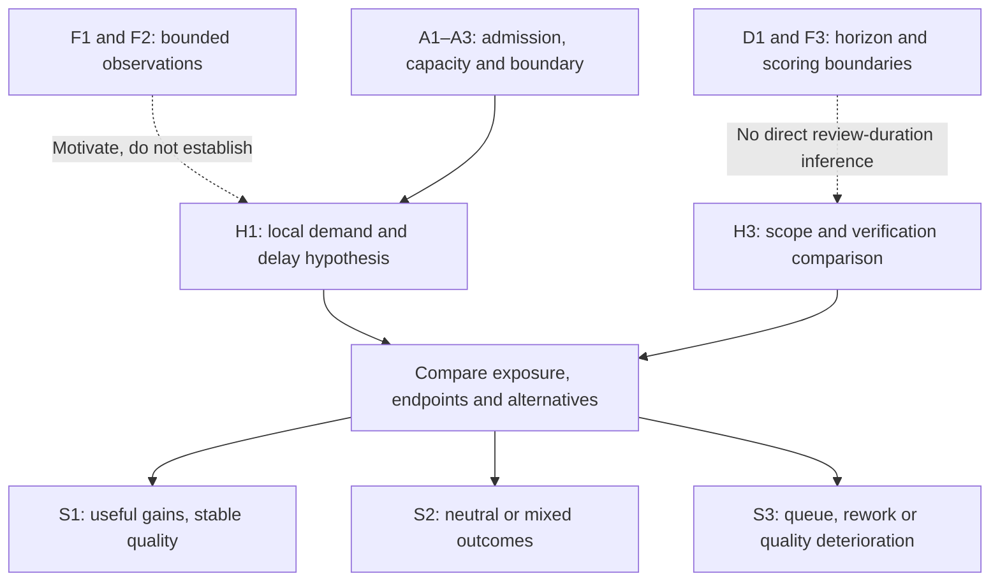

# SDLC rebalancing: functions, outcomes and testable hypotheses

> [Home](../../README.md) | [Evidence and delivery outcomes](../01_the_illusion.md) | [Mechanisms](../02_broken_mechanics.md) | [Source Registry](../../evidence/SOURCES.md) | [Live work plan #84](https://github.com/UncertaintyArchitectureGroup/The-Subprime-Code-Crisis/issues/84)

## The thesis and the outcome that matters

**Our central research thesis is that AI coding tools have changed the economics
and capacity of producing candidate software faster than delivery systems have
adapted their ability to select, understand, verify, integrate, operate and obtain
value from it. This structural imbalance calls for reassessing the whole SDLC.**
Rebalancing means addressing the actual constraint while preserving the functions
that make software useful and sustainable. It can mean better automation, clearer
intent, smaller changes, stronger capability, less unnecessary work or an already
adequate process left in place.

The complete boundary is **Intent → requirements → design → code → review → test
→ integration → deployment → operation → realized user outcomes → business
economics → feedback to Intent**. These are recurring functions, not a mandatory
waterfall or a requirement to staff every stage equally. AI can change several
functions; the thesis does not depend on claiming it affects only code.

The destination is useful, understandable and operable software at justified total
cost and risk. A release has to connect to a useful outcome: solving a problem,
preserving reliable service, reducing user effort, improving accessibility,
avoiding harm or producing decision-relevant learning. Delivering the same useful
service more cheaply can also be a benefit. User benefit, competitive advantage
and ROI are separate propositions; the economics card tests the connection rather
than assuming it. More code, more releases and unchanged usage settle none of them.

The strongest existing support is uneven translation of activity toward releases
and tracked completion, plus observed review-process changes in a distinct firm
setting. Task experiments retain their different time effects. The [evidence map](#existing-evidence-and-its-exact-coverage)
shows that support and its limits. **The diagnosis is explicit; the consequence
claims are separate.** Review overload, lost understanding, persistent debt,
burnout and higher TCO must each earn their own verdict. Their absence or successful
unchanged practice can narrow the diagnosis; an accounting identity cannot make
an industry hypothesis immune to evidence.

This is the single research register, expanded under
[#86](https://github.com/UncertaintyArchitectureGroup/The-Subprime-Code-Crisis/issues/86).
It implements the maintainer's [thesis and author-context direction](https://github.com/UncertaintyArchitectureGroup/The-Subprime-Code-Crisis/issues/84#2-authorial-continuity-and-existing-evidence),
including the R23 unpublished author-review context recorded there. That context
supplies questions and concepts, not independent empirical corroboration. The
earlier [H1–H5](#hypotheses-and-distinguishing-observations), source/model graph and
measurement handoff remain below with explicit mappings. The live plan owns work
order; this register owns propositions and their evidence coverage.

### How to use this register

Start with H0, then the node where a benefit or loss is claimed. Read its whole
outcome inventory, not just its output metric. Separate what was measured, what
is a proposed mechanism and what remains unknown. Follow the linked research owner
for the next evidence task; an open verdict is a useful result, not a requirement
to invent a supporting study. The first readable edition does not await completion
of every node investigation.

Use the [competing explanations](#competing-explanations) to ask which account a
result favors, following the [comparison method](../../governance/hypothesis-evaluation.md#compare-explanations)
and [source × hypothesis record](../../governance/templates.md#source-hypothesis-comparison).

## Common assessment contract

The [existing evaluation method](../../governance/hypothesis-evaluation.md) defines
the verdicts and evidence test. The following conventions apply to every card;
they avoid duplicating the method in each row.

- **Baseline:** no common historical team has been measured for this register.
  The inventories describe intended functions. Their actual previous delivery is
  **unmeasured** unless a scoped source result is identified. In a particular study,
  record demonstrated, weak, absent or unmeasured delivery for each outcome, with
  its evidence. Include existing automation, defects, staffing, duties and costs.
- **Comparison:** record the actual prior human/AI workflow, exposure/tool version,
  assignment unit, comparable task/risk/functional scope and the named intervention.
  Keep rejected, failed and withdrawn work in the denominator. Report per assigned
  task/initiative and per accepted useful outcome where selection changes.
- **Observation:** distinguish active person-hours, elapsed waiting, activity,
  assurance, demonstrated understanding, user outcomes and money. Each card gives
  candidate observables and a follow-up boundary. The owning evidence task must
  justify a concrete window, meaningful effect and critical-outcome margins before
  testing; these cards are not preregistered experiments or universal thresholds.
- **Substitution and cost:** a function may move to another node, tool or person.
  Name the receiving owner, evidence of adequate delivery and setup/ongoing burden.
  Count the work once across nodes. Neither fewer manual steps nor a new ceremony
  establishes improvement. Unmeasured functions are neither preserved nor harmed.
- **Decision:** the named local role accepts a stated tradeoff; it is not a new
  repository-mandated production gate. Preserve critical quality, safety, data and
  capability floors appropriate to the context. Higher cost can be justified by
  greater benefit; a lower local cost that hides an unacceptable transferred loss
  cannot establish overall improvement. These cards record proposed owners and
  criteria, not actual organizational consent or measured net benefits.
- **Symmetry:** observe the trigger independently of the predicted harm. Test a
  specified remedy against the actual baseline and, where feasible, an unchanged
  AI-assisted workflow. Adequate unchanged outcomes weaken a claimed need for that
  remedy. A remedy's failure cannot be reclassified afterward as “not real
  rebalancing.” Nonsignificance does not establish equivalence.

**Assessment history:** the starting #86 assessment on 2026-10-22 mapped existing
reviewed evidence; #87 adds the reviewed Chen–Stratton firm study and the explicitly
dated successor assessments below; #4 adds the reviewed Shen–Tamkin skill-formation
study and a bounded immediate individual-learning assessment. These are not
systematic searches of every node.
No full-chain **Plausible — triangulated** verdict
is assigned. Independent macro/micro evidence can justify that verdict when it
fits the same scoped proposition, methods and contrary evidence have been assessed,
and underlying data are independent. One rigorous study can establish its own
bounded finding without a second citation. Source states and hypothesis verdicts
remain different records.

## H0: separate the premise, mechanism, consequences and remedy

### H0-A — Uneven change in capacity and cost

**Prediction:** in specified tool/task settings, implementation or candidate
production gains exceed gains in complementary delivery functions. Compare the
same defined boundary before/after exposure against a credible untreated or
alternative-workflow comparator. Observe implementation time/cost and accepted
outcomes separately from activity, review, release and operation, over complete
task-to-release cycles; preserve outcome-specific samples where a source lacks
a linked cohort.

**Alternatives and weakening result:** improved output quality, changed task mix,
valuable experimentation or equally effective downstream assistance may account
for or absorb the activity increase. Sustained proportionate downstream gains at
comparable scope/quality/cost weaken an asymmetry claim in that setting. Positive
release gains are benefits even when proportionally smaller.

**Remedy test:** compare a predefined allocation of investment across functions
with additional coding optimization alone; use H0-R/BAL-1 for its net result.
The delivery owner must preserve the relevant node floors; no transfer of effort
counts as elimination. **Starting #86 verdict: Provisional support** for uneven translation in
the existing NBER setting and bounded coding gains; whole-system capacity/cost
ratios remain unmeasured. E-NBER/E-PENG support parts; E-METR-Productivity/E-METR-Update preserve
context/time heterogeneity.

**Assessment after #87, 2026-10-22:** retain **Provisional support** and extend its
observable scope to [Chen–Stratton's firm-level coding/completion pattern](#e-chen-stratton).
The small positive completion estimate is uncertain; neither study measures the
whole-system capacity/cost ratio or proves an industry-wide loss. Positive NBER
release gains remain benefits. Next: [Code #92](https://github.com/UncertaintyArchitectureGroup/The-Subprime-Code-Crisis/issues/92).

### H0-B — Complementary constraints attenuate useful outcomes

**Prediction:** where independently measured admitted service demand rises beyond
available quality-preserving capability, insufficient adaptation reduces the
translation into useful delivery, through stage waits, coordination or rework.
Measure demand, capacity, work/risk mix and policies before attributing observed
queues to this mechanism. Compare similar exposed workflows with different
baseline headroom/adaptation over multiple delivery cycles and downstream follow-up.

**Alternatives and weakening result:** deliberate experiments, scope changes,
release batching, product demand/discovery, selection and outcome lag can produce
attenuation without overloaded review. With the independently measured trigger
present, no meaningful worsening of the predicted stage/outcome link weakens that
local model. Broad sustained gains under unchanged adequate practice narrow the
claimed prevalence of a need to rebalance; absence of the trigger is not a test
of harm under that trigger.

**Remedy test:** predefine a stage-specific admission, capability or coordination
change and test whether useful outcomes improve enough to justify its total cost,
including displaced work and ownership. The delivery owner and affected node owner
accept the tradeoff. **Starting #86 verdict: Provisional support for the attenuation premise;
Open for identification of the proposed capacity mechanism.** E-NBER measures
bounded cross-outcome attenuation and provides a model-dependent complementarity
interpretation; it does not identify review overload. E-Xu is adjacent activity
evidence.

**Assessment after #87, 2026-10-22:** retain that split verdict.
[Chen–Stratton](#e-chen-stratton) adds direct review-process observations consistent
with the mechanism: longer elapsed merge time, more formal change requests and
comments, and broader reviewer participation after agent adoption. Active service
demand, competent capacity and causal mediation remain unidentified; altered
standards, coordination and successful adaptation remain alternatives. Next:
[Review #93](https://github.com/UncertaintyArchitectureGroup/The-Subprime-Code-Crisis/issues/93)
and [Integration #95](https://github.com/UncertaintyArchitectureGroup/The-Subprime-Code-Crisis/issues/95).

### H0-C — Local targets sustain the mismatch

**Prediction:** adoption decisions tied to coding/usage targets, without downstream
acceptance, expand commitments or remove complementary capacity sooner than
otherwise comparable outcome-led decisions. Inspect dated claims, actual targets,
budgets and decisions before measuring subsequent capability gaps and outcomes.
Compare decision cohorts over an adoption cycle and delivery/operating follow-up.

**Alternatives and weakening result:** commercial deadlines, demand, staffing or
already adequate capability may explain the choices. With the specified target
exposure, no earlier expansion, capacity loss or reduced use of downstream evidence
weakens the decision link; later net benefit alone does not test that earlier link.
**Remedy:** compare an explicit outcome/capability decision record with actual prior
decision practice, including decision delay and analysis cost. Failure to improve
decision accuracy or outcomes enough to justify cost weakens the remedy. The
investment owner owns the tradeoff; marketing intent is not inferred.
**Verdict: Open**, including the remedy; no direct decision-chain evidence is
assessed here. MKT-1 separates the documentary and causal links. Next:
[#100](https://github.com/UncertaintyArchitectureGroup/The-Subprime-Code-Crisis/issues/100).

### H0-D — Persistent mismatch has distinct downstream costs

**Prediction:** sustained, independently observed capability shortfalls contribute
to one or more of lost understanding, unresolved obligations, overload, incidents
or higher lifecycle cost. These are separate endpoints, not a compulsory sequence.
Compare matched exposure/risk and pre-existing trends, following tasks into later
change, operation and human outcomes. Measure capability through tasks, retained
obligations through a longitudinal ledger, human outcomes directly and economics
over the same defined horizon.

**Alternatives and weakening result:** new scope, pre-existing debt, reorganizations,
useful experimentation and improved automation may explain apparent burdens.
Stable/improved capability, recovery, well-being or full cost under the relevant
exposure weakens that endpoint's harm prediction with adequate precision; one
endpoint cannot stand in for another. **Remedy:** independently test the particular
training, ownership, capacity or recovery intervention against its full cost and
affected user/team outcomes. Engineering and operating owners share the relevant
decisions, with human outcomes included rather than traded away invisibly.
**Verdict: Open** for the downstream causal claims and remedies. E-Xu/E-Agarwal
provide adjacent proxies, not measured debt stock, cognition, burnout or TCO.
Next: HUM-1/2, DEBT-1 and OPS/ECO owners below.

### H0-R — Rebalancing improves the system

**Prediction:** a predefined intervention addressing an independently diagnosed
constraint improves useful outcomes and/or full cost and risk relative to the
actual prior workflow, without unacceptable loss of other node functions. Compare
it with unchanged practice and additional coding optimization where feasible,
including setup, learning, ongoing work, long-term maintenance and opportunity cost.

**Alternatives and weakening result:** adequate baseline capability, spontaneous
learning, improved tools or simpler task selection may deliver the same gain.
No meaningful incremental benefit, or benefit outweighed by cost/critical-outcome
loss, weakens the specified intervention. A successful unchanged process weakens
the claim it needed that intervention. Do not define the constraint from the remedy's
success or exempt failed interventions retrospectively.

**Remedy and decision:** the node-specific `-2` cards and BAL-1 specify candidate
changes; the delivery/investment owner evaluates benefit, capability, user effects
and cost together over the matching horizon. **Verdict: Open.** Existing observations
motivate this comparison but establish no common rebalancing package. Next:
[Economics #99](https://github.com/UncertaintyArchitectureGroup/The-Subprime-Code-Crisis/issues/99)
and each selected node issue; [#54](https://github.com/UncertaintyArchitectureGroup/The-Subprime-Code-Crisis/issues/54)
only if a specific feasible empirical question warrants collection.

## Competing explanations

These six families make the thesis contestable at its separate links: observed
local acceleration, uneven capability, the constraint mechanism, its persistence,
downstream consequences and the value of a specified remedy. **H0 is this
register's research-thesis identifier, not a statistical null hypothesis.** The
families are bounded alternatives, not exhaustive explanations or mutually
exclusive sides. Several may operate in the same setting; identify the particular
observation and link over which they compete.

The common assessment contract and complete node inventories still apply. Each
card describes a proposed comparison, not an observed baseline or a validated
intervention. Its owning task fixes the population, exposure, comparator, horizon,
meaningful effect and critical-outcome margins before judging results; any
retrospective choices remain explicit. Preserve Review's quality and competent
ownership outcomes even when one is unmeasured. No universal horizon, threshold,
probability or mandatory manual activity is introduced here.

| Family | Explanation to examine | Main claim boundary |
| --- | --- | --- |
| [ALT-1](#alt-1--adequate-capability-and-functional-substitution) | Existing capability or an effective substitute absorbs additional work | H0-B mechanism/prevalence; H0-R necessity |
| [ALT-2](#alt-2--transitional-adaptation) | Early mismatch recedes through bounded adaptation | H0-B duration; H0-D persistence; H0-R attribution |
| [ALT-3](#alt-3--task-mix-experimentation-and-measurement) | Scope, useful exploration or measurement accounts for apparent attenuation | H0-A/B interpretation; COD-1; DEBT-1 |
| [ALT-4](#alt-4--demand-discovery-and-adoption) | Demand and uptake explain the production-to-value gap | H0-B at the value boundary; INT/VAL/ECO |
| [ALT-5](#alt-5--selection-heterogeneity-and-external-changes) | Selection, context or other changes explain associations or limit their scope | Causal attribution and generalization of H0/node claims |
| [ALT-6](#alt-6--net-value-and-incremental-remedy-value) | Net benefit and the incremental value of a remedy are separate questions | H0-D/ECO versus H0-R/BAL-1 |

**Initial verdicts, 2026-10-22: Open**, including ALT-6a and ALT-6b separately.
[#109](https://github.com/UncertaintyArchitectureGroup/The-Subprime-Code-Crisis/issues/109)
defines these comparisons; it does not apply them to the existing evidence packet
or change its dated assessments. The nine-entry comparison belongs to
[#110](https://github.com/UncertaintyArchitectureGroup/The-Subprime-Code-Crisis/issues/110),
and the finite diagnostic search to
[#111](https://github.com/UncertaintyArchitectureGroup/The-Subprime-Code-Crisis/issues/111).
The node owners below retain subsequent research. Definition of a family supplies
neither evidence for it nor a new source state.

### ALT-1 — Adequate capability and functional substitution

**Scope and comparator:** teams admitting more comparable AI-assisted candidate
work, with specified baseline headroom, candidate quality or assistance in other
functions. Measure service requirements and available competent capacity
independently of the queues and losses being predicted. Compare the actual
workflow with its prior or credible concurrent baseline, and distinguish existing
capability from a separately proposed extra intervention. Follow complete delivery
cycles and a relevant delayed ownership/maintenance window.

**Prediction and distinguishing observations:** useful delivery improves while
quality, demonstrated understanding and recovery capability remain adequate at
acceptable total cost. Direct observations of the substitute supplying the same
function distinguish functional replacement from merely removing a manual step.
Sustained adequate outcomes without the proposed extra intervention weaken a claim
that this setting needed that intervention; absent overload exposure does not
refute a conditional harm prediction under overload.

**Would weaken this account:** independently measured higher comparable admitted
demand exposes a capability shortfall, persistent waiting/rework or a critical
quality/ownership loss despite the claimed headroom or substitute. Examine changed
work mix, reduced intake, staffing additions, hidden transferred effort and short
follow-up before attributing either success or failure.

**Relations and owners:** contests H0-B's prevalence/necessity claim and specific
H0-R remedies; it can coexist with constraints elsewhere. Full node outcomes remain
owned by the [node index](#node-index), especially
[Code #92](https://github.com/UncertaintyArchitectureGroup/The-Subprime-Code-Crisis/issues/92),
[Review #93](https://github.com/UncertaintyArchitectureGroup/The-Subprime-Code-Crisis/issues/93)
and [Integration #95](https://github.com/UncertaintyArchitectureGroup/The-Subprime-Code-Crisis/issues/95).

### ALT-2 — Transitional adaptation

**Scope and comparator:** comparable teams/work during a defined adoption period.
Follow the same teams through a declared learning horizon, with credible concurrent
comparators where available. Record tool versions, staffing, training and process
changes; distinguish routine adjustment from the particular H0-R intervention.

**Prediction and distinguishing observations:** an early mismatch diminishes
within that horizon as capability or coordination adapts, while useful outcomes
and critical quality/ownership functions recover. A longitudinal trajectory with
observed adaptation is more diagnostic than comparing unrelated early and late
cohorts. Recovery after a specified intervention alone does not identify spontaneous
adaptation or establish the intervention's incremental effect.

**Would weaken this account:** the predicted recovery fails within the stated
horizon with adequate measurement and precision, or apparent recovery comes only
from dropout of struggling teams, reduced scope or uncounted transferred work.
Check survivor selection, seasonal demand, staffing and simultaneous tool changes;
do not extend the learning window after seeing an unfavorable result.

**Relations and owners:** may explain timing while accepting initial H0-B imbalance;
challenges persistence in H0-D and attribution of improvement to H0-R. Relevant
owners are [Review #93](https://github.com/UncertaintyArchitectureGroup/The-Subprime-Code-Crisis/issues/93),
[Operation #97](https://github.com/UncertaintyArchitectureGroup/The-Subprime-Code-Crisis/issues/97)
and [Economics #99](https://github.com/UncertaintyArchitectureGroup/The-Subprime-Code-Crisis/issues/99),
including HUM-1/2 and DEBT-1's distinct delayed endpoints.

### ALT-3 — Task mix, experimentation and measurement

**Scope and comparator:** comparable assigned initiatives or tasks whose scope,
exploration, activity accounting or release policy changes with AI use. Compare
functional outcomes, quality and total effort across the same defined boundaries;
include failed, discarded and stopped work. Follow experimentation through its
decision/learning window and released work through the relevant delivery lag.

**Prediction and distinguishing observations:** apparent activity-to-output
attenuation is explained partly or wholly by broader scope, useful exploration,
finer counting or batching, without the proposed overload mechanism. Linked
task-to-outcome observations and justified learning from stopped experiments help
distinguish this account from wasted work. Unequal percentages from different
populations cannot form a conversion funnel.

**Would weaken this account:** attenuation and independently identified capability
shortfalls persist after credible boundary, scope, quality and lag comparisons,
without corresponding useful learning or additional functionality. Check task
selection, unobserved abandoned work and measurement changes. Report the total
exposure effect alongside adjusted comparisons: scope or experimentation may be
part of AI's effect, so adjusting it away is not automatically a causal correction.

**Relations and owners:** qualifies H0-A/B and COD-1 interpretations and inferred
waste/debt, while allowing a real constraint to coexist. Owners:
[Intent #89](https://github.com/UncertaintyArchitectureGroup/The-Subprime-Code-Crisis/issues/89),
[Code #92](https://github.com/UncertaintyArchitectureGroup/The-Subprime-Code-Crisis/issues/92)
and [Integration #95](https://github.com/UncertaintyArchitectureGroup/The-Subprime-Code-Crisis/issues/95);
DEBT-1 retains its persistence and later-cost test.

### ALT-4 — Demand, discovery and adoption

**Scope and comparator:** released capabilities and comparable user groups/tasks,
where user-outcome growth may lag production improvement. Link specific delivered
changes to availability, discovery, adoption and task benefit. Compare demand and
service conditions over a declared uptake and sustained-benefit window, including
non-users and adversely affected groups.

**Prediction and distinguishing observations:** a gap arises at discovery, demand,
competition or uptake despite adequate production and operability. Linked evidence
that users do not discover, need or yet adopt a delivered capability distinguishes
this boundary from a failure to deliver it. Usage and user benefit remain separate;
lower cost or better reliability can benefit users with unchanged usage.

**Would weaken this account:** sufficiently observed stable demand and uptake
conditions accompany an identified production/quality constraint that explains the
missing useful outcome, or the predicted uptake recovery does not occur within the
stated window. Check changing audiences, pricing, product fit, competing offerings
and external shocks. Separate marketplace series cannot identify this chain.

**Relations and owners:** competes with H0-B explanations specifically at the
production-to-value boundary; it does not explain every review queue and may
coexist with one. Owners:
[Intent #89](https://github.com/UncertaintyArchitectureGroup/The-Subprime-Code-Crisis/issues/89),
[User outcomes #98](https://github.com/UncertaintyArchitectureGroup/The-Subprime-Code-Crisis/issues/98)
and [Economics #99](https://github.com/UncertaintyArchitectureGroup/The-Subprime-Code-Crisis/issues/99).

### ALT-5 — Selection, heterogeneity and external changes

**Scope and comparator:** developers, teams or repositories with different adoption,
task selection, experience, architecture or concurrent changes. Define exposure,
assignment/analysis units and relevant strata; compare credible assigned or
matched groups over pre-exposure and outcome windows appropriate to the claim.

**Prediction and distinguishing observations:** an apparent AI effect diminishes
under a more credible comparison, precedes exposure, tracks a separate change,
or is concentrated in specified contexts. Allocation evidence, pre-trends,
attrition/participation checks and within-context estimates distinguish selection
or external-change explanations from an effect of the stated exposure. Genuine
effect heterogeneity limits generalization even when an average causal effect exists.

**Would weaken this account:** a scoped effect survives credible assignment,
comparator and measurement checks with adequate precision, and proposed external
changes do not explain its pattern. Check spillovers, concurrent staffing/deadlines,
measurement error and post-exposure selection; favorable subgroup choices made
after results remain exploratory. Robustness in one setting does not establish
prevalence elsewhere or eliminate every unidentified confounder.

**Relations and owners:** challenges attribution or generalization of H0 and node
claims, without denying a conditional mechanism in a genuinely exposed setting.
[#110](https://github.com/UncertaintyArchitectureGroup/The-Subprime-Code-Crisis/issues/110)
owns the first comparative assessment; each [node owner](#node-index) retains its
population/design question, and [#100](https://github.com/UncertaintyArchitectureGroup/The-Subprime-Code-Crisis/issues/100)
owns the specific marketing-to-decision chain in H0-C/MKT-1.

### ALT-6 — Net value and incremental remedy value

These are **two separately judged propositions**, not one verdict that can replace
the individual endpoints in H0-D. Both compare useful user outcomes, all affected
role-hours/costs and critical capability/quality floors over a stated setup,
delivery and maintenance horizon. Declare valuation, opportunity-cost and
uncertainty assumptions; do not add incompatible outcome units into a balance score.

**ALT-6a — Positive net value despite a local burden.** For comparable useful
service, AI-assisted production may yield sufficient benefit or savings to justify
greater verification effort or other specified burdens. Compare the actual
AI-assisted workflow with the credible prior/concurrent workflow. Sustained
benefit exceeding full incremental cost supports this account; a justified net
loss or a benefit dependent on omitted costs weakens it. Examine attribution,
benefit lag, cost transfer, pre-existing obligations and useful learning. Positive
monetary net benefit does not erase a measured learning, maintenance or human harm,
and cannot alone establish acceptable overall improvement when a critical floor
fails. This qualifies a net-harm conclusion; it does not refute the adverse
endpoint itself. Owners: [User outcomes #98](https://github.com/UncertaintyArchitectureGroup/The-Subprime-Code-Crisis/issues/98)
and [Economics #99](https://github.com/UncertaintyArchitectureGroup/The-Subprime-Code-Crisis/issues/99),
with H0-D/HUM/DEBT/OPS owners retaining their individual outcomes.

**ALT-6b — Insufficient incremental value from the specified remedy.** Compare a
predefined extra intervention with unchanged AI-assisted practice and, where
feasible, further coding optimization at comparable investment. No meaningful
incremental benefit, or cost/critical-outcome loss exceeding the gain, supports
this account; sufficient demonstrated incremental benefit with preserved floors
weakens it. Include setup, learning, upkeep and displaced work over the declared
horizon. Check spontaneous adaptation, task selection and simultaneous changes;
do not redefine a failed remedy after seeing results. This tests H0-R/BAL-1 and
the node `-2` cards independently of ALT-6a. Owners:
[Economics #99](https://github.com/UncertaintyArchitectureGroup/The-Subprime-Code-Crisis/issues/99)
and the relevant [node owner](#node-index); any separately approved collection
remains [#54](https://github.com/UncertaintyArchitectureGroup/The-Subprime-Code-Crisis/issues/54).

## Existing evidence and its exact coverage

These are nine reviewed source entries, not nine independent confirmations of H0.
Each linked brief owns its methods, calculations, disclosures and limitations.
Original locators below identify the inspected edition. The
[Source Registry](../../evidence/SOURCES.md) owns current processing state; a
hypothesis verdict cannot promote that state.

### E-NBER

[P-2026-01 — September 2026 revision](../../evidence/primary/2026-writing-code-vs-shipping-code.md),
Figure 1, Table 6, §§5–7 and Appendix C.4.8. Selected public-GitHub observational
cohorts show cumulative headlines of approximately **240% more commits, 80% more
repositories touched and 30% more releases**. Positive release gains and broad
attenuation coexist. Different outcome populations, specification sensitivity and
no separate async release estimate prevent a common-cohort conversion interpretation.
Releases are recently contributed-to repositories releasing, not deployed features
or user benefit. Complementarity is model-calibrated. Separate marketplace proxies
include modest Android usage growth. This supports the H0-A/H0-B and COD-1 premise;
review overload, ownership loss and full TCO remain unmeasured. The brief preserves
the May attachment as history; this assessment uses September.

### E-CHEN-STRATTON

[P-2026-04 — Chen–Stratton, 4 August 2026 working paper](../../evidence/primary/2026-chen-stratton-firm-production.md),
§§2–4 and Figures 6–7/11–13, pp39–40/44–46. In selected Jellyfish firms,
pooled agent-adoption estimates are about **30% more added lines and 23% more PRs
per active worker-month**. Resolved Jira issues have an approximately **3% positive
estimate, with an approximate 95% interval of −6% to +12%**. These are different
outcomes, not a loss funnel or evidence of zero completion gain; a formal test of
their difference is not supplied. Jira resolution is the authors' completion
proxy, not an independent deployment or user-benefit audit.

The agent review path has **3.45 additional elapsed days to merge from a 7.03-day
baseline**, more formal change requests/comments and broader reviewer participation.
These are direct process observations, not active labor, actual defects, quality
effectiveness or demonstrated ownership. Earlier assistant estimates do not show
the same significant merge-time, change-request and comment increases. Adoption is
observational; visible pre-period movements and incomplete exposure/coverage limit
causal attribution. The source's two-stage model interprets these patterns but
does not identify review saturation or prove that AI review is ineffective.

This extends H0-A/H0-B/COD-1's bounded premise and gives REV-1 provisional process
support. The causal demand/capacity mechanism, quality/ownership consequences,
INTG-1/2 and remedies remain Open. The brief records exact coefficients, uncertainty,
source-reporting discrepancies and the NBER comparison; the [#87 impact report](../../governance/reviews/issue-87-2026-10-22-source-impact.md)
maps every affected Code/Review/Integration function, including the unmeasured ones.

### E-PENG

[P-2023-01 — arXiv v1, 13 February 2023](../../evidence/primary/2023-copilot-task-productivity.md),
Study Design, Results/Figure 6, Table 1 and Discussion. A randomized 2022 Copilot
experiment on one JavaScript HTTP-server task reports **55.8% less completion time**
among completers (95% CI 21–89%). Assignment and completion denominators differ.
This is positive local task evidence, not lifecycle quality, team ownership or
enterprise delivery. It supports the bounded acceleration premise in H0-A/COD-1;
differences from METR do not identify a universal seniority or task-type cause.

### E-METR-Productivity

[P-2025-01 — arXiv v2, 25 July 2025](../../evidence/primary/2025-metr-experienced-developer-productivity.md),
§§2.1–2.3, Figure 1 and Appendices C.3/D/G.7. Early-2025 AI permission increased
active implementer task time in familiar mature OSS work: **19% longer** (95% CI
+2 to +39%, interval restated in the dated follow-up). Completion, exclusion and
imputation boundaries matter. Perceived savings differ from measured time. This
qualifies automatic acceleration in H0-A/COD-1; it measures neither other reviewers'
hours nor lost understanding, and it does not estimate today's tools.

### E-METR-Update

[P-2026-03 — 24 February 2026 update](../../evidence/primary/2026-metr-productivity-design-update.md),
opening results, study details and selection/time-measurement discussion. The
authors expect greater benefit than in early 2025, while explaining why participation,
task selection and concurrent-agent measurement make its magnitude unreliable.
Raw returning/new-cohort intervals cross zero. Keep this beside the historical
result: it is neither a reliable universal speedup nor a retraction. The same
research programme and returning participants do not constitute an independent
replication of the old result or of H0.

### E-Xu

[P-2025-03 — arXiv v3, 28 January 2026](../../evidence/primary/2025-xu-copilot-oss-activity.md),
§§3.1–3.4, Table 5 and Appendix Tables 11–14. Language-availability DiD reports
positive project activity, follow-up-commit proxy changes and activity-quartile
differences. The core review-count estimate is uncertain (p=.086). Core denotes
pre-treatment activity, not seniority; actual individual use is unobserved.
These are adjacent signals for H0-B/H0-D/REV-1/DEBT-1, not measured reviewer hours,
causal displacement, persistent debt or net delivery value. Source-internal
reporting discrepancies remain in the brief.

### E-Agarwal

[P-2026-02 — inspected arXiv v2, 27 January 2026](../../evidence/primary/2026-agarwal-agent-adoption.md),
§3, Table 2 and Figure 2/§4. Matched repository-month DiD after observable agent
PRs reports positive agent-first activity, inconclusive IDE-first activity and
separate static structural estimates. Exposure traces, selection and an IDE-first
complexity pre-trend limit causal interpretation. Static complexity is not human
cognitive load or debt per feature. H0-D/DES-1/HUM-1/DEBT-1 receive a reason to
investigate, not evidence of their later human/cost outcomes. Equivalence to the
final proceedings text remains unverified.

### E-METR-Horizon

[P-2025-02 — arXiv v1, 18 March 2025](../../evidence/primary/2025-metr-task-horizon.md),
§§3–4, 6.4, 8.2 and Appendix B.2, “Time to score.” Task horizon is fitted
human-baseline task length at a chosen success level, not required review time.
A small internal-PR exercise found manual scoring faster than implementation:
useful counterevidence against equating those durations. It does not estimate
complete production assurance or ownership. The historical version, scaffold/time
limits and internal count discrepancies remain explicit. It constrains REV-1/2
and legacy H3/H4 without validating a remedy.

### E-SHEN-TAMKIN

[P-2026-05 — arXiv v2, 1 February 2026](../../evidence/primary/2026-ai-impacts-skill-formation.md),
§§4.1–4.3, 5.2.1–5.2.2, Figures 6/11, §6 and Appendix D/Figure 23. The randomized comparison
analyzes 52 developers, 26 per arm, learning unfamiliar Trio tasks with GPT-4o
chat assistance or instructions/examples and web resources. All were Trio
novices; 48 reported at least four years of coding experience. Recruitment,
completion and analysis counts differ and are recorded in the brief.

The AI arm scored lower on the immediate unassisted 14-question, 27-point quiz
(reported d = .738, p = .010; adjusted d = .725, p = .016). The mean task-time
comparison is inconclusive (p = .391). All 26 AI-arm participants and 22 of 26
controls completed Task 2 within the study's 35-minute programming limit. Median encountered task errors
were 1 versus 3; these are not production defects. The brief retains the raw
4.15-point/27-point-scale versus 17% reporting discrepancy rather than treating
17% as a verified skill-loss percentage.

This adds a direct immediate individual-learning endpoint relevant to Code's
learning function and HUM-1. The six interaction patterns and subarea analyses
are exploratory; they do not identify a learning-preserving remedy. Durable
retention, expert system understanding, knowledge transfer, collective ownership,
burnout, user benefit and lifecycle ROI were not measured. Versions, summaries
and within-study patterns are not independent replications.

### Independence and missing links

Chen–Stratton's firm-month Jellyfish data/design and NBER's selected individual
GitHub cohorts are distinct analytical settings. Their person/repository overlap
is unknown; they are not documented disjoint random samples. Convergent
activity/completion patterns and added review-process coverage strengthen a bounded
inference without supplying a second measurement of the complete causal mechanism.
Chen–Stratton cites the May NBER edition; this register compares the accepted
September edition. Those versions are not independent studies.

NBER and Peng use different data/designs but share an author and relevant
Microsoft/GitHub relationships. METR productivity and its follow-up are one research
family; the horizon study uses a different design with overlapping organization
and researchers. The public-GitHub studies have potentially overlapping ecosystems,
with overlap not quantified here. Do not sum their sample sizes or count versions,
retellings or author essays as replications.

Taken together, these sources justify investigating an explicit systems diagnosis.
They do not measure the same full mechanism. No mapped study directly establishes
the complete intent, shared-ownership, burnout, user-task-benefit or lifecycle-ROI
propositions below. That is a gap in this assessed packet, not a finding that no
such evidence exists. The linked research owners must search positive, negative,
null and successful-adaptation evidence before revising those verdicts.

The skill-formation source adds immediate individual-learning coverage. It does
not fill the durable or collective-capability gaps, and its versions, summaries
and exploratory interaction patterns do not supply independent replications.

## Node index

| Function / hypotheses | Key contribution beyond the artifact | Research owner |
| --- | --- | --- |
| [Intent / INT-1/2](#intent--int-1-and-int-2) | Worthwhile selection, shared purpose, decision ownership and learning when stopping | [#89](https://github.com/UncertaintyArchitectureGroup/The-Subprime-Code-Crisis/issues/89) |
| [Requirements / REQ-1/2](#requirements--req-1-and-req-2) | Shared meaning, negotiated constraints and grounded acceptance | [#90](https://github.com/UncertaintyArchitectureGroup/The-Subprime-Code-Crisis/issues/90) |
| [Design / DES-1/2](#design--des-1-and-des-2) | Tradeoffs, shared system model, interfaces and future changeability | [#91](https://github.com/UncertaintyArchitectureGroup/The-Subprime-Code-Crisis/issues/91) |
| [Code / COD-1/2](#code--cod-1-and-cod-2) | Executable behavior, implementation learning and a maintainable handoff | [#92](https://github.com/UncertaintyArchitectureGroup/The-Subprime-Code-Crisis/issues/92) |
| [Review / REV-1/2](#review--rev-1-and-rev-2) | Quality plus demonstrated shared understanding and competent ownership | [#93](https://github.com/UncertaintyArchitectureGroup/The-Subprime-Code-Crisis/issues/93) |
| [Test / TST-1/2](#test--tst-1-and-tst-2) | Behavioral evidence, independent challenge, reproducibility and learning | [#94](https://github.com/UncertaintyArchitectureGroup/The-Subprime-Code-Crisis/issues/94) |
| [Integration / INTG-1/2](#integration--intg-1-and-intg-2) | Coherent behavior and knowledgeable cross-team coordination | [#95](https://github.com/UncertaintyArchitectureGroup/The-Subprime-Code-Crisis/issues/95) |
| [Deployment / DEP-1/2](#deployment--dep-1-and-dep-2) | Safe exposure, data integrity, receiving owners and intervention | [#96](https://github.com/UncertaintyArchitectureGroup/The-Subprime-Code-Crisis/issues/96) |
| [Operation / OPS-1/2](#operation--ops-1-and-ops-2) | Reliable service, diagnosis, recovery, maintenance and feedback | [#97](https://github.com/UncertaintyArchitectureGroup/The-Subprime-Code-Crisis/issues/97) |
| [User outcomes / VAL-1/2](#realized-user-outcomes--val-1-and-val-2) | Actual task benefit, affected groups, burden and decisions to revise/stop | [#98](https://github.com/UncertaintyArchitectureGroup/The-Subprime-Code-Crisis/issues/98) |
| [Economics / ECO-1/2](#business-economics-and-feedback-to-intent--eco-1-and-eco-2) | Lifecycle value, accountable investment and feedback to Intent | [#99](https://github.com/UncertaintyArchitectureGroup/The-Subprime-Code-Crisis/issues/99) |

## Node functions, outcomes and tests

In the inventories, **U** means actual local delivery has not been assessed here;
it does not mean the function was absent everywhere. The common assessment
contract applies to every row. Scoped source findings remain distinct from this
uncollected local baseline. All measurements are proposed observations.

For each node, **-1** tests the adverse/attenuation mechanism and **-2** separately
tests a remedy. The cards name candidate receiving owners and costs, not actual
organizational approvals. Functions can move if their outcomes remain adequate.

### Intent — INT-1 and INT-2

**Boundary and comparison:** an observed user/system problem becomes an admitted initiative, an experiment or a reasoned stop. Compare similar initiative portfolios and available budgets under the actual selection practice, with and without the specified coding assistance or selection intervention. Follow selection through the decision horizon and the later benefit/learning window; include stopped initiatives.

| Intended function/outcome | Actual baseline | AI change or possible substitute and owner | Proposed observable and cost |
| --- | --- | --- | --- |
| Select a worthwhile problem; distinguish desired outcome from proposed feature | U: prior selection quality and evidence use need assessment | Cheaper prototypes expand options; product owner and user research can supply independent problem checks | Justified/admitted/stopped initiatives per evaluated initiative; user problem evidence and later outcome, not proposal count; discovery and experiment hours |
| Establish shared purpose, assumptions and decision ownership | U: agreement and competent ownership are not inferred from an approved brief | Drafted proposals may compress discussion; product/engineering decision owners can explain assumptions and challenge alternatives together | Independent agreement on consequential goals/constraints; mistaken-assumption corrections per initiative; decision and coordination time |
| Negotiate priorities and opportunity cost; hand intent to Requirements | U: decision rights, tradeoffs and handoff quality unknown | AI ranks or elaborates options; accountable portfolio owner retains the decision and its rationale | Traceable priority changes; work displaced and clarification cycles per initiative; total invested capacity |
| Stop unsuitable work and preserve useful learning | U: prior stop practice and reuse of learning unknown | Cheap experiments can improve learning; named product owner records what changes the next decision | Decision accuracy against later evidence, time to stop/learn and avoided effort; useful no-release experiments remain benefits |

**INT-1:** Cheaper implementation increases admission of weakly justified initiatives when selection rewards activity instead of validated need. Establish the price/time change, admission exposure and incentive practice independently of later value. Predict poorer need-to-admission fit or lower realized value per invested effort. No meaningful decline in selection quality under increased comparable admissions weakens this claim; more useful experiments at lower cost can contradict the waste interpretation. Alternatives include unmet demand, better discovery and deliberately purchased learning.

**INT-2:** Explicit problem/value hypotheses, decision owners and stop criteria improve value or useful learning per invested effort. Compare the defined practice with actual selection, including its decision cost. No meaningful decision/value gain, slower learning or costs exceeding the benefit weakens the remedy; extra documentation is not its success measure.

**Critical outcomes and decision:** product/portfolio owner accepts discovery cost and speed tradeoffs while protecting relevant user need, safe experimentation and accountable decisions. The downstream test is improved user outcomes, useful learning or avoided waste at justified total effort, not more approved projects.

**Starting verdict, 2026-10-22:** INT-1 **Open**; INT-2 **Open**. No assessed direct comparison here establishes either selection deterioration or this remedy. Marketplace activity is not a measurement of intent quality. Next owner: [#89](https://github.com/UncertaintyArchitectureGroup/The-Subprime-Code-Crisis/issues/89); distinguish incentive evidence owned by #100 and outcomes owned by #98.

### Requirements — REQ-1 and REQ-2

**Boundary and comparison:** intent becomes shared domain meaning, constraints and acceptance expectations. Compare assigned changes of similar domain/risk under actual requirements practice and a specified drafting/oracle intervention. Follow from clarification through acceptance and a defined post-release semantic-error window.

| Intended function/outcome | Actual baseline | AI change or possible substitute and owner | Proposed observable and cost |
| --- | --- | --- | --- |
| Discover ambiguity, edge cases and conflicting domain assumptions | U: historical defect discovery and unresolved ambiguity unknown | Fast drafting can reveal or hide gaps; domain expert and analyst challenge cases against external records/user practice | Independently identified ambiguity and semantic corrections per assigned change; domain-validation hours |
| Negotiate scope, constraints and meaningful acceptance examples | U: specification volume does not establish correctness | AI produces candidate examples; product/domain owner supplies acceptance authority and a grounded oracle | Requirement violations per comparable task and completeness on held-out cases; negotiation and oracle-building effort |
| Build shared meaning and retain ownership of consequential decisions | U: participants' understanding and rights need observation | Generated text can replace transcription; maintainers/domain owner still demonstrate aligned interpretations | Agreement on unseen examples, later explanation and decision reversals; learning/handoff time |
| Preserve intent-to-design/code/test traceability and feed corrections back | U: actual trace usefulness and feedback unknown | Tool-assisted trace can replace manual linking; requirements owner maintains meaning across revisions | Time to locate/revise a mistaken assumption; downstream rework per requirement/change; upkeep and stale-link burden |

**REQ-1:** Fast drafting propagates unresolved intent or domain assumptions into implementation and generated tests, increasing semantic rework. Define the drafting exposure and independently identify mistaken assumptions before scoring downstream failures. Lower semantic-error/rework rates with clearer assisted specifications weaken the adverse prediction; under identified shared mistakes, unchanged escape rates within justified margins weaken the propagation link. Alternatives include improved examples, domain support, scope selection and better baseline checks.

**REQ-2:** Independently grounded examples, acceptance oracles and traceability reduce propagation at acceptable total effort. Compare the specified independent-check practice with actual baseline checking, not with an intentionally unchecked implementation. No meaningful reduction in semantic errors/rework, or greater total burden without compensating benefit, weakens the remedy.

**Critical outcomes and decision:** the product/domain owner and engineering owner agree correctness and consequential constraint floors. Less drafting can be beneficial if shared meaning and accountable acceptance survive. Count validation cost against avoided user errors, delayed delivery and later support/rework.

**Starting verdict, 2026-10-22:** REQ-1 **Open**; REQ-2 **Open**. The logical possibility of a shared mistaken assumption does not establish its frequency or an AI-caused increase. No direct full comparison is assessed here. Next owner: [#90](https://github.com/UncertaintyArchitectureGroup/The-Subprime-Code-Crisis/issues/90), coordinated with #94 for the oracle link.

### Design — DES-1 and DES-2

**Boundary and comparison:** requirements become a choice of structure, interfaces and failure boundaries. Compare equivalent intended capability and risk under actual design practice, controlling for inherited architecture and concurrent change. Assess initial delivery and later comparable change, maintenance and recovery work over a declared horizon.

| Intended function/outcome | Actual baseline | AI change or possible substitute and owner | Proposed observable and cost |
| --- | --- | --- | --- |
| Explore alternatives, choose tradeoffs and define boundaries/invariants | U: alternatives considered and decision quality unknown | Rapid implementation can bypass or enrich design exploration; technical owner can evaluate prototypes and explicit alternatives | Reversed consequential decisions, invariant violations and future change effort; prototyping/design hours |
| Reconcile interfaces, security, reliability and operability constraints | U: prior architectural assurance and coordination unknown | Automated analysis/contracts can replace some manual inspection; component/security/operations owners maintain accepted boundaries | Cross-component failures and change propagation per comparable feature; checking and coordination cost |
| Build a shared system model and distribute knowledgeable ownership | U: diagrams and named owners do not establish capability | AI-generated explanations may help; design/maintainer owners test understanding through unfamiliar change/diagnosis tasks | Correct explanations, diagnosis/change success and dependence on one person/tool; learning and handoff effort |
| Preserve future changeability and useful feedback to Requirements/Operation | U: actual maintenance trajectory and feedback unknown | Generated dependencies may simplify or expand obligations; technical owner maintains rationale and removal/refactoring decisions | Comparable later change/maintenance hours, dependency-related incidents and avoided work; ongoing support cost |

**DES-1:** Faster local implementation expands coupling/dependencies faster than architectural assessment and ownership adapt, raising later change or maintenance effort. Measure output and structural exposure independently of the later effort endpoint; record whether assessment/ownership changed. Under that exposure, stable or lower later effort with preserved or improved demonstrated capability weakens the claim. Alternatives include purposeful added functionality, architecture simplification, better tools and effective existing boundaries. Static complexity alone measures neither human load nor money-valued debt.

**DES-2:** Suitable boundaries, simpler designs, knowledgeable ownership and architectural checks reduce later burden without erasing useful gains. Specify the actual intervention and compare equivalent capabilities. No meaningful later improvement, or larger total cost than the benefit at the agreed horizon, weakens it; design-document volume is not success.

**Critical outcomes and decision:** the accountable technical owner, with security/operations owners, accepts architectural investment and speed tradeoffs while preserving justified safety, operability and changeability floors. Lifecycle benefit is less effort or risk for useful service, with delayed costs observed rather than presumed.

**Starting verdict, 2026-10-22:** DES-1 **Open**; DES-2 **Open**. [Agarwal structural/activity proxies](#e-agarwal) can motivate the question but do not themselves establish the specified future-cost/ownership mechanism or remedy. Next owner: [#91](https://github.com/UncertaintyArchitectureGroup/The-Subprime-Code-Crisis/issues/91); DEBT-1 keeps persistence separate.

### Code — COD-1 and COD-2

**Boundary and comparison:** requirements/design become executable candidate behavior, implementation feedback and maintainable change. Compare assigned tasks with similar capability/risk under specified tool versions, including actual baseline assistance. Separate generation, acceptance, production and user-outcome windows; include discarded exploration and failed work.

| Intended function/outcome | Actual baseline | AI change or possible substitute and owner | Proposed observable and cost |
| --- | --- | --- | --- |
| Produce correct executable behavior and expose implementation realities | U for the local workflow; source-specific task outcomes remain bounded observations | Generation reduces or shifts author work; engineer and product/domain owner validate behavior and return discoveries upstream | Correct completion per assigned task, accepted/retained/discarded change and semantic errors; active work versus elapsed time |
| Develop implementation/debugging knowledge and make assumptions visible | U: writing code is not proof of retained understanding | Agent exploration/explanations may supply learning or displace practice; engineer/mentor owns demonstrable capability | Held-out explanation, diagnosis and modification success after a stated delay; assisted and independent performance; learning effort |
| Produce change another maintainer can understand, own and safely modify | U: actual maintainability and knowledge distribution unknown | Smaller/generated patches, tests or tools may substitute for manual narration; receiving maintainer owns the handoff | Recipient comprehension/change tasks, rejection/rework and dependence on producer/tool; handoff/review burden |
| Feed feasibility, defects and unused work back to selection/design | U: actual feedback and reuse of exploration unknown | Cheap variants can improve exploration; technical/product owners decide retain, revise or stop | Useful learning and later avoided work per experiment; total effort for both successful and abandoned paths |

**COD-1:** AI's gain in candidate coding activity exceeds its gain in correct, accepted useful change in some task/tool contexts. Compare the actual outcome boundaries and denominators; do not turn unrelated study percentages into a conversion funnel. Proportional or larger end-to-end gains at comparable quality weaken attenuation in that setting. Alternatives include beneficial exploration, different work mix, release batching, demand and observation lag; activity growth alone does not identify a harmful mechanism.

**COD-2:** Task selection and constrained change size improve useful completion relative to total generation/verification effort. Define eligible tasks and the size intervention before results, retaining rejected/failed tasks in accounting. No improvement in correct useful completion per total effort, or fragmentation/coordination costs that erase the gain, weakens this remedy.

**Critical outcomes and decision:** technical and product owners set behavior, security and maintainability floors and accept explicit speed/learning tradeoffs. Coding time and preserved engineering capability are distinct outcomes; neither alone proves user benefit or ROI.

**Starting #86 verdict, 2026-10-22:** COD-1 **Provisional support**, limited to the bounded activity-to-release attenuation in [the September NBER evidence](#e-nber); correct useful change, ownership and causal explanation remain incompletely measured. COD-2 **Open**, with no direct assessed comparison of this intervention. [Peng](#e-peng), [METR task productivity](#e-metr-productivity) and [its update](#e-metr-update) retain their positive/negative or uncertain local results and context differences; this verdict is not an overall negative productivity judgment.

**Assessment after #87, 2026-10-22:** COD-1 remains **Provisional support**, now also
covering [Chen–Stratton's distinct coding/tracked-completion observations](#e-chen-stratton).
Correct useful change and retained knowledge remain incompletely measured, and
uncertain positive completion is preserved. COD-2 remains **Open**. Next owner:
[#92](https://github.com/UncertaintyArchitectureGroup/The-Subprime-Code-Crisis/issues/92),
with #4 for skill formation.

**Coverage after #4, 2026-10-22:** [Shen–Tamkin](#e-shen-tamkin) adds an immediate
individual-learning measure alongside task completion and an inconclusive mean
time comparison. This informs Code's learning function; it does not measure the
candidate-to-useful-delivery relationship or test task selection and constrained
change size. COD-1 retains its existing **Provisional support**; COD-2 remains
**Open**. Durable understanding and maintainable team handoff remain separate
gaps. #92 continues to own the full Code-node assessment.

### Review — REV-1 and REV-2

**Boundary and comparison:** an admitted change receives a quality decision and a knowledgeable team takes responsibility for it. Compare similar risk/scope and reviewer familiarity under actual review practice, including existing automation. Measure admitted service demand and quality-preserving capacity independently of queue length. Follow through review, a delayed capability check and a defined post-release defect/recovery window.

| Intended function/outcome | Actual baseline | AI change or possible substitute and owner | Proposed observable and cost |
| --- | --- | --- | --- |
| **Quality gate:** challenge assumptions; detect defects and assess fit, security and maintainability | U: previous review effectiveness needs measurement, not reputation | AI checks, specialist review or independent behavioral evidence can replace some line inspection; review/technical owner accepts risk | Detection and escaped-error rates per comparable change, severity and false alarms; human/automated triage effort |
| **Ownership gate:** accept informed responsibility and acquire/demonstrate shared understanding | U: approval clicks or named assignees do not establish capability | Assisted explanation/execution, paired diagnosis or other substitutes may build understanding; receiving maintainer team owns the result | Held-out behavior explanation and diagnosis/change/containment/recovery success, with and without the preferred assistant; capability distribution beyond the producer |
| Transfer domain context, standards and knowledge; support learning | U: prior knowledge transfer and retained learning unknown | Generated explanations can help or conceal assumptions; reviewer/mentor supplies independent challenge and feedback | Delayed transfer to an unfamiliar change, repeated error patterns and reliance on a single expert; mentoring/context-reconstruction hours |
| Coordinate admission and handoff; return changes/risks to author, design and operations | U: actual waiting, interruptions and decision quality unknown | Automated prioritization, smaller batches and clearer ownership may move work; review lead and receiving operations owner track the transfer | Queue age/WIP, active service versus elapsed merge time, repeated rework, interruption and handoff failure per risk stratum; total review-path cost |

**REV-1:** Increased admitted review demand without sufficient adaptation increases waiting/rework or leaves quality or ownership functions less effective. Identify exposure from admitted work mix, independently estimated service requirements, available competent time and specified policies. Stable waits, quality and demonstrated ownership without meaningful added burden under higher comparable demand weaken the claim. Alternatives include headroom, smaller changes, better generated output, assistance, batching or unrelated dependencies. A queue alone establishes none of these causes.

**REV-2:** Appropriate AI assistance, risk-based review and smaller batches preserve defect detection and competent shared ownership while lowering total review-path cost. Evaluate the specified combination against actual practice, including setup/upkeep, false positives and displaced work. No meaningful net gain, a critical quality/capability loss, or greater total burden without compensating benefit weakens the remedy. A faster approval is not an ownership result; less manual reading is not an ownership loss if a substitute works.

**Critical outcomes and decision:** review lead and accountable receiving maintainers agree quality and competent-ownership floors appropriate to the change. Explicitly price learning time, interruptions and later recovery capability. Product/operations owners accept downstream risk/cost tradeoffs; individual review savings must not hide burden transferred to them.

**Starting #86 verdict, 2026-10-22:** REV-1 **Open** for this specified causal and full-outcome proposition; REV-2 **Open**. [Output attenuation](#e-nber) and [review-count proxies](#e-xu) motivated review investigation but did not identify active review burden or demonstrate lost ownership.

**Assessment after #87, 2026-10-22:** REV-1 has **Provisional support for its
review-process component in the observed agent setting; Open for the specified
demand/capacity mechanism and quality/ownership consequences**. [Chen–Stratton](#e-chen-stratton)
reports longer PR submission-to-merge elapsed time, more formal change requests
and comments, and broader reviewer participation. These measures add direct
process coverage beyond output counts; they do not identify active review labor,
competent capacity or lost understanding. Visible pre-period movements and
observational adoption limit causal attribution. REV-2 remains **Open**: the
descriptive adoption of AI review tools does not evaluate the proposed remedy.
The existing [METR scoring counterexample](#e-metr-horizon) remains relevant to
effort claims. Next owner: [#93](https://github.com/UncertaintyArchitectureGroup/The-Subprime-Code-Crisis/issues/93),
with #4 for skill formation and #49 for recovery evidence.

**Coverage after #4, 2026-10-22:** [Shen–Tamkin](#e-shen-tamkin) provides adjacent
individual-learning evidence for the knowledge-transfer question. It does not
test production review, shared ownership or the proposed review intervention.
REV-1 retains **Provisional support for its observed review-process component;
Open for the specified demand/capacity mechanism and quality/ownership
consequences**. REV-2 remains **Open**. #93 retains the full quality and ownership
assessment; no review practice is validated by the new learning result.

### Test — TST-1 and TST-2

**Boundary and comparison:** candidate behavior receives reproducible evidence against defined expectations and failure boundaries. Compare equivalent tasks with jointly generated code/tests against the stated baseline using independently grounded requirements/checks. Follow through acceptance, regression and a stated field-defect window; keep test creation, execution and triage effort separate.

| Intended function/outcome | Actual baseline | AI change or possible substitute and owner | Proposed observable and cost |
| --- | --- | --- | --- |
| Establish behavioral evidence and independently challenge assumptions | U: baseline oracle correctness and error coverage unknown | Generation scales cases; domain/test owner provides independently grounded expected behavior | Missed semantic violations per independently characterized case/task; oracle provenance and validation cost |
| Discover edge/failure boundaries and assess regression risk | U: historic detection and risk coverage unknown | Property, adversarial, mutation or model-based checks can substitute for repetitive manual cases; test/security owners validate relevance | Detection on defined held-out failures, escaped severity, false alarms and regression success; tooling/triage effort |
| Make expectations reproducible and failures diagnosable | U: reproducibility and executable-spec usefulness unknown | Generated fixtures and diagnoses can help; test/component owners preserve environments, cases and meaning | Repeatability, flaky/invalid results and diagnosis time per failure; maintenance cost |
| Teach the team intended behavior and feed failures back to requirements/design/code | U: shared expectations and learning unknown | Interactive test exploration can replace some manual reading; domain/maintainer team receives the learning | Independent explanation of a failed case, corrected assumptions and later transfer; learning/handoff time |

**TST-1:** Joint generation of code and tests from shared assumptions raises undetected requirement violations relative to a specified baseline with independently grounded requirements/checks. Identify shared assumptions independently of the detected failure outcome. No meaningful increase in missed violations under that exposure weakens the prediction; a second invocation alone does not establish independence. Alternatives include strong existing oracles, genuinely diverse checks and clearer specifications. Test count and pass rate alone cannot decide it.

**TST-2:** Independent oracles, diverse/adversarial checks and suitable automation improve assurance per total effort. Specify the oracle independence, coverage and intervention, then compare with actual checking. Unchanged/worse relevant detection, greater false-alarm burden or no meaningful net benefit weakens the remedy. Preserving manual test writing is not an objective in itself.

**Critical outcomes and decision:** test/domain and accountable release owners agree semantic, reliability and security floors. They accept coverage/cost tradeoffs with explicit residual uncertainty. The intended downstream gains are fewer consequential failures, easier safe change and lower lifecycle burden, not more test artifacts.

**Starting verdict, 2026-10-22:** TST-1 **Open**; TST-2 **Open**. The register specifies a discriminating test; it has not measured shared-error prevalence, causal deterioration or remedy efficacy. Next owner: [#94](https://github.com/UncertaintyArchitectureGroup/The-Subprime-Code-Crisis/issues/94), coordinated with #90.

### Integration — INTG-1 and INTG-2

**Boundary and comparison:** accepted components become a coherent working system with reconciled interfaces and receiving owners. Compare equivalent system changes/risk across actual integration practice and the specified intervention; record concurrent changes, dependencies, release policy and opening work. Observe active integration work, waiting and later cross-component failures over matched windows.

| Intended function/outcome | Actual baseline | AI change or possible substitute and owner | Proposed observable and cost |
| --- | --- | --- | --- |
| Compose working components and reconcile interface assumptions | U: historic compatibility and interface agreement unknown | Faster component output changes arrival/mix; contract checks and integration owner can supply earlier reconciliation | Semantic integration failures and repeated rework per system change; active integration hours |
| Discover emergent interactions and maintain a coherent baseline | U: prior system-level assurance unknown | CI and realistic environment checks can replace manual assembly; system/test owners own failures and reproducibility | Reproducible integrated outcomes, escaped cross-component failures and rollback/rebuild effort |
| Coordinate dependencies and knowledgeable cross-team ownership | U: handoffs, decision rights and shared system understanding unknown | Automated coordination can help; named component/receiving teams demonstrate interface and failure knowledge | Blocked time, clarification cycles and cross-boundary diagnosis/change success; coordination and learning time |
| Transfer release-ready state, unresolved risks and feedback to design/operation | U: handoff completeness and usefulness unknown | Machine-readable manifests/evidence can replace duplicate documents; release/operations owners receive actionable state | Time to identify version/dependency/risk, readiness reversals and operations rework; handoff/upkeep cost |

**INTG-1:** Faster component output increases coordination, dependency and integration work when interfaces and ownership do not adapt. Define output exposure and interface/ownership practice independently of integration failures. Stable or lower integration burden at comparable functionality, quality and concurrency weakens the claim. Alternatives include simpler components, existing CI headroom, changed release batching and unrelated dependency delays.

**INTG-2:** Smaller batches, explicit contracts and continuous integration reduce that burden enough to preserve net gains. Compare a specified intervention with the actual baseline, including contract/CI maintenance and extra coordination. No meaningful improvement in useful system delivery per total effort, or new failures/costs that erase the benefit, weakens the remedy.

**Critical outcomes and decision:** integration/component owners and receiving operations owner accept cadence/tooling costs while protecting coherent behavior, cross-boundary accountability and diagnostic capability. Trace the effect to usable service and full system cost; a clean merge alone is not the endpoint.

**Starting verdict, 2026-10-22:** INTG-1 **Open**; INTG-2 **Open**. [Aggregate release attenuation](#e-nber) does not identify the integration mechanism or the remedy's effect. Next owner: [#95](https://github.com/UncertaintyArchitectureGroup/The-Subprime-Code-Crisis/issues/95).

### Deployment — DEP-1 and DEP-2

**Boundary and comparison:** accepted software is exposed to real environments/users, with readiness, detection and recovery decisions. Compare releases of similar risk/exposure under actual deployment practice and a specified intervention. Follow rollout plus a consequence window long enough to include migration/data effects; report exposure as well as release count.

| Intended function/outcome | Actual baseline | AI change or possible substitute and owner | Proposed observable and cost |
| --- | --- | --- | --- |
| Make a knowledgeable readiness decision and expose change safely | U: actual readiness and risk control unknown | More accepted changes alter cadence; automated staging/canary checks can substitute for repeated manual steps; release owner decides exposure | Failed changes per comparable release/exposure, affected users and severity; preparation/approval effort |
| Preserve environment, configuration and migration/data integrity | U: baseline state reconciliation and recovery limits unknown | Generated deployment scripts can reduce work or create durable effects; data/platform owners validate state and boundaries | Failed/partial migrations, data-integrity checks and irreversible consequences; rehearsal/reconciliation hours |
| Transfer ownership, operational context and intervention capability | U: documented handoff does not demonstrate readiness | Generated runbooks may help; on-call/release team proves it can diagnose, contain and act | Held-out rollout diagnosis/intervention tasks and time; handoff/learning and standby burden |
| Detect failures, contain exposure, restore where possible and learn from the field | U: detection/recovery effectiveness and feedback unknown | Observability and automated fallback can substitute for some manual monitoring; release/operations owners retain control | Detection/containment time, rollback effectiveness and residual harm; observation/fallback cost and feedback time |

**DEP-1:** A faster stream of accepted changes exceeds the ability to evaluate exposure, detect failure and recover safely. Establish arrival/risk mix and available readiness/response capability separately from failure outcomes. Stable or better outcomes under higher comparable change exposure and unchanged adequate practice weaken the adverse prediction. Alternatives include smaller safer changes, better output, headroom and unrelated infrastructure events.

**DEP-2:** Proportionate staging/canary, observability and rehearsed rollback improve safe delivery at sustainable cost. Define the practices and actual recovery boundaries before comparison. No meaningful reduction in consequential exposure/recovery burden, or cost/latency exceeding benefit, weakens the remedy. Rollback does not erase already disclosed data, external actions or irreversible state changes.

**Critical outcomes and decision:** release, data and operations owners agree exposure, integrity and response-capability floors. They accept deployment latency/cost tradeoffs against actual user harm and service continuity; a higher deployment frequency alone establishes neither improvement nor failure.

**Starting verdict, 2026-10-22:** DEP-1 **Open**; DEP-2 **Open**. Neither deployment harm nor this control package's effectiveness is established by the coding evidence assessed here. Next owner: [#96](https://github.com/UncertaintyArchitectureGroup/The-Subprime-Code-Crisis/issues/96).

### Operation — OPS-1 and OPS-2

**Boundary and comparison:** deployed capability becomes maintained, reliable service, support and feedback. Compare similar service/risk and user demand under actual operation, with the specified production/change exposure and recovery intervention. Follow through routine operation, later maintenance and a declared incident/recovery window; record censored/rare events.

| Intended function/outcome | Actual baseline | AI change or possible substitute and owner | Proposed observable and cost |
| --- | --- | --- | --- |
| Sustain useful, reliable service and respond to user problems | U: historic reliability/support baseline unknown | More or better changes can alter load; automated service support may substitute for routine work; service/support owners remain accountable | Service-quality outcomes, support burden per user/service interval and user-task disruption; operating cost |
| Detect and diagnose consequential failures | U: logs/runbooks do not establish retained knowledge | AI diagnostics may help; operations/component owners test explanation and diagnosis on unfamiliar failures | Correct diagnosis, detection/diagnosis time and false alarms; human/tool effort |
| Contain/recover and preserve competent ownership beyond one agent/person | U: actual fallback capability and knowledge distribution unknown | Explicit owners, drills and an independent recovery path may substitute for extensive manual code inspection | Containment/restoration and safe-change success with and without preferred agent; recovery limits, dependency and exercise/upkeep costs |
| Maintain the system and feed usage, incident, effort and cost lessons upstream | U: future maintenance and feedback effectiveness unknown | Assisted repair/analysis can improve or shift work; service/technical/product owners receive the evidence | Later change/maintenance hours, repeated incidents, adopted feedback and user effects; lifecycle effort and opportunity cost |

**OPS-1:** Change outpaces operating knowledge and response capacity, shifting local savings into support, incidents, maintenance and recovery. Define the change exposure, knowledge practice and response resources independently of incident outcomes. Stable/better operability and lower/comparable lifecycle burden under comparable exposure weaken the claim. Alternatives include lower defect rates, successful automation, improved observability, changing user demand and external incidents.

**OPS-2:** Explicit ownership, diagnostics and a tested independent recovery path preserve operability with less manual implementation inspection. Compare the specified substitute with actual operation; include a recovery exercise without the preferred agent, realistic access and known restoration limits. Failed capability floors, no meaningful gain or added maintenance burden exceeding benefit weakens the remedy. [#49](https://github.com/UncertaintyArchitectureGroup/The-Subprime-Code-Crisis/issues/49) owns the existing recovery proposal; its existence is not validation.

**Critical outcomes and decision:** the accountable service/operations owner accepts inspection/tooling tradeoffs while protecting reliability, intervention authority and demonstrated recovery capability. Measure user disruption, sustained team capability and operating/maintenance cost together. Additional UA runtime authority/evidence/fallback analysis applies when consequential model judgment is inside the product; AI-written conventional software does not automatically meet that condition.

**Starting verdict, 2026-10-22:** OPS-1 **Open**; OPS-2 **Open**. Current coding/activity evidence does not establish this longitudinal operating mechanism or substitute efficacy. Next owner: [#97](https://github.com/UncertaintyArchitectureGroup/The-Subprime-Code-Crisis/issues/97), with #49 for recovery and HUM-2 for measured human outcomes.

### Realized user outcomes — VAL-1 and VAL-2

**Boundary and comparison:** operated capability either helps relevant users achieve outcomes or creates new burdens. Compare equivalent user groups/tasks and service conditions under actual delivery and the specified outcome-led intervention. Define adoption and benefit lags, include non-users and adversely affected groups, and follow benefit beyond initial novelty.

| Intended function/outcome | Actual baseline | AI change or possible substitute and owner | Proposed observable and cost |
| --- | --- | --- | --- |
| Establish whether the intended problem is solved | U: earlier feature acceptance/usage does not establish user benefit | Faster experimentation can improve learning; product/user-research owner grounds success in the actual task | User-task success, time/error/effort and time to benefit per defined group; research/experiment cost |
| Preserve accessibility, reliability and manageable learning/support burden | U: distribution of benefits and harms unknown | More capability may simplify or complicate use; product/support/accessibility owners assess the change | Task outcomes by relevant group, user learning effort, support contacts and disruption; internal and user costs |
| Discover unexpected consequences and distinguish affected groups | U: prior observation and accountability unknown | Automated analytics can widen observation but omit context; research/product owner owns interpretation and follow-up | Unexpected harms/benefits, coverage and missingness by group; investigation effort |
| Return outcomes to Intent; revise, simplify or stop | U: actual feedback-to-decision performance unknown | Outcome-led experiments or removal may replace a release; product owner acts on evidence | Time to correct/stop, sustained useful outcomes and avoided burden; total decision/delivery effort |

**VAL-1:** More released capability fails to improve user-task outcomes or adds learning/support burden. Define change exposure independently of user benefit and compare like tasks/groups over a credible benefit window. Better sustained outcomes without meaningful additional burden weaken the adverse prediction. Alternatives include useful exploration, delayed benefit, different audiences, lower service cost and necessary reliability work. Downloads, releases or unchanged usage do not settle value.

**VAL-2:** Outcome-led experiments, useful simplification and paced change improve time to benefit, including decisions not to ship. Compare the specified practice with actual user-feedback and release decisions, counting research/delay costs. No meaningful user or useful-learning benefit, missed beneficial opportunities or greater total burden weakens the remedy.

**Critical outcomes and decision:** product owner with affected-user, accessibility and service representatives accepts rollout/learning tradeoffs while protecting consequential user-task and service floors. Benefit may be less effort, greater reliability or avoided harm with unchanged usage. Competitive advantage and ROI require the separate ECO comparison.

**Starting verdict, 2026-10-22:** VAL-1 **Open**; VAL-2 **Open**. The [NBER marketplace proxies](#e-nber) motivate this boundary but do not establish user-task benefit or its absence. Next owner: [#98](https://github.com/UncertaintyArchitectureGroup/The-Subprime-Code-Crisis/issues/98).

### Business economics and feedback to Intent — ECO-1 and ECO-2

**Boundary and comparison:** useful service/outcomes and their full costs inform continuation, redesign or stopping. Compare actual adoption evaluations with expanded lifecycle accounting for the same capability, counterfactual and horizon. Assess the decision intervention separately; state cash/resource units, discount/horizon assumptions and uncertainty where applicable.

| Intended function/outcome | Actual baseline | AI change or possible substitute and owner | Proposed observable and cost |
| --- | --- | --- | --- |
| Connect useful outcomes, risk/cost avoidance and investment | U: actual evaluation boundaries and attribution unknown | Local savings can improve returns or narrow attention; product/finance owner documents the benefit path | Incremental realized benefit/service preservation versus counterfactual, benefit lag and attribution; valuation uncertainty |
| Account for acquisition, generation, verification, coordination, operation and delayed maintenance | U: omissions must be found in real evaluations, not presumed | AI changes cost allocation/timing; engineering/operations/finance owners supply joint lifecycle accounting | Included versus omitted costs in consistent units/horizon; observed role-hours and cash outlays separately; no double-counted salary/time savings |
| Retain accountable assumptions and compare opportunity cost | U: old decision quality and ownership unknown | Tool-generated ROI analyses can support but not own judgment; investment decision owner challenges assumptions | Forecast/calibration errors, consequential assumption revisions and alternative uses of capacity; evaluation/upkeep effort |
| Choose continuation/redesign/stop and feed learning to Intent | U: actual decision consequences and follow-up unknown | Outcome-to-investment feedback may substitute for output targets; portfolio/product owner acts on it | Avoided losses, improved useful service per full cost and later decision quality; delayed or missed opportunities |

**ECO-1:** AI adoption creates material complementary/delayed costs that actual adoption evaluations omit, and including them materially reduces estimated return. Inspect actual evaluations and independently observe the added cost categories and benefit boundary. No material omission, or no meaningful change in return after inclusion, weakens this claim. An omitted cost alone does not establish negative net ROI; lower full cost for equal/better service can be a real benefit. Alternatives include already comprehensive accounting, larger benefits, substituted costs and justified learning investment.

**ECO-2:** Explicit outcome-to-investment feedback and full-cost comparison improve continuation, redesign and stop decisions. Specify the accounting/feedback intervention and compare actual decisions and later consequences with the existing process. No meaningful improvement, slower decisions that forgo benefits, or assessment cost exceeding its value weakens the remedy. Better forecasts alone do not establish better realized decisions.

**Critical outcomes and decision:** the accountable product/finance or investment owner accepts valuation and horizon choices, with technical/operations owners responsible for cost/capability evidence. Record critical user/service and team-capability floors separately from an average financial score. User benefit, sustainable return and a defensible competitive advantage are different claims; each needs its own link and observation.

**Starting verdict, 2026-10-22:** ECO-1 **Open**; ECO-2 **Open**. No comparison of actual adoption evaluations and later full-cost decisions is assessed here. Broad market spending or company R&D totals cannot substitute for that comparison. Next owner: [#99](https://github.com/UncertaintyArchitectureGroup/The-Subprime-Code-Crisis/issues/99), with VAL-1/2, DEBT-1 and BAL-1 as linked questions.

## Cross-cutting mechanisms

These cards inherit the common baseline, measurement and decision rules above.
They connect node outcomes without turning one proxy into several findings.
Their **2026-10-22 starting verdicts are Open** for both mechanism and proposed
remedy; the existing evidence map supplies adjacent observations where named,
not a completed assessment of these causal links.

### MKT-1 — Extrapolation from task speed to delivery commitments

**Prediction:** documented use of narrow task/usage claims in staffing, scope or
delivery commitments contributes to under-resourcing complementary work. Separate
three observations: what a dated first-party claim actually promised; whether a
decision-maker used that claim beyond its measured boundary; and what followed.
Record the decision exposure before measuring subsequent staffing/capability and
delivery. Compare similar decisions with correctly scoped evidence over an adoption
cycle and subsequent release/operation horizon.

**Functions and outcomes:** sound investment selection, shared expectations,
accountable commitment, funded capability and correction of a mistaken premise.
Their actual baseline is unmeasured here. A claim-to-decision trace and downstream
acceptance review could replace an unsupported speed assumption; the investment
owner receives its analysis and decision-delay costs. Measure promise/outcome
boundary mismatches per inspected claim, documented reliance per decision, capability
allocation, useful outcomes and total cost. A claim mismatch alone establishes
neither causal harm nor motive.

**Alternatives / tests:** demand, deadlines, staffing and already adequate capability
may explain decisions. No excess overcommitment or capability loss under documented
extrapolation weakens the decision link. **Remedy:** compare the specified trace and
outcome-based commitment process with actual prior practice; no material improvement
in decision accuracy or useful outcomes, or disproportionate delay/cost, weakens it.
Competent ownership and critical service outcomes remain floors. No accepted source
here follows this decision chain; E-PENG/E-METR-Productivity show why task boundaries matter,
not that marketing caused a decision. Owner: [#100](https://github.com/UncertaintyArchitectureGroup/The-Subprime-Code-Crisis/issues/100).

### HUM-1 — Practice, understanding and collective ownership

**Prediction:** replacing implementation/debugging practice or knowledge transfer
reduces later independent understanding and diagnosis when the new workflow does
not supply those functions adequately. Define exposure as recorded delegation and
practice/transfer opportunities, not as the later failure used to test competence.
Compare like-for-like developers/teams and initial ability, separately for novices,
experienced contributors and collective ownership. Follow learning, retention and
later unfamiliar diagnosis/change tasks rather than only immediate completion.

**Functions and outcomes:** durable learning, a shared system model, knowledge beyond
one producer and capability during tool/author absence. Actual baseline delivery is
unmeasured. Candidate substitutes include guided explanation, contrasting examples,
paired investigation and recovery practice owned by engineering/learning leads;
count learner, mentor, tooling and interruption time. Observe held-out explanation,
diagnosis/change success and time, retention, and distribution of competent owners.
Use normal tools where appropriate and explicitly test the fallback required by the
system's risk boundary; manual typing is not the outcome.

**Alternatives / tests:** prior experience, task selection, better explanations and
less cognitive distraction may improve learning. Preserved or improved later
capability after measured delegation weakens the adverse prediction with adequate
precision. **Remedy:** predefine the learning/substitution practice and compare it
with the actual workflow; no durable capability gain sufficient to justify total
effort weakens it. Relevant quality/recovery floors and employee learning needs must
remain visible to the engineering owner. E-Agarwal's static metric is not human
understanding; E-METR-Productivity's task time is not a learning outcome. The
[#4](https://github.com/UncertaintyArchitectureGroup/The-Subprime-Code-Crisis/issues/4)
assessment below adds immediate individual-learning evidence;
[Code #92](https://github.com/UncertaintyArchitectureGroup/The-Subprime-Code-Crisis/issues/92)
and [Review #93](https://github.com/UncertaintyArchitectureGroup/The-Subprime-Code-Crisis/issues/93)
retain their distinct node outcomes.

**Assessment after #4, 2026-10-22:** **Provisional support for the immediate
individual-learning component** from [Shen–Tamkin](#e-shen-tamkin). Randomized
access to GPT-4o during unfamiliar-library tasks was followed by lower immediate
unassisted assessment performance in the analyzed sample, alongside higher
observed Task 2 completion and an inconclusive mean time comparison. This is
reduced acquisition in that setting, not demonstrated loss of previously held
skills. The practice-displacement mediator, durable retention, expert system
understanding and collective ownership remain **Open**; the proposed learning
substitution remedy also remains **Open**. The exploratory interaction patterns
suggest tests rather than establish effectiveness. Code #92 and Review #93 keep
their distinct node outcomes and later evidence needs.

### HUM-2 — Sustained workload and exhaustion

**Prediction:** persistent workload, context switching or reduced control following
the defined adoption change increases measured exhaustion/burnout. Record actual
hours, interruptions, duties and perceived control before measuring the human
endpoint. Compare team baselines and similarly exposed teams with different capacity
or work policies across a sustained work period, including recovery afterward.

**Functions and outcomes:** sustainable attention, work control, mentoring and
response capacity. Baseline delivery and human effects are unmeasured here. An
explicit intake limit, duty redistribution or useful assistance could supply relief;
engineering/people leads own its staffing, deferred-work and coordination costs.
Measure active hours, interruption frequency, workload/control reports and validated
human-outcome measures, alongside service and user outcomes. Queue age, commits and
static complexity cannot stand in for exhaustion.

**Alternatives / tests:** deadlines, staffing loss, personal circumstances or reduced
routine toil may explain changes. Stable/improved human outcomes despite the
independently observed exposure weakens this adverse prediction. **Remedy:** compare
a named load/control intervention with the actual baseline; no sustained human
benefit, or shifting overload to another group, weakens it. The people/delivery
owners must assess human outcomes directly alongside justified service/cost
tradeoffs. No direct study of sustained workload or exhaustion is assessed in this register. Owners:
[Review #93](https://github.com/UncertaintyArchitectureGroup/The-Subprime-Code-Crisis/issues/93)
and [Operation #97](https://github.com/UncertaintyArchitectureGroup/The-Subprime-Code-Crisis/issues/97).

### DEBT-1 — Retained obligations and future change cost

**Prediction:** verification or maintenance obligations left unresolved after a
defined normal recovery period persist and increase subsequent change/operating
cost. Identify the obligation and exposure when the change is accepted, then follow
its resolution and later effects; do not define debt only from the cost increase
being tested. Compare similar scope/risk with resolved obligations and account for
pre-existing burdens, new features and code retirement.

**Functions and outcomes:** maintainable structure, knowledge, funded upkeep and
recoverability. Actual baseline delivery is unmeasured. A named obligation ledger,
targeted remediation and funded ownership could preserve those functions; the
engineering/service owner receives their audit, repair and opportunity costs.
Observe unresolved obligation counts/age/severity, later change/diagnosis effort,
incidents and remediation cost over later maintenance cycles. Changed lines,
short-term rework and throwaway code are not debt stock; durable data/operational
effects may survive discarded code.

**Alternatives / tests:** growth, useful experimentation and normal refinement may
explain churn. Obligations that resolve without material later burden weaken the
predicted persistence/cost link. **Remedy:** compare the specified remediation rule
with actual maintenance practice, preserving useful delivery and critical recovery;
no avoided burden sufficient to justify repair and displaced work weakens it.
E-Xu/E-Agarwal motivate this question but measure different proxies. Owners:
[Design #91](https://github.com/UncertaintyArchitectureGroup/The-Subprime-Code-Crisis/issues/91),
[Operation #97](https://github.com/UncertaintyArchitectureGroup/The-Subprime-Code-Crisis/issues/97)
and [Economics #99](https://github.com/UncertaintyArchitectureGroup/The-Subprime-Code-Crisis/issues/99).

### BAL-1 — Improve the constraint, not just local output

**Prediction / remedy:** a specified intervention at an independently diagnosed
constraint improves useful throughput, full cost and/or quality more than spending
the comparable effort on further local coding optimization. Preserve the benefits
and losses as separate outcomes. Compare with both the actual unchanged process
and the coding-only alternative over setup, several delivery cycles and relevant
maintenance follow-up. Define constraint measures and intervention selection before
observing its success.

**Functions and outcomes:** system-level allocation, preservation or adequate
replacement of node functions, sustainable capability and user/economic feedback.
The baseline is unmeasured. Possible substitutes include clearer selection, smaller
batches, targeted automation, capability changes or removal of unnecessary work;
name receiving owners and every transferred cost. The investment/delivery owner
sets acceptable tradeoffs and critical node floors. Observe useful outcomes per
total effort/cost, assurance, ownership, human burden and downstream user effects;
do not add incompatible metrics into an invented universal balance score.

**Alternatives / tests:** baseline headroom, spontaneous learning or coding as the
actual constraint can make further coding improvement the better choice. Equal or
better net results from unchanged/coding-only practice weaken the selected rebalance
claim; a meeting or new gate is not benefit by definition. E-NBER's calibrated model
offers an interpretation, not an observed test of these controls. Owner:
[Economics #99](https://github.com/UncertaintyArchitectureGroup/The-Subprime-Code-Crisis/issues/99)
with each relevant node owner. [#54](https://github.com/UncertaintyArchitectureGroup/The-Subprime-Code-Crisis/issues/54)
remains the separate owner of any specifically approved empirical pilot.

## H1–H5 continuity

The existing H1–H5 remain identifiable tests with their original endpoints and
falsifiers below. The expanded cards add functions and outcomes; they do not
silently reverse a previously established result. H1–H5 were proposed tests, not
validated effects. Their starting verdict remains **Open** on 2026-10-22.

| Earlier ID and disposition | Expanded coverage; difference to preserve |
| --- | --- |
| **H1 — retained:** admitted demand and waiting/WIP | H0-B, REV-1, INTG-1; keep independent demand/capacity measurement and stage/window accounting |
| **H2 — retained:** context loss, rework and displaced work | REV-1, HUM-1/2, OPS-1; later learning, human exhaustion and operation are additional endpoints |
| **H3 — retained:** autonomous scope and verification demand | DES-1, COD-1, REV-1, TST-1; verification effort and total benefit remain different outcomes |
| **H4 — retained adverse test:** review automation adds net burden | REV-2 and BAL-1 test beneficial interventions separately; a successful remedy can contradict H4 in that setting, not confirm a presumed burden |
| **H5 — split explicitly, original retained:** cheap requirements and shared test errors | INT-1, REQ-1, TST-1; unsuitable admission and correlated oracle error require different observations |

The following claim graph and detailed tests were developed under
[#63](https://github.com/UncertaintyArchitectureGroup/The-Subprime-Code-Crisis/issues/63).
They remain repository synthesis, not a validated causal model, calibrated queue
forecast or collected pilot. [#54](https://github.com/UncertaintyArchitectureGroup/The-Subprime-Code-Crisis/issues/54)
owns any separately approved study design and collection. The
[earlier analytical audit](../../governance/reviews/issue-63-2026-10-21-astra-review.md)
preserves that review history; the
[#86 audit](../../governance/reviews/issue-86-2026-10-22-register-audit.md)
records this expansion and changed-source-use assessment.

## Claim classes and permitted edges

| ID / class | Content and source boundary | What it permits |
| --- | --- | --- |
| F1 / empirical estimates | [NBER September revision](../../evidence/primary/2026-writing-code-vs-shipping-code.md): positive coding/release estimates and broad cross-outcome attenuation; observational, selected and specification-sensitive | Motivate a downstream comparison, not identify review overload or general productivity decline |
| M1 / source model result | NBER's hierarchical calibration with assumed technology and allocation | Model-dependent complementarity interpretation, not measured review capacity or a replacement ratio |
| F2 / separate descriptive observations | NBER marketplace entry and early usage proxies; modest Android usage growth, heterogeneous platform results | Compare production, discovery/demand, selection and lag explanations; no identified AI-to-value causal path |
| D1 / measurement definition | [METR v1](../../evidence/primary/2025-metr-task-horizon.md): fitted horizon at a chosen success level in human-time units | Describe benchmark capability; no global reliability or required review duration |
| F3 / bounded contrary evidence | METR's small internal-PR exercise: scoring faster than implementation | Refutes equating task duration and verification time; does not identify complete production-review cost |
| A1 / repository model assumption | A defined admission boundary, comparable work/risk and independently estimated verification demand | Separate generated candidates from work actually admitted to the stage |
| A2 / repository model assumption | Effective capacity at required quality depends on available time, skill, context, tools and duties; arrivals/service vary | Test local workload, utilization and delays without inferring saturation from headcount or the queue itself |
| A3 / repository model assumption | Stage/window, opening WIP, completed/withdrawn/transferred work and WIP/release policies are explicit | Separate accumulation, temporary queues, batching, blocked work and backlog shedding |
| H1–H5 / repository hypotheses | Conditional local relationships below | Predict endpoints that could support or weaken a particular explanation, not population prevalence |
| S1–S3 / scenarios | Beneficial, mixed and adverse outcomes | Organize possibilities without assigning probability or inevitability |

The [Goldratt/Cox record](../../evidence/methodology/1984-the-goal.md) is non-load-bearing context with an unresolved original-book access gap. A1–A3 are repository assumptions, not edition-verified propositions. Other studies retain their own populations and units; their percentages do not jointly calibrate this graph.

M1 interprets F1 under the source model; it supplies no missing empirical edge to H1. The graph shows logical dependencies, not estimated causal effects. An adverse outcome alone cannot identify its cause.

## What counts as a test

Separate three conclusions:

- **Nonactivation or adaptation:** the proposed trigger did not occur, or intake/capacity/tools changed enough to prevent it. This weakens inevitability, not a conditional prediction under a trigger that was absent.
- **Weakening or disconfirmation under the trigger:** independently observed exposure/conditions are present, but the predicted endpoint is absent or reversed, with uncertainty narrow enough to exclude a prespecified meaningful effect. Confounding and measurement error still need examination.
- **Net benefit:** useful delivery improves at comparable quality and lower total effort/cost. This can coexist with greater verification effort if implementation savings are larger. It is not a falsifier of increased verification demand by itself.

Do not define excess demand from the observed queue and then use the queue as confirmation. For a fixed stage, closing WIP equals opening WIP plus admitted/transferred-in work minus completed/withdrawn/transferred-out work, with consistent units and explicit splitting/reopening adjustments. That is accounting, not a discovered AI effect. Empirical questions include whether an intervention raises admitted service demand, how independently estimated utilization/variation predicts waiting, and whether delays add rework. Failure of a prediction based on an estimated capacity model can reject that local model; it cannot overturn the accounting identity.

## Hypotheses and distinguishing observations

| ID / proposed relationship and endpoint | Trigger, comparison and alternatives | Observation capable of weakening the local relationship |
| --- | --- | --- |
| **H1: additional admitted demand increases stage waiting/WIP** | Define stage/window; compare matched risk/work populations and independently estimate service requirements and available quality-preserving capacity. Examine opening WIP, bursts, blocked dependencies, staffing, batch policy and withdrawals. Do not infer AI exposure or overload from wait alone | If independently higher workload/utilization under comparable policies and capacity does not increase waits/WIP by a prespecified meaningful amount, revise this local demand-delay prediction or capacity estimate. If AI use does not increase admitted demand, its proposed first link is unsupported. Intake throttling or added capacity is adaptation, not refutation under unchanged conditions |
| **H2: waiting/context loss adds verification/rework or displaces planned work** | Measure delay and context changes independently; compare change-risk classes, review/rework role-hours, interruptions, mentoring/planned work and quality. Task complexity and concurrent code changes can confound the link; assistance may preserve context | With longer waits or independently measured context loss present, no meaningful increase in review/rework or loss of planned work at comparable quality weakens the proposed link. If context is preserved, the context-loss trigger was absent. Lower total effort alone does not decide this endpoint |
| **H3: larger autonomous task scope increases verification demand** | Compare predefined autonomy/scope levels on comparable assigned work/risk, with tool/scaffold, verifier skill and required quality recorded. Measure verification plus rework separately from implementation, per assigned task and per accepted outcome; include rejected/failed work. Better output, useful assistance and task selection are alternatives | With larger autonomous scope actually used in comparable work, unchanged/lower verification/rework effort within a predefined meaningful-effect margin and comparable quality weakens a positive verification-demand effect. Total effort savings can still coexist with higher verification effort. A benchmark horizon trend alone tests neither endpoint |
| **H4: review automation adds net burden** | Compare with/without assistance at comparable work and quality; include setup amortization, upkeep, triage, false positives, human review, missed defects, latency and operating cost over a stated window | Sustained lower combined effort/cost with comparable/improved quality contradicts net added burden in that setting. Saved time used for other useful work remains a benefit. Early setup cost alone does not establish sustained harm |
| **H5: cheaper requirements or generated tests increase acceptance/oracle errors** | Two separate proposed links: easier drafting changes admitted low-value scope; shared mistaken test/implementation assumptions survive checks. Measure acceptance/rejection, requirement rework, independently found errors and escaped defects with a comparator. Clearer specifications, independent oracles and task selection can prevent either trigger | Cheaper drafting without increased unsuitable admissions weakens the first link. Among independently identified shared-error cases exposed to the same checks, no higher escape/rework rate weakens the second. Better outcomes after independent checks show adaptation; generated test counts or marketplace usage do not establish shared-error exposure |

Quality, time and cost endpoints may conflict; report them separately rather than selecting the favorable one. No result here establishes that overload never occurs elsewhere.

## Proposed measurement handoff to #54

Before collection, define population, task/risk strata, intervention versions, comparator, primary endpoints, assignment/analysis unit, observation/follow-up windows and required quality. Set a minimum meaningful effect or equivalence/non-inferiority margin appropriate to that context, then report effect estimates and uncertainty; a nonsignificant difference alone does not demonstrate stable quality or no added burden. This appendix sets no universal numeric threshold.

Record all assigned tasks, generated candidates, admitted/completed/withdrawn work, opening/closing WIP, active service effort and waiting. Include rejected and failed work to avoid selecting successful completions only; show both per-assigned and per-accepted-outcome effort. Use the same task-to-production boundary for comparators. Measure capacity and changing duties independently of queue length; no general LOC/PR-to-hours conversion is established.

Compare useful releases/accepted outcomes with implementation, verification/rework, total human effort, quality/security and operating cost. Report task selection, learning, concurrent staffing/process changes, spillovers, repeated developers/teams, censoring and long-tail variation. A credible comparator or assignment design is needed for causal attribution; dashboard correlation is insufficient. These are design inputs, not collection permission or pilot results.

| Scenario | Observable result | Interpretation boundary |
| --- | --- | --- |
| **S1: beneficial** | Useful delivery improves at comparable/improved quality and lower/comparable total effort/cost | Test headroom, selection and adaptation; verification demand may still rise |
| **S2: neutral/mixed** | Local saving without delivery change, or outcomes move in different directions | Distinguish scope, batching, short follow-up and imprecision from an established net loss |
| **S3: adverse** | Persistent waits, rework or escaped defects with worse comparable delivery/effort | Investigate H1–H5 and alternatives before attributing causality or selecting a control |

Chapter6 remains a thought experiment. No data, effect sizes, scenario probabilities or pilot conclusions have been produced for these tests.
