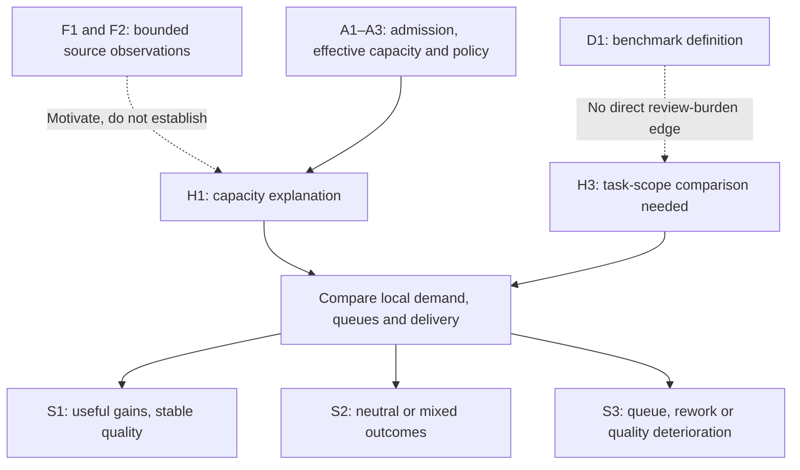

# Delivery mechanism: claim graph and proposed tests

> [Chapter 4](../01_the_illusion.md#chapter-4-a-review-capacity-scenario-when-candidate-work-outruns-verification) | [Chapters 5–7](../02_broken_mechanics.md) | [Registry](../../evidence/SOURCES.md)

This is repository synthesis prepared under [#63](https://github.com/UncertaintyArchitectureGroup/The-Subprime-Code-Crisis/issues/63), pending Astra analytical acceptance. It specifies a testable mechanism, not a validated causal model, calibrated queue forecast or collected pilot. [#54](https://github.com/UncertaintyArchitectureGroup/The-Subprime-Code-Crisis/issues/54) owns study design and any approval/resources for later collection.

## Claim classes and permitted edges

| ID / class | Content and source boundary | What it permits |
| --- | --- | --- |
| F1 / empirical estimates | [NBER supplied May version](../../evidence/primary/2026-writing-code-vs-shipping-code.md): positive coding/release estimates, cross-outcome attenuation; observational and selected samples. September revision awaits review | Motivate a downstream comparison, not identify review overload or general productivity decline |
| M1 / source model result | NBER's hierarchical calibration under its assumptions | A model-dependent complementarity interpretation, not measured review hours or a replacement ratio |
| F2 / separate descriptive observations | NBER marketplace entry and early usage proxies, separate from matched developers | Motivate production, discovery/demand, selection and lag explanations; no identified AI-to-value causal path |
| D1 / measurement definition | [METR pinned v1](../../evidence/primary/2025-metr-task-horizon.md): fitted task horizon at a chosen success level in human-time units | Describe benchmark capability; no global reliability or review-duration inference |
| A1 / repository model assumption | Generated candidates enter a defined admission/selection policy; admitted work has measurable size/risk/service demand | Compare demand with effective capacity, rather than treating every generated line as queued work |
| A2 / repository model assumption | Capacity at required quality depends on available time, skill, tooling, context and other duties; demand/service vary | Test local utilization, bursts and delays; constant staffing alone does not establish saturation |
| A3 / repository model assumption | WIP/pull/release policies and the observation window are explicit | Distinguish persistent backlog, scheduled batching, blocked dependencies and temporary queues |
| H1–H5 / repository hypotheses | Conditional links in the tests below | Predict observations that may support, weaken or reject a local explanation; no population prevalence |
| S1–S3 / scenarios | Beneficial, neutral/mixed, adverse paths below | Organize possible outcomes without probabilities or inevitability |

The [Goldratt/Cox methodology record](../../evidence/methodology/1984-the-goal.md) is an interpretive lens with unresolved original-book access. A1–A3 are stated here as repository assumptions, not edition-verified propositions from that book. Positive/null/negative results in other studies retain their separate samples and units; no cross-study percentage calibrates this graph.

M1 is an interpretation of F1 under the source model; it does not supply a missing empirical edge to H1. The graph shows logical dependencies, not estimated causal effects. A negative outcome alone cannot identify which hypothesis produced it.

## Hypotheses, alternatives and disconfirming observations

| ID / proposed relationship | Conditions and competing explanation | Proposed observations | Weakening or disconfirming outcome in the defined setting |
| --- | --- | --- | --- |
| **H1: admitted demand → queue/delay** | A1–A3; demand/variation strain the relevant capacity. Staff absence, task mix, blocked dependencies or release batching could explain waits | Admitted/completed/withdrawn changes, stage WIP/age, active effort versus waiting, available skill-hours, risk mix and release policy | Falling coding effort and increased useful releases with stable/falling WIP, wait and total effort at stable quality; or queue changes explained by the alternatives |
| **H2: queue/unfamiliarity → extra verification/rework or displaced work** | Context actually degrades or checks become inadequate; assistance, learning and smaller changes could offset it | Re-review/rework hours by role, interruption/context costs, mentoring/planned work, defect escapes and follow-up window | Stable/improved quality and mentoring/planned work with lower total review/rework effort; no measured context penalty |
| **H3: autonomous scope → greater verification demand** | Admitted work requires additional context/validation; better output, task selection or tooling may reduce demand | Matched task/risk categories and agent/scaffold version, implementation plus review/rework effort, correctness and useful completion | Larger autonomous scope with lower total human effort and stable/improved quality; horizon trend alone supplies no evidence either way |
| **H4: review automation → net added burden** | Setup, upkeep, alert handling and missed defects outweigh saved inspection. Narrow useful checks are an alternative | With/without-assistance comparison of setup/upkeep/triage/human review, false positives, missed defects, latency, operating cost and outcomes | Sustained human-effort/cost savings at comparable scope and stable/improved quality; saved time reinvested in useful work remains a benefit |
| **H5: cheaper requirements/tests → weak acceptance or shared-oracle errors** | Poor selection or shared mistaken assumptions survive independent checks. Clearer specs, independent oracles and targeted automation may improve quality | Task acceptance, rejected scope, requirement rework, independently detected errors and normalized escaped defects | Better acceptance and fewer errors at comparable/lower total effort; neither NBER marketplace flatness nor generated test counts identify the adverse link |

These tests apply locally. A successful adaptation weakens a claim of inevitable harm and may prevent an adverse mechanism from being activated; it does not prove that overload never occurs elsewhere. Conversely, queue growth without exposure, comparable work and confounder checks does not identify AI causation.

## Proposed measurement handoff to #54

Define the population, task/risk strata, intervention versions, comparator, observation/follow-up windows and acceptance/quality criteria **before collection**. Distinguish candidate production, admitted work, completed/withdrawn work, active service effort and waiting. Record headroom and changing duties rather than inferring capacity from headcount. Summarize variation/long-tail waits as well as averages; count rejected/abandoned work to avoid selecting successful changes only.

Use the same task-to-production boundary for both arms/periods. Compare useful releases or accepted outcomes alongside total human effort, rework, quality/security outcomes and operating cost. Report task selection, concurrent staffing/process changes, learning, spillovers, censoring and uncertainty. There is no universal conversion from LOC/PR counts to required verification hours, no required numerical threshold here, and no new collection permission.

| Scenario | Observable result to report | Interpretation boundary |
| --- | --- | --- |
| **S1: beneficial** | Less implementation effort, useful delivery improves, quality stable/improved, comparable/lower total effort/cost | Weakens inevitable overload; test whether existing headroom, selection or adaptation explains the benefit |
| **S2: neutral/mixed** | Local speed gain with unchanged delivery, or effort/quality moving in different directions | Distinguish batching, changed scope, short follow-up and uncertainty from a demonstrated net loss |
| **S3: adverse** | Persistent stage WIP/waits, rework or escaped defects increase, with worse comparable delivery/effort outcomes | Investigate H1–H5 and alternatives before causal attribution or choosing a control |

The thought experiment in Chapter 6 is not an observed case study. No measurements, effect sizes, scenario probabilities or pilot conclusions have been produced for this appendix.
