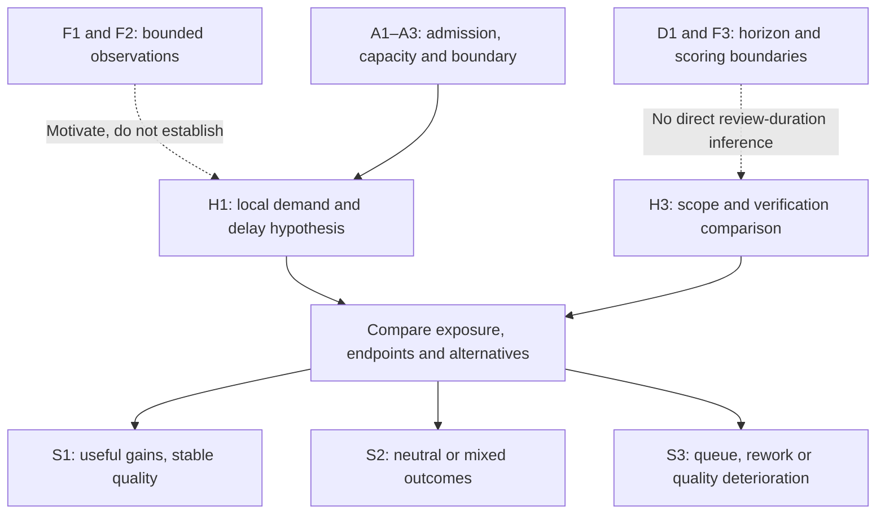

# Delivery mechanism: claim graph and proposed tests

> [Chapter4](../01_the_illusion.md#chapter-4-a-review-capacity-scenario-when-candidate-work-outruns-verification) | [Chapters5–7](../02_broken_mechanics.md) | [Registry](../../evidence/SOURCES.md)

This is repository synthesis under [#63](https://github.com/UncertaintyArchitectureGroup/The-Subprime-Code-Crisis/issues/63), not a validated causal model, calibrated queue forecast or collected pilot. [#54](https://github.com/UncertaintyArchitectureGroup/The-Subprime-Code-Crisis/issues/54) owns study design and any later collection decision. The [dated analytical audit](../../governance/reviews/issue-63-2026-10-21-astra-review.md) records review scope and outcomes.

## Claim classes and permitted edges

| ID / class | Content and source boundary | What it permits |
| --- | --- | --- |
| F1 / empirical estimates | [NBER September revision](../../evidence/primary/2026-writing-code-vs-shipping-code.md): positive coding/release estimates and broad cross-outcome attenuation; observational, selected and specification-sensitive | Motivate a downstream comparison, not identify review overload or general productivity decline |
| M1 / source model result | NBER's hierarchical calibration with assumed technology and allocation | Model-dependent complementarity interpretation, not measured review capacity or a replacement ratio |
| F2 / separate descriptive observations | NBER marketplace entry and early usage proxies; modest Android usage growth, heterogeneous platform results | Compare production, discovery/demand, selection and lag explanations; no identified AI-to-value causal path |
| D1 / measurement definition | [METR v1](../../evidence/primary/2025-metr-task-horizon.md): fitted horizon at a chosen success level in human-time units | Describe benchmark capability; no global reliability or required review duration |
| F3 / bounded contrary evidence | METR's small internal-PR exercise: scoring faster than implementation | Refutes equating task duration and verification time; does not identify complete production-review cost |
| A1 / repository model assumption | A defined admission boundary, comparable work/risk and independently estimated verification demand | Separate generated candidates from work actually admitted to the stage |
| A2 / repository model assumption | Effective capacity at required quality depends on available time, skill, context, tools and duties; arrivals/service vary | Test local workload, utilization and delays without inferring saturation from headcount or the queue itself |
| A3 / repository model assumption | Stage/window, opening WIP, completed/withdrawn/transferred work and WIP/release policies are explicit | Separate accumulation, temporary queues, batching, blocked work and backlog shedding |
| H1–H5 / repository hypotheses | Conditional local relationships below | Predict endpoints that could support or weaken a particular explanation, not population prevalence |
| S1–S3 / scenarios | Beneficial, mixed and adverse outcomes | Organize possibilities without assigning probability or inevitability |

The [Goldratt/Cox record](../../evidence/methodology/1984-the-goal.md) is non-load-bearing context with an unresolved original-book access gap. A1–A3 are repository assumptions, not edition-verified propositions. Other studies retain their own populations and units; their percentages do not jointly calibrate this graph.

M1 interprets F1 under the source model; it supplies no missing empirical edge to H1. The graph shows logical dependencies, not estimated causal effects. An adverse outcome alone cannot identify its cause.

## What counts as a test

Separate three conclusions:

- **Nonactivation or adaptation:** the proposed trigger did not occur, or intake/capacity/tools changed enough to prevent it. This weakens inevitability, not a conditional prediction under a trigger that was absent.
- **Weakening or disconfirmation under the trigger:** independently observed exposure/conditions are present, but the predicted endpoint is absent or reversed, with uncertainty narrow enough to exclude a prespecified meaningful effect. Confounding and measurement error still need examination.
- **Net benefit:** useful delivery improves at comparable quality and lower total effort/cost. This can coexist with greater verification effort if implementation savings are larger. It is not a falsifier of increased verification demand by itself.

Do not define excess demand from the observed queue and then use the queue as confirmation. For a fixed stage, closing WIP equals opening WIP plus admitted/transferred-in work minus completed/withdrawn/transferred-out work, with consistent units and explicit splitting/reopening adjustments. That is accounting, not a discovered AI effect. Empirical questions include whether an intervention raises admitted service demand, how independently estimated utilization/variation predicts waiting, and whether delays add rework. Failure of a prediction based on an estimated capacity model can reject that local model; it cannot overturn the accounting identity.

## Hypotheses and distinguishing observations

| ID / proposed relationship and endpoint | Trigger, comparison and alternatives | Observation capable of weakening the local relationship |
| --- | --- | --- |
| **H1: additional admitted demand increases stage waiting/WIP** | Define stage/window; compare matched risk/work populations and independently estimate service requirements and available quality-preserving capacity. Examine opening WIP, bursts, blocked dependencies, staffing, batch policy and withdrawals. Do not infer AI exposure or overload from wait alone | If independently higher workload/utilization under comparable policies and capacity does not increase waits/WIP by a prespecified meaningful amount, revise this local demand-delay prediction or capacity estimate. If AI use does not increase admitted demand, its proposed first link is unsupported. Intake throttling or added capacity is adaptation, not refutation under unchanged conditions |
| **H2: waiting/context loss adds verification/rework or displaces planned work** | Measure delay and context changes independently; compare change-risk classes, review/rework role-hours, interruptions, mentoring/planned work and quality. Task complexity and concurrent code changes can confound the link; assistance may preserve context | With longer waits or independently measured context loss present, no meaningful increase in review/rework or loss of planned work at comparable quality weakens the proposed link. If context is preserved, the context-loss trigger was absent. Lower total effort alone does not decide this endpoint |
| **H3: larger autonomous task scope increases verification demand** | Compare predefined autonomy/scope levels on comparable assigned work/risk, with tool/scaffold, verifier skill and required quality recorded. Measure verification plus rework separately from implementation, per assigned task and per accepted outcome; include rejected/failed work. Better output, useful assistance and task selection are alternatives | With larger autonomous scope actually used in comparable work, unchanged/lower verification/rework effort within a predefined meaningful-effect margin and comparable quality weakens a positive verification-demand effect. Total effort savings can still coexist with higher verification effort. A benchmark horizon trend alone tests neither endpoint |
| **H4: review automation adds net burden** | Compare with/without assistance at comparable work and quality; include setup amortization, upkeep, triage, false positives, human review, missed defects, latency and operating cost over a stated window | Sustained lower combined effort/cost with comparable/improved quality contradicts net added burden in that setting. Saved time used for other useful work remains a benefit. Early setup cost alone does not establish sustained harm |
| **H5: cheaper requirements or generated tests increase acceptance/oracle errors** | Two separate proposed links: easier drafting changes admitted low-value scope; shared mistaken test/implementation assumptions survive checks. Measure acceptance/rejection, requirement rework, independently found errors and escaped defects with a comparator. Clearer specifications, independent oracles and task selection can prevent either trigger | Cheaper drafting without increased unsuitable admissions weakens the first link. Among independently identified shared-error cases exposed to the same checks, no higher escape/rework rate weakens the second. Better outcomes after independent checks show adaptation; generated test counts or marketplace usage do not establish shared-error exposure |

Quality, time and cost endpoints may conflict; report them separately rather than selecting the favorable one. No result here establishes that overload never occurs elsewhere.

## Proposed measurement handoff to #54

Before collection, define population, task/risk strata, intervention versions, comparator, primary endpoints, assignment/analysis unit, observation/follow-up windows and required quality. Set a minimum meaningful effect or equivalence/non-inferiority margin appropriate to that context, then report effect estimates and uncertainty; a nonsignificant difference alone does not demonstrate stable quality or no added burden. This appendix sets no universal numeric threshold.

Record all assigned tasks, generated candidates, admitted/completed/withdrawn work, opening/closing WIP, active service effort and waiting. Include rejected and failed work to avoid selecting successful completions only; show both per-assigned and per-accepted-outcome effort. Use the same task-to-production boundary for comparators. Measure capacity and changing duties independently of queue length; no general LOC/PR-to-hours conversion is established.

Compare useful releases/accepted outcomes with implementation, verification/rework, total human effort, quality/security and operating cost. Report task selection, learning, concurrent staffing/process changes, spillovers, repeated developers/teams, censoring and long-tail variation. A credible comparator or assignment design is needed for causal attribution; dashboard correlation is insufficient. These are design inputs, not collection permission or pilot results.

| Scenario | Observable result | Interpretation boundary |
| --- | --- | --- |
| **S1: beneficial** | Useful delivery improves at comparable/improved quality and lower/comparable total effort/cost | Test headroom, selection and adaptation; verification demand may still rise |
| **S2: neutral/mixed** | Local saving without delivery change, or outcomes move in different directions | Distinguish scope, batching, short follow-up and imprecision from an established net loss |
| **S3: adverse** | Persistent waits, rework or escaped defects with worse comparable delivery/effort | Investigate H1–H5 and alternatives before attributing causality or selecting a control |

Chapter6 remains a thought experiment. No data, effect sizes, scenario probabilities or pilot conclusions have been produced for these tests.
